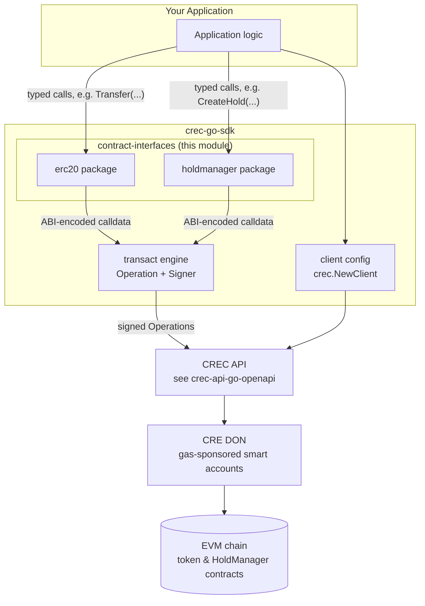
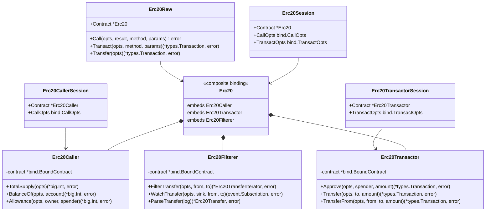
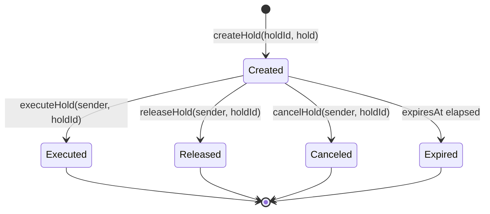
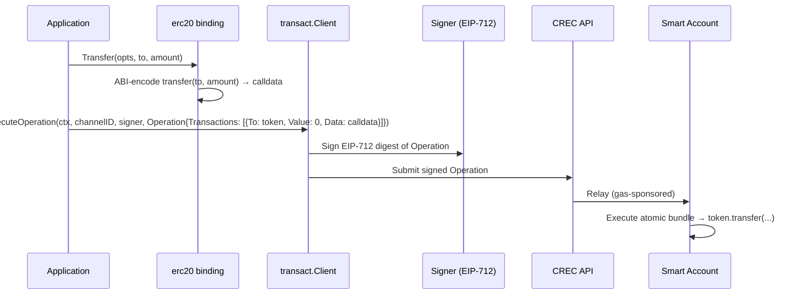
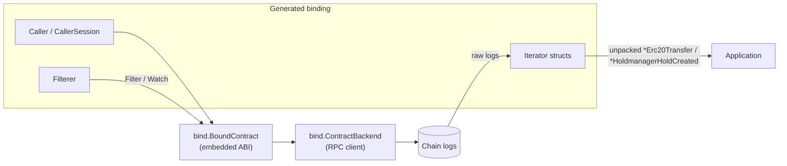
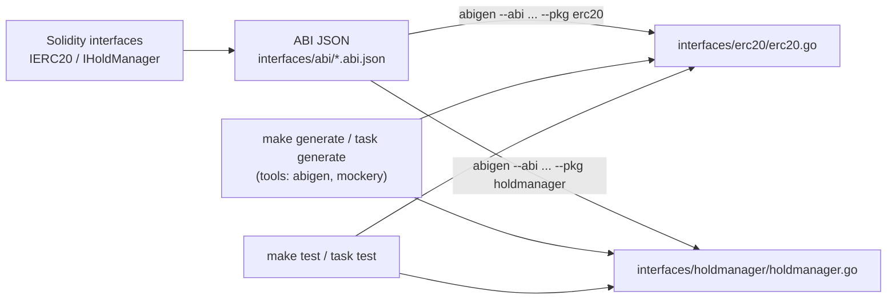

# Contract Interfaces (`crec-go-sdk`)

## Introduction

The **contract-interfaces** module is a leaf module of the [crec-go-sdk](../crec-go-sdk.md) (CRE Connect SDK for Go). It provides **pre-generated, type-safe Go bindings for onchain smart-contract interfaces** that CRE Connect applications interact with. All code in this module is generated — never hand-edited — by [`abigen`](https://geth.ethereum.org/docs/developers/dapp-developer/native-bindings) (from `go-ethereum`) from ABI JSON files that act as the single source of truth.

Two contract interfaces are currently shipped:

| Package | Contract interface | Purpose |
|---|---|---|
| `crec-sdk/interfaces/erc20` | `IERC20` | Standard fungible-token surface: balances, allowances, transfers |
| `crec-sdk/interfaces/holdmanager` | `IHoldManager` | Token escrow/hold primitives: create, execute, release, extend, cancel holds |

These bindings give SDK consumers strongly-typed ABI encoding/decoding for calldata (used when building gas-sponsored [`Operation`s](crec-go-sdk_transact-engine.md)) and for decoding contract events, without hand-writing ABI packing code.

> **Source of truth:** `crec-sdk/interfaces/abi/IERC20.abi.json` and `crec-sdk/interfaces/abi/IHoldManager.abi.json`. The Go files under `interfaces/erc20/` and `interfaces/holdmanager/` begin with `// Code generated - DO NOT EDIT.`

---

## Module Overview

### Package Layout

```
crec-sdk/
├── interfaces/
│   ├── abi/                          # ABI JSON sources (inputs to abigen)
│   │   ├── IERC20.abi.json
│   │   └── IHoldManager.abi.json
│   ├── erc20/erc20.go                # generated binding: Erc20*
│   └── holdmanager/holdmanager.go    # generated binding: Holdmanager*
├── transact/                         # consumes calldata → Operations (see transact-engine)
├── options.go                        # client configuration (see client-config)
└── Makefile / Taskfile.yaml          # `generate` target re-runs abigen
```

### Design Constraints

- **Generated code**: every file starts with `// Code generated - DO NOT EDIT.` Manual changes are lost on regeneration (`make generate` / `task generate`, defined in `crec-sdk/Makefile` and `crec-sdk/Taskfile.yaml`).
- **ABI-embedded**: each binding embeds its full ABI via `bind.MetaData` (e.g. `Erc20MetaData`, `HoldmanagerMetaData`), so no runtime ABI file is required.
- **Legacy aliases**: `Erc20ABI` / `HoldmanagerABI` package vars are deprecated shims for the ABI string — use `Erc20MetaData.ABI` instead.
- **Upstream dependency**: bindings are compiled against `github.com/ethereum/go-ethereum` v1.16.8 (pinned in `crec-sdk/go.mod`), specifically the `accounts/abi/bind`, `common`, `core/types`, and `event` packages.

---

## Architecture

### Context Within the SDK

The contract-interfaces module sits at the edge of the SDK, between your application logic and the transaction/event machinery:



- The **write path** produces ABI-encoded calldata that is wrapped in a `transact/types.Operation` and relayed by the CRE network — see [transact-engine](crec-go-sdk_transact-engine.md).
- The **read/event path** can target any `bind.ContractBackend` (e.g., a direct RPC connection) for state queries, log filtering, and subscriptions.
- How the client is constructed and configured is covered in [client-config](crec-go-sdk_client-config.md); the wire protocol of the backend API is documented in [crec-api-go-openapi](../crec-api-go-openapi.md).

### Binding Architecture (abigen pattern)

Both generated packages follow the canonical `abigen` three-way split — a read-only caller, a write-only transactor, and a log filterer — plus session and raw wrappers. The diagram shows the `erc20` package; `holdmanager` is structurally identical (prefix `Holdmanager`):



Each layer serves a different usage style:

| Layer | Types | When to use |
|---|---|---|
| **Composite** | `Erc20`, `Holdmanager` | Full read+write+filter access through one handle (`NewErc20` / `NewHoldmanager`) |
| **Split** | `*Caller`, `*Transactor`, `*Filterer` | Least-privilege construction when only one capability is needed |
| **Session** | `*Session`, `*CallerSession`, `*TransactorSession` | Repeated calls with fixed options — per-call `opts` argument disappears |
| **Raw** | `*Raw`, `*CallerRaw`, `*TransactorRaw` | Escape hatch: invoke methods by name / plain fund transfers, bypassing generated typed methods |
| **Events** | `*Iterator`, `*<Event>` structs | `Filter*` (historical logs), `Watch*` (live subscription), `Parse*` (decode a single log) |

---

## ERC-20 Binding (`interfaces/erc20`)

### ABI Surface

Generated from `crec-sdk/interfaces/abi/IERC20.abi.json` (standard ERC-20 minus `name`/`symbol`/`decimals`):

| Go method | Kind | Selector | Solidity |
|---|---|---|---|
| `TotalSupply` | read | `0x18160ddd` | `totalSupply() view returns (uint256)` |
| `BalanceOf` | read | `0x70a08231` | `balanceOf(address) view returns (uint256)` |
| `Allowance` | read | `0xdd62ed3e` | `allowance(address,address) view returns (uint256)` |
| `Approve` | write | `0x095ea7b3` | `approve(address,uint256) returns (bool)` |
| `Transfer` | write | `0xa9059cbb` | `transfer(address,uint256) returns (bool)` |
| `TransferFrom` | write | `0x23b872dd` | `transferFrom(address,address,uint256) returns (bool)` |

Events:

| Event | Topic0 | Go struct | Indexed fields |
|---|---|---|---|
| `Transfer` | `0xddf252ad…b3ef` | `Erc20Transfer{From, To, Value, Raw}` | `from`, `to` |
| `Approval` | `0x8c5be1e5…b925` | `Erc20Approval{Owner, Spender, Value, Raw}` | `owner`, `spender` |

### Usage Example

```go
import (
    "github.com/ethereum/go-ethereum/common"
    "github.com/smartcontractkit/crec-sdk/interfaces/erc20"
)

// Read: bind to a deployed token via any bind.ContractBackend.
token, err := erc20.NewErc20(tokenAddress, backend)

balance, err := token.BalanceOf(nil, common.HexToAddress("0x..."))

// Session style: fix call options once for many reads.
sess := &erc20.Erc20Session{Contract: token}
supply, err := sess.TotalSupply()

// Write: produced calldata is what gets wrapped into a CREC Operation.
tx, err := token.Transfer(nil, recipient, amount) // returns *types.Transaction
```

For how the resulting calldata is bundled into a gas-sponsored operation and signed, see the **write-path data flow** below and the [transact-engine](crec-go-sdk_transact-engine.md) module.

---

## HoldManager Binding (`interfaces/holdmanager`)

The `IHoldManager` interface implements a hold/escrow lifecycle over arbitrary ERC-20 tokens (the 0x-style hold pattern): a sender locks funds under a `holdId`, and a designated executor or the sender resolves the hold by executing, releasing, canceling, or letting it expire.

### Hold Lifecycle

Derived from the ABI (`createHold`, `executeHold`, `releaseHold`, `extendHold`, `cancelHold`, `isExpired`, `getHoldStatus`):



The `expiresAt` timestamp can be pushed forward with `extendHold(sender, holdId, expiresAt)`. The current state is returned by `getHoldStatus` as a `uint8` (`IHoldManager.HoldStatus` enum); `heldBalanceOf(sender)` reports the sender's total locked amount.

### ABI Surface

Generated from `crec-sdk/interfaces/abi/IHoldManager.abi.json`:

| Go method | Kind | Selector | Notes |
|---|---|---|---|
| `GetHold` | read | `0x003a30a6` | Returns an `IHoldManagerHold` struct |
| `GetHoldStatus` | read | `0x5cd2aadc` | Returns the `HoldStatus` enum (`uint8`) |
| `HeldBalanceOf` | read | `0xbe9c1add` | Total held balance for a sender |
| `IsExpired` | read | `0x00f304db` | Whether `expiresAt` has passed |
| `CreateHold` | write | `0xae01e0bd` | `createHold(holdId bytes32, hold Hold)` |
| `ExecuteHold` | write | `0x0e432dec` | Executor resolves the hold |
| `ReleaseHold` | write | `0xc1c60fe2` | Sender returns funds to sender |
| `ExtendHold` | write | `0x29251264` | Push `expiresAt` forward |
| `CancelHold` | write | `0xeee2068b` | Cancel the hold |

The Solidity struct `IHoldManager.Hold` is mapped to the generated Go struct:

```go
type IHoldManagerHold struct {
    Token     common.Address
    Sender    common.Address
    Recipient common.Address
    Executor  common.Address
    ExpiresAt *big.Int
    Value     *big.Int
}
```

Events (all keyed by `sender` and `holdId`, except `HoldCreated` which is keyed by `holdId`):

| Event | Go struct | Payload |
|---|---|---|
| `HoldCreated` | `HoldmanagerHoldCreated` | `HoldId [32]byte`, `Hold IHoldManagerHold` |
| `HoldExecuted` | `HoldmanagerHoldExecuted` | `Sender`, `HoldId` |
| `HoldReleased` | `HoldmanagerHoldReleased` | `Sender`, `HoldId` |
| `HoldExtended` | `HoldmanagerHoldExtended` | `Sender`, `HoldId`, `ExpiresAt *big.Int` |
| `HoldCanceled` | `HoldmanagerHoldCanceled` | `Sender`, `HoldId` |

Each event has the full `Filter*` / `Watch*` / `Parse*` triplet plus an iterator type (e.g. `HoldmanagerHoldCreatedIterator`) as described in the [binding architecture](#binding-architecture-abigen-pattern).

---

## Data Flow

### Write Path: Typed Calldata → Signed Operation

The generated `*Transactor` methods encode arguments with the embedded ABI. In the CRE Connect model, that calldata becomes the `Data` field of a `transact/types.Transaction` inside an atomic `Operation`, which is signed (EIP-712) and submitted to the CREC API for gas-sponsored execution by a smart account:



- `Operation{ID, Account, Deadline, Transactions[]}` and `Transaction{To, Value, Data}` are defined in the [transact-engine](crec-go-sdk_transact-engine.md) module; signer abstractions (`Signer`, `TypedDataSigner`) are pluggable (local, KMS, Vault, Fireblocks, Privy).
- The alternative *untyped* path — pass a human-readable or JSON ABI fragment to `queries.Client.CallContractWithABI` for read-only calls — requires no binding at all; the bindings in this module are the *typed* counterpart for interfaces you use repeatedly.

### Read & Event Path



- **`Filter*`** performs a one-shot historical log query and returns an iterator; **`Watch*`** opens a live subscription delivering unpacked event structs on a channel; **`Parse*`** decodes a single `types.Log` you obtained elsewhere (e.g., from a CREC verifiable event payload).
- Sessions (`*CallerSession`) remove per-call option boilerplate for repeated reads.

---

## Code Generation Pipeline

Bindings are regenerated with `make generate` (or `task generate`), which installs and runs `abigen` and `mockery` (the latter for the KMS signer mocks in the transact engine, not this module). The pipeline is defined in `crec-sdk/Makefile` and `crec-sdk/Taskfile.yaml`:



Exact commands from `crec-sdk/Makefile`:

```makefile
abigen --abi interfaces/abi/IERC20.abi.json --pkg erc20 --out interfaces/erc20/erc20.go
abigen --abi interfaces/abi/IHoldManager.abi.json --pkg holdmanager --out interfaces/holdmanager/holdmanager.go
```

**When ABI sources change** (e.g., adding `decimals()` to `IERC20`): edit the `.abi.json` file → run `make generate` → commit both the ABI and the regenerated Go file together. Build/test/coverage targets and dev-tool installation are covered in [build-tooling](crec-go-sdk_build-tooling.md).

---

## Usage Guidance & Gotchas

1. **Never edit generated files.** Regenerate instead; otherwise `make generate` will silently revert your changes.
2. **Use `*MetaData.ABI`, not the deprecated `*ABI` package vars.** The `Erc20ABI` / `HoldmanagerABI` vars are kept only for backwards compatibility.
3. **Zero-value options are valid.** Passing `nil` for `*bind.CallOpts` / `*bind.TransactOpts` is accepted by `abigen` wrappers; sessions are preferred when many calls share options.
4. **Write methods return, but do not submit.** In the CREC flow, transactor methods are used to *produce* calldata; execution, gas sponsorship, and nonce/fee management belong to the smart-account operation model ([transact-engine](crec-go-sdk_transact-engine.md)). A direct `bind.TransactOpts` submission to an RPC backend is possible but bypasses CREC sponsorship.
5. **Hold IDs are `bytes32`.** HoldManager keyed lookups use `[32]byte` hold IDs and sender addresses; plan ID generation accordingly.
6. **Event indexing rules.** Only `indexed` Solidity parameters are usable as filter rules (`from`/`to` for `Transfer`; `owner`/`spender` for `Approval`; `sender`/`holdId` for hold events). All event data is also available unindexed in the event struct.

---

## Related Documentation

- [crec-go-sdk](../crec-go-sdk.md) — parent SDK module overview and unified `crec.Client` entry point.
- [crec-go-sdk_client-config](crec-go-sdk_client-config.md) — `clientConfig` and functional options (`WithDONConfig`, verification settings).
- [crec-go-sdk_transact-engine](crec-go-sdk_transact-engine.md) — `Operation`/`Transaction` types, `Signer`/`TypedDataSigner` interfaces, EIP-712 handling.
- [crec-go-sdk_build-tooling](crec-go-sdk_build-tooling.md) — Makefile/Taskfile targets, vendoring, coverage.
- [crec-api-go-openapi](../crec-api-go-openapi.md) — the CREC API OpenAPI specification the SDK clients communicate with.
- [Developer Toolchain](<../Developer_Toolchain_(CLI,_SDKs___API_Clients).md>) — the full developer-toolchain documentation map.
