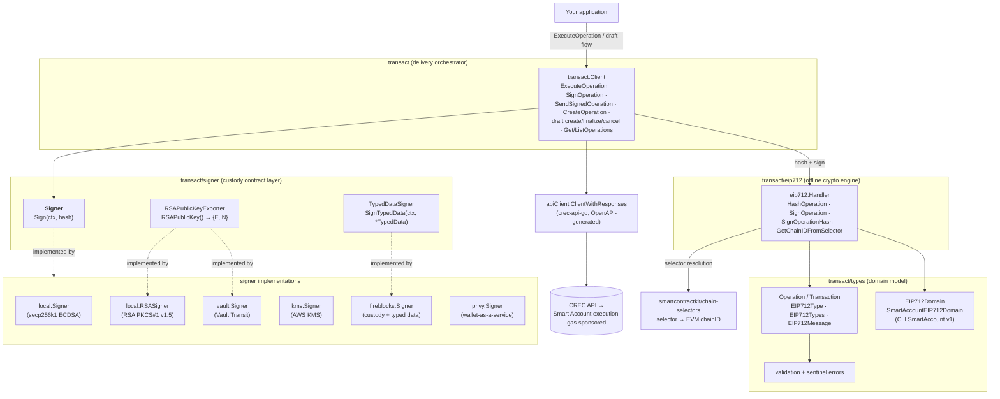
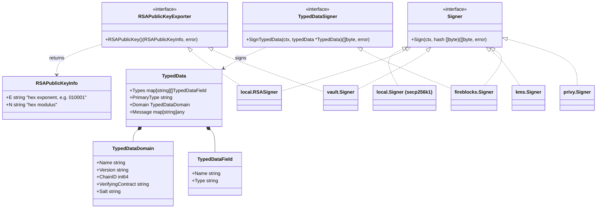
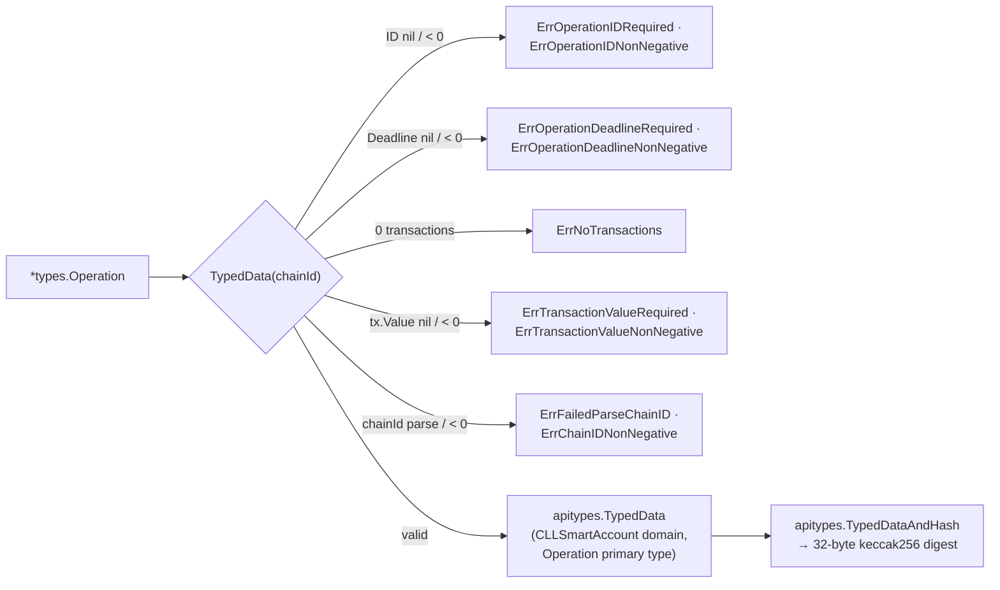
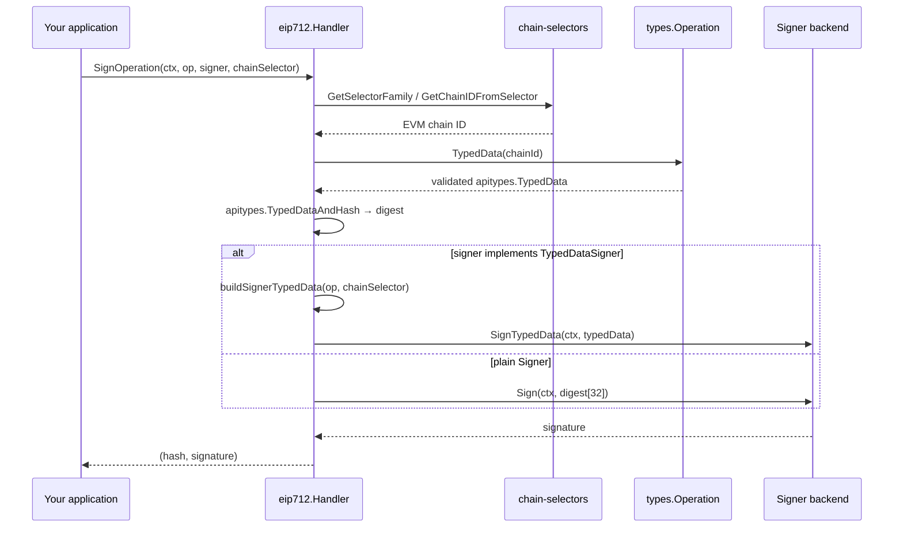
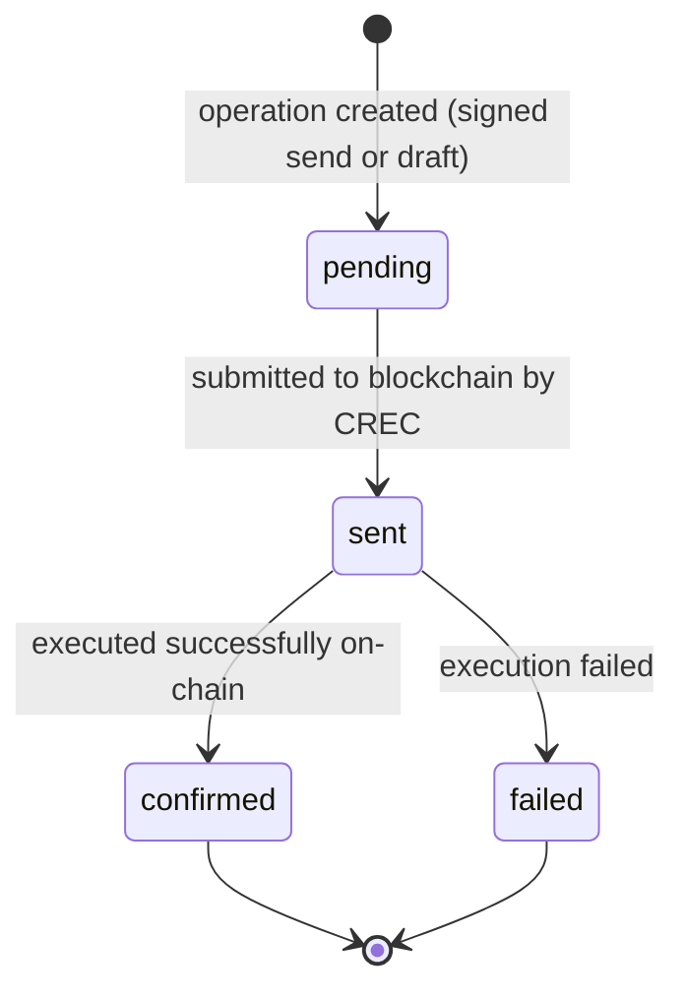

# crec-go-sdk — Transact Engine (`transact/`)

## Introduction

The **transact-engine** module is the transaction-execution half of the [crec-go-sdk](../crec-go-sdk.md) (`github.com/smartcontractkit/crec-sdk`). It enables a Go application to bundle one or more on-chain calls into an atomic **`Operation`**, hash and sign it with **EIP-712 typed data**, and submit the signed bundle to the CRE Connect (CREC) platform, where a **CREC Smart Account** executes it atomically with gas sponsored by the platform.

The module is intentionally split into a **crypto core** (no network dependencies) and a **delivery layer** (API calls), so offline signing workflows are fully supported:

1. **`transact/signer`** — the *custody contract layer*. Defines the `Signer`, `TypedDataSigner`, and `RSAPublicKeyExporter` interfaces plus the EIP-712 `TypedData` wire structs. Five interchangeable backends implement these interfaces: local ECDSA/RSA keys, AWS KMS, HashiCorp Vault Transit, Fireblocks, and Privy.
2. **`transact/types`** — the *domain model*. Defines `Operation` / `Transaction`, the `CLLSmartAccount` EIP-712 domain, and the validation + sentinel-error contract enforced before anything is hashed.
3. **`transact/eip712`** — the *hashing/signing engine*. `eip712.Handler` turns an `Operation` into a keccak256 EIP-712 digest (resolving CRE chain selectors to EVM chain IDs via `smartcontractkit/chain-selectors`) and drives a signer through the right signing path.
4. **`transact`** — the *delivery orchestrator*. `transact.Client` embeds the `eip712.Handler` and owns the operation lifecycle against the CREC API: create, send, finalize drafts, get, list.

> **Module placement.** This page documents the `transact/` slice of the [crec-go-sdk module](../crec-go-sdk.md). Companion pages cover [client configuration](crec-go-sdk_client-config.md), [generated contract interfaces](crec-go-sdk_contract-interfaces.md) (`erc20`, `holdmanager` — commonly used to build the calldata placed into `Transaction.Data`), and [build & codegen tooling](crec-go-sdk_build-tooling.md). The HTTP transport used to submit operations is the OpenAPI-generated client documented in [crec-api-go-openapi](../crec-api-go-openapi.md).

Core components in scope:

| Component | File | Role |
|---|---|---|
| `Signer` | `crec-sdk/transact/signer/signer.go` | Sign pre-hashed 32-byte digests (e.g. keccak256 EIP-712 digests) |
| `TypedDataSigner` | `crec-sdk/transact/signer/signer.go` | Sign full EIP-712 typed data — lets custody providers apply policy on the human-readable structure |
| `RSAPublicKeyExporter` | `crec-sdk/transact/signer/signer.go` | Export RSA public exponent `E` / modulus `N` in the CREC hex string encoding |
| `Operation` | `crec-sdk/transact/types/types.go` | Atomic bundle of transactions, EIP-712 typed-data source and validator |

---

## Architecture

### Package layout & component relationships



Key structural decisions (also documented in the [parent overview](../crec-go-sdk.md#architecture)):

* **Offline-first crypto** — `eip712.Handler` and `transact/types` have zero network dependencies. Only `SendSignedOperation`/`CreateOperation` touch the API, so signing can happen in an air-gapped process or a signing service while delivery happens elsewhere.
* **Capability-based interfaces** — backends implement only what they can. The engine **type-asserts** `signer.Signer` to the optional `TypedDataSigner` / `RSAPublicKeyExporter` interfaces at call time, so new custody providers need no engine changes.
* **Single transport** — the delivery layer posts through the same generated `ClientWithResponses` used by every other sub-client; see [crec-api-go-openapi](../crec-api-go-openapi.md).

### Interface model



Capability matrix:

| Backend | `Signer` | `TypedDataSigner` | `RSAPublicKeyExporter` | Typical use |
|---|:---:|:---:|:---:|---|
| `local.Signer` (secp256k1 ECDSA) | ✅ | — | — | Development, testing, smart-account (EVM) signing |
| `local.RSASigner` | ✅ | — | ✅ | Development/testing of RSA wallets; deterministic PKCS#1 v1.5 |
| `vault.Signer` (Vault Transit) | ✅ | — | ✅ | Enterprise key custody, key lifecycle (create/rotate) |
| `kms.Signer` (AWS KMS) | ✅ | — | — | AWS-native infrastructure |
| `fireblocks.Signer` | ✅ | ✅ | — | Custody with transaction policy enforcement |
| `privy.Signer` | ✅ | — | — | Wallet-as-a-service for customer-facing apps |

---

## The `Operation` EIP-712 model (`transact/types`)

### Data model

`Operation` (`crec-sdk/transact/types/types.go`) represents a batch of transactions executed **atomically** by a smart account:

| Field | Type | Meaning |
|---|---|---|
| `ID` | `*big.Int` | Unique operation ID; prevents replay (e.g. a fresh random or timestamp-based value). Required, non-negative. |
| `Account` | `common.Address` | The smart account (verifying contract) that will execute the batch. |
| `Deadline` | `*big.Int` | Expiration timestamp; `0` means no expiration. Required, non-negative. |
| `Transactions` | `[]Transaction` | Ordered calls to execute. Must contain ≥ 1 entry. |

`Transaction`:

| Field | Type | Meaning |
|---|---|---|
| `To` | `common.Address` | Target contract address |
| `Value` | `*big.Int` | Native-currency amount. Serialized as a **JSON string** (`json:"value,string"`) so amounts above 2⁵³ survive JavaScript clients. |
| `Data` | `hexutil.Bytes` | ABI-encoded calldata (see [generated contract interfaces](crec-go-sdk_contract-interfaces.md) for typed builders) |

### EIP-712 domain

All operations are signed under a single fixed domain:

```go
EIP712DomainName    = "CLLSmartAccount"  // EIP712DomainName constant
EIP712DomainVersion = "1"                // EIP712DomainVersion constant
```

`SmartAccountEIP712Domain(chainId int64, account common.Address)` instantiates the domain with the chain ID and the verifying contract set to the operation's account. `chainId` is an `int64` because go-ethereum's `apitypes.TypedDataDomain` uses `math.HexOrDecimal256`, whose constructor accepts only `int64` — this is the reason `Operation.TypedData(chainId string)` parses and validates the chain ID string up front.

The full EIP-712 type set produced for signing:

```text
EIP712Domain:  name(string), version(string), chainId(uint256), verifyingContract(address)
Operation:     id(uint256), account(address), deadline(uint256), transactions(Transaction[])
Transaction:   to(address), value(uint256), data(bytes)
```

### Validation contract

`Operation.TypedData(chainId string)` builds the go-ethereum `apitypes.TypedData` and enforces the platform invariants client-side. Every failure maps to a sentinel error usable with `errors.Is`:

| Sentinel error | Triggered when |
|---|---|
| `ErrOperationIDRequired` | `ID == nil` |
| `ErrOperationIDNonNegative` | `ID < 0` |
| `ErrOperationDeadlineRequired` | `Deadline == nil` |
| `ErrOperationDeadlineNonNegative` | `Deadline < 0` |
| `ErrNoTransactions` | zero transactions |
| `ErrTransactionValueRequired` | a transaction's `Value == nil` |
| `ErrTransactionValueNonNegative` | a transaction's `Value < 0` (also raised by `Transaction.EIP712Message`) |
| `ErrFailedParseChainID` | chain ID string is not parseable |
| `ErrChainIDNonNegative` | parsed chain ID is negative |



---

## Signing pipeline (`transact/eip712.Handler`)

The handler is constructed with an optional logger (`eip712.NewHandler(*Options)`) and implements three primitives. The `transact.Client` embeds the handler and re-exposes all three, so both surfaces are available.

### `HashOperation(op, chainSelector) → common.Hash`

Resolves the CRE **chain selector** (Chainlink's cross-chain chain identifier) into an EVM chain ID, builds typed data, and hashes it:

1. Parse selector as `uint64`; reject `""` / `"0"` (`ErrParseChainSelector`).
2. `chainselectors.GetSelectorFamily` — must be `FamilyEVM`, else `ErrUnsupportedChainFamily` (signing is EVM-only today).
3. `chainselectors.GetChainIDFromSelector` → decimal chain-ID string (`ErrGetChainID`).
4. `op.TypedData(chainId)` → validation + typed data (`ErrCreateTypedData`).
5. `apitypes.TypedDataAndHash` → 32-byte digest (`ErrComputeOperationHash`).

### `SignOperation(ctx, op, signer, chainSelector) → (hash, signature, error)`

Hashes the operation, then **dispatches on signer capability**:

* If the signer implements **`TypedDataSigner`** (e.g. Fireblocks), the handler builds the SDK-level `signer.TypedData` (via `buildSignerTypedData`, mirroring the on-chain type set and domain) and hands the **full structured payload** to `SignTypedData` — so the custody provider can render and enforce policy on the human-readable operation before signing.
* Otherwise the signer's plain `Sign(ctx, hash.Bytes())` is called with the 32-byte digest.

This dual-path is what keeps the engine custody-agnostic: HSM/KMS-style providers that can only sign opaque digests and policy-aware custody platforms that need the full typed data are served by the same call site.

### `SignOperationHash(ctx, opHash, signer) → signature`

Signs an already-computed digest — used by the **draft finalize** flow where the digest is supplied by the caller or the server.



---

## End-to-end operation lifecycle (`transact.Client`)

`transact.NewClient(&transact.Options{CRECClient: apiClient, Logger: logger})` wires the handler onto the generated CREC client ([crec-api-go-openapi](../crec-api-go-openapi.md)). Typical access is via the root client: `client.Transact.*`.

```mermaid
sequenceDiagram
    participant App as Your application
    participant TX as transact.Client
    participant H as eip712.Handler
    participant S as signer (local/KMS/Vault/…)
    participant API as CREC API

    App->>TX: ExecuteOperation(ctx, channelID, signer, operation, chainSelector)
    TX->>H: SignOperation (hash + sign)
    H-->>TX: digest, signature
    TX->>API: POST /channels/{id}/operations<br/>(signed CreateOperation)
    API-->>TX: 201 { operation_id } (status: pending → sent)
    TX->>API: GET operation (retrieval after creation)
    API-->>TX: Operation
    TX-->>App: *apiClient.Operation
    Note over API: DON relays & executes atomically on-chain;<br/>gas sponsored by CREC
```

Convenience and alternative entry points:

* **`ExecuteTransactions`** — bundles raw `[]types.Transaction` + executor account + deadline into a fresh `Operation` (random 128-bit ID from `crypto/rand`), then delegates to `ExecuteOperation`.
* **Manual split** — `SignOperation` / `SignOperationHash` then `SendSignedOperation(ctx, channelID, op, signature, chainSelector)`; useful when hashing/signing happens in one process and delivery in another.
* **Draft workflow** — `CreateUnsignedDraftOperation` / `SendDraftOperation` create a server-side draft (optionally with per-transaction `DraftTransactionPreview` metadata for UX rendering); `ExecuteDraftOperation` signs the digest and finalizes via `SendSignedDraftOperation` (PATCH with `FinalizeOperation{Status: accepted, digest, signature}`, digest must be exactly 32 bytes); drafts can be cancelled, with 404/409 mapped to `ErrDraftNotFound`, `ErrDraftNotFinalizable`, `ErrDraftNotCancellable`. The SDK does **not** recompute/compare the digest on finalize — compute it locally with `HashOperation` if you want to verify it yourself.
* **Read side** — `GetOperation(ctx, channelID, operationID)` and `ListOperations` with filters (`Status`, `ChainSelector`, `Address`, `WalletID`, `ChainEnvironment`) and `Limit`/`Offset` pagination returning `(operations, hasMore, error)`.

Operation states observed via `Operation.Status`:



Every API path funnels through a shared status-code switch that maps HTTP responses onto canonical errors (`apierror.WrapValidation` / `WrapNotFound` / `WrapConflict`, and re-exported sentinels `ErrChannelNotFound`, `ErrChannelArchived`, `ErrWalletNotFound`, `ErrOperationNotFound`) — see [error handling](#error-handling).

---

## Signer implementations

All implementations live under `crec-sdk/transact/signer/` and satisfy at minimum `signer.Signer`. Swapping backends never changes application code — only construction.

### `local` — in-memory keys (development & testing)

* **`local.Signer`** wraps an `*ecdsa.PrivateKey` (secp256k1) and signs with go-ethereum `crypto.Sign`, normalizing the recovery byte into Ethereum form (`v + 27`). `Destroy()` clears the key reference (best-effort — Go does not guarantee scalar zeroization).
* **`local.RSASigner`** wraps an `*rsa.PrivateKey` and signs **PKCS#1 v1.5 with SHA-256** (deterministic), hashing the input itself — byte-for-byte interchangeable with the Vault RSA signer at its defaults. Construction (`NewRSASigner` / `GenerateRSAKey`) rejects keys smaller than **2048 bits** and runs `rsa.PrivateKey.Validate()`. It implements `RSAPublicKeyExporter` (hex `E`/`N`, e.g. `"010001"` for exponent 65537), returns defensive copies via `PublicKey()`, and `Destroy()` performs a best-effort wipe of `D`, primes, and CRT precomputed values (including deprecated `CRTValues` via reflection).

### `vault` — HashiCorp Vault Transit

`vault.NewSigner(vaultUrl, token, mountPath, key, opts...)` (`ErrSignerConfigIncomplete` if any parameter is empty). Signing posts base64 input to `{mount}/sign/{key}` and strips the `vault:v1:` prefix from the response:

* **RSA keys** — `signature_algorithm` defaults to `pkcs1v15` (required by CREC RSA wallets); `RSASigAlgPSS` available via `WithRSASignatureAlgorithm` only when the verifier expects PSS. `WithRSAPrehashed(false)` (default) means Vault hashes the input with SHA-256 before signing.
* **ECDSA keys** — legacy behavior preserved: `prehashed=true` with ASN.1 (DER) marshaling.
* The key type is read from `{mount}/keys/{key}` exactly once (`sync.Once`) and propagated on error, so `Sign` fails explicitly rather than silently using the wrong padding.
* Supported key types: `rsa-2048`, `rsa-4096`, `ecdsa-p256`, `ecdsa-p384`, `ecdsa-p521`; `CreateKey` / `CreateKeyInVault` support provisioning and return a `KeyCreationResult` (including the hex modulus for RSA).
* Implements **`RSAPublicKeyExporter`**: fetches the latest key version, parses the PKIX/PEM public key, and exports hex `E`/`N` — the same encoding the platform uses for Smart Wallet allowed-signer configuration.
* Integration tests spin up a **real Vault container** via testcontainers (see [testing](#testing--codegen-touchpoints)).

### `kms` — AWS KMS

`kms.Signer` signs through the AWS KMS API (`aws-sdk-go-v2/service/kms`, configured per `Options{KeyID, Region}`). HTTP access to KMS is behind a narrow `KMSClient` interface whose mock (`transact/signer/kms/mocks/KMSClient.go`) is generated by mockery as part of the SDK's `generate` target — see [build tooling](crec-go-sdk_build-tooling.md).

### `fireblocks` — custody with policy enforcement

`fireblocks.Signer` implements **both** `Signer` and `TypedDataSigner`. It authenticates to the Fireblocks API with JWTs signed by an RSA private key (`FIREBLOCKS_*` environment variables or explicit options), submits signing operations (raw message or **typed-message** payloads for EIP-712), and polls `OperationStatus` (`SUBMITTED → PENDING_* → COMPLETED` etc., default poll 500 ms, timeout 60 s; `ErrFireblocksOperationTerminal` on terminal failure). Because it sees the complete `TypedData`, the custody platform can enforce transaction policies on the decoded operation before releasing a signature.

### `privy` — wallet-as-a-service

`privy.Signer` signs through the Privy wallet service (`privy.NewSignerFromEnv()` for env-based configuration), aimed at customer-facing applications where end-user wallets are managed by Privy.

---

## Error handling

The engine layers errors so `errors.Is` works end-to-end:

* **`transact/types`** — operation-validation sentinels (table above), raised while building typed data.
* **`transact/eip712`** — `ErrOperationRequired`, `ErrSignerRequired`, `ErrParseChainSelector`, `ErrGetChainFamily`, `ErrUnsupportedChainFamily`, `ErrGetChainID`, `ErrInvalidChainIDString`, `ErrCreateTypedData`, `ErrComputeOperationHash`, `ErrHashOperation`, `ErrSignOperation` (signer errors are wrapped with `%w` inside these).
* **`transact`** — request-contract errors (`ErrChannelIDRequired`, `ErrChainSelectorRequired`, `ErrAtLeastOneTransactionRequired`, `ErrSignatureRequired`, `ErrInvalidDeadline`, `ErrTransactionPreviewCountMismatch`, …), draft lifecycle errors (`ErrDraftNotFound`, `ErrDraftNotFinalizable`, `ErrDraftNotCancellable`), and re-exports of the shared `apierror` sentinels (`ErrChannelNotFound`, `ErrChannelArchived`, `ErrWalletNotFound`, `ErrOperationNotFound`) used by all SDK sub-clients.

```go
if errors.Is(err, transact.ErrDraftNotFinalizable) { /* 409 from finalize */ }
if errors.Is(err, eip712.ErrUnsupportedChainFamily) { /* non-EVM selector */ }
if errors.Is(err, types.ErrNoTransactions)          /* empty bundle */ }
```

---

## Testing & codegen touchpoints

The module's test and generation surface is owned by [crec-go-sdk_build-tooling](crec-go-sdk_build-tooling.md); the transact-relevant touchpoints:

* `make test` / `make coverage` run the full suite (`go test ./...`), including `transact/types` validation tests, the eip712 example tests, and per-signer unit tests.
* **`test-vault-transit.sh`** runs (1) the Vault signer unit tests (`./transact/signer/vault -run TestSigner`) and (2) the cross-package integration test `TestSignOperationWithVaultTransit` in `./transact`, which uses **testcontainers** to boot a real Vault instance with an RSA-2048 Transit key and exercises the full hash → sign → verify flow.
* `make generate` regenerates the mockery `KMSClient` mock used by `kms.Signer` tests (the other `generate` outputs — `abigen` contract bindings — belong to the [contract-interfaces](crec-go-sdk_contract-interfaces.md) module).
* `make docs` serves the package references (including `transact/*` godoc) locally via `pkgsite` on port 8080.

---

## Related documentation

* [crec-go-sdk](../crec-go-sdk.md) — SDK overview: root client composition, event verification, and how `transact` fits alongside the other sub-clients.
* [crec-go-sdk client configuration](crec-go-sdk_client-config.md) — functional options (`clientConfig`), DON verification defaults, watcher polling.
* [crec-go-sdk contract interfaces](crec-go-sdk_contract-interfaces.md) — `erc20` / `holdmanager` bindings for building `Transaction.Data` calldata.
* [crec-go-sdk build tooling](crec-go-sdk_build-tooling.md) — Makefile/Taskfile, codegen, Vault test harness.
* [crec-api-go-openapi](../crec-api-go-openapi.md) — the generated transport (`CreateOperation`, `FinalizeOrCancelOperation`, `ListOperations`) used by the delivery layer.
* [Developer Toolchain (CLI, SDKs & API Clients)](../../Developer_Toolchain_(CLI,_SDKs___API_Clients).md) — sibling surfaces: [cre-cli secrets commands](../cre-cli-secrets.md) (share the Vault-gateway model the Vault signer integrates with) and the [TypeScript CRE SDK](../cre-sdk-core.md).
* [Shared Foundation Libraries & Domain Types](../../Shared_Foundation_Libraries___Domain_Types.md) — chain-selector and chain-type primitives the engine builds on.
* [Workflow & Capability Runtime (CRE Engine)](../../Workflow___Capability_Runtime_(CRE_Engine).md) — the runtime whose DON workflows and capabilities produce the events this SDK verifies and whose smart accounts execute these operations.
