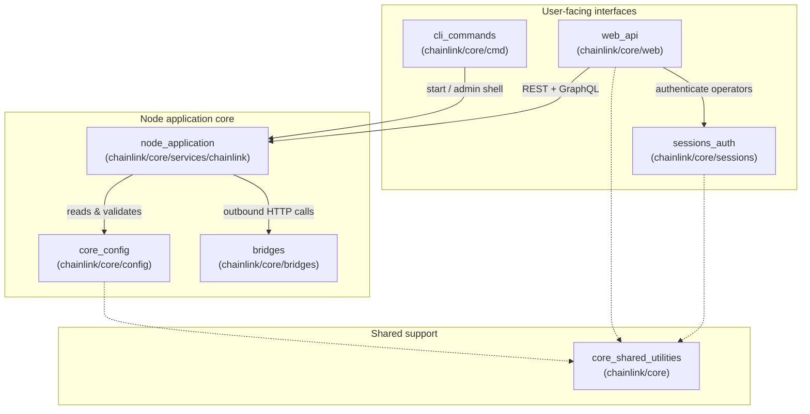
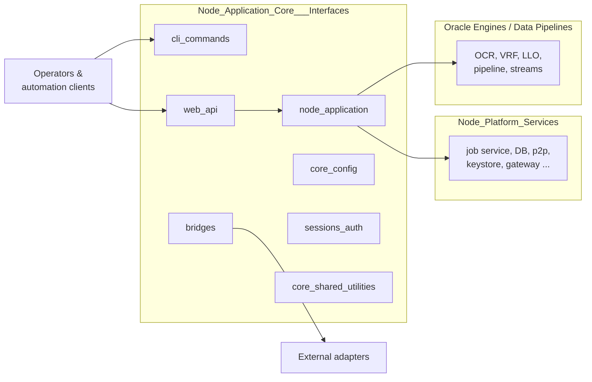
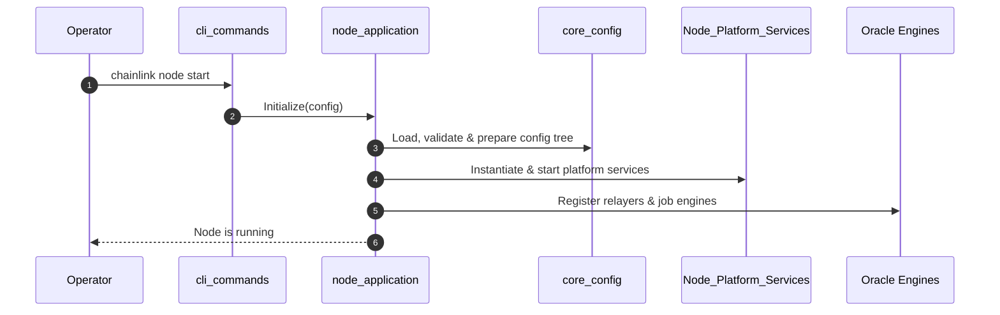

# Node Application Core & Interfaces

## Purpose

The `Node_Application_Core___Interfaces` module (rooted at `chainlink/core`) contains the **Chainlink node application itself** — the composition root that bootstraps, wires together, and runs a Chainlink node — together with the **operator-facing interfaces** that expose it (CLI, REST, GraphQL) and the cross-cutting concerns that support them (configuration, session authentication, external-adapter bridges, and shared utilities).

In contrast to the sibling modules (`Node_Platform_Services`, `Oracle_Engines___Data_Pipelines`), which implement the node's service and engine internals, this module defines:

- **How the node starts and stops** — application lifecycle, dependency wiring, and relay/chain registration.
- **How the node is configured** — the configuration tree consumed by every subsystem.
- **How operators interact with the node** — CLI commands, the web API, and their authentication.
- **How the node reaches outside itself** — external adapter bridges and shared helper libraries.

## Components

| Component | Path | Responsibility | Documentation |
|---|---|---|---|
| `node_application` | `chainlink/core/services/chainlink` | Application bootstrap, lifecycle (Initialize/Start/Close), service/relay wiring | [node_application.md](Node_Application_Core___Interfaces/node_application.md) |
| `core_config` | `chainlink/core/config` | Node configuration tree: chain keys, CCV, dispatcher, observability, workflows | [core_config.md](Node_Application_Core___Interfaces/core_config.md) |
| `cli_commands` | `chainlink/core/cmd` | CLI entry point and commands (node start, admin shell, renderers, remote resources) | [cli_commands.md](Node_Application_Core___Interfaces/cli_commands.md) |
| `web_api` | `chainlink/core/web` | REST controllers, GraphQL API, presenters, RBAC middleware | [web_api.md](Node_Application_Core___Interfaces/web_api.md) |
| `sessions_auth` | `chainlink/core/sessions` | Operator session management with pluggable LDAP and OIDC authentication | [sessions_auth.md](Node_Application_Core___Interfaces/sessions_auth.md) |
| `bridges` | `chainlink/core/bridges` | External adapter bridge types, credentials, and outbound web requests | [bridges.md](Node_Application_Core___Interfaces/bridges.md) |
| `core_shared_utilities` | `chainlink/core` | Shared helpers: ABI utilities, config validation, logging, test support | [core_shared_utilities.md](Node_Application_Core___Interfaces/core_shared_utilities.md) |

## Architecture

### High-level composition

The CLI and Web API are the two entry points into the running node; both ultimately operate through the application core, which is configured by `core_config` and leans on the shared utilities for cross-cutting behavior.

### System context

The application core is the bridge between operator tooling and the rest of the node: it instantiates the platform services and registers the oracle engines/relayers, while bridges provide connectivity to off-chain external adapters.

### Node startup lifecycle

A typical node start flows through the module as follows:

## References

- [Node Application (bootstrap & lifecycle)](Node_Application_Core___Interfaces/node_application.md)
- [Core Config (configuration tree)](Node_Application_Core___Interfaces/core_config.md)
- [CLI Commands](Node_Application_Core___Interfaces/cli_commands.md)
- [Web API (REST & GraphQL)](Node_Application_Core___Interfaces/web_api.md)
- [Sessions & Auth (LDAP / OIDC)](Node_Application_Core___Interfaces/sessions_auth.md)
- [Bridges (external adapters)](Node_Application_Core___Interfaces/bridges.md)
- [Core Shared Utilities](Node_Application_Core___Interfaces/core_shared_utilities.md)