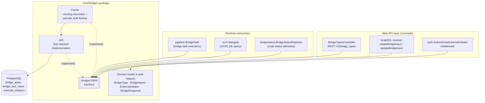
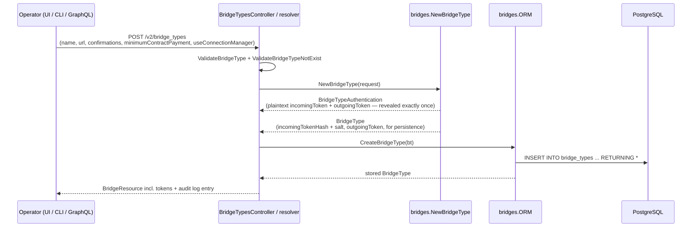
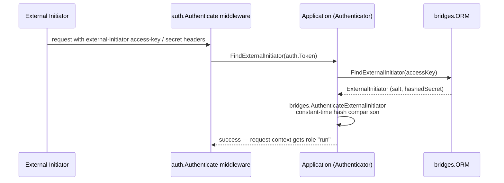
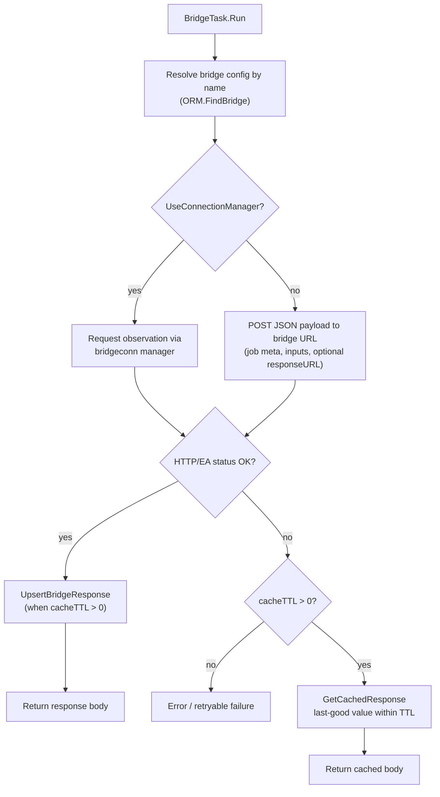

# Bridges (External Adapters)

## 1. Purpose and Scope

The `bridges` module (`chainlink/core/bridges/`) implements **Bridges** — Chainlink's mechanism for integrating **external adapters** — and the closely related **External Initiator** registry.

A *bridge* is a named, operator-registered reference to an external HTTP service (an "external adapter", e.g. a price aggregation service or a market-closure API). During job execution, a pipeline `bridge` task resolves the bridge by name and POSTs a JSON payload to its URL. The module provides everything the node needs to manage and use these registrations:

- **Domain model & validation** — `BridgeType`, `BridgeTypeRequest`, `BridgeName` (canonical, regex-validated, lower-cased names).
- **Credential generation & authentication** — per-bridge incoming/outgoing tokens, salted SHA-256 hashing, constant-time verification.
- **Persistence** — the `bridges.ORM` interface with a PostgreSQL (sqlx) implementation for the `bridge_types`, `bridge_last_value` and `external_initiators` tables.
- **Response caching** — an in-memory decorator (`Cache`) that keeps the last-good bridge response per `(dotID, specID)` and flushes it to the database in periodic bulk upserts.
- **External initiators** — remote principals that may trigger job runs against the node API, with their own salted-secret authentication.

> **Note on structure:** this module is a small, cohesive package (4 source files) that acts as a shared building block for many other subsystems. It is therefore documented on this single page rather than split into sub-module pages.

## 2. Package Layout

| File | Responsibility | Key symbols |
|---|---|---|
| `chainlink/core/bridges/bridge_type.go` | Domain model, credential generation, name validation, response metadata envelope | `BridgeType`, `BridgeTypeRequest`, `BridgeTypeAuthentication`, `NewBridgeType`, `AuthenticateBridgeType`, `BridgeName`, `ParseBridgeName`, `BridgeMetaData`, `BridgeMetaDataJSON`, `MarshalBridgeMetaData`, `BridgeResponse` |
| `chainlink/core/bridges/orm.go` | Persistence: bridge CRUD, response cache storage, external initiator storage | `ORM` (interface), `orm`, `NewORM` |
| `chainlink/core/bridges/cache.go` | Caching `ORM` decorator (implements `services.Service`) | `Cache`, `NewCache`, `CacheServiceName`, `DefaultUpsertInterval` |
| `chainlink/core/bridges/external_initiator.go` | External initiator model and authentication | `ExternalInitiator`, `ExternalInitiatorRequest`, `NewExternalInitiator`, `AuthenticateExternalInitiator` |
| `chainlink/core/bridges/mocks/orm.go` | Mockery-generated `ORM` mock for tests | `mocks.ORM` |

The module's single seam for the rest of the node is the **`bridges.ORM` interface** — every consumer depends on that interface, never on the concrete implementation.

## 3. Architecture Overview



### Wiring in the node Application

The node's application layer creates one SQL-backed bridge ORM at startup and injects it into every consumer (`chainlink/core/services/chainlink/application.go`, `NewApplication`):

```go
bridgeORM      = bridges.NewORM(opts.DS)
pipelineRunner = pipeline.NewRunner(pipelineORM, bridgeORM, ...)
jobORM         = job.NewORM(opts.DS, pipelineORM, bridgeORM, keyStore, globalLogger)
...
bridgeStatusReporter := bridgestatus.NewBridgeStatusReporter(..., bridgeORM, jobORM, ...)
```

- The same instance is handed to the [pipeline runner](../Oracle_Engines___Data_Pipelines/pipeline.md) (used by `BridgeTask`), the [job ORM](node_application.md) (used to find jobs referencing a bridge), the OCR2 delegate, and the bridge status reporter.
- It is exposed to the web layer through `Application.BridgeORM()`.
- A `bridges.Cache` decorator (also satisfying `ORM` + `services.Service`) is available in the package for deployments that want in-memory reads and batched writes; the default wiring uses the plain SQL ORM.

## 4. Functional Areas

### 4.1 Bridge Types: Domain Model & Credentials (`bridge_type.go`)

**Lifecycle of a bridge registration:**



Key behaviors:

- **Name validation** — `BridgeName` values must match `^[a-zA-Z0-9-_]*$` and are normalized to lower case (`ParseBridgeName`). The type implements JSON un/marshaling and `driver.Valuer`/`sql.Scanner` so it round-trips cleanly through HTTP and the database. This same identifier is used as the task type in [pipeline](../Oracle_Engines___Data_Pipelines/pipeline.md) job specs (`type = "bridge"`).
- **Credential generation** — `NewBridgeType` generates three 24-character random secrets (`utils.NewSecret`): an `incomingToken`, an `outgoingToken`, and a `salt`. Only **SHA-256(incomingToken + salt)** is persisted (`IncomingTokenHash`), so the plaintext incoming token can never be recovered from the node; both plaintext tokens are returned once in the `BridgeTypeAuthentication` response.
- **Verification** — `AuthenticateBridgeType` hashes a presented token with the stored salt and compares it in constant time (`crypto/subtle.ConstantTimeCompare`), preventing timing attacks. The **outgoing token** is stored in plaintext because the node must actively present it to the external adapter, whereas the **incoming token** is a shared secret the adapter presents back to the node.
- **Update semantics** — `UpdateBridgeType` only changes `url`, `confirmations`, `minimum_contract_payment` and `use_connection_manager`; the name and credentials are immutable.
- **Response metadata envelope** — `BridgeMetaData` / `BridgeMetaDataJSON` / `MarshalBridgeMetaData` produce the well-known `meta` payload (`latestAnswer`, `updatedAt`) that certain external adapters (market-closure, outlier-detection) depend on.
- **`BridgeResponse`** — `{DotID, SpecID, Value, FinishedAt}` is the canonical representation of one cached bridge response row, shared by the ORM and cache layers.

### 4.2 Persistence (`orm.go`)

The `ORM` interface groups three concerns, all backed by PostgreSQL via `sqlx` + `sqlutil.DataSource`:

| Concern | Methods | Table |
|---|---|---|
| Bridge CRUD | `FindBridge`, `FindBridges`, `CreateBridgeType`, `UpdateBridgeType`, `DeleteBridgeType`, `BridgeTypes` (paged + count) | `bridge_types` |
| Response cache | `GetCachedResponse`, `GetCachedResponseWithFinished`, `UpsertBridgeResponse`, `BulkUpsertBridgeResponse` | `bridge_last_value` |
| External initiators | `ExternalInitiators`, `CreateExternalInitiator`, `DeleteExternalInitiator`, `FindExternalInitiator`, `FindExternalInitiatorByName` | `external_initiators` |

Implementation notes:

- `FindBridges` performs a single `IN`-query and errors unless **every** requested name exists (used for bulk job-spec validation).
- Reads use `sqlutil.Transact` with read-only transaction options; creates use prepared named statements with `RETURNING *` so the caller receives server-generated timestamps.
- The response cache lookups are time-scoped: `GetCachedResponseWithFinished` returns the newest row whose `finished_at` is younger than the staleness threshold (`now - maxElapsed`).
- `BulkUpsertBridgeResponse` uses `ON CONFLICT ... DO UPDATE SET value = excluded.value` for efficient batch flushes.
- `WithDataSource(sqlutil.DataSource) ORM` re-wraps the ORM around a different data source — the standard pattern that lets transaction-scoped or tenant-scoped data sources flow through the same interface.

### 4.3 Response Caching (`cache.go`)

`Cache` is an `ORM` **decorator** that also implements `services.Service` (service name `"BridgeCache"`, flush interval `DefaultUpsertInterval = 5s`):

- **Bridge-type cache** — a `sync.Map` keyed by `BridgeName` (`FindBridge`/`FindBridges` hit memory first; creates/updates refresh it; deletes evict it even if the row was already gone, keeping the two layers consistent).
- **Last-value cache** — an RWMutex-guarded map keyed by `dotID||specID`.
  - `GetCachedResponse` prefers an in-memory value fresher than the TTL, falling back to the database (and repopulating memory).
  - `UpsertBridgeResponse` only writes to memory, guarded against save races (a newer cached value wins).
- **Periodic flush** — on `Start`, a jittered ticker triggers `doBulkUpsert`, which pushes all dirty in-memory values to PostgreSQL via `BulkUpsertBridgeResponse`.

This turns N single-row writes per interval into one batched write, at the cost of up to one interval of durability lag.

### 4.4 External Initiators (`external_initiator.go`)

An `ExternalInitiator` is a remote principal allowed to call the node API (historically to initiate runs). Each initiator has an `AccessKey` + secret pair (hashed with a per-initiator salt via `auth.HashedSecret`) and its own `OutgoingSecret`/`OutgoingToken` for node→initiator communication.



The node router accepts this authentication method on `GET /v2/ping` and `POST /v2/jobs/:ID/runs`; initiator CRUD is exposed as session-authenticated admin endpoints. See [Web API: Auth & RBAC](web_api/web_api_auth_rbac.md) and [Sessions & Auth](sessions_auth.md).

## 5. Runtime Data Flow: Executing a Bridge Task

The dominant runtime consumer is the pipeline `BridgeTask` (`chainlink/core/services/pipeline/task.bridge.go`), which the [pipeline runner](../Oracle_Engines___Data_Pipelines/pipeline.md) executes for every `bridge` task in a job spec:



Details:

- Requests honor task-level `cacheTTL` (falling back to the node-wide `BridgeCacheTTL`), custom `headers`, `includeInputAtKey` input merging, and EA-style status/error extraction.
- **Async bridges**: with `async = "true"`, a `pending` flag (header `X-Chainlink-Pending` or JSON body) suspends the run, which the adapter later resumes through the `responseURL` embedded in the request.
- The task emits per-bridge Prometheus metrics (`bridge_latency_seconds`, `bridge_latency_histogram_ms`, `bridge_errors_total`, `bridge_cache_hits_total`, `bridge_cache_errors_total`) and pipeline telemetry (`BridgeTelemetry`).
- Caching relies entirely on the `bridges.ORM` seam — `UpsertBridgeResponse` on success, `GetCachedResponse` on failure — so the behavior is identical with or without the `Cache` decorator.

## 6. Database Model

| Table | Columns | Notes |
|---|---|---|
| `bridge_types` | `name` (PK), `url`, `confirmations`, `incoming_token_hash`, `salt`, `outgoing_token`, `minimum_contract_payment`, `use_connection_manager`, `created_at`, `updated_at` | One row per registered external adapter |
| `bridge_last_value` | `dot_id`, `spec_id`, `value`, `finished_at` | Last-good response per pipeline task; upserted on primary-key constraint `bridge_last_value_pkey` |
| `external_initiators` | `id`, `name` (unique), `url`, `access_key`, `salt`, `hashed_secret`, `outgoing_secret`, `outgoing_token`, `created_at`, `updated_at` | Remote principals allowed to trigger runs |

## 7. Integration Points (Cross-Module)

| Consumer | How it uses `bridges` | Where documented |
|---|---|---|
| Pipeline engine (`BridgeTask`, `Runner`) | Resolves bridge configs, executes HTTP/connection-manager calls, caches last-good responses via `ORM` | [Pipeline](../Oracle_Engines___Data_Pipelines/pipeline.md) |
| REST API (`/v2/bridge_types`) | `BridgeTypesController` CRUD with role-based access (`RequiresEditRole`), existence validation, and delete protection (rejects deletion while jobs reference the bridge) | [Web API: REST controllers](web_api/web_api_rest_controllers.md) |
| GraphQL API | `createBridgeInput` / `updateBridgeInput` mutations and bridge queries/resolvers | [Web API: GraphQL API](web_api/web_api_graphql_api.md) |
| Auth middleware | `bridges.AuthenticateExternalInitiator` + `FindExternalInitiator` authenticate external-initiator requests | [Web API: Auth & RBAC](web_api/web_api_auth_rbac.md), [Sessions & Auth](sessions_auth.md) |
| Node status reporter | `bridgestatus.NewBridgeStatusReporter` reads bridge registrations via `ORM` to report bridge status telemetry | [Node Status Reporter](../Node_Platform_Services/node_status_reporter.md) |
| Application lifecycle | ORM created in `NewApplication`, shared across subsystems, exposed via `Application.BridgeORM()` | [Node Application](node_application.md) |
| Shared utilities | `utils.NewSecret`, `assets.Link` (minimum contract payment), `sqlutil.DataSource`/`Transact` | [Core Shared Utilities](core_shared_utilities.md) |

## 8. Security & Operational Notes

- **Secrets are revealed once.** The plaintext `incomingToken` (and `outgoingToken`) are only returned by the create call; only the salted hash of the incoming token is stored. Losing them requires rotating the bridge.
- **Constant-time comparisons** are used for both bridge tokens and external-initiator secrets (`crypto/subtle`).
- **Audit logging.** Bridge create/update/delete through the REST controller emit audit events (`audit.BridgeCreated`, `BridgeUpdated`, `BridgeDeleted`).
- **Delete protection.** `Destroy` refuses to remove a bridge while any job references it (`JobORM().FindJobIDsWithBridge`).
- **Cache durability trade-off.** When the `Cache` decorator is used, last-value writes are batched (`DefaultUpsertInterval`, 5s); a node crash could lose up to one interval of cache updates (impact limited: the cache is only a resilience fallback).
- **Bridge-name canonicalization.** Names are lower-cased and regex-validated at every entry point (REST, GraphQL, job specs), preventing duplicate or malformed task types.

## 9. Related Documentation

- [Node Application Core & Interfaces](../Node_Application_Core___Interfaces.md) — parent module overview.
- [Node Application](node_application.md) — how services (including the bridge ORM) are constructed, started and stopped.
- [Web API](web_api.md) — REST/GraphQL surface that manages bridges and external initiators.
- [Pipeline](../Oracle_Engines___Data_Pipelines/pipeline.md) — the execution engine that consumes bridges at runtime.
