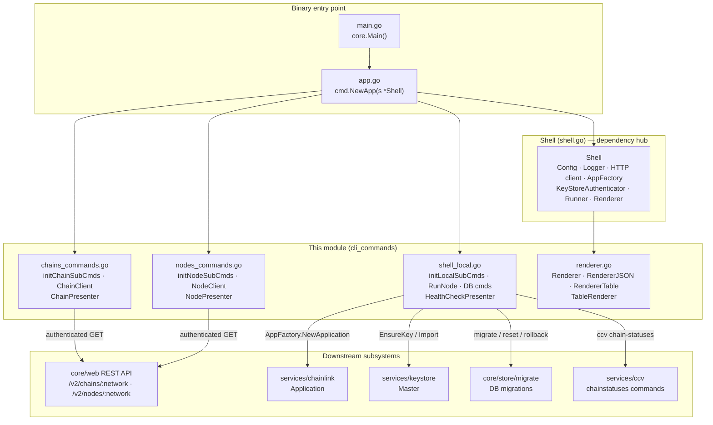
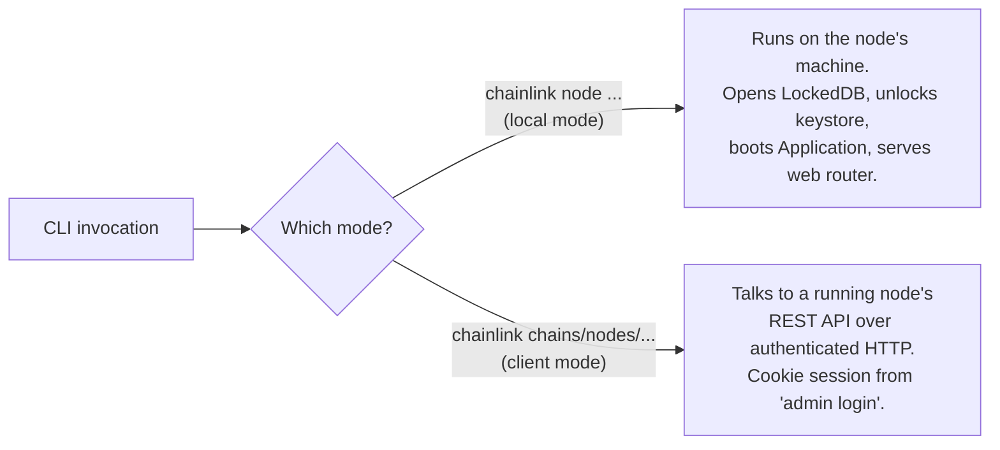
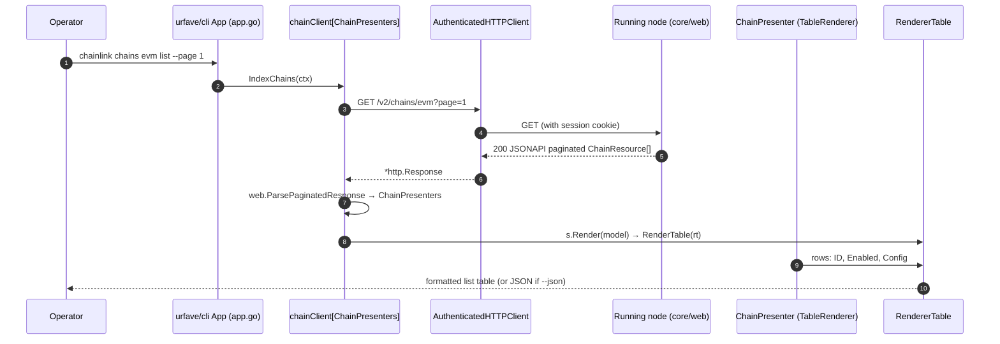
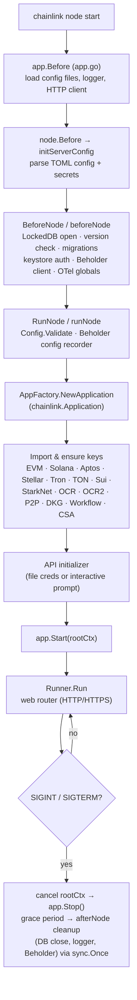

# CLI Commands (`chainlink/core/cmd`)

> Parent module: [Node Application, Core & Interfaces](../Node_Application_Core___Interfaces.md)

## 1. Purpose and Scope

The **`cli_commands`** module is the Go package `github.com/smartcontractkit/chainlink/v2/core/cmd`. It implements the entire operator-facing command-line surface of the Chainlink node — the `chainlink` binary. Every interaction an operator has with the node through a terminal (starting the node, managing its database, inspecting chains and node configurations, checking health) is dispatched through this package.

Its core responsibilities are:

| Responsibility | Where |
|---|---|
| Node lifecycle (start / graceful shutdown, key bootstrapping) | `shell_local.go` |
| Local administration (database management, block pruning, tx rebroadcast, config validation) | `shell_local.go` |
| Remote resource inspection (`chains <network> list`, `nodes <network> list`) via the node REST API | `chains_commands.go`, `nodes_commands.go` |
| Output presentation (human-readable tables vs. JSON) | `renderer.go`, presenters |

The binary entry point is deliberately thin: `chainlink/main.go` calls `core.Main()` (`chainlink/core/main.go`), which builds a production-configured `cmd.Shell` and hands it to `cmd.NewApp()`, the urfave/cli router defined in `chainlink/core/cmd/app.go`. This module *is* that router's implementation.

## 2. Architecture Overview

### 2.1 Component map

### 2.2 The `Shell` — shared runtime hub

All commands are methods (or closures) on the `Shell` struct (`chainlink/core/cmd/shell.go`). It is wired once by `cmd.NewApp`'s `Before` hook and by `newProductionClient()` in `chainlink/core/main.go`:

- **`Config chainlink.GeneralConfig`** — the effective TOML configuration (see [core config](core_config.md)). Rebuilt from `--config` / `--secrets` files for `node` subcommands.
- **`Renderer`** — set to `RendererTable` by default; switched to `RendererJSON` when the global `--json` flag is set (`app.go`).
- **`HTTP` / `CookieAuthenticator`** — the authenticated HTTP client used by *remote* (client-mode) commands; cookie-based sessions are established by `chainlink admin login` (see [sessions & auth](sessions_auth.md)).
- **`AppFactory` / `Runner`** — used by *local* commands to instantiate and run a full [node application](node_application.md).
- **`LDB` / `DS` / `KeyStore` / `BeholderClient`** — initialized lazily by `beforeNode` for commands that need direct database, keystore or telemetry access.

### 2.3 Operating modes

The same binary serves both modes; the distinction is which subsystem each command family touches.

## 3. Sub-modules

The module is documented in three focused sub-pages, located under [`cli_commands/`](cli_commands/) (final generated file names):

| Sub-module | Documentation file | Core components | Summary |
|---|---|---|---|
| **Rendering framework** | [cli_commands_renderer.md](cli_commands/cli_commands_renderer.md) | `TableRenderer` (`chainlink/core/cmd/renderer.go`) | The `Renderer`/`RendererJSON`/`RendererTable` trio and the `TableRenderer` presenter contract that decouples CLI output formatting from data sources. |
| **Remote resource commands** | [cli_commands_remote_resources.md](cli_commands/cli_commands_remote_resources.md) | `ChainPresenter` (`chains_commands.go`), `NodePresenter` (`nodes_commands.go`) | Network-scoped `chains`/`nodes` command families, the generic `ChainClient`/`NodeClient` REST clients with pagination, and their table presenters. |
| **Local shell commands** | [cli_commands_shell_local.md](cli_commands/cli_commands_shell_local.md) | `HealthCheckPresenter` (`shell_local.go`) | `chainlink node start` and local administration: DB lifecycle commands, keystore bootstrapping, transaction rebroadcast, block pruning, health presentation, and shutdown semantics. |

All three sub-pages link back to this overview; diagrams and details are not duplicated here.

## 4. Data Flow: a remote `list` command end-to-end

The `nodes` flow is identical, targeting `/v2/nodes/:network` and rendering `Name, Chain ID, State, Config`. Because pagination, authentication, error translation and rendering are all centralized in `Shell.getPage` and the `Renderer` implementations, adding a new network-scoped resource family requires only a client + presenter pair (see [remote resource commands](cli_commands/cli_commands_remote_resources.md)).

## 5. Node startup flow (local mode)

Startup performs a defensive security posture worth noting: root-directory and TLS-directory permissions are tightened to `0700`, protected files (`secret`, `cookie`, `.password`, `.env`, `.api`) are permission-checked and ownership-verified, and dev builds warn loudly (`build.IsDev()`). The `safe` flag passed to `initLocalSubCmds` hides destructive commands (`db reset`, `db preparetest`, `db create-migration`, `db delete-chain`) in production builds — `build.IsProd()` is driven by the `CL_IS_PROD_BUILD` make variable and the `-tags dev` build of `install-chainlink-dev` in `chainlink/GNUmakefile`.

## 6. How this module fits into the system

- **[Node application](node_application.md)** — `RunNode`, `RebroadcastTransactions` and `RemoveBlocks` construct a full `chainlink.Application` through `AppFactory`; the CLI is the only supported way operators boot it. `GeneralConfig` (from [core config](core_config.md)) gates every key-ensure/import branch during startup.
- **[Web API](web_api.md)** — remote commands are thin clients of the node's REST controllers: `/v2/chains/:network` maps to `ChainsController`, `/v2/nodes/:network` to the node status endpoints; the CLI deserializes the *same* `ChainResource`/`NodeResource` JSONAPI payloads that the controllers emit, keeping the wire contract symmetric.
- **[Sessions & auth](sessions_auth.md)** — client-mode commands depend on cookie sessions (`RemoteLogin`, `SessionCookieAuthenticator`) and surface HTTP 401/403 errors with guidance to re-login.
- **[Keystore](../Node_Platform_Services/keystore.md)** — startup ensures/imports keys for every enabled chain family (EVM, Solana, Aptos, Stellar, Tron, TON, Sui, StarkNet, OCR, OCR2, P2P, DKG recipient, Workflow, CSA).
- **[Database persistence](../Node_Platform_Services/database_persistence.md)** — the `node db` command family wraps `core/store/migrate` and `core/store` reset/fixture utilities.

## 7. Conventions for extending the CLI

1. **New network-scoped resource** — implement a `*Client` with the generic pagination pattern (embed `*Shell`, hold a `path`, implement an `Index*` action calling `cli.getPage`), a presenter pair (single + slice) implementing `TableRenderer`, and register via an `init*SubCmds` helper iterating `relay.SupportedNetworks` (skipping `relay.NetworkDummy`), as done in `chains_commands.go` and `nodes_commands.go`.
2. **New renderable type** — prefer implementing `TableRenderer` (`RenderTable`) over adding a case to the `RendererTable.Render` type switch; the switch is legacy surface kept for older presenters (VRF keys, pipeline runs, log config, external initiator credentials).
3. **New local command** — add it to `initLocalSubCmds` in `shell_local.go`; use `Before: s.BeforeNode` / `After: s.AfterNode` when it needs DB/keystore/telemetry, and route errors through `s.errorOut` for consistent exit codes.
