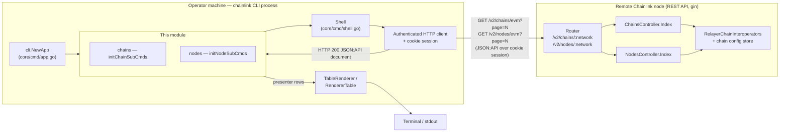
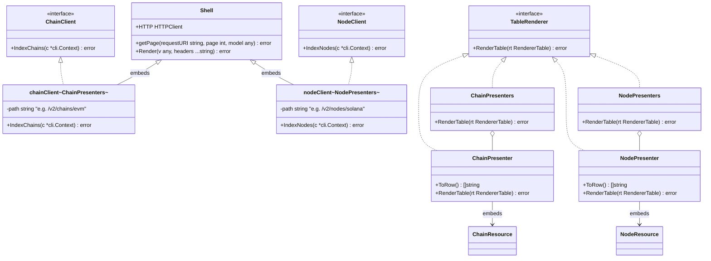
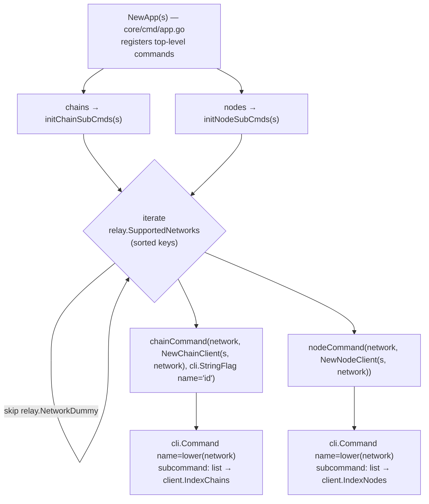

# CLI Remote Resources — Chains & Nodes Commands

> **Module scope:** `chainlink/core/cmd/chains_commands.go` and `chainlink/core/cmd/nodes_commands.go`
> **Parent module:** [CLI Commands](../cli_commands.md)
> **Documentation tree:** [Node Application Core & Interfaces](../../Node_Application_Core___Interfaces.md)

## 1. Introduction

This module implements the *remote resource* commands of the operator CLI: the read-only
`chainlink chains <network> list` and `chainlink nodes <network> list` subcommands. Unlike the
[node-local commands](cli_commands_shell_local.md), these commands do **not** operate on a local
database. Instead they act as *thin HTTP clients* against the REST API of a **running Chainlink
node** (which may be on another machine):

1. Build one CLI subcommand per supported network (`evm`, `solana`, `starknet`, `aptos`, `tron`,
   `ton`, `sui`, `stellar`) from `relay.SupportedNetworks`.
2. Issue an authenticated `GET` against the node's JSON:API endpoints
   (`/v2/chains/<network>`, `/v2/nodes/<network>`).
3. Deserialize the JSON:API collection into presenter types (`ChainPresenters`,
   `NodePresenters`).
4. Render the result as a human-readable list in the terminal (or JSON with `--json`).

The module is intentionally minimal — each command family is a single `list` action — and relies
heavily on two shared building blocks: the [table renderer](cli_commands_renderer.md) and the
`Shell`'s remote-API plumbing (`Shell.getPage`).

## 2. Responsibilities

| Responsibility | Where |
|---|---|
| Generate per-network `chains` / `nodes` subcommands | `initChainSubCmds`, `initNodeSubCmds` |
| Generic, network-agnostic HTTP list clients | `chainClient[P]`, `nodeClient[P]` (`P` = a `TableRenderer` slice type) |
| Map server resources to table rows | `ChainPresenter`, `NodePresenter` (`ToRow`, `RenderTable`) |
| Pagination + authenticated GET + JSON:API deserialization | `Shell.getPage` (`core/cmd/shell_remote.go`) |
| Text rendering of presenter rows | `renderList` in [renderer module](cli_commands_renderer.md) |

## 3. Context: how it fits into the system

The module is the operator-facing "viewer" for the same resources that the node's
[Web API](../web_api.md) manages. The `ChainsController` and `NodesController` on the node serve
the endpoints consumed here, while the node process itself is assembled by the
[Application](../node_application.md); the set of available networks is defined by the
[relay layer](../node_application/node_application_relay.md).



Key points:

* **Client mode is implicit.** When the CLI runs these commands it never boots a node; it talks to
  `--remote-node-url` (default `http://localhost:6688`) using the cookie session created by
  `chainlink admin login` (see `NewApp` in `core/cmd/app.go`).
* **One server, one client contract.** The presenter types used by this module are the *same*
  types the node's controllers emit, so CLI and server stay in lockstep automatically.
* **No local state.** All state (chain configs, node statuses) lives on the node; this module only
  reads.

## 4. Architecture

### 4.1 Component model

Both command families are built from the same two abstractions: a **generic client** bound to one
HTTP path, and a **presenter** that knows how to flatten a server resource into table rows.



Design characteristics:

* **Generics over output type.** `chainClient[P TableRenderer]` / `nodeClient[P TableRenderer]`
  parameterize the client on the presenter slice that the JSON:API response is deserialized into,
  eliminating duplicated fetch/paginate/render code across networks.
* **Composition over inheritance.** Clients embed `*Shell` to reuse its authenticated HTTP client,
  cookie session, and renderer dispatch.
* **Presenter/adapter pattern.** `ChainPresenter` wraps `presenters.ChainResource` and
  `NodePresenter` wraps `presenters.NodeResource`, adding the `TableRenderer` behavior. Single
  items and slices both implement `TableRenderer`, so either can be returned by an action.
* **Fail-fast flag contract.** `chainCommand` panics at startup if the chain-ID flag is not named
  `"id"` — an invariant enforced where the command tree is built, not at request time.

### 4.2 Command-tree generation

The per-network subcommands are *generated* at CLI startup from the relay layer's registry of
supported networks:



* Networks come from `relay.SupportedNetworks` in `core/services/relay/relay.go`
  (`evm`, `solana`, `starknet`, `aptos`, `tron`, `ton`, `sui`, `stellar`, plus the internal
  `dummy` network which is **explicitly skipped**).
* Keys are iterated in sorted order (`slices.Sorted(maps.Keys(...))`), so help output is stable.
* Command names are lower-cased network names; each exposes exactly one subcommand, `list`.

## 5. Component reference

### 5.1 Chain commands (`core/cmd/chains_commands.go`)

| Component | Kind | Description |
|---|---|---|
| `initChainSubCmds(s *Shell)` | func | Builds one `chainCommand` per supported network (sorted; `dummy` skipped). |
| `chainCommand(typ, client, chainID)` | func | Wraps a `ChainClient` into a `cli.Command`; **panics** if the chain-ID flag name ≠ `"id"`. |
| `ChainClient` | interface | `IndexChains(c *cli.Context) error`. |
| `chainClient[P TableRenderer]` | struct | Embeds `*Shell`; carries the API `path`. |
| `NewChainClient(s, network)` | func | Returns a `ChainClient` bound to `/v2/chains/<network>`, deserializing into `ChainPresenters`. |
| `IndexChains` | method | `Shell.getPage(cli.path, c.Int("page"), &p)` — fetch + deserialize + render. |
| `ChainPresenter` | struct | Embeds `presenters.ChainResource`; `ToRow()` → `["ID", "Enabled", "Config"]`. |
| `ChainPresenters` | slice | `[]ChainPresenter`; renders all rows under `chainHeaders = ["ID", "Enabled", "Config"]`. |

The server-side resource it renders is `presenters.ChainResource`
(`core/web/presenters/chain.go`), produced from the node's `chainlink.NetworkChainStatus`:

```go
type ChainResource struct {
    JAID                // JSON:API id — the chain ID as a string
    Network string `json:"network"`
    Enabled bool   `json:"enabled"`
    Config  string `json:"config"` // TOML
}
```

### 5.2 Node commands (`core/cmd/nodes_commands.go`)

| Component | Kind | Description |
|---|---|---|
| `initNodeSubCmds(s *Shell)` | func | Mirrors `initChainSubCmds` for node configuration. |
| `nodeCommand(typ, client)` | func | Wraps a `NodeClient` into a `cli.Command` with a `list` subcommand. |
| `NodeClient` | interface | `IndexNodes(c *cli.Context) error`. |
| `nodeClient[P TableRenderer]` | struct | Embeds `*Shell`; carries the API `path`. |
| `NewNodeClient(s, network)` | func | Returns a `NodeClient` bound to `/v2/nodes/<network>`, deserializing into `NodePresenters`. |
| `IndexNodes` | method | `Shell.getPage(cli.path, c.Int("page"), &p)`. |
| `NodePresenter` | struct | Embeds `presenters.NodeResource`; `ToRow()` → `["Name", "ChainID", "State", "Config"]`. |
| `NodePresenters` | slice | Renders all rows under `nodeHeaders = ["Name", "Chain ID", "State", "Config"]`. |

`presenters.NodeResource` wraps the shared `types.NodeStatus`
(`chainlink-common/pkg/types`) — fields `ChainID`, `Name`, `Config`, `State` — and is serialized by
the node as a JSON:API resource of type `"node"` with composite id `"<chainID>/<name>"` (see
`core/web/presenters/node_test.go`).

### 5.3 Server-side contract (peer module)

The HTTP contract consumed here is provided by the node's controllers (see
[Web API documentation](../web_api.md)):

```go
// core/web/chains_controller.go
type ChainsController interface {
    Index(c *gin.Context, size, page, offset int) // lists chains
    Show(*gin.Context)                            // gets a chain by id
}

// core/web/nodes_controller.go
type NodesController interface {
    Index(c *gin.Context, size, page, offset int) // lists nodes, optionally filtered by chain id
}
```

`NodesController` is backed by `NetworkScopedNodeStatuser`, which resolves per-network node
statuses through `chainlink.RelayerChainInteroperators` — i.e. the same relayer machinery the node
uses at runtime ([node application relay](../node_application/node_application_relay.md)).

### 5.4 Rendering contract

Rendering is delegated to the sibling [renderer module](cli_commands_renderer.md):

* `TableRenderer` interface — `RenderTable(rt RendererTable) error`.
* `RendererTable.Render` type-switches on the model; any `TableRenderer` (including these
  presenters) is dispatched to `RenderTable`.
* Both command families render via `renderList(headers, rows, writer)`, which prints one
  `Header: value` line per field and separates items with dashed dividers:

```
--------------------------------------------------
ID: 137
Enabled: true
Config: [EVM]
...
--------------------------------------------------
ID: 80001
Enabled: false
Config: [EVM]
...
--------------------------------------------------
```

* With the app-level `-j/--json` flag, `NewApp` swaps the Shell's renderer for `RendererJSON`, so
  the deserialized presenters are printed as JSON instead of the list layout.

## 6. Runtime data flow — `chainlink chains evm list`

```mermaid
sequenceDiagram
    autonumber
    actor U as Operator
    participant APP as cli.App (NewApp)
    participant CC as chainClient~ChainPresenters~
    participant SH as Shell
    participant HC as Authenticated HTTP client
    participant NODE as Node REST API (gin)
    participant CTRL as ChainsController

    U->>APP: chains evm list
    APP->>CC: IndexChains(c)
    CC->>SH: getPage("/v2/chains/evm", page, &ChainPresenters)
    SH->>HC: GET /v2/chains/evm (page query only if &gt; 0)
    HC->>NODE: HTTP GET + session cookie
    NODE->>CTRL: Index(ctx, size, page, offset)
    CTRL-->>NODE: []chainlink.NetworkChainStatus
    NODE-->>HC: 200 OK — JSON:API { data: [ {type:"chain", ...} ] }
    HC-->>SH: *http.Response
    SH->>SH: deserializeAPIResponse → ChainPresenters (jsonapi)
    SH->>SH: Render(ChainPresenters)
    SH-->>CC: RendererTable dispatch → ChainPresenters.RenderTable
    CC->>CC: renderList(chainHeaders, rows)
    CC-->>U: formatted list on stdout
```

Step-by-step:

1. **Command dispatch** — urfave/cli resolves `chains` → per-network command (`evm`) → `list`,
   whose `Action` is `client.IndexChains` (wired up in `initChainSubCmds`).
2. **Fetch** — `Shell.getPage` (`core/cmd/shell_remote.go`) parses the client's `path`, appends a
   `page` query parameter *only when the value is positive* (the generated `list` subcommands
   register no flags, so the server's default page is used in practice), and issues a `GET`
   through the Shell's authenticated HTTP client.
3. **Deserialize** — the response body is decoded as a JSON:API collection into the generic
   parameter `P` (`ChainPresenters` / `NodePresenters`) using the same presenter types the server
   marshals.
4. **Render** — `Shell.Render` hands the model to the active renderer; in table mode
   `RendererTable.Render` dispatches to the presenter's `RenderTable`, which flattens every
   resource via `ToRow()` and writes the list layout with `renderList`.

Failure modes follow the shared Shell conventions: HTTP 401/403 are translated into actionable
messages (e.g. *"you may need to login first using the CLI via 'chainlink admin login'"*) by
`Shell.parseResponse`/`deserializeAPIResponse`, and errors surface via `Shell.errorOut`.

## 7. Command surface

```text
chainlink chains
├── aptos list
├── evm list
├── solana list
├── starknet list
├── stellar list
├── ton list
├── tron list
└── sui list

chainlink nodes
├── aptos list
├── ...   (same per-network set)
└── sui list
```

Typical usage:

```bash
# Establish a session against a node, then list resources
chainlink --remote-node-url https://node.example.com admin login
chainlink chains evm list
chainlink nodes solana list

# JSON output for scripting (app-level flag)
chainlink -j chains evm list
```

Global flags that affect these commands (declared in `NewApp`, `core/cmd/app.go`):

| Flag | Effect |
|---|---|
| `--remote-node-url` | Target node API (default `http://localhost:6688`). |
| `--admin-credentials-file` | Credentials file for non-interactive login (client mode). |
| `--insecure-skip-verify` | Skip TLS verification (self-signed node certificates). |
| `-j / --json` | Emit JSON instead of the table/list layout. |

## 8. Extending the module

**Adding a new network** requires no change in this module: add the network to
`relay.SupportedNetworks` (and its `Network*` constant) in `core/services/relay/relay.go`. Both
`initChainSubCmds` and `initNodeSubCmds` pick it up automatically on the next build — provided the
node's [relay layer](../node_application/node_application_relay.md) supports the network and the
server-side controllers can serve it. Keep in mind:

* The internal `dummy` network is filtered out; mark test-only networks accordingly.
* Command names are `strings.ToLower(network)` — network constants must be lower-case-safe and
  unique.
* Adding *new subcommands* beyond `list` (e.g. `create`, `delete`) means extending
  `chainCommand`/`nodeCommand`; write/delete operations also require corresponding
  controller/RPC support on the node (see [Web API](../web_api.md)).

**Adding a new resource family** (e.g. forwarders, bridges — which follow the same pattern in
their own files): implement a `TableRenderer` presenter pair, define a client interface + generic
client bound to an API path, and register an `initXxxSubCmds` entry in `NewApp`.

## 9. Testing

Relevant tests in `chainlink/core/cmd`:

* `chains_commands_test.go` — `TestShell_IndexEVMChains` boots a real test application, runs
  `cmd.NewChainClient(client, "evm").IndexChains(...)` against an empty CLI context, and asserts
  the rendered `ChainPresenters` contents (`assertTableRenders`).
* `chains_commands_integration_test.go`, `node_commands_test.go`,
  `node_commands_integration_test.go` — verify command behavior against test nodes.

The unit-test pattern — a real in-process application plus a recording renderer — works precisely
because these clients are thin: the only logic to test is path construction, deserialization into
the presenter slice, and row mapping.

## 10. Related documentation

* [CLI Commands (parent)](../cli_commands.md) — overview of the CLI layer.
* [CLI Renderer](cli_commands_renderer.md) — `TableRenderer`, `RendererTable`, `renderList`.
* [CLI Local Shell Commands](cli_commands_shell_local.md) — the `node` (local) counterpart.
* [Web API](../web_api.md) — server-side controllers serving `/v2/chains/:network` and
  `/v2/nodes/:network`.
* [Node Application](../node_application.md) — the node process the CLI talks to.
* [Node Application Relay](../node_application/node_application_relay.md) — source of
  `relay.SupportedNetworks` and per-network relayer support.
