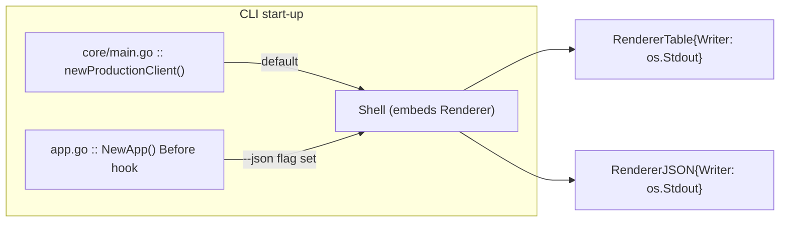
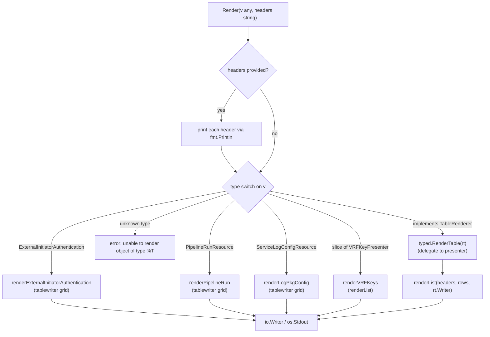
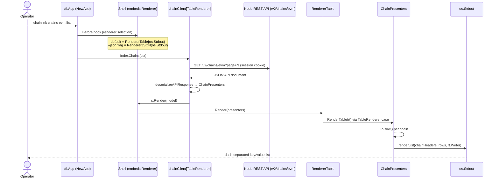
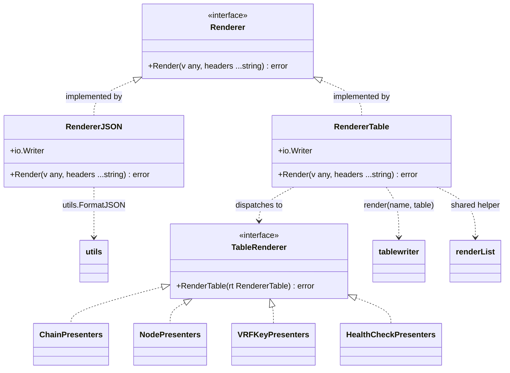

# CLI Commands — Renderer

> **Module scope:** `chainlink/core/cmd/renderer.go` (package `cmd`)
> **Parent:** [CLI Commands](../cli_commands.md) · **Area:** [Node Application Core & Interfaces](../../Node_Application_Core___Interfaces.md)

---

## 1. Introduction

The `cli_commands_renderer` module implements the **output-formatting subsystem of the Chainlink node's command-line interface**. It is the single point through which every remote and local CLI command turns structured data (JSON:API resources produced by the node's web layer) into human- or machine-readable terminal output.

The `cmd` package describes itself as *"the front-end interface for the application as a command-line utility"*, and its package doc explicitly dedicates a section to the `Renderer`:

> *"Renderer helps format and display data (based on the kind of data it is) to the command line."* — `chainlink/core/cmd/doc.go`

The module delivers:

| Concern | Provided by |
|---|---|
| A **single dispatch contract** for output (`Render(any, ...string) error`) | `Renderer` interface |
| **JSON output** (`--json` flag) | `RendererJSON` |
| **Human-readable table/list output** (default) | `RendererTable` |
| A **strategy hook** so domain presenters can render themselves | `TableRenderer` interface |
| Shared **table + list formatting primitives** | `render()`, `renderList()` helpers |

---

## 2. Core Components

All components live in `chainlink/core/cmd/renderer.go` unless noted otherwise.

### 2.1 `Renderer` — the output contract

```go
// Renderer implements the Render method.
type Renderer interface {
    Render(any, ...string) error
}
```

`Shell` **embeds** this interface (`chainlink/core/cmd/shell.go`), so every command action can simply call `s.Render(model)` without knowing whether the user requested JSON or table output. Concrete implementations are selected at start-up (see §3).

### 2.2 `RendererJSON` — machine-readable output

```go
type RendererJSON struct {
    io.Writer
}
```

* Serializes any value via `utils.FormatJSON` (`json.MarshalIndent` with a two-space indent, defined in `chainlink/core/utils/utils.go`).
* Appends a trailing `"\n"` before writing to the embedded `io.Writer`.
* Ignores the variadic `headers` argument.
* Works on **any** value — including plain presenters and presenter slices — with no type dispatch required.

### 2.3 `RendererTable` — human-readable output and dispatcher

```go
type RendererTable struct {
    io.Writer
}

type TableRenderer interface {
    RenderTable(rt RendererTable) error
}
```

`RendererTable.Render(v any, headers ...string)` is the heart of the module. It:

1. Prints any supplied header strings (`fmt.Println`).
2. Type-switches on the incoming value (`chainlink/core/cmd/renderer.go`):
   * `*webpresenters.ExternalInitiatorAuthentication` → `renderExternalInitiatorAuthentication`
   * `*webpresenters.PipelineRunResource` → `renderPipelineRun`
   * `*webpresenters.ServiceLogConfigResource` → `renderLogPkgConfig`
   * `*[]VRFKeyPresenter` → `renderVRFKeys`
   * `TableRenderer` → **delegates** to `typed.RenderTable(rt)` (double dispatch)
   * `default` → returns `unable to render object of type %T: %v`
3. Because `RendererTable` embeds `io.Writer`, presenters receiving it in `RenderTable(rt)` can write their rows to the same destination stream as the renderer itself.

### 2.4 `TableRenderer` — presenter-side strategy interface

`TableRenderer` is the extension mechanism of the module. Presenters that implement it own their **column headers** and **row construction** (usually via a `ToRow() []string` method) and delegate formatting to the shared helpers. Implementations in the codebase:

| Presenter | File | Headers | Notes |
|---|---|---|---|
| `ChainPresenter` / `ChainPresenters` | `chains_commands.go` | `ID, Enabled, Config` | Used by `chainlink chains <network> list` |
| `NodePresenter` / `NodePresenters` | `nodes_commands.go` | `Name, Chain ID, State, Config` | Used by `chainlink nodes <network> list` |
| `VRFKeyPresenter` / `VRFKeyPresenters` | `vrf_keys_commands.go` | `Compressed, Uncompressed, Hash` | Slice variant also has a dedicated fast-path case in `Render` |
| `HealthCheckPresenters` | `shell_local.go` | `Name, Status, Output` | Colors status red/green via `fatih/color`; used by the `health` command |
| `JobPresenter` family | `jobs_commands.go` | job-specific | Renders jobs and pipeline runs |

The generic CLI clients are parameterized over the interface (`chainClient[P TableRenderer]`, `nodeClient[P TableRenderer]`), which is what allows one implementation of `IndexChains`/`IndexNodes` to serve every supported relay network (see [CLI Commands — Remote Resources](cli_commands_remote_resources.md)).

### 2.5 Formatting helpers (package-private)

* **`renderList(fields []string, items [][]string, writer io.Writer)`** — renders *label-aligned key/value "list" blocks* separated by dash lines. It computes the longest label, pads all labels to that width, tracks the widest line (including multi-line cell values via `strings.SplitSeq`), and emits:
  `---- / Name: value / … / ----` per item. This is the workhorse used by virtually every `TableRenderer` implementation.
* **`render(name string, table *tablewriter.Table)`** — renders a true grid table using `github.com/olekukonko/tablewriter` configured with a custom *double-line* symbol set (`║` columns, `═` rows, `╬` center) via `renderer.NewBlueprint`. It prints a banner `╔ <name>` before the grid. Used by the built-in presenters (`ExternalInitiatorAuthentication`, `PipelineRun`, `ServiceLogConfig`).

---

## 3. Runtime Wiring — Choosing a Renderer

The renderer implementation is selected once per process and injected into `Shell`:



1. **Default (tables):** `chainlink/core/main.go::newProductionClient` constructs the production `Shell` with `Renderer: cmd.RendererTable{Writer: os.Stdout}`.
2. **JSON mode:** `chainlink/core/cmd/app.go::NewApp` declares the global `--json, j` flag (*"json output as opposed to table"*) and, in its `Before` hook, swaps the embedded renderer: `s.Renderer = RendererJSON{Writer: os.Stdout}`.

Commands never choose a format themselves — they call `s.Render(...)` and the injected implementation decides the output style.

---

## 4. Type-Dispatch Flow



---

## 5. End-to-End Data Flow

The typical journey of a remote command such as `chainlink chains evm list`:



Two shell-level entry points funnel into `s.Render` (both in `chainlink/core/cmd/shell_remote.go`):

* **`getPage(requestURI, page, model)`** — paginated `GET`, deserialization into a `TableRenderer` presenter slice, then `s.Render(model)`. Used by all `list` subcommands (chains, nodes, keys…).
* **`renderAPIResponse(resp, dst, headers...)`** — deserializes a create/update response, then `s.Render(dst, headers...)`. Used by mutating commands, e.g. `keys vrf create` (`VRFKeyPresenter`), `initiators create` (`ExternalInitiatorAuthentication`), `config loglevel` / `config logsql` (`ServiceLogConfigResource`).

The data being rendered originates from the node's web layer presenters — see [Web API](../web_api.md) for how those resources are produced.

---

## 6. Built-in Render Targets

| Value type passed to `Render` | Output style | Columns / labels | Triggering commands (examples) |
|---|---|---|---|
| `*webpresenters.ExternalInitiatorAuthentication` | `tablewriter` double-line grid | Name, URL, AccessKey, Secret, OutgoingToken, OutgoingSecret | `initiators create` |
| `*webpresenters.PipelineRunResource` | `tablewriter` double-line grid | ID, Created At, Finished At (omitted when zero) | `jobs run` |
| `*webpresenters.ServiceLogConfigResource` | `tablewriter` double-line grid (one row per service) | ID, Service, LogLevel | `config loglevel`, `config logsql` |
| `*[]VRFKeyPresenter` | `renderList` block | Compressed, Uncompressed, Hash | `keys vrf list` |
| any `TableRenderer` (incl. `*ChainPresenters`, `*NodePresenters`, `*HealthCheckPresenters`, `*VRFKeyPresenter`) | presenter-defined (usually `renderList`) | presenter-defined headers | `chains <net> list`, `nodes <net> list`, `health`, … |
| anything else | — | — | error: `unable to render object of type %T` |

---

## 7. Component Relationships



**Design pattern.** The combination of `Renderer` (output format) + `TableRenderer` (per-domain layout) is a classic *strategy + double-dispatch* arrangement: `RendererTable` decides **how** output is produced (grid vs list, destination stream), while presenters decide **what** is shown (headers + rows). New resource types only need to satisfy the small `TableRenderer` interface to become renderable by every generic client in the `cmd` package.

---

## 8. Extending the Renderer

To make a new resource renderable:

1. **Wrap the web resource** in a presenter in `core/cmd` (optionally embedding `JAID` so the JSON:API `id` marshals as normal JSON — see `chainlink/core/cmd/presenters.go`).
2. **Implement `ToRow() []string`** mapping resource fields to display values.
3. **Implement `RenderTable(rt RendererTable) error`**: build the headers slice, collect rows, and call `renderList(headers, rows, rt.Writer)`.
4. For **collections**, implement `RenderTable` on a slice type (`type XPresenters []XPresenter`), aggregating `ToRow()` results.
5. Pass the presenter type to the generic clients (`chainClient[P TableRenderer]`, `nodeClient[P TableRenderer]`) or call `s.renderAPIResponse(resp, &presenter)` directly.

Only add a new case to `RendererTable.Render` if the value **cannot** implement `TableRenderer` (the current cases exist for legacy/pointers-to-web-resources reasons; `default` intentionally errors on unknown types).

---

## 9. Dependencies

| Dependency | Kind | Usage |
|---|---|---|
| `github.com/olekukonko/tablewriter` (+ `renderer`, `tw` sub-packages) | external | Grid tables with double-line blueprint symbols in `render()` |
| `chainlink/v2/core/utils` (`FormatJSON`) | in-repo | Indented JSON serialization for `RendererJSON` |
| `chainlink/v2/core/web/presenters` | in-repo | Resource types dispatched by `Render` ([Web API](../web_api.md)) |
| `io`, `fmt`, `strings` | stdlib | Writer plumbing, alignment padding, `strings.SplitSeq` for multi-line cells |

---

## 10. Behavior Notes & Caveats

* **Mixed output sinks.** `RendererTable.Render` prints variadic headers and `render()` prints its `╔ <name>` banner via `fmt.Println` (direct stdout), while table/list *content* goes through the injected `io.Writer`. Tests and tooling that capture output through a custom writer should account for this.
* **Errors from `renderList` are swallowed** (explicitly noted in-code as an `errcheck` accommodation); the function is fire-and-forget.
* **`FinishedAt` handling** in `renderPipelineRun` renders an empty cell when the run has not finished (`null.Time` zero check).
* **`RendererJSON` ignores `headers`** — header strings are a table-only concept.
* **Health output is colored** (`fatih/color`) only in the presenter layer (`HealthCheckPresenters.ToRow`), not in the renderer itself — see [CLI Commands — Shell Local](cli_commands_shell_local.md).
* The node's lifecycle and service wiring that backs the API endpoints feeding this renderer is documented in [Node Application](../node_application.md).

---

## 11. Testing

`chainlink/core/cmd/renderer_test.go` covers the core behaviors:

* `TestRendererJSON_RenderVRFKeys` — JSON rendering of a `[]VRFKeyPresenter`.
* `TestRendererTable_RenderExternalInitiatorAuthentication` — table rendering against a `testWriter` that asserts each field value appears in the stream.
* `TestRendererTable_RenderUnknown` — an anonymous struct produces the expected *unable to render* error.
* Presenter-side `RenderTable` implementations are exercised in `chains_commands_test.go`, `node_commands_test.go`, `shell_local_test.go`, `vrf_keys_commands_test.go`, and friends.

---

## 12. Related Documentation

* [CLI Commands](../cli_commands.md) — parent module: command surface overview.
* [CLI Commands — Remote Resources](cli_commands_remote_resources.md) — `ChainPresenter`/`NodePresenter` and the generic HTTP clients that consume this renderer.
* [CLI Commands — Shell Local](cli_commands_shell_local.md) — local commands and `HealthCheckPresenters`.
* [Web API](../web_api.md) — origin of the presenters/resources rendered here.
* [Node Application](../node_application.md) — application lifecycle behind the API the CLI talks to.
* [Node Application Core & Interfaces](../../Node_Application_Core___Interfaces.md) — top-level area page.
