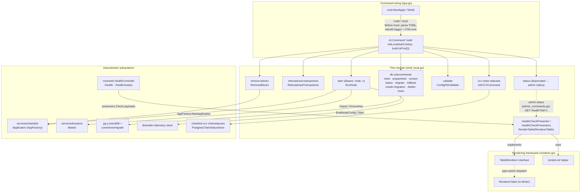
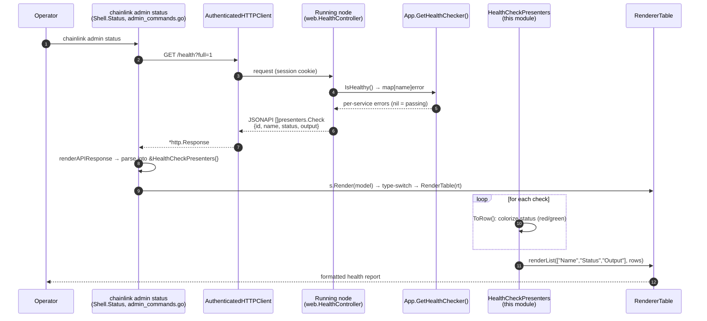
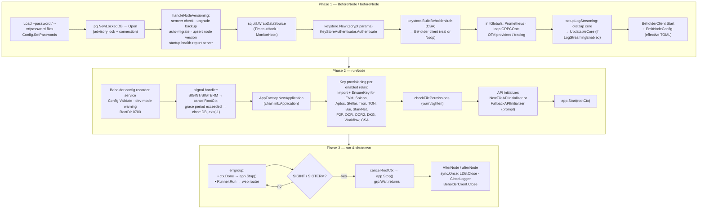
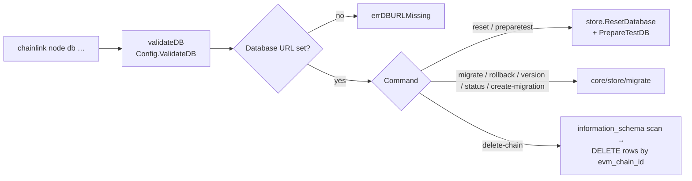

# CLI Shell — Local Commands (`shell_local.go`)

> Parent module: [CLI Commands](../cli_commands.md) · Grandparent: [Node Application, Core & Interfaces](../../Node_Application_Core___Interfaces.md)
>
> **Core component:** `HealthCheckPresenter` — `chainlink/core/cmd/shell_local.go`

## 1. Purpose and Scope

This module implements the **local (server-side) command surface** of the `chainlink` binary — the commands under `chainlink node` (alias `local`) that *must* run on the same machine as the node because they operate directly on its database, keystore files, and process lifecycle:

| Responsibility | Key entry points |
|---|---|
| Boot and run the full node application | `RunNode` / `runNode` |
| Prepare per-process resources (LockedDB, keystore, Beholder telemetry) for any local command | `BeforeNode` / `beforeNode`, `AfterNode` / `afterNode` |
| Database administration (reset, migrate, rollback, fixtures, cleanup) | `db` subcommand family, `validateDB` |
| Emergency operations (transaction rebroadcast, log-poller block pruning) | `RebroadcastTransactions`, `RemoveBlocks` |
| Configuration validation | `ConfigFileValidate` |
| CCV (Cross-Chain Verification) chain-status management | `initCCVCommand` |
| Health-check result presentation (the module's core component) | `HealthCheckPresenter`, `HealthCheckPresenters.RenderTable` |

Unlike the [remote resource commands](cli_commands_remote_resources.md), which are thin authenticated HTTP clients of a *running* node, every command here instantiates or manipulates node state directly.

## 2. Architecture Overview

### 2.1 Component map



### 2.2 The `safe` flag and build modes

`initLocalSubCmds(s *Shell, safe bool)` receives `build.IsProd()` from the `node` command registration in `chainlink/core/cmd/app.go` (`Subcommands: initLocalSubCmds(s, build.IsProd())`). Destructive commands (`db reset`, `db preparetest`, `db create-migration`, `db delete-chain`) are marked `Hidden: safe` — they are **hidden in production builds** and only exposed in dev builds. This is controlled by the build tooling in [`chainlink/GNUmakefile`](../../Build,_CI___Release_Infrastructure/chainlink_build_and_tooling.md): `CL_IS_PROD_BUILD ?= true` for default builds, while the `install-chainlink-dev` target compiles with `go install -tags dev`, flipping `build.IsProd()` to `false`. Legacy deprecation warnings also live here: the old `node status` and `node profile` commands are hidden and redirect operators to `admin status` / `admin profile`.

## 3. Core Component: `HealthCheckPresenter`

### 3.1 Structure

```go
type HealthCheckPresenter struct {
    webPresenters.Check   // Name, Status, Output (+ embedded JAID.ID)
}

func (p *HealthCheckPresenter) ToRow() []string

type HealthCheckPresenters []HealthCheckPresenter

func (ps HealthCheckPresenters) RenderTable(rt RendererTable) error  // implements cmd.TableRenderer
```

- It embeds [`webPresenters.Check`](../web_api.md) (`chainlink/core/web/presenters/check.go`): the JSONAPI resource emitted by the node's health endpoints, carrying `Name`, `Status` (`web.HealthStatusPassing = "passing"` / `web.HealthStatusFailing = "failing"`, defined in `chainlink/core/web/health_controller.go`) and an `Output` message (the failing check's error string).
- `ToRow()` colorizes the status with `fatih/color` — **red** for `failing`, **green** for `passing` — and returns the `Name / Status / Output` triple. Unknown statuses are rendered uncolored, making the presenter forward-compatible with new health states.
- `HealthCheckPresenters.RenderTable` implements the [`TableRenderer`](cli_commands_renderer.md) contract and renders via the shared `renderList` helper (`renderer.go`) with headers `Name, Status, Output`. Dispatch happens through the `RendererTable.Render` type-switch `case TableRenderer`, so the global `--json` flag (which swaps the Shell's `Renderer` for `RendererJSON`) automatically yields JSON instead.

### 3.2 Data flow: node health report → terminal



The same presenter type is deserialization *and* rendering target: because it embeds the JSONAPI-tagged `Check` resource plus `JAID`, `web.ParsePaginatedResponse` can unmarshal directly into `HealthCheckPresenters{}` before any rendering occurs — no intermediate DTO. The (hidden, deprecated) local `node status` command in this file invokes the very same `s.Status` implementation but prints a deprecation warning first, steering operators to `admin status`.

## 4. Node Startup Lifecycle (`RunNode`)

`chainlink node start` is the module's most complex command. It is a three-phase pipeline — **prepare (`BeforeNode`) → boot (`runNode`) → run & shut down**:



Key behaviors worth noting:

- **Idempotent key provisioning.** Each enabled chain family (gated by `GeneralConfig`, see [core config](../core_config.md)) gets `Import` for keys listed in config (tolerating `keystore.ErrKeyExists`) followed by `EnsureKey` for auto-creation. OCR2 keys are ensured only for the *enabled* relay set (EVM, Solana, StarkNet, Aptos, Tron, TON, Sui, Stellar). See the [keystore module](../../Node_Platform_Services/keystore.md).
- **Admin auth always local.** Unlike remote sessions ([sessions & auth](../sessions_auth.md)), startup initializes `app.BasicAdminUsersORM()` and seeds the API user from the `--api` credentials file, falling back to the interactive `FallbackAPIInitializer`.
- **Bounded shutdown.** `shutdown.HandleShutdown` cancels `rootCtx`; if the configured `ShutdownGracePeriod` elapses before `app.Stop()` completes, the shutdown handler explicitly closes the LockedDB (releasing file locks) and calls `os.Exit(-1)`, because deferred functions do not run after `os.Exit`. Graceful shutdown duration is logged via `static.InitTime`/timestamp.
- **Telemetry wiring.** `EmitNodeConfig` publishes the effective (defaults-applied) TOML through a `custmsg.Labeler` labelled with `system=Application`, version, and commit — a Beholder `pb.BaseMessage`. Details in [Beholder telemetry](../../Telemetry___Observability_Platform/beholder-telemetry.md). The application itself is documented in [node application lifecycle](../node_application/node_application_lifecycle.md).

## 5. Database Administration Commands

All `db` subcommands run `Before: s.validateDB` (which invokes `Config.ValidateDB`) and resolve the database URL from `CL_DATABASE_URL` or the secrets TOML (`Database.URL`), failing with `errDBURLMissing` when unset. Underlying persistence primitives are documented in [database persistence](../../Node_Platform_Services/database_persistence.md).

| Command | Implementation | Safety semantics |
|---|---|---|
| `db reset` | `store.ResetDatabase` (drop/create/migrate) | Refuses databases not suffixed `_test` unless `--dangerWillRobinson`; uses `DROP DATABASE … WITH (FORCE)` (PostgreSQL 13+) |
| `db preparetest` | `db reset` + `store.PrepareTestDB` fixtures | `--user-only` loads only the test-user fixture |
| `db migrate` | `migrate.SetMigrationENVVars(EVMConfigs)` → `migrate.Migrate` | Applies pending migrations |
| `db rollback` | `migrate.Rollback` | Optional version argument; one migration if omitted |
| `db version` / `db status` | `migrate.Current` / `migrate.Status` | Read-only |
| `db create-migration` | `migrate.Create` | Generates `.sql` (default) or `.go` migration files |
| `db delete-chain` | dynamic `DELETE … WHERE evm_chain_id = $1` against every table discovered via `information_schema` | EVM-only (`--type`); refuses non-`_test` databases without `--danger` |



## 6. Operational Commands

### 6.1 `rebroadcast-transactions`

Emergency recovery for a stuck EVM transaction queue. The flow:

1. Validate config and construct an `Application` via `AppFactory`.
2. Fetch the legacy EVM chain service: `app.GetRelayers().LegacyEVMChains().Get(chainID)` and assert it to `legacyevm.Chain` — rebroadcast is **not available in loop (plugin-process) mode** (marked with a `//nolint:staticcheck` and TODO BCF-2511 for a chain-agnostic design; relay architecture in [node application relay](../node_application/node_application_relay.md)).
3. Dial the EVM client, unlock the keystore, and verify the signer address is enabled for the chain (`keyStore.Eth().CheckEnabled`).
4. Assemble the `txmgr` stack — `TxStore`, `EvmTxAttemptBuilder`, `EvmTxmFeeConfig`, `StuckTxDetector`, `EVMTxmMetrics`, `EvmConfirmer` — and call `ec.ForceRebroadcast(ctx, nonces, gas.EvmFee{GasPrice}, address, overrideGasLimit)` for the inclusive nonce range.
5. Reject gas prices exceeding `math.MaxInt64` (overflow guard).

### 6.2 `remove-blocks`

Prunes log-poller data: requires `--start` (positive) and `--evm-chain-id`, validates config, builds an `Application`, and delegates to `app.DeleteLogPollerDataAfter(ctx, chainID, start)`. Signal handling closes the DB and releases the lock via `afterNode`.

### 6.3 `ccv chain-statuses`

`initCCVCommand` builds a `ccv` → `chain-statuses` command tree from the external `chainlink-ccv/verifier` module (`chainstatuses.InitCCVChainStatusesCommandsWithFactory`). The factory injects:

- a `ccvLoggerAdapter` that augments the shell logger with an `Errorw` method the CCV library expects, and
- a `chainstatus.NewPostgresChainStatusStore` backed by the shell's `DataSource` (`s.DS`, set up by `BeforeNode`).

Commands list/enable/disable chain statuses and set finalized block heights; the usage text warns that the node must be shut down first since changes take effect on next start. Related configuration in [core config CCV](../core_config/core_config_ccv.md).

### 6.4 `validate`

`ConfigFileValidate` pretty-prints the merged, defaults-applied configuration (`Config.LogConfiguration`), then runs `Config.Validate` through `configExitErr` (pretty-prints `Invalid configuration: …` and exits non-zero). This is the supported replacement for the deprecated remote `config validate`.

## 7. Security Posture

The module enforces several defensive measures on every startup or privileged local command:

1. **Directory permissions** — `utils.EnsureDirAndMaxPerms(RootDir, 0700)` before boot.
2. **TLS directory hardening** — `checkFilePermissions` walks `<root>/tls` and demotes any file exceeding the `ownerPermsMask` (`0o700`).
3. **Protected files** — `secret`, `cookie`, `.password`, `.env`, `.api` under the root dir are permission-tightened and checked for chainlink-user ownership (`utils.IsFileOwnedByChainlink`); non-owned files log a warning that will become mandatory.
4. **Destructive-command gating** — the `safe` build flag and `_test`-suffix / `--danger*` guards described in §2.2 and §5.
5. **Dev-mode disclosure** — `build.IsDev()` prints a prominent warning that the node must not run in production.

## 8. Dependencies and Related Modules

| Dependency | Relationship | Documentation |
|---|---|---|
| `cmd/renderer.go` | `HealthCheckPresenters` implements `TableRenderer` and uses `renderList`; `RendererTable`/`RendererJSON` chosen by the global `--json` flag | [CLI rendering framework](cli_commands_renderer.md) |
| `cmd/admin_commands.go`, `shell_remote.go` | Consumers: `admin status` / `health` fetch node health over authenticated HTTP and render through this module's presenter | [CLI remote resource commands](cli_commands_remote_resources.md), [CLI commands overview](../cli_commands.md) |
| `core/web` | Source of `presenters.Check` and the `passing`/`failing` status constants; the JSONAPI health contract | [Web API](../web_api.md) |
| `services/chainlink.Application` | Created by `RunNode`, `RebroadcastTransactions`, `RemoveBlocks` via `AppFactory` | [Node application](../node_application.md), [lifecycle](../node_application/node_application_lifecycle.md) |
| `GeneralConfig` | Gates every key-provisioning branch and validation path | [Core config](../core_config.md) |
| Keystore & `pg.LockedDB` / migrations | Initialized in `beforeNode`; all key ensure/import and `db` operations flow through them | [Keystore](../../Node_Platform_Services/keystore.md), [Database persistence](../../Node_Platform_Services/database_persistence.md) |
| Beholder / OTel | Config emission, log streaming core, global providers | [Beholder telemetry](../../Telemetry___Observability_Platform/beholder-telemetry.md) |

## 9. Extending the Module

1. **New local command** — add it to `initLocalSubCmds`; use `Before: s.BeforeNode` / `After: s.AfterNode` when it needs DB, keystore, or telemetry access, and route errors through `s.errorOut` for consistent exit codes. Destructive commands must be gated with `Hidden: safe` plus explicit runtime confirmation flags.
2. **New renderable output** — implement `TableRenderer` (`RenderTable`) on a presenter pair (single + slice) and reuse `renderList`; do not extend the legacy `RendererTable.Render` type-switch (see [rendering framework](cli_commands_renderer.md)).
3. **New chain family in startup** — the key-provisioning block in `runNode` follows a fixed pattern: read imported keys from `GeneralConfig`, `Import` (tolerate `ErrKeyExists`), then `EnsureKey`. Extend `keystore.Master` and the config tree together (see [keystore](../../Node_Platform_Services/keystore.md)).
