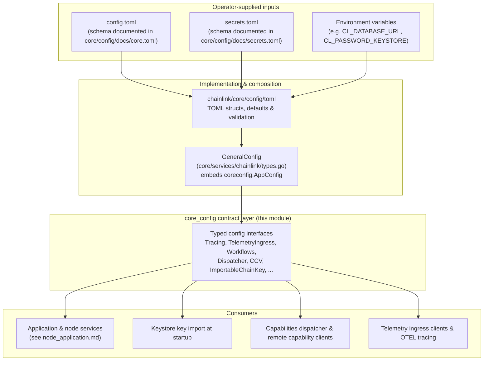
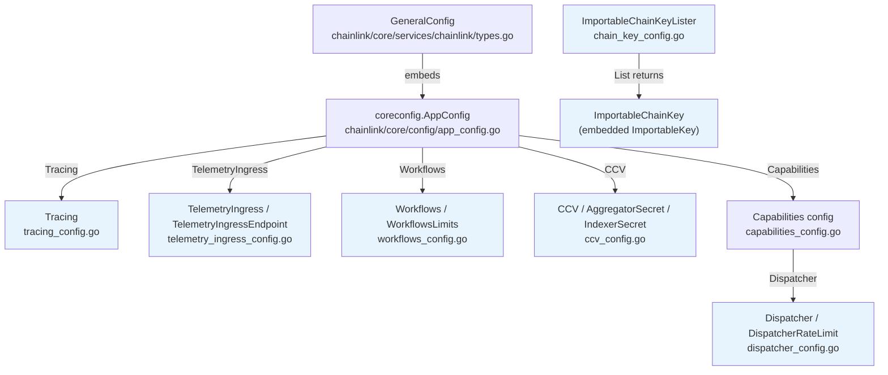
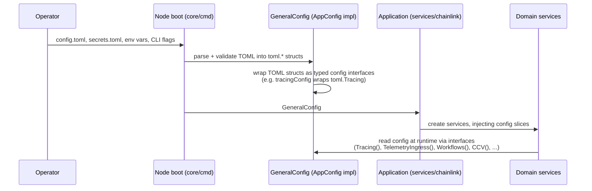

# core_config

## Overview

The `core_config` module (`chainlink/core/config` package) is the **typed configuration contract** of the Chainlink node. It is a pure interface layer: instead of passing raw TOML structs around, the codebase passes small, immutable Go interfaces — one per configuration domain. This decouples every service from the parsing/serialization details of the TOML files and makes configuration trivially mockable in tests.

This page documents the six domain configuration files that make up the module's core:

| File | Interfaces | Configuration domain | Access path |
|---|---|---|---|
| `tracing_config.go` | `Tracing` | OpenTelemetry distributed tracing | `AppConfig.Tracing()` |
| `telemetry_ingress_config.go` | `TelemetryIngress`, `TelemetryIngressEndpoint` | Outbound telemetry pipelines to ingress servers | `AppConfig.TelemetryIngress()` |
| `workflows_config.go` | `Workflows`, `WorkflowsLimits` | Workflow registration limits | `AppConfig.Workflows()` |
| `dispatcher_config.go` | `Dispatcher`, `DispatcherRateLimit` | Capabilities dispatcher buffering & rate limiting | `AppConfig.Capabilities().Dispatcher()` |
| `ccv_config.go` | `CCV`, `AggregatorSecret`, `IndexerSecret` | Cross-Chain Verification (CCV) API secrets | `AppConfig.CCV()` |
| `chain_key_config.go` | `ImportableChainKey`, `ImportableKey`, `ImportableChainKeyLister` | Chain keys to be imported into the keystore at startup | Standalone lister consumed during node boot |

> **Note:** The `chainlink/core/config` package contains many more domain config files (Database, Log, OCR2, P2P, WebServer, Capabilities, ...). Those are all siblings composed by the same `AppConfig` interface (`chainlink/core/config/app_config.go::AppConfig`); this wiki page focuses on the six domains listed above. The overall node wiring that *consumes* this configuration is described in [node_application.md](node_application.md).

## Role in the overall architecture

The module sits at the boundary between **operator-supplied configuration** (TOML files, environment variables) and the **running node services**. The reference implementation of every interface in this module is produced by the TOML binding layer (`chainlink/core/config/toml`, see `chainlink/core/config/toml/types.go`) and wrapped by adapters in `chainlink/core/services/chainlink` (e.g., `tracingConfig` wraps a `toml.Tracing` value, see `chainlink/core/services/chainlink/config_tracing.go::tracingConfig`). All of these are then aggregated into a single `GeneralConfig` value (`chainlink/core/services/chainlink/types.go::GeneralConfig`), which embeds `coreconfig.AppConfig` and is handed to the node `Application` (`chainlink/core/services/chainlink/application.go::Application`).

The composition is strictly hierarchical — `AppConfig` is the root, and each domain accessor returns one of this module's interfaces:

Because `GeneralConfig` embeds `AppConfig`, every service created by the node's `Application` receives read-only access to these configuration domains without any direct dependency on the TOML layer.

## Sub-module documentation

The module is organized into five functional sub-modules. Detailed documentation for each, including component responsibilities, TOML mapping, defaults and consumers, is available here:

| Sub-module | Components | Documentation |
|---|---|---|
| **Observability** | `Tracing`, `TelemetryIngress`, `TelemetryIngressEndpoint` | [core_config_observability.md](core_config/core_config_observability.md) |
| **Capabilities dispatcher** | `Dispatcher`, `DispatcherRateLimit` | [core_config_dispatcher.md](core_config/core_config_dispatcher.md) |
| **Workflows limits** | `Workflows`, `WorkflowsLimits` | [core_config_workflows.md](core_config/core_config_workflows.md) |
| **CCV secrets** | `CCV`, `AggregatorSecret`, `IndexerSecret` | [core_config_ccv.md](core_config/core_config_ccv.md) |
| **Importable chain keys** | `ImportableChainKey`, `ImportableKey`, `ImportableChainKeyLister` | [core_config_chain_keys.md](core_config/core_config_chain_keys.md) |

### Observability (tracing & telemetry ingress)

Defines *where* and *how* the node exports diagnostic data: `Tracing` configures the OpenTelemetry span collector (enabled flag, collector target such as `localhost:4317`, node identity, sampling ratio, TLS mode and user-defined trace attributes), while `TelemetryIngress` configures the buffering, batching and endpoints used to push telemetry messages to remote ingress servers (including optional CHIP Ingress support).

### Capabilities dispatcher

`Dispatcher` tunes the capabilities subsystem's message dispatch — the receive buffer size (`ReceiverBufferSize`, default `10000`) and a token-bucket rate limiter (`DispatcherRateLimit`: global and per-sender RPS plus burst sizes). These settings protect the node from being overwhelmed by DON-to-DON capability messages.

### Workflows limits

`Workflows` exposes `WorkflowsLimits`: a global cap (default `200`), a per-owner cap (default `200`), and a per-owner override map. These limits bound how many workflows can be registered on the node.

### CCV secrets

`CCV` exposes credentials for the Cross-Chain Verification subsystem: a list of `AggregatorSecret` (verifier ID + API key/secret) and an `IndexerSecret` (API key/secret). These authenticate the node against external CCV aggregator and indexer services.

### Importable chain keys

`ImportableChainKey` describes a chain key (per-chain details from `chain-selectors`, an encrypted JSON key blob, and its password) that the node imports into its keystore during startup, via the `ImportableChainKeyLister.List()` accessor.

## Configuration data flow

Key properties of this flow:

1. **Validation happens once, at boot.** `AppConfig.Validate()` / `ValidateDB()` surface misconfiguration before any service starts; deprecated options are reported as errors by the shared validation helpers (see `chainlink/core/utils/config/validate.go::DeprecatedError` in [core_shared_utilities.md](core_shared_utilities.md)).
2. **Secrets are separated.** Credential-bearing values (keystore/VRF passwords, CCV secrets) live in `secrets.toml`/environment variables and are merged into the same typed interfaces at runtime.
3. **Configuration is read-only at runtime.** Services only see accessor methods; dynamic re-configuration is limited to explicit setters on `AppConfig` (`SetLogLevel`, `SetLogSQL`, `SetPasswords`).
4. **Documentation of the TOML surface is generated.** The operator-facing keys and defaults for these domains are maintained in `chainlink/core/config/docs/core.toml` and `chainlink/core/config/docs/secrets.toml` (e.g. `[Tracing]`, `[TelemetryIngress]`, `[Workflows.Limits]`, `[Capabilities.Dispatcher]`).

## Interaction with other modules

- **Node application & lifecycle** — `GeneralConfig` and the `Application` that consumes it are documented in [node_application.md](node_application.md); the config composition itself in [node_application_config.md](node_application/node_application_config.md).
- **Telemetry & observability platform** — the runtime implementations of the telemetry ingress clients (including the noop fallbacks) live in the telemetry platform; see [telemetry_ingress.md](../Telemetry___Observability_Platform/telemetry_ingress.md).
- **Keystore** — importable chain keys are materialized into the node keystore at startup; see [keystore.md](../Node_Platform_Services/keystore.md).
- **Workflows / CRE engine** — the workflow limits defined here bound the workflow registry and syncer described in [workflows.md](../Workflow___Capability_Runtime_(CRE_Engine)/workflows.md).
- **Capabilities runtime** — the dispatcher settings govern the remote capability message pipeline described in [core_capabilities_runtime.md](../Workflow___Capability_Runtime_(CRE_Engine)/core_capabilities_runtime.md).

## References

- Package: `chainlink/core/config`
- Root interface: `chainlink/core/config/app_config.go::AppConfig`
- Composition point: `chainlink/core/services/chainlink/types.go::GeneralConfig`
- TOML struct definitions: `chainlink/core/config/toml/types.go`
- Operator-facing TOML docs with defaults: `chainlink/core/config/docs/core.toml`, `chainlink/core/config/docs/secrets.toml`
- Test mocks for the telemetry interfaces: `chainlink/core/config/mocks/`
