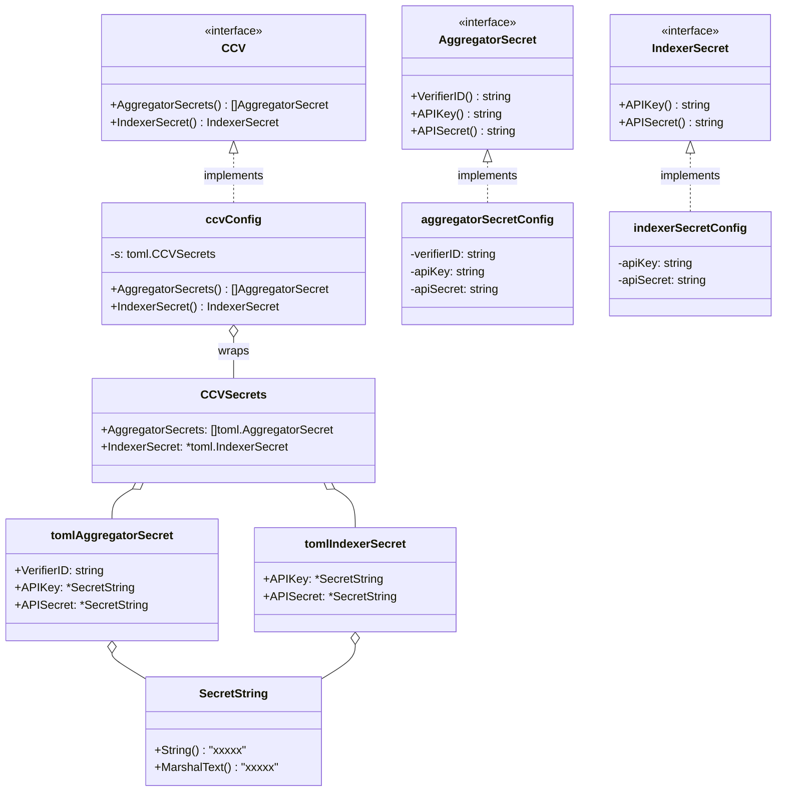
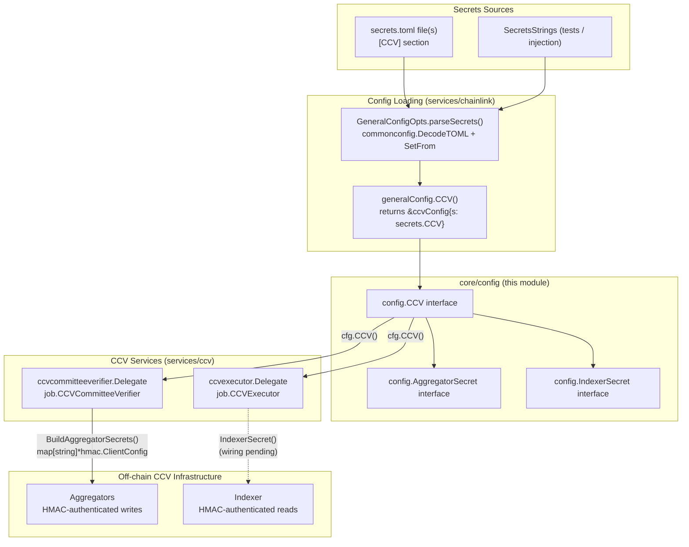
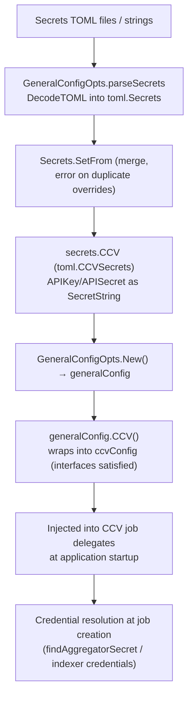
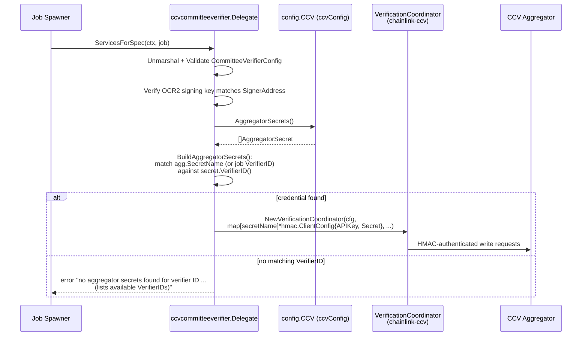

# CCV Configuration (core_config_ccv)

## Introduction

The `core_config_ccv` module defines the **interface contract for CCV (Cross-Chain Verification) secret configuration** in the Chainlink node. CCV is the cross-chain verification layer used by the CCIP ecosystem: **committee verifier** nodes attest to cross-chain messages, and **executor** nodes execute verified messages. Both roles authenticate to off-chain infrastructure — *aggregators* (writes, from verifiers) and the *indexer* (reads, from executors) — using HMAC credentials.

This module lives in `chainlink/core/config/ccv_config.go` and is deliberately minimal: it declares three interfaces (`CCV`, `AggregatorSecret`, `IndexerSecret`) that insulate downstream services from how the credentials are stored and loaded. It is one of several secret-oriented config facets exposed by the node's configuration system; see the parent page [core_config](../core_config.md) for the overall config package architecture, and [node_application_config](../node_application/node_application_config.md) for how `GeneralConfig` aggregates these facets.

Key characteristics:

- **Secrets-only**: CCV configuration exists exclusively in the *secrets* TOML (`[CCV]` section); the regular config TOML (`config.Core` in `chainlink/core/config/toml/types.go`) has no CCV field.
- **Redacted by default**: credentials are typed as `commonconfig.SecretString`, which renders as `xxxxx` when logged, serialized, or dumped.
- **Multi-aggregator support**: an arbitrary list of aggregator credentials keyed by `VerifierID`, plus a single indexer credential.
- **Consumed by job delegates**: wired into the `CCVCommitteeVerifier` and `CCVExecutor` job types during node application startup (see [node_application_lifecycle](../node_application/node_application_lifecycle.md)).

---

## Source Components

| Component | Location | Role |
|---|---|---|
| `CCV` (interface) | `chainlink/core/config/ccv_config.go` | Top-level accessor for CCV secrets |
| `AggregatorSecret` (interface) | `chainlink/core/config/ccv_config.go` | One aggregator's HMAC credential |
| `IndexerSecret` (interface) | `chainlink/core/config/ccv_config.go` | The indexer's HMAC credential |
| `ccvConfig`, `aggregatorSecretConfig`, `indexerSecretConfig` | `chainlink/core/services/chainlink/config_ccv.go` | Concrete implementations wrapping parsed TOML secrets |
| `CCVSecrets`, `AggregatorSecret`, `IndexerSecret` (TOML structs) | `chainlink/core/config/toml/types.go` | TOML schema for the `[CCV]` secrets section |
| `ccvcommitteeverifier.Delegate` | `chainlink/core/services/ccv/ccvcommitteeverifier/delegate.go` | Consumer: builds aggregator HMAC configs for the verification coordinator |
| `ccvexecutor.Delegate` | `chainlink/core/services/ccv/ccvexecutor/delegate.go` | Consumer: holds indexer credential (consumption pending, see [Known limitations](#known-limitations)) |

---

## Interface Reference

The full contract, as defined in `chainlink/core/config/ccv_config.go`:

```go
type CCV interface {
    AggregatorSecrets() []AggregatorSecret
    IndexerSecret() IndexerSecret
}

type AggregatorSecret interface {
    VerifierID() string
    APIKey() string
    APISecret() string
}

type IndexerSecret interface {
    APIKey() string
    APISecret() string
}
```

| Interface | Method | Description |
|---|---|---|
| `CCV` | `AggregatorSecrets()` | Returns all configured aggregator credentials. Each verifier job can authenticate against multiple aggregators. |
| `CCV` | `IndexerSecret()` | Returns the single credential used to authenticate the node to the CCV indexer. |
| `AggregatorSecret` | `VerifierID()` | Identifier of the verifier this credential belongs to. Acts as the **lookup key** when resolving credentials for a job. |
| `AggregatorSecret` | `APIKey()` / `APISecret()` | HMAC key pair used to authenticate the node to the CCV aggregator. |
| `IndexerSecret` | `APIKey()` / `APISecret()` | HMAC key pair used to authenticate the node to the CCV indexer. |

> **Note:** unlike most config facets that return nested sub-configs, the accessors here return **plain `string` values**. The redaction guarantee applies at the TOML layer (`SecretString`); once a consumer retrieves the values through this interface, it is responsible for handling them as sensitive data.

---

## TOML Configuration

### Schema

Defined in `chainlink/core/config/toml/types.go` and embedded in the root `Secrets` struct as `CCV CCVSecrets`:

```go
type CCVSecrets struct {
    AggregatorSecrets []AggregatorSecret `toml:",omitempty"`
    IndexerSecret     *IndexerSecret     `toml:",omitempty"`
}

type AggregatorSecret struct {
    // VerifierID is the ID of the verifier that this secret belongs to.
    VerifierID string `toml:",omitempty"`
    // APIKey / APISecret authenticate the node to the CCV aggregator.
    APIKey    *commonconfig.SecretString `toml:",omitempty"`
    APISecret *commonconfig.SecretString `toml:",omitempty"`
}

type IndexerSecret struct {
    // APIKey / APISecret authenticate the node to the CCV indexer.
    APIKey    *commonconfig.SecretString `toml:",omitempty"`
    APISecret *commonconfig.SecretString `toml:",omitempty"`
}
```

### Example (secrets TOML)

The following is the canonical shape exercised by the unit test `chainlink/core/services/chainlink/config_ccv_test.go`:

```toml
[[CCV.AggregatorSecrets]]
VerifierID = "default-verifier-1"
APIKey = "default-api-key"
APISecret = "default-api-secret"

[[CCV.AggregatorSecrets]]
VerifierID = "secondary-verifier-1"
APIKey = "secondary-api-key"
APISecret = "secondary-api-secret"

[CCV.IndexerSecret]
APIKey = "indexer-api-key"
APISecret = "indexer-api-secret"
```

- `[[CCV.AggregatorSecrets]]` is a TOML **array of tables** — declare one block per verifier/aggregator credential.
- `[CCV.IndexerSecret]` is a single table (at most one indexer credential).
- All values belong in the **secrets file** (loaded via `GeneralConfigOpts.Setup(configFiles, secretsFiles)`), never in the regular config file.

> At the time of writing, the auto-generated reference in `chainlink/core/config/docs/secrets.toml` does not yet document the `[CCV]` section; the table above is authoritative.

---

## Architecture

### Class view



### Component & consumer view



---

## Configuration Loading Flow

The CCV section flows through the standard secrets pipeline of the node's configuration system:



Implementation notes:

1. **Parsing** — `GeneralConfigOpts.parseSecrets` decodes each secrets TOML string into a `toml.Secrets` and merges it via `SetFrom`, which *errors* on conflicting duplicate values (unlike the config TOML, which silently overrides). This protects against accidentally shadowing aggregator credentials.
2. **Wrapping** — `generalConfig.CCV()` (in `chainlink/core/services/chainlink/config_general.go`) returns `&ccvConfig{s: g.secrets.CCV}`. The implementation converts each `*commonconfig.SecretString` to a plain `string` lazily, when `AggregatorSecrets()` / `IndexerSecret()` are called.
3. **Redaction** — because the raw TOML values are `commonconfig.SecretString`, the auto-logged `secretsTOML` output (see `generalConfig.LogConfiguration`) and any effective-config dumps render CCV credentials as `xxxxx` (see `chainlink-common/pkg/config/secret.go`). `VerifierID` is a plain string and is **not** redacted, since it is an identifier, not a secret.

---

## Runtime Behavior & Component Interaction

### Credential resolution in the committee verifier

The primary consumer is `ccvcommitteeverifier.Delegate` (`job.CCVCommitteeVerifier`). When the job spawner creates services for a CCV committee verifier job, the delegate resolves the aggregator credentials for the job's aggregators and hands them to the verification coordinator:



The matching semantics, from `BuildAggregatorSecrets` / `findAggregatorSecret` in `ccvcommitteeverifier/delegate.go`:

- Each aggregator in the decoded job config carries a `SecretName`.
- The credential is found in the secrets TOML by matching the `SecretName` against the entry's `VerifierID`.
- **Legacy single-aggregator configs** have an empty `SecretName`; in that case the job's `VerifierID` is used as the lookup key and the credential is stored under the `""` map key.
- A missing credential is a hard error at job creation; the error enumerates all configured `VerifierID`s to aid diagnosis.

### Indexer credential (executor)

`ccvexecutor.Delegate` (`job.CCVExecutor`) receives `cfg.CCV()` at construction and holds it with the comment *"Houses secrets that are needed by the executor (e.g. indexer API keys)"*. The delegate is intended to supply `[CCV.IndexerSecret]` credentials to the executor coordinator; wiring is still pending (a `TODO: pass secrets as a separate param in the constructor` note marks the spot in `ccvexecutor/delegate.go`).

### Application wiring

Both delegates are registered in the node application constructor (`chainlink/core/services/chainlink/application.go`), which passes `cfg.CCV()` — the interface defined by this module — alongside keystores and chain services:

```go
job.CCVCommitteeVerifier: ccvcommitteeverifier.NewDelegate(
    globalLogger, opts.DS,
    cfg.CCV(),                    // ← this module's interface
    keyStore.OCR2(),
    relayChainInterops.LegacyEVMChains().Slice(),
),
job.CCVExecutor: ccvexecutor.NewDelegate(
    globalLogger,
    cfg.CCV(),                    // ← this module's interface
    keyStore.Eth(),
    relayChainInterops.LegacyEVMChains().Slice(),
),
```

For the surrounding startup sequence and service lifecycle, see [node_application_lifecycle](../node_application/node_application_lifecycle.md). For how this fits among the other config facets, see [core_config](../core_config.md); sibling facets such as [core_config_dispatcher](core_config_dispatcher.md), [core_config_observability](core_config_observability.md), and [core_config_workflows](core_config_workflows.md) follow the same interface/implementation split.

---

## Known Limitations

- **Indexer secret not yet consumed**: `ccvexecutor.Delegate` holds the CCV config, but the executor coordinator does not yet receive the indexer credentials (explicit `TODO` in the code). The `[CCV.IndexerSecret]` section is parsed and validated today, but its operational effect is deferred.
- **Undocumented in generated config docs**: the `[CCV]` section is not yet present in `chainlink/core/config/docs/secrets.toml` (the canonical, operator-facing secrets reference); treat the schema in this page as the source of truth.
- **No env-var overrides documented for CCV**: unlike `[Database.URL]` (`CL_DATABASE_URL`) or `[Pyroscope.AuthToken]` (`CL_PYROSCOPE_AUTH_TOKEN`), no dedicated `CL_...` environment variable exists for the CCV section; supply credentials via the secrets file.
- **Plain-string exposure after retrieval**: the interface returns raw strings, so consumers (and test harnesses) must avoid logging them.

---

## Testing

`chainlink/core/services/chainlink/config_ccv_test.go` (`TestCCVConfig`) is the behavioral specification for this module. It:

1. Feeds a two-entry `[[CCV.AggregatorSecrets]]` list plus a `[CCV.IndexerSecret]` block through `GeneralConfigOpts{SecretsStrings: ...}`.
2. Asserts that `cfg.CCV().AggregatorSecrets()` returns both entries with exact `VerifierID` / `APIKey` / `APISecret` values, in declaration order.
3. Asserts `cfg.CCV().IndexerSecret()` exposes the indexer key pair.

This confirms the end-to-end path (TOML → `toml.CCVSecrets` → `ccvConfig` → interfaces) without any environment lookups.

---

## Related Documentation

- [core_config](../core_config.md) — overview of the node's config package and the facade pattern used by all config facets.
- [node_application_config](../node_application/node_application_config.md) — `GeneralConfig` and the TOML/secrets parsing pipeline that produces the `CCV()` accessor.
- [node_application_lifecycle](../node_application/node_application_lifecycle.md) — where the CCV delegates are registered during application startup.
- [core_config_chain_keys](core_config_chain_keys.md) — the sibling secrets facet for importable chain keys, using the same `Secrets` TOML.
- [CCIP_Cross-Chain_Protocol](../../CCIP_Cross-Chain_Protocol.md) — the cross-chain protocol ecosystem that CCV verifies and executes.
