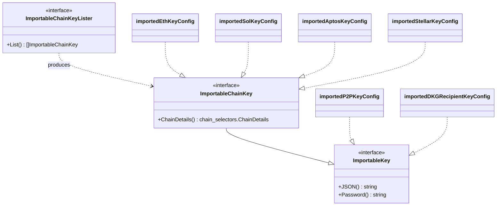
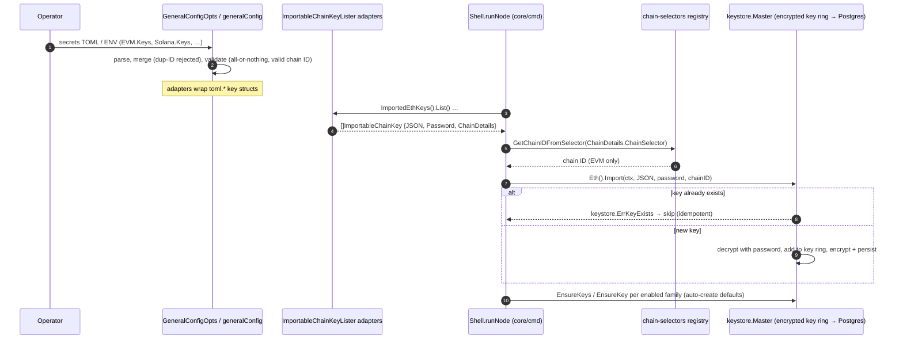

# Core Config — Chain Keys (`core_config_chain_keys`)

> **Module root:** `chainlink/core/config/chain_key_config.go`
> **Core component:** [`config.ImportableChainKey`](../../repo/chainlink/core/config/chain_key_config.go)
> **Parent:** [core_config](../core_config.md) · **Grandparent:** [Node Application Core & Interfaces](../../Node_Application_Core___Interfaces.md)

## 1. Introduction

`core_config_chain_keys` defines the **configuration-side contract for chain signing keys provisioned out-of-band** (via the secrets TOML file or environment variables) rather than created through the node API or CLI.

At node startup, a Chainlink node must have signing keys available in its encrypted keystore. Operators can either:

1. Create keys via the `keys` CLI commands or the Web API and let the node auto-create defaults (`EnsureKey`), or
2. **Pre-provision keys** (e.g., generated externally, managed by IaC/KMS workflows) and hand them to the node through the secrets TOML.

Option 2 is enabled by this module: a tiny, dependency-free interface layer in `core/config` that lets the configuration layer *describe* importable keys — **the key JSON blob, its decryption password, and the chain it belongs to** — without `core/config` importing any concrete key implementation (EVM, Solana, Aptos, Stellar, …). The node's startup path consumes these abstractions and imports the keys into the [`keystore.Master`](../../Node_Platform_Services/keystore.md) encrypted key ring.

This is a classic dependency-inversion seam: the config package owns the interface, chain-specific packages own the implementations.

---

## 2. Core Components

Source: [`chainlink/core/config/chain_key_config.go`](../../repo/chainlink/core/config/chain_key_config.go)

### 2.1 `ImportableKey`

The chain-agnostic base contract for any key material that can be imported into a keystore:

| Method | Returns | Purpose |
|---|---|---|
| `JSON() string` | `string` | The serialized key payload. Must be a valid JSON string conforming to the particular key format (e.g., a Go-ethereum `v3` keystore blob for EVM, a Solana JSON keypair, …). |
| `Password() string` | `string` | The password used to encrypt the key payload; required by the keystore to decrypt/adopt the key. |

Implementations (all in [`core/services/chainlink`](../../repo/chainlink/core/services/chainlink)):

| Implementation | Wraps | Used for |
|---|---|---|
| `importedP2PKeyConfig` | `toml.P2PKey` | P2P peer identity key ([view](../../repo/chainlink/core/services/chainlink/config_imported_p2p_key.go)) |
| `importedDKGRecipientKeyConfig` | `toml.DKGRecipientKey` | CRE DKG recipient key ([view](../../repo/chainlink/core/services/chainlink/config_imported_dkg_participant_key.go)) |

### 2.2 `ImportableChainKey`

Extends `ImportableKey` with chain identity:

| Method | Returns | Purpose |
|---|---|---|
| `ChainDetails()` | `chain_selectors.ChainDetails` | The chain details (chain selector + chain name) this key belongs to, resolved via the [`chain-selectors`](../../repo/chainlink/go.mod) registry (`github.com/smartcontractkit/chain-selectors`). |

`chain_selectors.ChainDetails` carries `{ChainSelector uint64, ChainName string}`. Because the secrets TOML stores a **chain ID** (`ID` field) — whose type varies per family — each adapter is responsible for translating that ID into universal chain-selector coordinates.

| Adapter | TOML type | ID type | Chain-details resolution |
|---|---|---|---|
| `importedEthKeyConfig` | `toml.EthKey` | `int` (EVM chain ID) | `chain_selectors.ChainByEvmChainID(uint64(id))` → `{Selector, Name}` ([view](../../repo/chainlink/core/services/chainlink/config_imported_eth_key.go)) |
| `importedSolKeyConfig` | `toml.SolKey` | `string` (Solana chain ID) | `chain_selectors.SolanaChainIdToChainSelector()[id]` → `{selector, "solana"}` ([view](../../repo/chainlink/core/services/chainlink/config_imported_sol_key.go)) |
| `importedAptosKeyConfig` | `toml.AptosKey` | `uint64` (Aptos chain ID) | `chain_selectors.GetChainDetailsByChainIDAndFamily(id, FamilyAptos)` ([view](../../repo/chainlink/core/services/chainlink/config_imported_aptos_key.go)) |
| `importedStellarKeyConfig` | `toml.StellarKey` | `string` (Stellar chain ID) | `chain_selectors.GetChainDetailsByChainIDAndFamily(id, FamilyStellar)` ([view](../../repo/chainlink/core/services/chainlink/config_imported_stellar_key.go)) |

All adapters degrade gracefully: if the `ID` is unset or unknown to the chain-selectors registry, `ChainDetails()` returns the zero-value `chain_selectors.ChainDetails{}`.

### 2.3 `ImportableChainKeyLister`

Enumeration contract used by the startup import loop:

| Method | Returns | Purpose |
|---|---|---|
| `List()` | `[]ImportableChainKey` | All keys of one chain family currently present in configuration. |

### 2.4 Interface hierarchy



---

## 3. Where the keys come from — Secrets TOML wiring

The adapters wrap types defined in [`core/config/toml/types.go`](../../repo/chainlink/core/config/toml/types.go) under the `Secrets` root (parsed from the secrets TOML file and `CL_*` env vars):

| Secrets TOML section | Go type | Chain-aware? | Notes |
|---|---|---|---|
| `[[EVM.Keys]]` | `EthKeys` / `EthKey` | ✅ | Field named `EVM` to align with relayer config convention |
| `[[Solana.Keys]]` | `SolKeys` / `SolKey` | ✅ | |
| `[[Aptos.Keys]]` | `AptosKeys` / `AptosKey` | ✅ | |
| `[[Stellar.Keys]]` | `StellarKeys` / `StellarKey` | ✅ | |
| `[P2PKey]` | `P2PKey` | ❌ (`ImportableKey`) | Single, node-global key |
| `[DKGRecipientKey]` | `DKGRecipientKey` | ❌ (`ImportableKey`) | Single, node-global key |

Every per-key entry has exactly three fields — `JSON` (`commonconfig.SecretString`), `ID` (chain ID), `Password` (`commonconfig.SecretString`) — with these semantics enforced by the TOML layer:

- **All-or-nothing**: `(JSON != nil) == (Password != nil) == (ID != nil)` — a partially specified key fails `ValidateConfig`.
- **Valid chain ID**: the `ID` is validated against the chain-selectors registry (e.g., `SolanaNameFromChainId`, `AptosChainIdToChainSelector`, `StellarNameFromChainId`).
- **Merge safety**: when multiple secrets files/env layers are merged via `SetFrom`, keys **append** and duplicate IDs raise an `OverrideError` (overrides are forbidden for secrets); a missing `ID` is deferred to validation rather than treated as a merge conflict.

The `generalConfig` implementation of [`GeneralConfig`](../../repo/chainlink/core/services/chainlink/types.go) surfaces the adapters as accessors (see [`config_general.go`](../../repo/chainlink/core/services/chainlink/config_general.go)):

```go
ImportedEthKeys()    config.ImportableChainKeyLister   // backed by secrets.EVM
ImportedSolKeys()    config.ImportableChainKeyLister   // backed by secrets.Solana
ImportedAptosKeys()  config.ImportableChainKeyLister   // backed by secrets.Aptos
ImportedStellarKeys() config.ImportableChainKeyLister  // backed by secrets.Stellar
ImportedP2PKey()     config.ImportableKey              // backed by secrets.P2PKey
ImportedDKGRecipientKey() config.ImportableKey         // backed by secrets.DKGRecipientKey
```

For how these accessors fit into the overall `AppConfig`/`GeneralConfig` structure, see [node_application_config](../node_application/node_application_config.md).

---

## 4. Where the keys go — startup import flow

The primary consumer is the node bootstrap path in [`core/cmd/shell_local.go::runNode`](../../repo/chainlink/core/cmd/shell_local.go). For each **enabled** chain family, the loop:

1. Iterates the family's `ImportableChainKeyLister.List()`.
2. For EVM, resolves the numeric chain ID back from `k.ChainDetails().ChainSelector` using `chain_selectors.GetChainIDFromSelector` (the keystore `Import` API requires a `*big.Int` chain ID for key enablement).
3. Calls the matching keystore importer: `app.GetKeyStore().Eth().Import(ctx, []byte(k.JSON()), k.Password(), cid)` (Solana/Aptos/Stellar import without a chain-ID argument).
4. Treats `keystore.ErrKeyExists` as **idempotent success** (logged at debug level) so restarts don't fail; any other error aborts startup.
5. Afterwards, ensures a default key exists per enabled family (`EnsureKeys`/`EnsureKey`), honoring `EVM.AutoCreateKey` for EVM chains.
6. Imports the chain-agnostic P2P key (`P2P().Import`) when `P2P.Enabled()` and a JSON blob is present, and the DKG recipient key when `CRE().EnableDKGRecipient()` is set — both followed by their `EnsureKey` counterparts.

Imported keys land in the **encrypted key ring** managed by [`keystore.Master`](../../repo/chainlink/core/services/keystore/master.go) — persisted to PostgreSQL via `saveEncryptedKeyRing`, encrypted under the keystore password (`Password.Keystore` secret / `CL_PASSWORD_KEYSTORE`) with configurable scrypt parameters. Details of the key ring and per-family stores are documented in [keystore](../../Node_Platform_Services/keystore.md).



### 4.1 Component interaction overview

```mermaid
flowchart LR
    subgraph core/config (this module)
        IF[ImportableKey<br/>ImportableChainKey<br/>ImportableChainKeyLister]
    end
    subgraph core/config/toml
        T[Secrets TOML types<br/>EthKeys · SolKeys · AptosKeys · StellarKeys · P2PKey · DKGRecipientKey]
    end
    subgraph core/services/chainlink
        GC[generalConfig<br/>Imported*Keys() accessors]
        AD[config_imported_*_key.go adapters]
    end
    subgraph core/cmd
        RN[runNode startup loop]
    end
    subgraph core/services/keystore
        KM[keystore.Master<br/>encrypted key ring]
    end
    SEL[(chain-selectors<br/>registry)]

    T --> AD
    AD -->|implement| IF
    GC -->|expose| AD
    GC --> RN
    IF -->|contract consumed by| RN
    AD -.resolve IDs.-> SEL
    RN -->|Import + EnsureKey| KM
```

---

## 5. Extending to a new chain family

Adding importable keys for a new chain family touches three well-delimited spots:

1. **TOML types** — add a `<Family>Keys`/`<Family>Key` pair in `core/config/toml/types.go` (JSON/ID/Password with all-or-nothing + duplicate-ID merge semantics) and wire it into `Secrets`.
2. **Adapters** — add `config_imported_<family>_key.go` in `core/services/chainlink` implementing `ImportableChainKey` + `ImportableChainKeyLister`, mapping the family's chain-ID representation to `chain_selectors.ChainDetails` (ideally via `GetChainDetailsByChainIDAndFamily`), and expose a `generalConfig.Imported<Family>Keys()` accessor.
3. **Startup loop** — extend `runNode` in `core/cmd/shell_local.go` to import the family's keys (guarded by the family's `*Enabled()` check) and call `EnsureKey`.

The `core/config` interfaces themselves **never change** — that stability is their purpose. A reference example of a chain-agnostic consumer is the P2P/DKG import path, which only ever needs `ImportableKey`.

---

## 6. Security considerations

- **Secret types**: all key JSON and passwords use `commonconfig.SecretString`, and the secrets TOML rendering (`Secrets.TOMLString()`) is redacted before logging/emission (the node config recorder and `LogConfiguration` output).
- **Encryption at rest**: imported keys are re-encrypted into the keystore's key ring; plaintext JSON/passwords are only transiently held in memory during startup import.
- **Idempotency & restarts**: `keystore.ErrKeyExists` is tolerated, making key provisioning declarative and restart-safe; conflicting duplicates *within* config are rejected at parse time instead.
- **Password strength**: the keystore password comes from `Password.Keystore` (env `CL_PASSWORD_KEYSTORE`); database-URL complexity rules and insecure-build gating are handled by the [core_config](../core_config.md) validation layer, not here.

---

## 7. Related documentation

| Area | Page | Relationship |
|---|---|---|
| Parent config family | [core_config](../core_config.md) | Sibling sub-configs: [dispatcher](core_config_dispatcher.md), [CCV](core_config_ccv.md), [observability](core_config_observability.md), [workflows](core_config_workflows.md) |
| Config structure & lifecycle | [node_application_config](../node_application/node_application_config.md) | `GeneralConfig`/`AppConfig` wiring, TOML parsing, env overrides |
| Key consumption at boot | [node_application_lifecycle](../node_application/node_application_lifecycle.md) | Where `NewApplication`/node start-up orchestration lives |
| Destination of imported keys | [keystore](../../Node_Platform_Services/keystore.md) | `keystore.Master`, encrypted key ring, per-family key stores |
| Operator-facing key management | [cli_commands](../cli_commands.md) | `keys` CLI commands (create/import/export for EVM, Solana, Aptos, Stellar, …) |

---

## 8. Source file index

| File | Contents |
|---|---|
| [`chainlink/core/config/chain_key_config.go`](../../repo/chainlink/core/config/chain_key_config.go) | The three interfaces (this module's entire surface) |
| [`chainlink/core/config/toml/types.go`](../../repo/chainlink/core/config/toml/types.go) | `Secrets`, `EthKeys`, `SolKeys`, `AptosKeys`, `StellarKeys`, `P2PKey`, `DKGRecipientKey` + validation/merge |
| [`chainlink/core/services/chainlink/config_general.go`](../../repo/chainlink/core/services/chainlink/config_general.go) | `Imported*Keys()` accessors on `generalConfig` |
| [`chainlink/core/services/chainlink/config_imported_eth_key.go`](../../repo/chainlink/core/services/chainlink/config_imported_eth_key.go) | EVM adapter (reference implementation) |
| [`chainlink/core/services/chainlink/config_imported_sol_key.go`](../../repo/chainlink/core/services/chainlink/config_imported_sol_key.go) · [`config_imported_aptos_key.go`](../../repo/chainlink/core/services/chainlink/config_imported_aptos_key.go) · [`config_imported_stellar_key.go`](../../repo/chainlink/core/services/chainlink/config_imported_stellar_key.go) | Solana / Aptos / Stellar adapters |
| [`chainlink/core/services/chainlink/config_imported_p2p_key.go`](../../repo/chainlink/core/services/chainlink/config_imported_p2p_key.go) · [`config_imported_dkg_participant_key.go`](../../repo/chainlink/core/services/chainlink/config_imported_dkg_participant_key.go) | Chain-agnostic (`ImportableKey`) adapters |
| [`chainlink/core/cmd/shell_local.go`](../../repo/chainlink/core/cmd/shell_local.go) | Startup import loop (`runNode`) |
| [`chainlink/core/services/keystore/master.go`](../../repo/chainlink/core/services/keystore/master.go) · [`keystore/eth.go`](../../repo/chainlink/core/services/keystore/eth.go) | Key ring, `Import`/`EnsureKey` implementations |
| [`chainlink/go.mod`](../../repo/chainlink/go.mod) | Pins `github.com/smartcontractkit/chain-selectors` (external registry dependency) |
