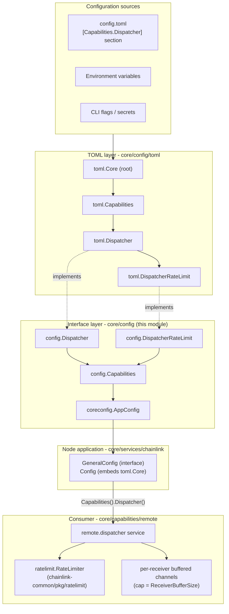
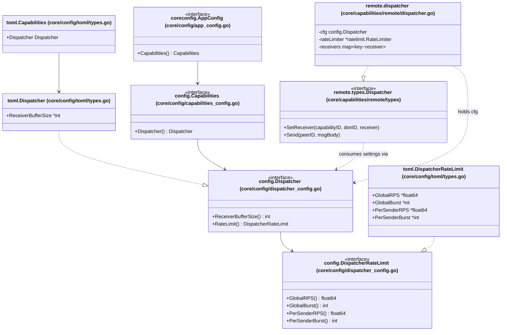
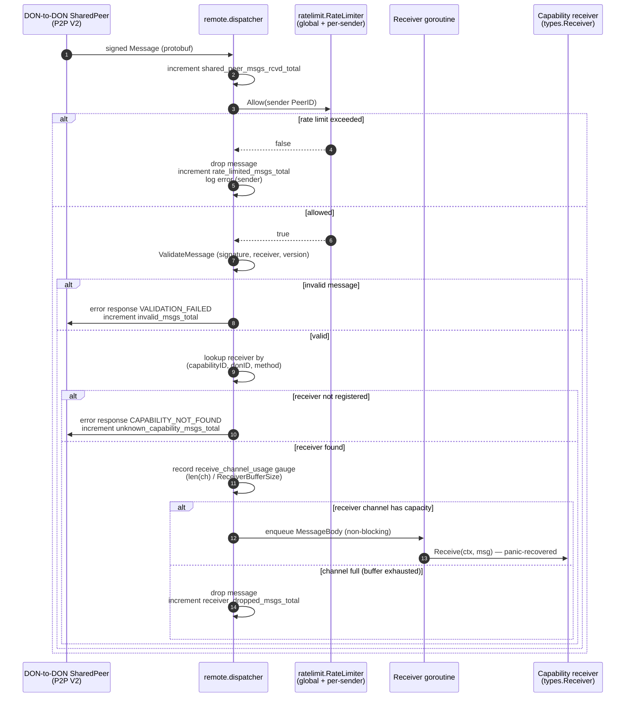

# Core Config — Dispatcher

## 1. Overview

The `core_config_dispatcher` module defines the **configuration contract for the Dispatcher**, the DON-to-DON (capabilities) message dispatcher that runs inside the Chainlink node's CRE capabilities runtime. It lives in [`chainlink/core/config/dispatcher_config.go`](#8-source-map) and consists of two small Go interfaces:

- **`Dispatcher`** — intake tuning: the size of the buffer used for incoming messages.
- **`DispatcherRateLimit`** — back-pressure tuning: global and per-sender token-bucket rate limits.

Like all `core/config` modules, this package defines **interfaces only**. The concrete values are carried by the TOML configuration layer (`core/config/toml`) and surfaced to services through the node's `GeneralConfig` (`AppConfig` → `Capabilities()` → `Dispatcher()`). The primary consumer is `core/capabilities/remote/dispatcher.go`, which uses these settings to decide **how fast** messages coming from other DON peers may be processed and **how much** each capability receiver may buffer before dropping messages.

> This page documents only the dispatcher settings. For the config architecture shared by all settings families, see [Core Config](../core_config.md); for the application that owns the config object, see [Node Application](../node_application.md) and [Node Application Config](../node_application/node_application_config.md).

### At a glance

| Element | Location | Role |
| --- | --- | --- |
| `config.Dispatcher` interface | `core/config/dispatcher_config.go` | Intake contract: `ReceiverBufferSize()`, `RateLimit()` |
| `config.DispatcherRateLimit` interface | `core/config/dispatcher_config.go` | Rate-limit contract: `GlobalRPS`, `GlobalBurst`, `PerSenderRPS`, `PerSenderBurst` |
| TOML schema (`Dispatcher`, `DispatcherRateLimit`) | `core/config/toml/types.go` | `[Capabilities.Dispatcher]` section of `config.toml`; implements the interfaces above |
| Access path | `core/config/app_config.go`, `core/config/capabilities_config.go` | `GeneralConfig.Capabilities().Dispatcher()` |
| Primary consumer | `core/capabilities/remote/dispatcher.go` | Remote capabilities dispatcher (signing, routing, rate limiting) |
| User-facing defaults | `core/config/docs/core.toml` | Generated documentation of `[Capabilities.Dispatcher]` with defaults |

---

## 2. Configuration contract

### 2.1 `config.Dispatcher`

```go
type Dispatcher interface {
	ReceiverBufferSize() int
	RateLimit() DispatcherRateLimit
}
```

| Method | Semantics (as consumed by the runtime) |
| --- | --- |
| `ReceiverBufferSize() int` | Capacity of **each** per-receiver buffered channel (`chan *types.MessageBody`). Messages are enqueued non-blockingly; when the channel is full the message is **dropped** (lossy by design). The value is also the denominator of the `platform_don2don_dispatcher_receive_channel_usage` gauge. |
| `RateLimit() DispatcherRateLimit` | Returns the nested rate-limit policy applied to *incoming* messages before they are routed. |

### 2.2 `config.DispatcherRateLimit`

```go
type DispatcherRateLimit interface {
	GlobalRPS() float64
	GlobalBurst() int
	PerSenderRPS() float64
	PerSenderBurst() int
}
```

The four values parameterise a two-tier token bucket implemented by `chainlink-common/pkg/ratelimit` (`ratelimit.NewRateLimiter`) and enforced in `dispatcher.handleMessage` via `rateLimiter.Allow(sender)`:

| Method | Tier | Meaning |
| --- | --- | --- |
| `GlobalRPS() float64` | Global | Sustained message-processing rate allowed across **all** senders combined. |
| `GlobalBurst() int` | Global | Bucket depth for the global tier — how many messages may be processed in a short burst above the sustained rate. |
| `PerSenderRPS() float64` | Per-sender | Sustained processing rate allowed **per sending peer** (keyed by the sending `PeerID`). |
| `PerSenderBurst() int` | Per-sender | Bucket depth for the per-sender tier. |

**Important behavioural properties:**

- Rate limiting applies to the **inbound** path only. The outbound `Send` path (message signing + transmission through the DON-to-DON shared peer) is *not* rate limited by this config.
- When either tier is exhausted, the message is **dropped** (not queued): a `rate_limited` metric is incremented and an error is logged. This makes the dispatcher deliberately lossy under overload to protect the node from message floods by a misbehaving or compromised peer.

---

## 3. Architecture and component relationships

The module follows the standard `core/config` pattern — a strict separation between the **TOML schema** (parsing, defaults, validation), the **runtime interfaces** (this module), and the **consumer services**:



The same relationships expressed as types:



**How the config reaches the consumer:** the node's root `Config` (`core/services/chainlink/config.go`) embeds `toml.Core`, which transitively owns `toml.Capabilities` → `toml.Dispatcher` → `toml.DispatcherRateLimit`. Because the TOML types implement the interfaces defined in this module, `GeneralConfig` can hand consumers an opaque `config.Dispatcher` value without the capabilities runtime depending on the TOML layer. Dependency direction is therefore: *capabilities runtime → `core/config` interfaces → satisfied by `core/config/toml`*.

---

## 4. Runtime behaviour: how the settings are used

The consumer is `remote.dispatcher` (`chainlink/core/capabilities/remote/dispatcher.go`), a `services.Service` started as part of the node's capabilities runtime bootstrap (see [Core Capabilities Runtime](../../Workflow___Capability_Runtime_(CRE_Engine)/core_capabilities_runtime.md)). It routes signed protobuf `MessageBody` traffic between DON peers (over the DON-to-DON shared peer of the P2P layer — see [P2P](../../Node_Platform_Services/p2p.md)) and locally registered capabilities.

`NewDispatcher(cfg config.Dispatcher, don2donSharedPeer, signer, registry, lggr)` reads the config exactly once at construction:

```go
rl, err := ratelimit.NewRateLimiter(ratelimit.RateLimiterConfig{
    GlobalRPS:      cfg.RateLimit().GlobalRPS(),
    GlobalBurst:    cfg.RateLimit().GlobalBurst(),
    PerSenderRPS:   cfg.RateLimit().PerSenderRPS(),
    PerSenderBurst: cfg.RateLimit().PerSenderBurst(),
})
```

and `setReceiver` sizes each receiver queue with `make(chan *types.MessageBody, d.cfg.ReceiverBufferSize())`.

### 4.1 Inbound message processing flow



Key takeaways for operators:

- **Lossy by design.** Both overload mechanisms (rate-limit rejection and full receiver buffers) *drop* messages rather than block the P2P receive loop. Back-pressure is expressed as message loss plus metrics, not as queueing.
- **Per-receiver isolation.** Every `(capabilityID, donID, method)` receiver gets its own goroutine and its own buffer sized by `ReceiverBufferSize`, so one slow capability cannot starve the others' intake — but it can lose its own messages.
- **Outbound path is unthrottled.** `Send` stamps version/sender/receiver/timestamp, signs the payload and transmits it via the shared peer; no dispatcher rate limit applies to sends.

### 4.2 Observability

The dispatcher exposes Beholder (OTel) metrics whose interpretation depends directly on this module's settings (see [Beholder Telemetry](../../Telemetry___Observability_Platform/beholder-telemetry.md)):

| Metric | Type | Relation to this config |
| --- | --- | --- |
| `platform_don2don_dispatcher_shared_peer_msgs_rcvd_total` | counter | Inbound volume before rate limiting. |
| `platform_don2don_dispatcher_rate_limited_msgs_total` | counter | Dropped by global/per-sender token buckets (`GlobalRPS`/`Burst`, `PerSenderRPS`/`Burst`). |
| `platform_don2don_dispatcher_invalid_msgs_total` | counter | Failed validation (after rate limiting). |
| `platform_don2don_dispatcher_unknown_capability_msgs_total` | counter | No receiver registered for `(capabilityID, donID, method)`. |
| `platform_don2don_dispatcher_receive_channel_usage` | gauge | `len(receiver.ch) / ReceiverBufferSize` — a value persistently near `1.0` signals the buffer is too small or the receiver too slow. |
| `platform_don2don_dispatcher_receiver_dropped_msgs_total` | counter | Dropped because a receiver buffer was full. |
| `platform_don2don_dispatcher_messages_sent_total` / `..._send_errors_total` | counters | Outbound path (not rate limited). |

---

## 5. Configuration reference

Values are configured in the `[Capabilities.Dispatcher]` section of `config.toml` (or via the equivalent environment variables/flags accepted by the node's config loader — see the parent [Core Config](../core_config.md) page and `chainlink/core/services/chainlink/CONFIG.md`). The defaults below are the ones published in the generated reference `chainlink/core/config/docs/core.toml`:

| Setting | Type | Default | Description |
| --- | --- | --- | --- |
| `Capabilities.Dispatcher.ReceiverBufferSize` | int | `10000` | Size of the buffer for incoming messages (per registered receiver). |
| `Capabilities.Dispatcher.RateLimit.GlobalRPS` | float64 | `800` | Global rate limit for the dispatcher (messages/second, all senders). |
| `Capabilities.Dispatcher.RateLimit.GlobalBurst` | int | `1000` | Global burst limit (token-bucket depth). |
| `Capabilities.Dispatcher.RateLimit.PerSenderRPS` | float64 | `10` | Per-sender rate limit (messages/second per peer). |
| `Capabilities.Dispatcher.RateLimit.PerSenderBurst` | int | `50` | Per-sender burst limit (token-bucket depth). |

Example (defaults made explicit):

```toml
[Capabilities.Dispatcher]
ReceiverBufferSize = 10000

[Capabilities.Dispatcher.RateLimit]
GlobalRPS = 800
GlobalBurst = 1000
PerSenderRPS = 10
PerSenderBurst = 50
```

Tuning notes (derived from the runtime behaviour described in §4):

- Raising `ReceiverBufferSize` trades memory for loss tolerance on bursty receivers; monitor `receive_channel_usage` before/after.
- Lowering `PerSenderRPS`/`PerSenderBurst` hardens the node against a single misbehaving DON peer but drops legitimate traffic from that peer once the budget is exhausted — dropped messages are visible in `rate_limited_msgs_total` but are **not** retried by the dispatcher.
- `GlobalRPS`/`GlobalBurst` bound the node's total dispatcher processing cost, independent of how the load is distributed across senders.

---

## 6. Interaction with other modules

| Module | Relationship |
| --- | --- |
| [Core Config](../core_config.md) | Parent module describing the shared TOML/interface/app-config architecture of which this module is one settings family. |
| [Node Application Config](../node_application/node_application_config.md) | `GeneralConfig` exposes this module's interfaces via `AppConfig.Capabilities().Dispatcher()`. |
| [Core Capabilities Runtime (CRE Engine)](../../Workflow___Capability_Runtime_(CRE_Engine)/core_capabilities_runtime.md) | The remote capabilities dispatcher configured by this module is part of the node's capabilities runtime; it routes trigger/executable messages between DONs and local capabilities. |
| [P2P](../../Node_Platform_Services/p2p.md) | Inbound/outbound messages flow over the DON-to-DON `SharedPeer`; peer identity (`PeerID`) keys the per-sender rate-limit tier. |
| [Beholder Telemetry](../../Telemetry___Observability_Platform/beholder-telemetry.md) | All dispatcher metrics listed in §4.2 are emitted through Beholder. |
| Sibling config modules — [Chain Keys](core_config_chain_keys.md), [CCV](core_config_ccv.md), [Observability](core_config_observability.md), [Workflows](core_config_workflows.md) | Peer settings families under `[Capabilities]` and the root config; no direct coupling with Dispatcher. |

---

## 7. Extension and testing notes

- The interfaces are intentionally minimal, so alternative config sources (tests, mocks, programmatic setups) can satisfy `config.Dispatcher` without the TOML layer; the remote dispatcher only depends on the interface.
- Behaviour is covered by `chainlink/core/capabilities/remote/dispatcher_test.go` (receiver registration/dedup via `ErrReceiverExists`, routing by `(capabilityID, donID, method)`, rate-limit and drop paths).
- Because `NewDispatcher` snapshots the four rate-limit values at construction and the buffer size is fixed per receiver at registration time, **config changes require a node restart** to take effect.

## 8. Source map

| Source | Contents |
| --- | --- |
| `chainlink/core/config/dispatcher_config.go` | `Dispatcher`, `DispatcherRateLimit` interfaces (this module's core components). |
| `chainlink/core/config/toml/types.go` | TOML schema types `toml.Dispatcher`, `toml.DispatcherRateLimit` (pointer fields + accessors), embedded in `toml.Capabilities` / `toml.Core`. |
| `chainlink/core/config/capabilities_config.go` | `Capabilities` interface exposing `Dispatcher() Dispatcher`. |
| `chainlink/core/config/app_config.go` | `AppConfig` interface (`Capabilities()` access path). |
| `chainlink/core/config/docs/core.toml` | Generated user-facing config reference — `[Capabilities.Dispatcher]` defaults (§5). |
| `chainlink/core/services/chainlink/config.go` | Node `Config` embedding `toml.Core` (implementation of `GeneralConfig`). |
| `chainlink/core/capabilities/remote/dispatcher.go` | Primary consumer: `NewDispatcher`, rate limiting, receiver channels, Beholder metrics. |
| `chainlink/core/capabilities/remote/types/types.go` | Runtime `Dispatcher` service contract (`SetReceiver`, `Send`, …) implemented by the consumer. |
| `chainlink-common/pkg/ratelimit` | Token-bucket rate limiter (`NewRateLimiter` / `Allow(sender)`) parameterised by this module. |
