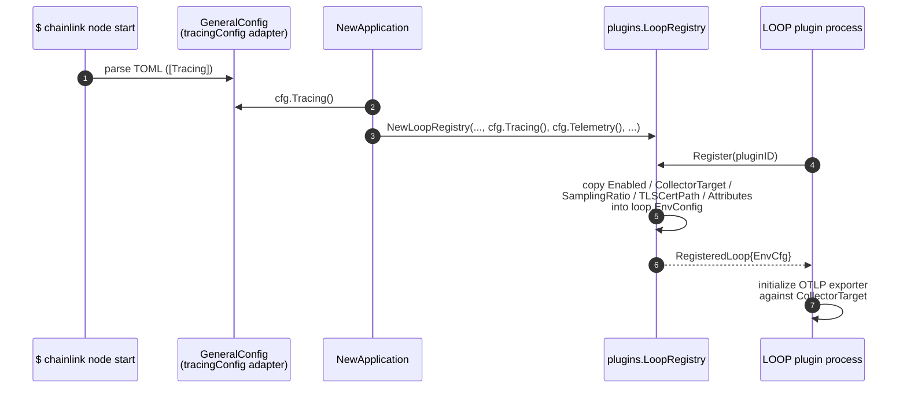
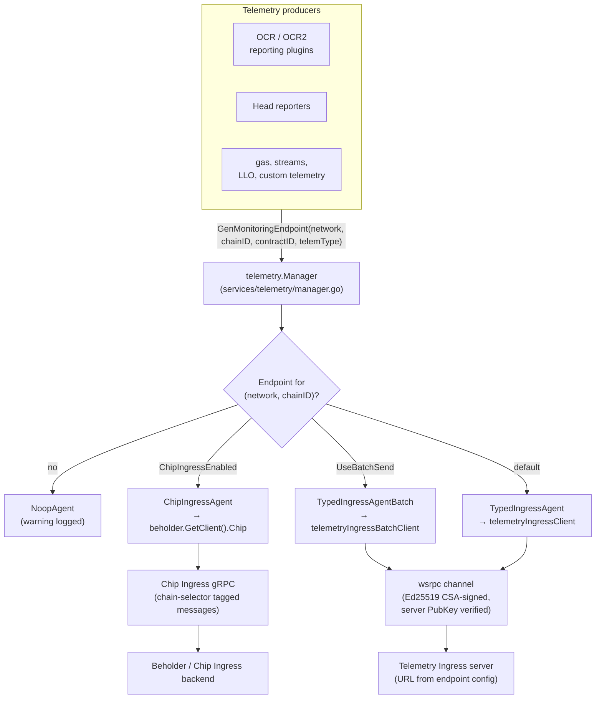
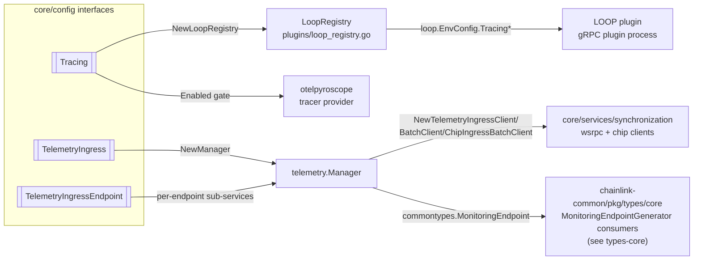

# core_config_observability

> **Module**: `chainlink/core/config` (observability subset) — [core_config](../core_config.md)

## Introduction

The `core_config_observability` module defines the **access interfaces** through which the Chainlink node reads its two external-telemetry configuration planes:

1. **`Tracing`** — distributed tracing settings (OpenTelemetry OTLP collector target, sampling, TLS, span attributes). Consumed by the node application and forwarded to LOOP plugin processes.
2. **`TelemetryIngress` / `TelemetryIngressEndpoint`** — the per-network/per-chain pipeline configuration used to ship product telemetry (OCR, OCR2, gas, LLO/streams, …) to a remote telemetry ingress server or to the Chip Ingress service.

The module follows the standard [core_config](../core_config.md) layering pattern:

| Layer | Location | Role |
|---|---|---|
| TOML representation | `chainlink/core/config/toml/types.go` | Pointer fields with merge (`SetFrom`) semantics, `ValidateConfig()` |
| Access interfaces | `chainlink/core/config/tracing_config.go`, `telemetry_ingress_config.go` | Read-only view consumed by services |
| Adapter implementations | `chainlink/core/services/chainlink/config_tracing.go`, `config_telemetry_ingress.go` | Wrap TOML structs, satisfy interfaces via `GeneralConfig` |

The interfaces deliberately hide the TOML representation (pointer fields, merge rules) so that services depend on a stable, nil-free accessor API. This mirrors how the rest of the node configuration is exposed through [`GeneralConfig`](../node_application/node_application_config.md).

---

## Architecture

### Component overview

```mermaid
flowchart TB
    subgraph TOML["TOML layer (core/config/toml)"]
        TT["toml.Tracing<br/>(pointer fields)"]
        TI["toml.TelemetryIngress"]
        TIE["toml.TelemetryIngressEndpoint"]
        TI --- TIE
    end

    subgraph IFACE["Access interfaces (core/config)"]
        ITr["&lt;&lt;interface&gt;&gt;<br/>Tracing"]
        ITI["&lt;&lt;interface&gt;&gt;<br/>TelemetryIngress"]
        ITIE["&lt;&lt;interface&gt;&gt;<br/>TelemetryIngressEndpoint"]
        ITI -- Endpoints(): []TelemetryIngressEndpoint --> ITIE
    end

    subgraph ADAPT["Adapters (services/chainlink)"]
        ATr["tracingConfig"]
        ATi["telemetryIngressConfig"]
        ATe["telemetryIngressEndpointConfig"]
        ATi -- Endpoints() --> ATe
    end

    TT -.->|wrapped by| ATr
    TI -.->|wrapped by| ATi
    TIE -.->|wrapped by| ATe
    ITr <-.- ATr
    ITI <-.- ATi
    ITIE <-.- ATe

    GC["GeneralConfig<br/>(services/chainlink/types.go)"] -->|Tracing()| ATr
    GC -->|TelemetryIngress()| ATi

    subgraph CONSUMERS["Consumers"]
        LR["plugins.LoopRegistry<br/>(LOOP plugin env)"]
        MGR["telemetry.Manager<br/>(services/telemetry)"]
        PYR["Pyroscope span-profile<br/>linking (otel)"]
    end

    ITr --> LR
    ITr --> PYR
    ITI --> MGR
```

*The TOML structs, interfaces and adapters are connected by the dotted "implicit implementation" edges; solid edges show ownership/wiring established in `NewApplication` (`chainlink/core/services/chainlink/application.go`).*

### Relationships to the rest of the system

| Consumer | File | What it uses |
|---|---|---|
| `plugins.NewLoopRegistry(...)` | `chainlink/core/services/chainlink/application.go` | `cfg.Tracing()` — forwarded to every registered LOOP plugin process |
| `LoopRegistry.Register` | `chainlink/plugins/loop_registry.go` | Copies `TracingEnabled`, `TracingCollectorTarget`, `TracingSamplingRatio`, `TracingTLSCertPath`, `TracingAttributes` into `loop.EnvConfig` |
| Pyroscope span profiling | `chainlink/core/services/chainlink/application.go` | `cfg.Tracing().Enabled()` gates `otelpyroscope` tracer-provider wrapping when `Pyroscope.LinkTracesToProfiles` is set |
| `telemetry.NewManager(...)` | `chainlink/core/services/chainlink/application.go` | `cfg.TelemetryIngress()` — full ingress configuration plus CSA keystore |
| LOOP plugin processes | [Plugin_Process_Framework_(Loop)](../../Plugin_Process_Framework_(Loop).md) | Receive tracing env vars and initialize their own OTLP exporters |

---

## Components

### `Tracing` interface

**File:** `chainlink/core/config/tracing_config.go`

```go
type Tracing interface {
    Enabled() bool
    CollectorTarget() string
    NodeID() string
    SamplingRatio() float64
    TLSCertPath() string
    Mode() string
    Attributes() map[string]string
}
```

| Accessor | TOML key (`[Tracing]`) | Meaning |
|---|---|---|
| `Enabled()` | `Enabled` | Master switch for OTLP tracing export |
| `CollectorTarget()` | `CollectorTarget` | OTLP collector `host:port` (e.g. `localhost:4317`) |
| `NodeID()` | `NodeID` | Logical node identifier attached to trace metadata |
| `SamplingRatio()` | `SamplingRatio` | Trace sampling ratio in `[0,1]` (`1.0` = sample everything) |
| `TLSCertPath()` | `TLSCertPath` | Path to the CA/cert used to reach the collector |
| `Mode()` | `Mode` | Transport mode for the collector connection (e.g. `tls`) |
| `Attributes()` | `[Tracing.Attributes]` | Free-form key/value resource attributes added to exported spans |

The adapter `tracingConfig` (`chainlink/core/services/chainlink/config_tracing.go`) simply dereferences the underlying `toml.Tracing` pointer fields.

> **Note:** When the tracing configuration is forwarded to LOOP plugins via `LoopRegistry.Register`, only `Enabled`, `CollectorTarget`, `SamplingRatio`, `TLSCertPath` and `Attributes` are propagated (`loop.EnvConfig.Tracing*` fields). `NodeID` and `Mode` are node-local and are not part of the plugin env channel.

### `TelemetryIngress` interface

**File:** `chainlink/core/config/telemetry_ingress_config.go`

```go
type TelemetryIngress interface {
    Logging() bool
    UniConn() bool
    BufferSize() uint
    MaxBatchSize() uint
    SendInterval() time.Duration
    SendTimeout() time.Duration
    UseBatchSend() bool
    Endpoints() []TelemetryIngressEndpoint
    ChipIngressEnabled() bool
}
```

| Accessor | TOML key (`[TelemetryIngress]`) | Meaning |
|---|---|---|
| `Logging()` | `Logging` | Enable per-message debug logging in the ingress clients |
| `UniConn()` | `UniConn` | Share a single wsrpc connection across batch workers (batch mode only) |
| `BufferSize()` | `BufferSize` | Channel capacity buffering `TelemPayload` before sending |
| `MaxBatchSize()` | `MaxBatchSize` | Maximum messages per batch send (batch mode only) |
| `SendInterval()` | `SendInterval` | Max wait before a partially filled batch is flushed |
| `SendTimeout()` | `SendTimeout` | Timeout for a single batch send RPC |
| `UseBatchSend()` | `UseBatchSend` | Select the batching ingress client vs. the per-message client |
| `Endpoints()` | `[[TelemetryIngress.Endpoints]]` | One endpoint per network/chain pair |
| `ChipIngressEnabled()` | `ChipIngressEnabled` | Route telemetry through the Chip Ingress (Beholder) service instead of legacy wsrpc ingress |

### `TelemetryIngressEndpoint` interface

**File:** `chainlink/core/config/telemetry_ingress_config.go`

```go
type TelemetryIngressEndpoint interface {
    Network() string
    ChainID() string
    ServerPubKey() string
    URL() *url.URL
}
```

Each endpoint identifies **where** telemetry for a `(Network, ChainID)` pair is sent and **how it is authenticated**:

- `Network()` / `ChainID()` — lookup key used by `telemetry.Manager.GenMonitoringEndpoint` (normalised to upper case internally).
- `URL()` — the wsrpc telemetry ingress server address (returns `nil` when unset in TOML).
- `ServerPubKey()` — the server's Ed25519 public key, used together with the node's **CSA key** to establish the signed wsrpc channel.

---

## TOML configuration and validation

The TOML structs live in `chainlink/core/config/toml/types.go` as part of the `[Core]` config root (fields `Tracing` and `TelemetryIngress`). All fields are pointers/optional to support layered merging via `SetFrom` when multiple `-c` config files are supplied (see [node_application_config](../node_application/node_application_config.md)).

Cross-field validation in `Core.ValidateConfig()`:

- If **both** `Tracing.Enabled` and `Telemetry.Enabled` are true, `Tracing.CollectorTarget` must **differ** from `Telemetry.Endpoint` — the OTLP trace collector and the Beholder telemetry endpoint cannot be the same target.

A complete example from `chainlink/core/services/chainlink/testdata/config-full.toml`:

```toml
[Tracing]
Enabled = true
CollectorTarget = 'localhost:4317'
NodeID = 'clc-ocr-sol-devnet-node-1'
SamplingRatio = 1.0
Mode = 'tls'
TLSCertPath = '/path/to/cert.pem'

[Tracing.Attributes]
env = 'dev'
test = 'load'

[TelemetryIngress]
UniConn = false
Logging = true
BufferSize = 1234
MaxBatchSize = 4321
SendInterval = '1m0s'
SendTimeout = '5s'
UseBatchSend = true
ChipIngressEnabled = false

[[TelemetryIngress.Endpoints]]
Network = 'EVM'
ChainID = '1'
URL = 'prom.test'
ServerPubKey = 'test-pub-key'
```

---

## Data flow

### Tracing configuration flow (node → plugins)



The same `cfg.Tracing()` value also gates span-profile correlation in the core process: when `Pyroscope.LinkTracesToProfiles` is enabled and `Tracing.Enabled` is true, the global OTel tracer provider is wrapped with `otelpyroscope` so span IDs are recorded alongside Pyroscope profiles (`application.go`).

### Telemetry ingress flow (node → ingress server)



Key behaviours of the `telemetry.Manager` (`chainlink/core/services/telemetry/manager.go`):

- On construction, one sub-service is created per configured endpoint. `newEndpoint` rejects endpoints missing `Network`, `ChainID`, `URL` or `ServerPubKey`, and rejects duplicate `(Network, ChainID)` pairs.
- **Chip Ingress mode** (`ChipIngressEnabled()`): telemetry is emitted through the shared Beholder Chip client; agents derive the on-chain `ChainSelector` from `(chainID, network)` via the chain-selectors library (`chip_ingress.go`).
- **Batch mode** (`UseBatchSend()`): `synchronization.NewTelemetryIngressBatchClient(url, serverPubKey, csaKeystore, logging, lggr, bufferSize, maxBatchSize, sendInterval, sendTimeout, uniConn)` — a worker pool with per-connection or shared (`UniConn`) wsrpc connections whose fields map 1:1 onto this module's accessors.
- **Single mode**: `synchronization.NewTelemetryIngressClient(url, serverPubKey, csaKeystore, lggr, bufferSize)` — buffered channel of `TelemPayload` with drop counters.
- When no endpoint matches a `(network, chainID)` lookup, a `NoopAgent` is returned and a warning is logged — telemetry is silently dropped rather than failing the caller. The no-op transport counterparts (`NoopTelemetryIngressClient`, `NoopTelemetryIngressBatchClient` in `core/services/synchronization`) mirror this pattern; see [telemetry_ingress](../../Telemetry___Observability_Platform/telemetry_ingress.md).

---

## Component interaction: interface ↔ consumer map



The generated monitoring endpoints satisfy `commontypes.MonitoringEndpoint` (defined in the shared [types-core](../../Shared_Foundation_Libraries___Domain_Types/types-core.md) library together with `MonitoringEndpointGenerator`), which is the contract consumed by OCR/OCR2 plugins and relayers when they request a telemetry sink.

---

## Related configuration (distinctions)

This module is one of **three** observability configuration planes in `[Core]`; do not confuse them:

| TOML section | Interface | Purpose | Where documented |
|---|---|---|---|
| `[Tracing]` | `config.Tracing` (this module) | OTLP **distributed tracing** for the node and LOOP plugins | this page |
| `[TelemetryIngress]` | `config.TelemetryIngress` (this module) | Product **telemetry shipping** (OCR, gas, LLO, …) to ingress servers / Chip Ingress | this page + [telemetry_ingress](../../Telemetry___Observability_Platform/telemetry_ingress.md) |
| `[Telemetry]` | `config.Telemetry` | **Beholder** OTLP exporter (metrics/logs/traces via OTel SDK), Chip Ingress endpoint, durable emitter | [node_application_config](../node_application/node_application_config.md), [beholder-telemetry](../../Telemetry___Observability_Platform/beholder-telemetry.md) |
| `[Prometheus]` / pprof / Pyroscope / Sentry | `config.PrometheusServices`, `AutoPprof`, `Pyroscope`, `Sentry` | Local metrics scrape, profiling and crash reporting | [node_application_config](../node_application/node_application_config.md) |

For the broader telemetry platform (Beholder emitter, Chip Ingress protocol, Kafka-based monitoring stack, Grafana tooling), see [Telemetry___Observability_Platform](../../Telemetry___Observability_Platform.md). A ready-made local metrics stack (Prometheus + Grafana + Alertmanager) is provided by `chainlink/tools/docker/docker-compose.observability.yaml`; the Kafka/Zookeeper/Schema-registry stack used by the monitoring agents is described in [ops-monitoring-stack](../../Telemetry___Observability_Platform/ops-monitoring-stack.md).

---

## Operational notes

- **Fail-open semantics:** both planes are designed to degrade gracefully — tracing disabled means no spans are exported; missing telemetry endpoints yield `NoopAgent`s; Chip Ingress agent creation failures fall back to no-op with an error log.
- **Buffer sizing:** `BufferSize` bounds in-memory telemetry before it is dropped (`dropMessageCount` in the wsrpc clients); batch mode adds `MaxBatchSize`/`SendInterval`/`SendTimeout` tuning. Size these relative to expected telemetry volume per chain.
- **Credentials:** ingress connections are mutually authenticated with the node's CSA (Ed25519) key — the keystore is passed alongside this configuration into `telemetry.NewManager` and the wsrpc clients. The TOML only carries the *server's* public key (`ServerPubKey`).
- **Config surface stability:** services must depend on the interfaces in this module, not on `toml` structs, so the TOML schema can evolve (see the transition diagram in `chainlink/core/services/chainlink/CONFIG.md`).

## References

- Parent module: [core_config](../core_config.md)
- Sibling config modules: [core_config_chain_keys](core_config_chain_keys.md), [core_config_ccv](core_config_ccv.md), [core_config_dispatcher](core_config_dispatcher.md), [core_config_workflows](core_config_workflows.md)
- Application wiring: [node_application](../node_application.md), [node_application_lifecycle](../node_application/node_application_lifecycle.md), [node_application_config](../node_application/node_application_config.md)
- Telemetry platform: [telemetry_ingress](../../Telemetry___Observability_Platform/telemetry_ingress.md), [beholder-telemetry](../../Telemetry___Observability_Platform/beholder-telemetry.md), [chip-ingress](../../Telemetry___Observability_Platform/chip-ingress.md), [monitoring](../../Telemetry___Observability_Platform/monitoring.md)
- Plugin process framework receiving tracing env config: [loop-plugin-core](../../Plugin_Process_Framework_(Loop)/loop-plugin-core.md)
- Shared monitoring endpoint types: [types-core](../../Shared_Foundation_Libraries___Domain_Types/types-core.md)
