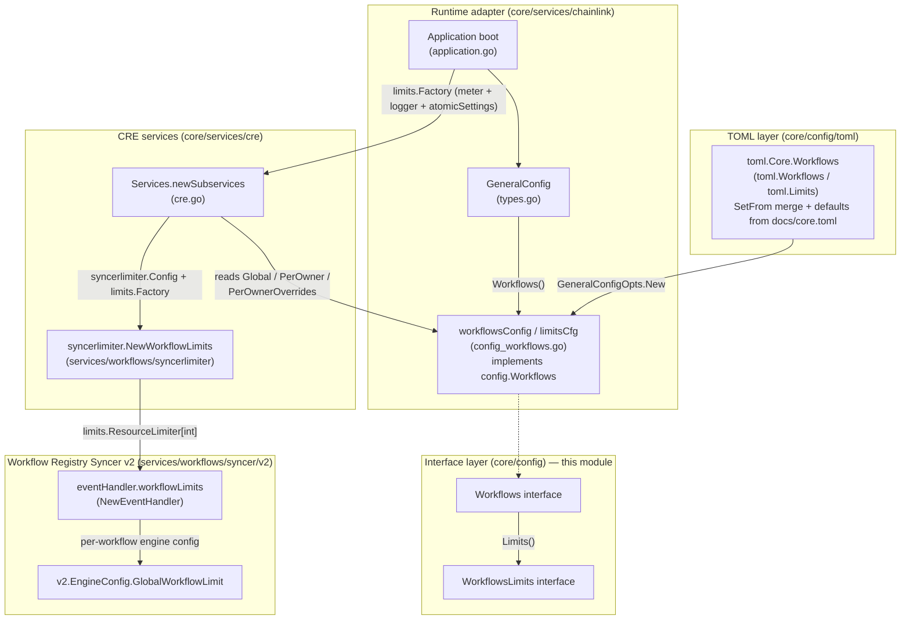
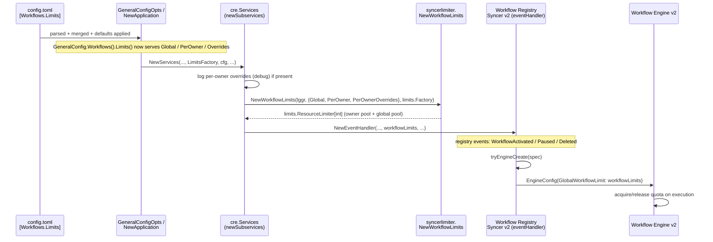
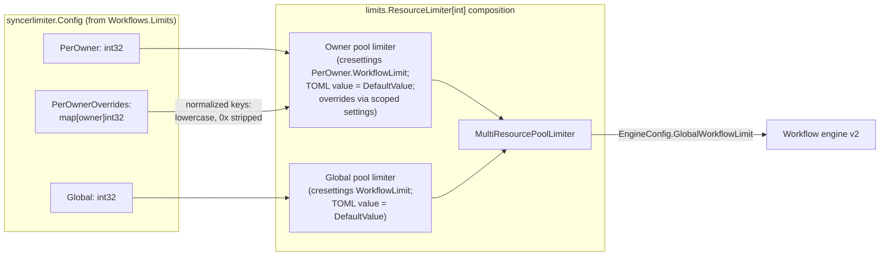

# Workflows Configuration (`core_config_workflows`)

The `core_config_workflows` module defines the **workflow-count governance policy** of a Chainlink node: how many workflows may be registered and run on the node in total (**global**), how many a single workflow owner may run (**per-owner**), and which owners receive **per-owner overrides**. It is a small but security-relevant slice of the node's configuration surface: it protects node operators from resource exhaustion by malicious or accidental workflow flooding, while remaining flexible enough to grant trusted owners higher quotas.

The module lives in `chainlink/core/config/workflows_config.go` and exposes two access-control interfaces consumed by the Workflow Registry Syncer and the workflow engine during CRE (Chainlink Runtime Environment) boot.

## Core Components

The module consists of two Go interfaces (source: `chainlink/core/config/workflows_config.go`):

```go
// Workflows is the top-level accessor for workflow configuration.
type Workflows interface {
    Limits() WorkflowsLimits
}

// WorkflowsLimits exposes the configured workflow-count quotas.
type WorkflowsLimits interface {
    Global() int32                              // max workflows on the node, across all owners
    PerOwner() int32                            // max workflows per owner
    PerOwnerOverrides() map[string]int32        // owner address -> custom limit (falls back to PerOwner)
}
```

| Component | Role |
|---|---|
| `Workflows` | Entry point returned by the node's `AppConfig.Workflows()` method; currently only groups the limits sub-config. |
| `WorkflowsLimits` | Read-only view of the three quota settings: `Global`, `PerOwner`, and `PerOwnerOverrides`. |

The interfaces are intentionally minimal and read-only: values are resolved at boot, and any *dynamic* adjustment happens through the CRE settings framework (see [Limit Enforcement Model](#limit-enforcement-model)), not by mutating this config.

## Configuration Surface (TOML)

The settings are provided in the node's `config.toml` under the `[Workflows]` section. The generated reference documentation (including defaults) lives in `chainlink/core/config/docs/core.toml`:

```toml
[Workflows]
[Workflows.Limits]
# Global is the maximum number of workflows that can be registered globally.
Global = 200 # Default
# PerOwner is the maximum number of workflows that can be registered per owner.
PerOwner = 200 # Default
```

Per-owner overrides are declared as a map of EVM-style owner addresses to limits. The canonical example comes from the unit test `chainlink/core/services/chainlink/config_workflows_test.go`:

```toml
[Workflows]
[Workflows.Limits]
Global = 200
PerOwner = 200

[Workflows.Limits.Overrides]
0xae4E781a6218A8031764928E88d457937A954fC3 = 5
0x538aAaB4ea120b2bC2fe5D296852D948F07D849e = 10
```

**Merge semantics.** The TOML-side structs (`toml.Workflows` / `toml.Limits` in `chainlink/core/config/toml/types.go`) hold pointer fields and implement `SetFrom`, so when multiple config files are layered (base file, `-s` secret/flag files, environment), the last non-`nil` value wins per field. `Overrides` maps are copied wholesale when present. Defaults for unset fields are seeded from the generated docs at boot (`chainlink/core/config/docs/defaults.go`, via `configdoc.DefaultsOnly` over `core.toml`), which guarantees the runtime wrapper never dereferences a `nil` pointer.

> **Note:** Do not confuse `[Workflows]` (count quotas — this module) with `[Capabilities.WorkflowRegistry]` (workflow registry contract address, storage URLs, sync strategy) or `[CRE]` (engine behavior). Those belong to the Capabilities and CRE configuration, described in the parent module [core_config](../core_config.md).

## Architecture

The module follows the standard node configuration layering: a **TOML schema layer** (parse/merge/validate), an **interface layer** (this module), a **runtime adapter layer** (`services/chainlink`), and **service consumers** (CRE services → workflow syncer → workflow engines).



### Wiring Responsibilities

| Layer | File | Responsibility |
|---|---|---|
| TOML schema | `chainlink/core/config/toml/types.go` (`toml.Workflows`, `toml.Limits`) | Parse, merge (`SetFrom`), and hold pointer-typed values. |
| Defaults/docs | `chainlink/core/config/docs/core.toml` + `defaults.go` | Generated reference and default seeding (`Global=200`, `PerOwner=200`). |
| Interfaces | `chainlink/core/config/workflows_config.go` | Consumer-facing contract (this module). |
| Runtime adapter | `chainlink/core/services/chainlink/config_workflows.go` | `workflowsConfig` wraps `toml.Workflows`, implements `config.Workflows`; aggregates into `AppConfig` (embedded by `GeneralConfig`). |
| Boot wiring | `chainlink/core/services/chainlink/application.go` | Creates the shared `limits.Factory` (Beholder meter, logger, `loop.AtomicSettings`) and passes it to `cre.NewServices`. |
| Consumer | `chainlink/core/services/cre/cre.go::newSubservices` | Reads the three limit values and instantiates the workflow resource limiter. |
| Enforcement | `chainlink/core/services/workflows/syncerlimiter/limiter.go`, `chainlink/core/services/workflows/syncer/v2/handler.go` | Enforces quotas on workflow activation and hands the limiter to each engine. |

## Data Flow: From TOML to Enforcement

The sequence below traces what happens on node boot and on the first workflow registration events:



## Limit Enforcement Model

`syncerlimiter.NewWorkflowLimits` (in `chainlink/core/services/workflows/syncerlimiter/limiter.go`) translates the three config values into the resource-manager limiter framework:

1. **Owner pool** — built from the CRE settings schema entry `cresettings.Default.PerOwner.WorkflowLimit`. The TOML `PerOwner` value becomes the setting's `DefaultValue` (when `> 0`).
2. **Global pool** — built from `cresettings.Default.WorkflowLimit`, with the TOML `Global` value as `DefaultValue`.
3. **Per-owner overrides** — injected as *owner-scoped* settings through the `keyedOwnerSettings` wrapper, so a lookup for a specific owner resolves its override first and falls back to the `PerOwner` default otherwise.
4. **Composition** — the two pools are combined into a `limits.MultiResourcePoolLimiter[int]`, meaning a workflow activation must fit **both** the owner quota and the global quota. The combined limiter is closed with the CRE services (`Services.close()`).



Two behaviors are worth highlighting for maintainers:

- **Owner key normalization.** Override keys are normalized (`strings.ToLower`, `0x` prefix stripped) both when the config is loaded (`normalizeOverrides`) and when lookups occur, so `0xAE4E…` and `ae4e…` refer to the same owner.
- **Dynamic updates.** Because the pools are built on the `cresettings` schema and the shared `limits.Factory` is backed by `loop.AtomicSettings`, quota values can be adjusted at runtime through the CRE settings pipeline; the TOML values act as boot-time defaults. See the [settings](../../Shared_Foundation_Libraries___Domain_Types/settings.md) module for the underlying framework.

## Validation and Failure Modes

- The `toml.Limits` struct has **no dedicated `ValidateConfig`**: correctness relies on defaults being applied at boot and on the adapters dereferencing pointers (`*l.l.Global`, `*l.l.PerOwner`) in `config_workflows.go`. A value of `0` is meaningful — it disables that quota level (`cfg.PerOwner > 0` / `cfg.Global > 0` guards in `syncerlimiter`), whereas negative values are treated like "unset" for default purposes.
- If the syncer limiter cannot be constructed (e.g., an invalid settings pool), `cre.NewServices` fails node boot with `could not instantiate workflow syncer limiter`.
- Per-owner override contents are logged at debug level at boot (`loaded per owner overrides`) to aid operator audits.

## Related Documentation

- Parent module — the shared configuration architecture and sibling config sections: [core_config](../core_config.md)
- Where `GeneralConfig` and the TOML parsing pipeline are described: [node_application_config](../node_application/node_application_config.md)
- Where `Application` boot wires the `limits.Factory` into CRE services: [node_application_lifecycle](../node_application/node_application_lifecycle.md)
- Primary consumers — Workflow Registry Syncer and workflow engines: [workflows (CRE Engine)](../../../Workflow___Capability_Runtime_\(CRE_Engine\)/workflows.md)
- The settings/limits framework used at enforcement time: [settings](../../Shared_Foundation_Libraries___Domain_Types/settings.md) and [config-validation](../../Shared_Foundation_Libraries___Domain_Types/config-validation.md)
- Sibling config modules: [core_config_chain_keys](core_config_chain_keys.md), [core_config_ccv](core_config_ccv.md), [core_config_dispatcher](core_config_dispatcher.md), [core_config_observability](core_config_observability.md)
