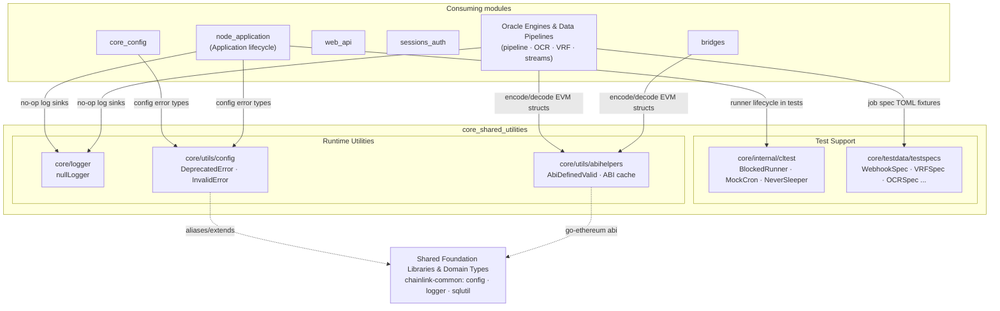
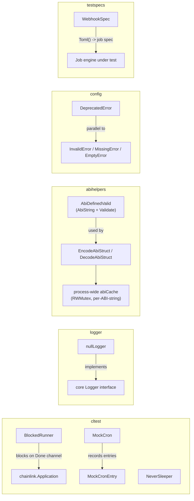
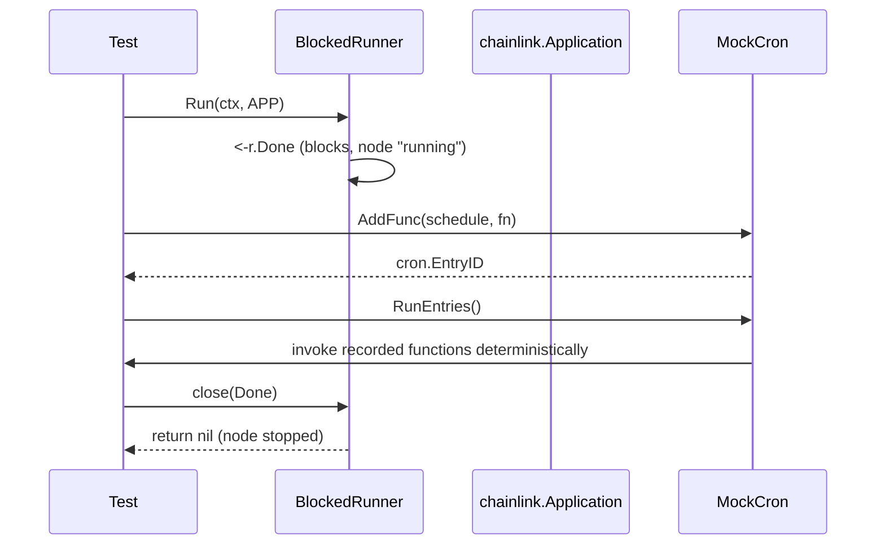
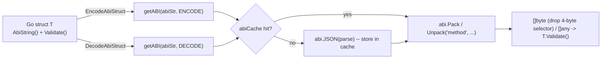

# Core Shared Utilities

## 1. Overview

`core_shared_utilities` is a cross-cutting collection of small, self-contained helper packages that live inside `chainlink/core` and are consumed by nearly every other subsystem of the Chainlink node. Unlike the domain modules in this wiki (node lifecycle, config, web API, sessions, bridges, ...), these components own no business logic and no persistence of their own. Instead they provide the **foundational plumbing** the rest of the node is built on:

| Concern | Package | Purpose |
|---|---|---|
| **Test doubles** | `core/internal/cltest` | Runners, cron and sleeper mocks that decouple tests from real node startup and wall-clock time |
| **Test data** | `core/testdata/testspecs` | Ready-made, parameterized TOML job specs (webhook, VRF, OCR, cron, gateway, streams, ...) for exercising the job engine |
| **Logging** | `core/logger` | The `nullLogger` no-op implementation of the node `Logger` interface |
| **ABI encoding** | `core/utils/abihelpers` | Cached, generic ABI encode/decode helpers for EVM structs and data words |
| **Config validation errors** | `core/utils/config` | Canonical error types (`InvalidError`, `MissingError`, `DeprecatedError`, ...) used when validating node configuration |

Because these packages are imported by nearly everything else, they are deliberately dependency-light: they depend on standard library, go-ethereum primitives, and `chainlink-common` foundation types — not on other node services.

## 2. Architecture

The module is a set of parallel utility packages, each addressing one orthogonal concern. Downstream modules (`node_application`, `core_config`, `web_api`, `sessions_auth`, `bridges`, `Oracle_Engines___Data_Pipelines`, etc.) pull in one or more of them at build/test time.

### 2.1 Component relationship summary

## 3. Sub-modules

Each concern is documented in detail in its own page:

| Sub-module | Components | Documentation |
|---|---|---|
| **Test Support (cltest & job-spec fixtures)** | `BlockedRunner`, `EmptyRunner`, `MockCron`/`MockCronEntry`, `NeverSleeper`, `WebhookSpec` (+ VRF/OCR/gateway/stream spec generators) | [core_shared_utilities_test_support.md](core_shared_utilities/core_shared_utilities_test_support.md) |
| **Logging (null logger)** | `nullLogger` (implements the core `Logger` interface) | [core_shared_utilities_logging.md](core_shared_utilities/core_shared_utilities_logging.md) |
| **ABI Helpers** | `AbiDefinedValid`, `EncodeAbiStruct`/`DecodeAbiStruct`, `ABIEncode`/`ABIDecode`, `abiCache`, `EvmWord`, `ProofFlagsToBits`, `DecodeOCR2Config` | [core_shared_utilities_abi_helpers.md](core_shared_utilities/core_shared_utilities_abi_helpers.md) |
| **Config Validation Errors** | `DeprecatedError`, `InvalidError`, `MissingError`, `EmptyError`, `OverrideError`, `UniqueStrings` (+ deprecated `Err*` aliases) | [core_shared_utilities_config_validation.md](core_shared_utilities/core_shared_utilities_config_validation.md) |

> Files verified against the generated wiki: `core_shared_utilities/core_shared_utilities_test_support.md`, `core_shared_utilities/core_shared_utilities_logging.md`, `core_shared_utilities/core_shared_utilities_abi_helpers.md`, `core_shared_utilities/core_shared_utilities_config_validation.md`.

## 4. How the module fits into the overall system

### 4.1 Relationship to the node application lifecycle

The node's `Application` interface (see [node_application_lifecycle](node_application/node_application_lifecycle.md)) defines the start/stop contract for the whole node process. `cltest.BlockedRunner` plugs directly into that contract: its `Run(ctx, chainlink.Application) error` blocks on a `Done` channel, letting tests spin up a "node" that stays alive until the test explicitly releases it. `MockCron` and `NeverSleeper` similarly stand in for the scheduler and backoff machinery that the real node uses during startup and error recovery.

### 4.2 Relationship to configuration

`core/utils/config` supplies the error vocabulary used when TOML/secret configuration is validated. Its types alias or wrap the `chainlink-common/pkg/config` foundation errors (`ErrInvalid`, `ErrMissing`, `ErrEmpty`, `UniqueStrings`) described in [config-validation](../Shared_Foundation_Libraries___Domain_Types/config-validation.md), and add node-specific errors such as `DeprecatedError` (with the semver version at which the setting will be removed) and `OverrideError` (duplicate keys across multiple secrets files). Consumers include the `GeneralConfig` machinery of [node_application_config](node_application/node_application_config.md) and the focused config packages of [core_config](core_config.md) (dispatcher, tracing, telemetry ingress, workflows, chain keys, CCV).

### 4.3 Relationship to data pipelines and EVM interactions

`abihelpers` is the encoding backbone used wherever the node must pack/unpack EVM structs without a full contract binding: it wraps `go-ethereum/accounts/abi` with a process-wide, read-mostly cache keyed by ABI definition, plus conveniences such as `EvmWord` (uint64 → `common.Hash`), `ProofFlagsToBits`, and `DecodeOCR2Config` for OCR2 aggregator config logs. The pipeline/OCR engines that consume these primitives are documented in [pipeline](../Oracle_Engines___Data_Pipelines/pipeline.md) and [ocr](../Oracle_Engines___Data_Pipelines/ocr.md).

### 4.4 Relationship to testing infrastructure

`testspecs` provides canned job definitions (webhook, VRF, VRFv2+, OCR, OCR2, bootstrap, gateway, cron, stream, standard capabilities, blockhash store, block header feeder) as TOML strings with sensible defaults and per-test overrides. They feed the job spawner and pipeline runner tested under `node_application` and `Oracle_Engines___Data_Pipelines`, and mirror the spec models used by the [chainlink-node-web-sdk](../Dev,_Test___Simulation_Environments/chainlink-node-web-sdk.md) and [deployment-environment](../Dev,_Test___Simulation_Environments/deployment-environment.md) tooling.

### 4.5 Relationship to observability

`nullLogger` implements the node `Logger` interface (`With`, `Named`, `Trace..Fatalw`, `Sync`, `Recover`) as a complete no-op. It is the sink of choice for libraries that must be constructed with a logger but whose output would be noise (health checks, benchmarks, fire-and-forget services), complementing the production logging stack described in [logger](../Shared_Foundation_Libraries___Domain_Types/logger.md) and the telemetry platform in [Telemetry___Observability_Platform](../Telemetry___Observability_Platform.md).

## 5. Usage flows

### 5.1 Test harness using blocked runner + mock cron

### 5.2 Generic ABI struct encode/decode

## 6. Design principles

1. **No cyclic dependencies upward** — these packages sit at the bottom of the `chainlink/core` import graph; they never import node services (the only inversion is `cltest`, which is a test-only package referencing `chainlink.Application` purely to satisfy the runner contract).
2. **Test parity with production** — mocks (`BlockedRunner`, `MockCron`, `NeverSleeper`) implement the same interfaces the node uses in production, so test behavior maps 1:1 to real behavior.
3. **Zero-cost opt-outs** — `nullLogger` makes "no logging" a free, type-safe choice instead of nil-pointer guards.
4. **Performance via caching, correctness via validation** — the ABI cache trades a little memory for avoided re-parsing on the hot path, while `AbiDefinedValid` guarantees decoded payloads are re-validated before use.
5. **Backward-compatible error surface** — `core/utils/config` keeps deprecated aliases (`ErrInvalid`, `ErrMissing`, ...) so older call sites keep compiling while migrating to the `chainlink-common` canonical types.

## 7. Related modules

- [node_application](node_application.md) — consumes the runner contract and lifecycle that `cltest` mocks.
- [core_config](core_config.md) — the config packages whose validation uses `core/utils/config` errors.
- [Node_Platform_Services](../Node_Platform_Services.md) — platform services built on the same foundation libraries.
- [Shared_Foundation_Libraries___Domain_Types](../Shared_Foundation_Libraries___Domain_Types.md) — canonical `chainlink-common` config/logger/types that `core/utils/config` and `core/logger` mirror or alias.
- [Dev,_Test___Simulation_Environments](../Dev,_Test___Simulation_Environments.md) — the larger-scale test environments that complement the in-process fixtures documented here.
