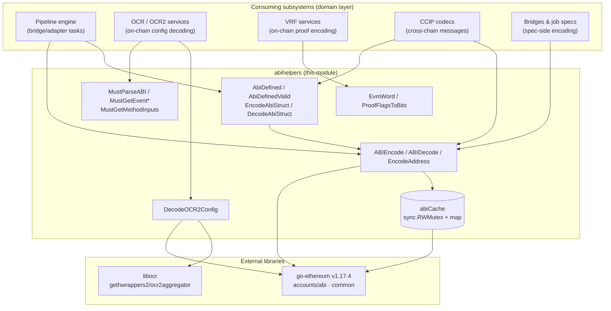
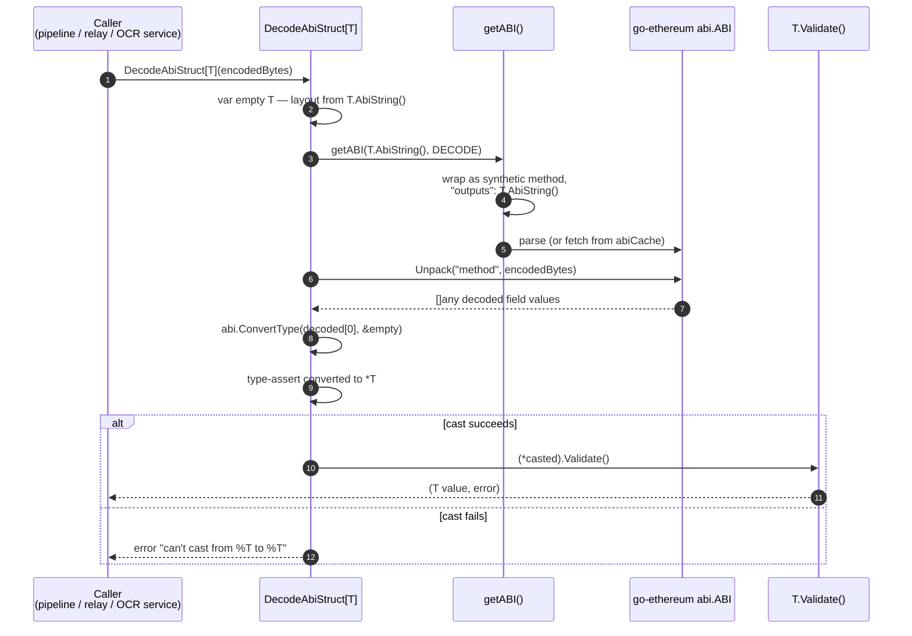
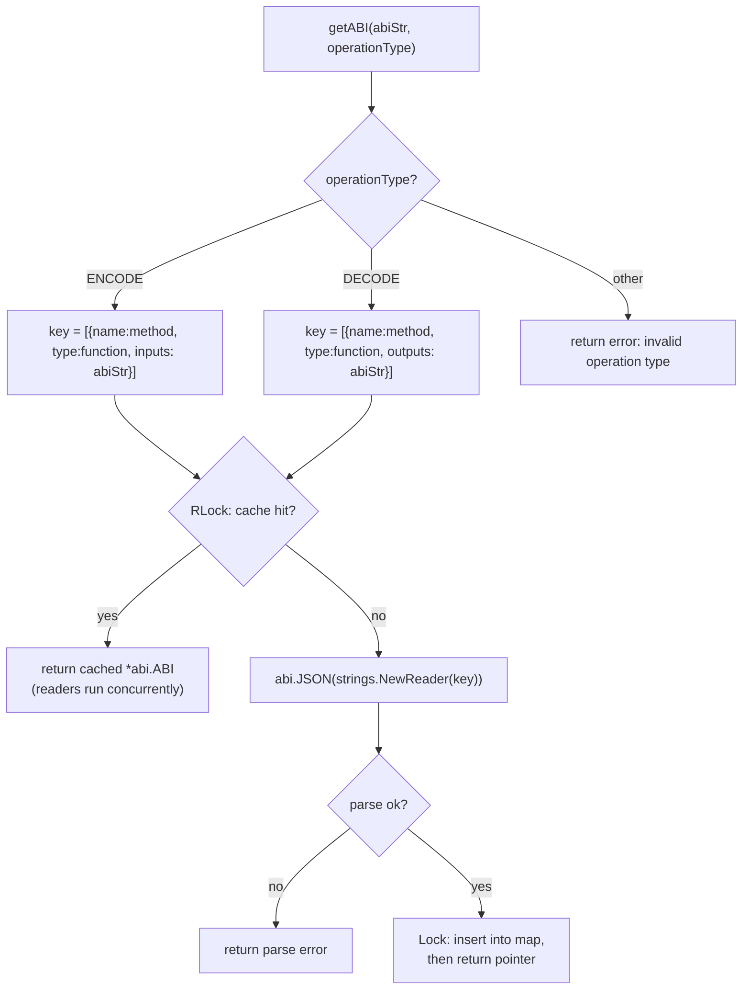

# ABI Helpers (`core/utils/abihelpers`)

> **Module:** `core_shared_utilities_abi_helpers`
> **Source:** `chainlink/core/utils/abihelpers/abi_helpers.go`
> **Parent:** [Core Shared Utilities](../core_shared_utilities.md)

---

## 1. Overview

The `abihelpers` module is a small, dependency-light utility package that provides **Ethereum ABI (Application Binary Interface) encoding and decoding services** to the rest of the Chainlink node. It wraps the low-level `go-ethereum/accounts/abi` machinery behind an ergonomic, type-safe API so that subsystems such as the pipeline engine, OCR2 configuration processing, VRF proof construction, and CCIP messaging can serialize Go structs to ABI-encoded bytes (and back) without duplicating boilerplate or re-parsing ABI JSON on every call.

Its core responsibilities are:

| Responsibility | Mechanism |
|---|---|
| Type-safe struct ↔ ABI encoding | `AbiDefined` / `AbiDefinedValid` interfaces + generics (`EncodeAbiStruct`, `DecodeAbiStruct`) |
| Raw ABI encode/decode of arbitrary values | `ABIEncode`, `ABIDecode`, `EncodeAddress` |
| Fast repeated ABI parsing | Process-wide, thread-safe `abiCache` (RWMutex-guarded map) |
| Panic-fast lookups for static ABIs | `MustParseABI`, `MustGetEventID`, `MustGetEventInputs`, `MustGetMethodInputs` |
| EVM primitive conveniences | `EvmWord` (uint64 → 32-byte word), `ProofFlagsToBits` (bool slice → bitfield) |
| OCR2 on-chain config decoding | `DecodeOCR2Config` (via the `libocr` generated `OCR2Aggregator` wrapper) |

The named core component of this module, **`AbiDefinedValid`**, is the contract that enables *validated* round-trips: any Go type that can describe its own ABI layout and self-validate can be transparently encoded to and decoded from ABI bytes.

---

## 2. Position in the System

`abihelpers` lives in `chainlink/core/utils/` and is part of the **core shared utilities** layer (see the [Node Application — Core & Interfaces](../../Node_Application_Core___Interfaces.md) overview). It sits *below* all domain services and *above* the external `go-ethereum` and `libocr` libraries. It holds no runtime state other than the ABI cache and exposes no long-lived services — it is a pure library consumed at node startup, in job specs, and in per-run pipeline/relay hot paths.



Sibling utility modules that address other cross-cutting concerns are documented separately — see [Config Validation](core_shared_utilities_config_validation.md), [Logging](core_shared_utilities_logging.md), and [Test Support](core_shared_utilities_test_support.md).

---

## 3. Component Reference

### 3.1 Type contracts: `AbiDefined` and `AbiDefinedValid`

```go
type AbiDefined interface {
    AbiString() string
}

type AbiDefinedValid interface {
    AbiDefined
    Validate() error
}
```

- **`AbiDefined`** — implemented by any Go type that can return the ABI JSON fragment describing its own on-chain layout (typically a single-element array of fields, i.e., a tuple definition). This lets callers encode/decode the type without knowing its layout.
- **`AbiDefinedValid`** — extends `AbiDefined` with a `Validate() error` hook. It is the requirement for `DecodeAbiStruct`, guaranteeing that every decoded value is also *semantically* valid, not just decodable. This is the module's named core component and the pattern used by OCR2, CCIP, and relay configuration structs that travel across the ABI boundary.

### 3.2 Generic struct encoding/decoding

| Function | Signature | Behaviour |
|---|---|---|
| `EncodeAbiStruct[T AbiDefined]` | `func[T](decoded T) ([]byte, error)` | Encodes a Go struct using its own `AbiString()` definition. Thin wrapper over `ABIEncode`. |
| `DecodeAbiStruct[T AbiDefinedValid]` | `func[T](encoded []byte) (T, error)` | Zero-values a `T`, uses its `AbiString()` to unpack the bytes, converts via `abi.ConvertType` into `*T`, then calls `T.Validate()`. Returns a typed error if the conversion cast fails (`can't cast from %T to %T`). |
| `EncodeAddress` | `func(common.Address) ([]byte, error)` | Encodes a single `address` value using the inline definition `[{"type":"address"}]`. |

### 3.3 Low-level encode/decode

| Function | Signature | Behaviour |
|---|---|---|
| `ABIEncode` | `func(abiStr string, values ...any) ([]byte, error)` | Wraps `abiStr` as a synthetic `method` function whose **inputs** are `abiStr`, packs the values with go-ethereum, and **strips the 4-byte function selector** (`res[4:]`), returning pure argument bytes. |
| `ABIDecode` | `func(abiStr string, data []byte) ([]any, error)` | Wraps `abiStr` as a synthetic `method` whose **outputs** are `abiStr`, then unpacks `data`. |
| `EvmWord` | `func(uint64) common.Hash` | Converts a `uint64` into a 32-byte, big-endian, left-padded EVM word (`common.Hash`). |
| `ProofFlagsToBits` | `func([]bool) *big.Int` | Encodes a boolean slice as a bitfield `*big.Int` (bit *i* set ⇔ `proofFlags[i]` true) — the encoding expected by on-chain Merkle multi-proof verifiers. |

### 3.4 Panic-fast accessors (for static ABIs)

These are intended for **startup-time or package-level** use where the ABI is a compile-time constant; a missing event/method or malformed JSON panics rather than returning an error:

- `MustParseABI(abiStr string) abi.ABI` — parses a full ABI JSON document.
- `MustGetEventID(name string, abi2 abi.ABI) common.Hash` — returns the event's topic-0 ID (keccak256 of the event signature); used to build log filters.
- `MustGetEventInputs(name string, abi2 abi.ABI) abi.Arguments` — the event's indexed/non-indexed input definitions.
- `MustGetMethodInputs(name string, abi2 abi.ABI) abi.Arguments` — a method's input definitions (e.g., for building calldata or validating job spec types).

### 3.5 OCR2 on-chain config decoding

`DecodeOCR2Config(encoded []byte) (*ocr2aggregator.OCR2AggregatorConfigSet, error)` unpacks the payload of an OCR2Aggregator **`ConfigSet` log event** into the generated wrapper struct from `github.com/smartcontractkit/libocr/gethwrappers2/ocr2aggregator`. This is how OCR2 jobs pick up new on-chain configuration emitted by the aggregator contract.

---

## 4. Data Flow

### 4.1 Validated decode round-trip (`DecodeAbiStruct`)

The canonical flow for a validated ABI round-trip is shown below. `T` is typically an on-chain/offchain configuration struct (OCR2, CCIP, relay configs) that implements `AbiDefinedValid`.



Encoding is the mirror image: `EncodeAbiStruct` calls `ABIEncode(T.AbiString(), T)`, which wraps the definition as **inputs** of a synthetic `method`, packs the values, and returns the payload with the 4-byte selector removed.

### 4.2 ABI cache

Because `abi.JSON(...)` parsing is expensive (JSON deserialization + reflection over type definitions), every parsed ABI fragment is memoized in a package-level cache keyed by the **fully wrapped synthetic definition** — meaning the same raw `abiStr` yields distinct entries for encode (`"inputs"`) and decode (`"outputs"`) semantics.



**Cache contract and caveats:**

- **Thread safety:** the `abiCache` guards a `map[string]*abi.ABI` with a `sync.RWMutex`; lookups take a read lock (concurrent readers scale), misses parse outside the lock and take a write lock only to insert.
- **Shared pointers:** the same `*abi.ABI` pointer is handed to every caller. Consumers must treat the returned `abi.ABI` as read-only.
- **Unbounded growth:** entries are never evicted. In practice keys are static strings defined in code, so the cache is bounded; dynamically constructed ABI strings would leak memory and should be avoided.

---

## 5. Consumer Integration

Typical integration points across the node (details live in each consumer's documentation page):

| Consumer | Usage | Docs |
|---|---|---|
| **Pipeline / bridge tasks** | Encode adapter/bridge request data and decode responses across the ABI boundary of EVM jobs. | [Pipeline module](../../Oracle_Engines___Data_Pipelines/pipeline.md) |
| **OCR2 services** | `DecodeOCR2Config` unpacks `ConfigSet` logs so OCR2 jobs can adopt new on-chain aggregator configuration; `Must*` accessors supply event IDs for log filtering. | [OCR module](../../Oracle_Engines___Data_Pipelines/ocr.md) |
| **VRF services** | `ProofFlagsToBits` produces the bitfield consumed by on-chain Merkle multi-proof verification during randomness fulfillment (cf. `SolidityProof` in `chainlink/core/services/vrf/proof/solidity_proof.go`). | [VRF module](../../Oracle_Engines___Data_Pipelines/vrf.md) |
| **CCIP** | Low-level `ABIEncode`/`ABIDecode` and the `AbiDefined(Valid)` pattern for chain-specific message and extra-data codecs. | [CCIP module](../../CCIP_Cross-Chain_Protocol/ccip.md) |
| **Bridges & job specs** | ABI fragments declared in bridge/job specifications are encoded at spec-processing time. | [Bridges module](../bridges.md) |

> Note: domain types shared with plugin processes are defined in the shared foundation layer — see [Types Core](../../Shared_Foundation_Libraries___Domain_Types/types-core.md); `abihelpers` provides the *encoding mechanics*, not the domain types themselves.

---

## 6. Dependencies

### 6.1 External

Pinned in `chainlink/go.mod` (module `github.com/smartcontractkit/chainlink/v2`, Go 1.27.1):

- **`github.com/ethereum/go-ethereum v1.17.4`** — `accounts/abi` (parsing, `Pack`/`Unpack`, `ConvertType`) and `common` (`Address`, `Hash`). ABI parser semantics (tuple handling, aliasing, struct tags) follow this version; upgrading go-ethereum can change accepted ABI JSON.
- **`github.com/smartcontractkit/libocr`** — the generated `gethwrappers2/ocr2aggregator` binding used by `DecodeOCR2Config` for the `ConfigSet` event layout.

### 6.2 Standard library

`encoding/binary`, `fmt`, `math/big`, `strings`, `sync`.

### 6.3 Internal

None at the package level — `abihelpers` imports no other `chainlink/...` package, which keeps it safe for use from nearly every layer without import cycles.

---

## 7. Error Handling, Panics & Concurrency

- **Errors vs. panics:** the non-`Must*` API returns `error` for every failure mode (invalid ABI string, pack/unpack failure, cast failure, validation failure). The `Must*` accessors panic deliberately — they are only safe with ABIs known at build time, and a panic there signals a programming error rather than a runtime condition.
- **Validation is separate from decoding:** `DecodeAbiStruct` calls `T.Validate()` *after* a successful decode; a syntactically valid payload can still be rejected. Callers must handle both failure classes.
- **Concurrency:** all shared state is the RWMutex-guarded ABI cache (see §4.2); every other function is stateless and safe for concurrent use.
- **Selector stripping:** `ABIEncode` returns argument bytes only (`res[4:]`). Callers that need to build *calldata* (selector + args) must prepend the selector themselves, typically obtained via `MustGetEventID`-style accessors or `crypto.Keccak256` on the canonical signature.

---

## 8. Usage Patterns

**Implementing an ABI-defined, validated struct:**

```go
type OCR2OffchainConfig struct {
    DeltaProgressNanoseconds uint64 `json:"deltaProgressNs"`
    // ...
}

func (c OCR2OffchainConfig) AbiString() string {
    return `[{"components":[{"name":"deltaProgressNs","type":"uint64"}],"type":"tuple"}]`
}

func (c OCR2OffchainConfig) Validate() error {
    if c.DeltaProgressNanoseconds == 0 {
        return errors.New("deltaProgressNs must be set")
    }
    return nil
}

// encode → wire → decode (validated):
encoded, err := abihelpers.EncodeAbiStruct(cfg)
decoded, err := abihelpers.DecodeAbiStruct[OCR2OffchainConfig](encoded)
```

**Startup-time log filtering with a static ABI:**

```go
var aggregatorABI = abihelpers.MustParseABI(ocr2aggregator.OCR2AggregatorABI)
var configSetID = abihelpers.MustGetEventID("ConfigSet", aggregatorABI) // topic-0 filter
```

---

## 9. Related Documentation

- [Core Shared Utilities](../core_shared_utilities.md) — parent module: sibling utilities for [config validation](core_shared_utilities_config_validation.md), [logging](core_shared_utilities_logging.md), and [test support](core_shared_utilities_test_support.md).
- [Node Application — Core & Interfaces](../../Node_Application_Core___Interfaces.md) — the application layer this utility package supports.
- [Pipeline](../../Oracle_Engines___Data_Pipelines/pipeline.md), [OCR](../../Oracle_Engines___Data_Pipelines/ocr.md), [VRF](../../Oracle_Engines___Data_Pipelines/vrf.md) — primary data-pipeline consumers.
- [CCIP Cross-Chain Protocol](../../CCIP_Cross-Chain_Protocol/ccip.md) — cross-chain codecs built on the same encoding primitives.
- [Shared Foundation Libraries — Types Core](../../Shared_Foundation_Libraries___Domain_Types/types-core.md) — domain types exchanged across ABI/plugin boundaries.
- Build dependency source of truth: `chainlink/go.mod`.
