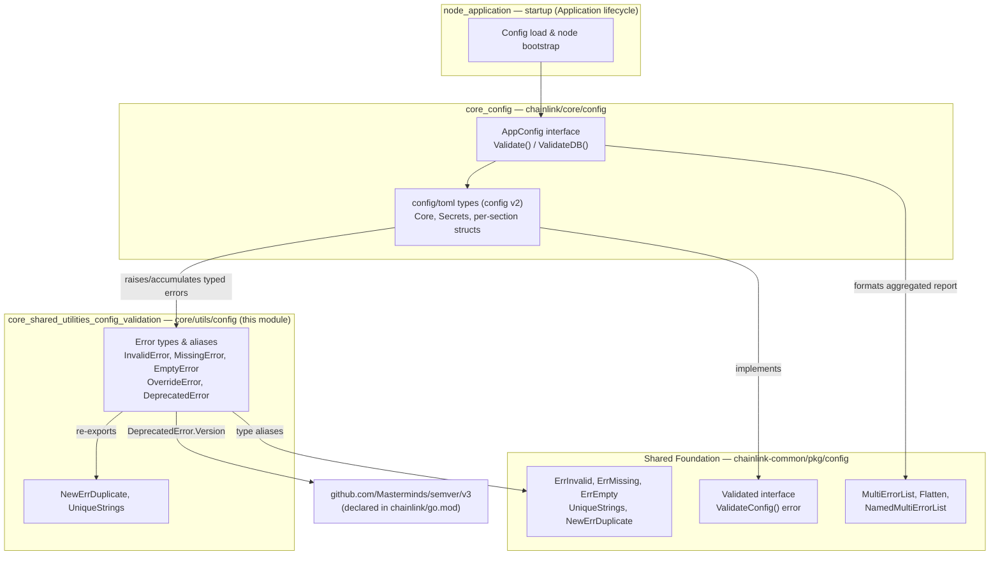
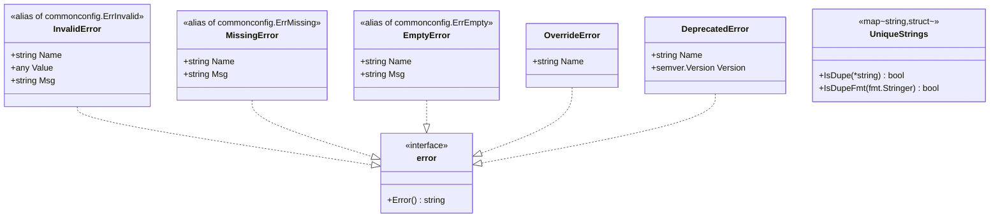
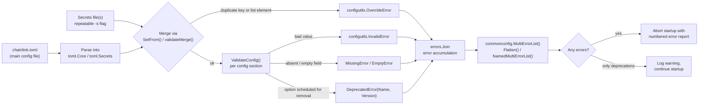
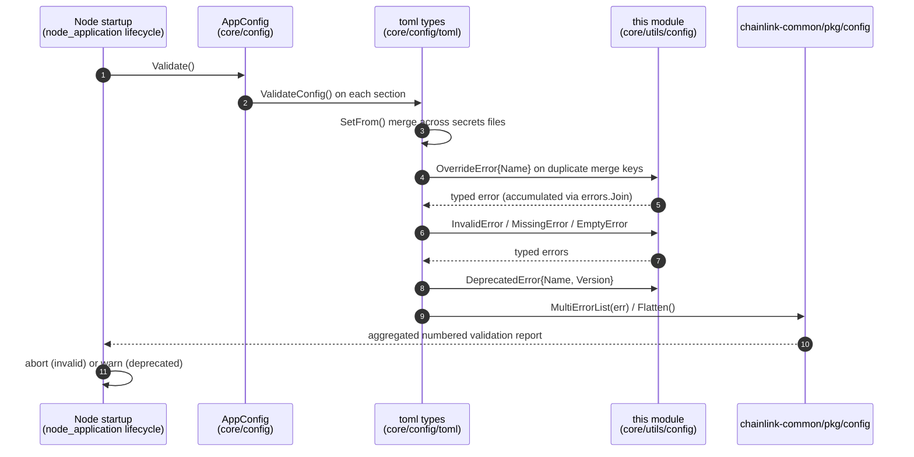
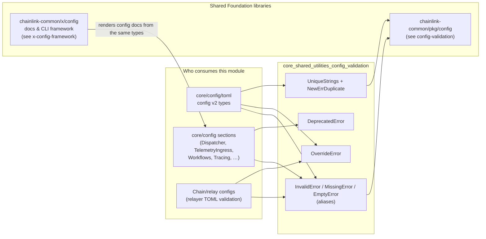

# core_shared_utilities — Config Validation

> **Source:** [`chainlink/core/utils/config/validate.go`](../../chainlink/core/utils/config/validate.go) · **Core component:** `DeprecatedError`

## 1. Introduction

The `core_shared_utilities_config_validation` module is the **node's shared validation vocabulary**: a small, dependency-light package (`chainlink/core/utils/config`) that defines the canonical error types, deprecation reporting, and uniqueness helpers used whenever a Chainlink node validates its TOML configuration and merges multiple config/secrets files.

It is intentionally a *facade*: most of the heavy lifting (base error structs, error aggregation, the `Validated` interface) lives in the shared library [`chainlink-common/pkg/config`](../../Shared_Foundation_Libraries___Domain_Types/config-validation.md). This module re-exports those primitives under core-owned names, adds two core-specific error types (`OverrideError`, `DeprecatedError`), and preserves legacy `Err*` aliases so older call sites keep compiling.

### Design goals

| Goal | How it is achieved |
|---|---|
| Uniform error taxonomy across all config packages | Type aliases to `chainlink-common/pkg/config` errors (`InvalidError`, `MissingError`, `EmptyError`) |
| Reject silent override of secrets across multiple `-s` files | `OverrideError`, checked inside `SetFrom`/`validateMerge` |
| Warn operators about config options scheduled for removal | `DeprecatedError` with an optional `semver.Version` removal target |
| Report *all* validation problems, not just the first | Combined with `errors.Join` / `commonconfig.MultiErrorList` aggregation |
| Zero-drama refactoring of error names | Deprecated `Err*` aliases (`ErrInvalid`, `ErrMissing`, `ErrEmpty`, `ErrOverride`, `ErrDeprecated`) |

---

## 2. Architecture and Dependencies

The module sits at the bottom of the configuration stack: it has no configuration behavior of its own but is imported by every config type that implements `ValidateConfig()`.



### External dependencies

| Dependency | Role | Artifact evidence |
|---|---|---|
| `github.com/smartcontractkit/chainlink-common/pkg/config` | Base error structs, `UniqueStrings`, `Validated` interface, error-flattening helpers | See [config-validation](../../Shared_Foundation_Libraries___Domain_Types/config-validation.md) |
| `github.com/Masterminds/semver/v3` | Semantic-version value for `DeprecatedError.Version` removal target | declared in `chainlink/go.mod` (`github.com/Masterminds/semver/v3 v3.5.0`) |

---

## 3. Error Taxonomy

All exported types implement the standard `error` interface. The first four are aliases of the shared-library types; the last two are core-specific.



### Type reference

| Type | Message format | Raised when |
|---|---|---|
| `InvalidError` | `<Name>: invalid value (<Value>): <Msg>` | A config field holds a semantically wrong value (bad chain ID, contradictory flags, unexpandable path, …) |
| `MissingError` | `<Name>: missing: <Msg>` | A required field is absent |
| `EmptyError` | `<Name>: empty: <Msg>` | A present-but-empty field where emptiness is invalid |
| `NewErrDuplicate(name, value)` | `<Name>: invalid value (<Value>): duplicate - must be unique` | Constructor producing a standard `InvalidError` for duplicates |
| `UniqueStrings` | — (helper, not an error) | Detect duplicates while validating lists; non-nil, non-empty strings are recorded, second sighting returns `true` |
| `OverrideError` | `<Name>: overrides (duplicate keys or list elements) are not allowed for multiple secrets files` | Merging multiple secrets files would silently override an already-set key or list element |
| `DeprecatedError` | `<Name>: is deprecated and will be removed in a future version` — or `…in version <v>` when `Version != semver.Version{}` | A config option that is scheduled for removal is still present |

### Backward-compatibility aliases

The legacy names remain available but are formally deprecated, pointing users to the new names:

```go
// Deprecated: use InvalidError instead.
type ErrInvalid = InvalidError
// Deprecated: use MissingError instead.
type ErrMissing = MissingError
// Deprecated: use EmptyError instead.
type ErrEmpty = EmptyError
// Deprecated: use OverrideError instead.
type ErrOverride = OverrideError
// Deprecated: use DeprecatedError instead.
type ErrDeprecated = DeprecatedError
```

This is the same deprecation pattern the module itself documents with `DeprecatedError` — applied to its own API.

---

## 4. Data Flow: How Validation Errors Reach the Operator

The typical lifecycle of a configuration load — *parse → merge secrets → validate → aggregate → report* — is where these types are produced.



Key properties of this flow:

1. **Merge-time rejection (`OverrideError`).** When an operator passes multiple secrets files (repeatable `-s` flag), `SetFrom` methods call `validateMerge` first. Any key that would be *overwritten* rather than *set for the first time* produces an `OverrideError`, and the merge aborts — secrets can never be silently replaced by a later file. The comment in `core/config/toml/types.go` documents this contract: *"Replacing would discard the keys contributed by earlier `-s` files; validateMerge has already rejected any duplicated across them."*
2. **Validate-time accumulation.** Each config section implements the shared [`Validated`](../../Shared_Foundation_Libraries___Domain_Types/config-validation.md) interface (`ValidateConfig() error`). Implementations accumulate errors with `errors.Join` instead of returning the first failure, so an operator fixes everything in one pass.
3. **Aggregation.** The accumulated tree of joined errors is flattened into a numbered list via `commonconfig.MultiErrorList` / `Flatten` / `NamedMultiErrorList` before being printed.

### Sequence: node startup validation



---

## 5. Real Usage in the Codebase

The sibling [`core_config`](../core_config.md) module's TOML v2 types (`chainlink/core/config/toml`) are the primary consumer, imported as `configutils "github.com/smartcontractkit/chainlink/v2/core/utils/config"`:

```go
// core/config/toml/types.go — top-level Core section
func (c *Core) ValidateConfig() (err error) {
    _, verr := parse.HomeDir(*c.RootDir)
    if verr != nil {
        err = errors.Join(err, configutils.InvalidError{Name: "RootDir", Value: true,
            Msg: fmt.Sprintf("Failed to expand RootDir. Please use an explicit path: %s", verr)})
    }
    if (*c.OCR.Enabled || *c.OCR2.Enabled) && !*c.P2P.V2.Enabled {
        err = errors.Join(err, configutils.InvalidError{Name: "P2P.V2.Enabled", Value: false,
            Msg: "P2P required for OCR or OCR2. Please enable P2P or disable OCR/OCR2."})
    }
    return err
}

// core/config/toml/types.go — secrets merge rejection
func (a *AptosKeys) validateMerge(f *AptosKeys) (err error) {
    // …
    if _, ok := have[*aptosKey.ID]; ok {
        err = errors.Join(err, configutils.OverrideError{Name: fmt.Sprintf("AptosKeys: %d", *aptosKey.ID)})
    }
    // …
}
```

Patterns visible here, all enabled by this module:

- **Cross-field invariants** — e.g. OCR/OCR2 require P2Pv2; conflicting tracing vs. telemetry endpoints.
- **Section-level naming** — errors carry the config path (`P2P.V2.Enabled`, `AptosKeys: 42`) so the numbered report maps directly to TOML keys.
- **Per-key uniqueness** — chain-key lists (Solana, Aptos, Stellar, EVM keys) reject duplicate IDs both at merge time (`OverrideError`) and validate time (`NewErrDuplicate` / `UniqueStrings`).

These validated section types are surfaced to the rest of the node through the `AppConfig` interface (see [node_application_config](../node_application/node_application_config.md)).

---

## 6. Component Interaction Summary



Related documentation (no duplication here):

- **Parent module:** [core_shared_utilities](../core_shared_utilities.md) — overview of all shared utilities.
- **Upstream validation primitives:** [config-validation](../../Shared_Foundation_Libraries___Domain_Types/config-validation.md) (`Validated`, `ErrInvalid`, `KeyNotFoundError`, `MultiErrorList`).
- **Config definitions that adopt these errors:** [core_config](../core_config.md) and its sub-modules ([dispatcher](../core_config/core_config_dispatcher.md), [chain keys](../core_config/core_config_chain_keys.md), [observability](../core_config/core_config_observability.md), [workflows](../core_config/core_config_workflows.md)).
- **Where validated config is consumed at boot:** [node_application_config](../node_application/node_application_config.md) and [node_application_lifecycle](../node_application/node_application_lifecycle.md).

---

## 7. Maintenance Notes

- **Adding a new error kind:** prefer extending `chainlink-common/pkg/config` (so relayers and other services share it) and alias it here, mirroring the `InvalidError` pattern. Only core-specific semantics (like secrets-file override rules) belong as concrete types in this package.
- **Renaming error types:** never remove the legacy `Err*` aliases while they are still referenced; they exist precisely to keep renames (`ErrOverride → OverrideError`, …) backward compatible.
- **Deprecation lifecycle:** when removing a config option, first annotate it with a `DeprecatedError` carrying the target `semver.Version`; operators get a precise removal timeline instead of an open-ended "future version" warning. The deprecated field should continue parsing (no effect) until the removal release — the same retention pattern used for, e.g., `InsecurePPROFHeap` and the removed FluxMonitor section in `core/config/toml`.
- **Secrets-merge safety:** `OverrideError` exists to guarantee *no silent overwrite* of secrets; any new mergeable secrets section must implement `validateMerge` and return `OverrideError` (not a plain `InvalidError`) on conflicts, per the established convention in `core/config/toml/types.go`.
