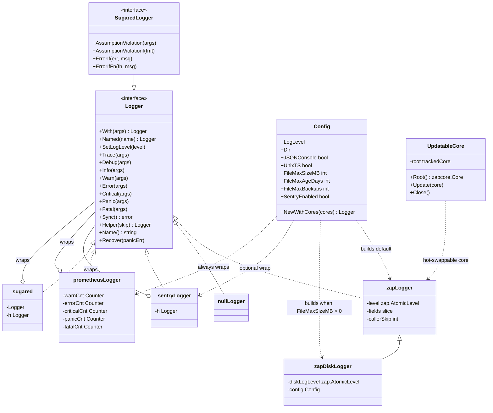
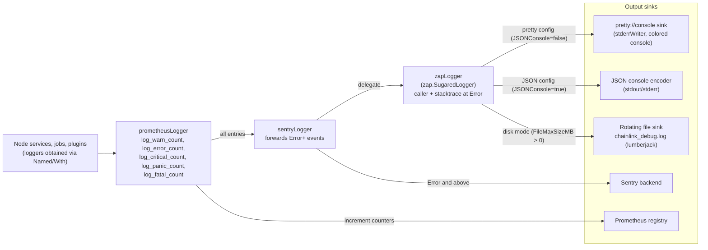
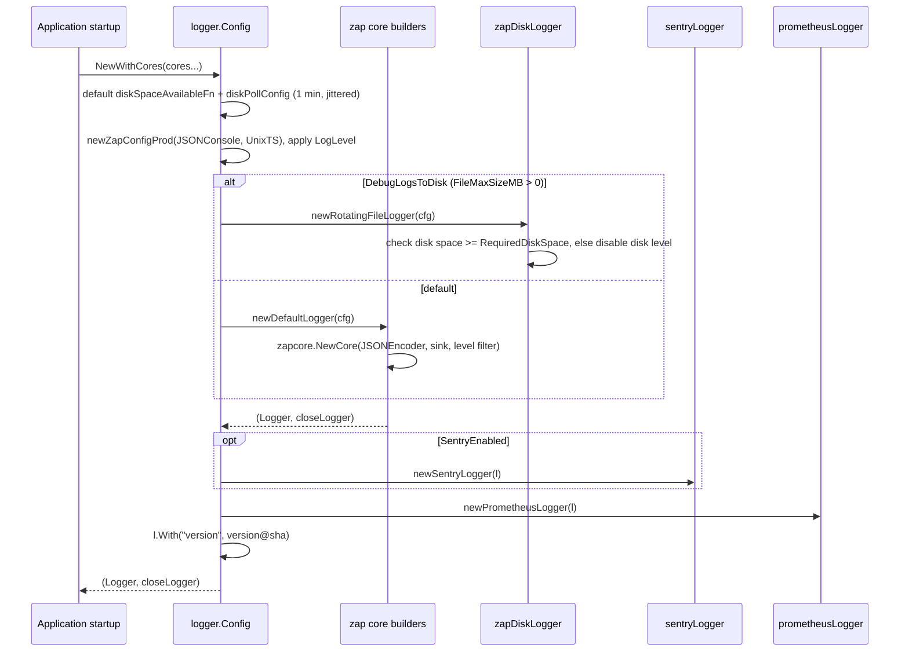
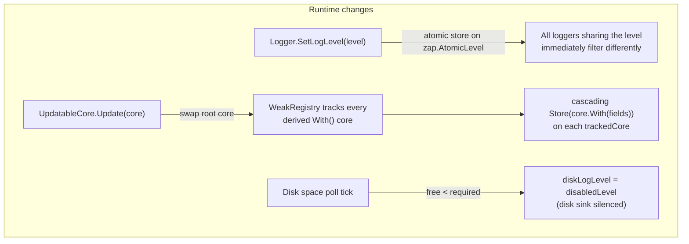
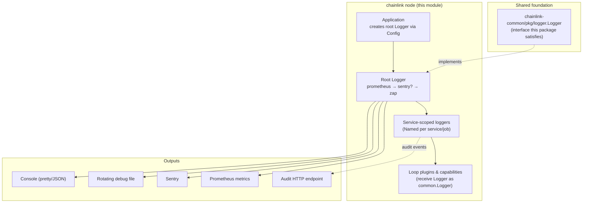

# Core Shared Utilities: Logging (`chainlink/core/logger`)

## 1. Overview

The `core/logger` package is the **canonical logging subsystem of the Chainlink node**. It defines the node-wide `Logger` contract, a high-performance [uber/zap](https://github.com/uber-go/zap)-based production implementation, structured-console and rotating-file output, and a set of decorator wrappers that add Sentry error forwarding, Prometheus counters, and test ergonomics on top of any `Logger`.

The module's named core component, `nullLogger` (`chainlink/core/logger/null_logger.go`), implements the **Null Object pattern**: it is a fully-functional, do-nothing `Logger` that lets code paths run without logging, without nil checks, and without nil-pointer panics.

This package sits at the very bottom of the node's dependency graph — it is a *core shared utility* consumed by virtually every other module in the system (application lifecycle, platform services, oracle engines, web API, CLI, and plugins), while depending on almost nothing itself.

> **Related pages**
> - Parent utilities index: [Core Shared Utilities](../core_shared_utilities.md)
> - Node wiring and lifecycle: [Node Application Lifecycle](../node_application/node_application_lifecycle.md)
> - Shared (cross-repo) logger contract: [Shared Foundation: Logger](../../Shared_Foundation_Libraries___Domain_Types/logger.md)
> - Sibling utilities: [ABI Helpers](core_shared_utilities_abi_helpers.md), [Config Validation](core_shared_utilities_config_validation.md), [Test Support](core_shared_utilities_test_support.md)
> - External telemetry pipelines: [Telemetry & Observability Platform](../../Telemetry___Observability_Platform.md)

---

## 2. Key Components

| Component | File | Kind | Purpose |
|---|---|---|---|
| `Logger` | `chainlink/core/logger/logger.go` | Interface | The node's logging contract: levels, `With`/`Named` scoping, `Sync`, `Helper`, `Recover`. Structurally compatible with `chainlink-common/pkg/logger.Logger`. |
| `zapLogger` | `chainlink/core/logger/zap.go` | Implementation | Production implementation embedding `*zap.SugaredLogger`; owns the atomic log level and caller-skip bookkeeping. |
| `nullLogger` / `NullLogger` | `chainlink/core/logger/null_logger.go` | Implementation | No-op logger singleton (`NullLogger Logger = &nullLogger{}`) used where logging is intentionally disabled. |
| `SugaredLogger` / `Sugared()` | `chainlink/core/logger/sugared.go` | Interface + wrapper | Adds `AssumptionViolation*`, `ErrorIf`, and `ErrorIfFn` convenience helpers to any `Logger`. |
| `Config` | `chainlink/core/logger/logger.go` | Struct | Construction options (level, file rotation, JSON/pretty console, Sentry) and `NewWithCores(...)` factory. |
| `sentryLogger` | `chainlink/core/logger/sentry.go` | Decorator | Forwards `Error`-and-above entries to Sentry; coordinates with `Recover` to avoid double reporting. |
| `prometheusLogger` | `chainlink/core/logger/prometheus.go` | Decorator | Increments `log_{warn,error,critical,panic,fatal}_count` counters for observability dashboards. |
| `TestLogger`, `TestLoggerObserved` | `chainlink/core/logger/test_logger.go` | Test helper | zaptest-backed loggers with optional `observer.ObservedLogs` for assertions. |
| `zapDiskLogger` | `chainlink/core/logger/zap_disk_logging.go` | Implementation | Optional debug-log-to-disk mode with rotation (lumberjack) and disk-space self-preservation. |
| `UpdatableCore` / `trackedCore` | `chainlink/core/logger/zap.go` | Infrastructure | Thread-safe, hot-swappable `zapcore.Core` with cascading updates to all derived cores. |
| `Fields` | `chainlink/core/logger/fields.go` | Helper | Ordered map type for building structured key/value field slices. |
| `audit.LoggerService` | `chainlink/core/logger/audit/audit_logger.go` | Service | Separate buffered audit-event forwarder to an HTTP endpoint (`AUDIT_LOGS_*` env config). |

---

## 3. Architecture

The package is organised as a small core (`zapLogger`) surrounded by **decorating wrappers** that all satisfy the same `Logger` interface. Callers never know which layers are present; the production stack is assembled in `Config.NewWithCores`.



Key static guarantees enforced in code:

- `var _ common.Logger = (Logger)(nil)` — the core `Logger` satisfies the shared `chainlink-common/pkg/logger.Logger` interface, so any core logger can be handed to cross-repo modules (Loop plugins, common services). See [Shared Foundation: Logger](../../Shared_Foundation_Libraries___Domain_Types/logger.md).
- `var _ Logger = &zapLogger{}` and `var _ Logger = &zapDiskLogger{}` — compile-time interface checks for implementations.

---

## 4. Log-Level Semantics

The `Logger` doc comment (`logger.go`) prescribes the operational meaning of each level. These conventions are consistent across the entire node codebase:

| Level | Meaning | Example |
|---|---|---|
| `Fatal` | Logs then calls `os.Exit(1)`; does **not** unwind the stack | Reserved for unrecoverable startup failures |
| `Panic` | Unrecoverable error / invariant violation / programmer error | Corrupted internal state |
| `Critical` | Requires quick action from the node operator; extremely rare | Failed to listen on TCP port |
| `Error` | Clearly node-side fault; no immediate action needed | Database write timed out |
| `Warn` | Fault with unclear attribution; review periodically | Peer connection closed unexpectedly |
| `Info` | High-level operational events; first level operators watch | Entered new epoch, observation submitted |
| `Debug` | Forensic detail; not expected to be watched | Message received / dropped |
| `Trace` | Only compiled in with the `trace` build tag (`go test -tags trace`) | Per-call tracing with `[TRACE] ` prefix |

Notes on special variants:

- **Trace** methods are `//go:build trace` gated (`trace.go`); without the tag (`trace_noop.go`) they are free no-ops, so `Trace` calls are safe to leave in hot paths.
- **`Recover(panicErr)`** reports recovered goroutine panics at `Critical` level ("Recovered goroutine panic") while avoiding double-reporting to Sentry.
- **`Fatal`** logs and calls `os.Exit(1)` immediately — use with care, as deferred functions and stack unwinding are skipped.

---

## 5. Logging Data Flow

A production `Logger` is an onion: the caller talks to the outermost decorator, and the entry travels through the decorators into the zap core and finally to the configured sinks.



Implementation details behind each hop:

1. **`prometheusLogger`** (outermost): counts entries at `Warn`, `Error`, `Critical`, `Panic`, `Fatal` then delegates. Counters are registered process-wide via `promauto` and surface through the node's standard Prometheus endpoint (see [Node Platform Services](../../Node_Platform_Services.md)).
2. **`sentryLogger`** (optional, only when `Config.SentryEnabled`): mirrors every call to the wrapped logger and additionally ships `Error`-and-above entries to Sentry with a 5s flush deadline (`SentryFlushDeadline`). It uses `l.Helper(1)` so caller annotations stay accurate.
3. **`zapLogger`**: embeds `*zap.SugaredLogger`, created with `zap.AddCaller()` and `zap.AddStacktrace(zapcore.ErrorLevel)`. `With` copies the structured field list, `Named` produces dot-separated hierarchical names (`A` → `A.B`), and `Helper(skip)` bumps the caller-skip so wrapper frames don't pollute caller annotations.
4. **Sinks**:
   - `pretty://console` — a custom zap sink scheme registered in `init()` (`prettyconsole.go`), writing colourised console output to `stderrWriter` (a stable wrapper around `os.Stderr`). Colours are controlled by `InitColor` and the `CL_LOG_COLOR=true` environment variable.
   - JSON console — the default `zap.NewProductionEncoderConfig` encoder; `UnixTS=false` selects ISO-8601 timestamps.
   - Rotating file — `zapDiskLogger` writes console-encoded entries to `<Dir>/chainlink_debug.log` via `lumberjack` with size/age/backup limits and compression.

---

## 6. Construction & Startup Flow

`Config.NewWithCores` assembles the full stack. This happens once, during node startup (see [Node Application Lifecycle](../node_application/node_application_lifecycle.md)).



Disc-space self-preservation: `zapDiskLogger` polls free disk space (default every minute, jittered) and compares it with `RequiredDiskSpace()` = `FileMaxSizeMB × MB × (FileMaxBackups + 1)`. If available space is insufficient, the disk-specific level is set to `disabledLevel` (`zapcore.FatalLevel + 1`), silencing disk output while console logging continues.

---

## 7. Dynamic Reconfiguration

Two mechanisms allow a running node to change logging behaviour without restart:



- **`SetLogLevel(zapcore.Level)`** operates on a `zap.AtomicLevel` shared by the logger family — a cheap, thread-safe level flip (used, for example, by administrative endpoints).
- **`UpdatableCore`** goes further: it wraps the root `zapcore.Core` in a `trackedCore` and registers every derived `With(...)` core in a `WeakRegistry`. Calling `Update(core)` atomically replaces the underlying core of the root *and* all tracked descendants, re-applying their accumulated `zapcore.Field`s. This enables wholesale core swaps (e.g. switching sink implementations at runtime) while preserving per-logger context fields.
- **Disk-space polling** continuously protects the host from filling its disk with debug logs.

---

## 8. The `nullLogger` Core Component

`chainlink/core/logger/null_logger.go` provides the package-level singleton:

```go
var NullLogger Logger = &nullLogger{}
```

`nullLogger` implements the **entire** `Logger` interface as a no-op. This is the [Null Object pattern](https://en.wikipedia.org/wiki/Null_object_pattern) applied to logging: instead of `if lggr != nil` guards or nil-pointer panics scattered through the codebase, every consumer can always assume it holds a valid `Logger`.

### 8.1 Behavioural contract

| Method group | Behaviour |
|---|---|
| `With`, `Named`, `Helper` | Return **the same instance** (`l`) — derived loggers are still no-ops, so scoping is free and allocation-free |
| `SetLogLevel` | No-op (there is no level to change) |
| `Trace…Debug…Info…Warn…Error…Critical…Panic…Fatal…` (plain, `f`, and `w` variants — 24 methods) | Immediate return; nothing is formatted or emitted |
| `Sync` | Returns `nil` — callers can safely defer `Sync()` |
| `Name` | Returns the literal string `"nullLogger"`, which makes it identifiable if it ever leaks into diagnostics |
| `Recover` | No-op — recovered panics are silently swallowed (appropriate only where logging is intentionally disabled) |

### 8.2 When to use it

- **Optional logging**: code that accepts a `Logger` but may be constructed without one can default to `logger.NullLogger` rather than special-casing `nil`.
- **Test scaffolding and benchmarks**: suppress log noise where `TestLogger` output would pollute results (for assertions prefer `TestLoggerObserved` instead).
- **Disabled features**: components whose logging is turned off by configuration can be handed `NullLogger` to keep control flow identical between enabled/disabled modes.

### 8.3 Caveats

- Because `With`/`Named` return the singleton itself, all "derived" null loggers share identity — code that relies on distinct logger names for assertions will not work with `NullLogger` (use `TestLogger`/`TestLoggerObserved` for that).
- `Recover` intentionally does nothing; never route real panic recovery through `NullLogger` in production paths.
- The pattern's value is in **non-negotiable interface fulfilment**: like `zapLogger`, it is guarded by the interface contract, so swapping a real logger for `NullLogger` (or vice versa) requires no caller changes.

A similar no-op philosophy appears elsewhere in the system — e.g. the audit package's own `audit.NoopLogger` and the shared-package default logger — each scoped to its own interface.

---

## 9. Sugared Helpers

`Sugared(l Logger) SugaredLogger` wraps any `Logger` with ergonomic helpers commonly needed across the codebase:

- `AssumptionViolation(args...)` / `...f` / `...w` — logs at `Error` level with the prefix `"AssumptionViolation: "`, flagging invariant violations that indicate bugs.
- `ErrorIf(err, msg)` — logs `msg` with `{"err": err}` only when `err != nil`.
- `ErrorIfFn(fn, msg)` — invokes `fn()` (typically a deferred closure) and logs its error if non-nil; safe to use in `defer` statements.

The wrapper maintains a pre-computed `Helper(1)` logger so stack-trace callers point at user code rather than the wrapper itself.

---

## 10. Test Support

The package is also the test-time logging toolkit for the entire repo (see also [Test Support](core_shared_utilities_test_support.md)):

- **`TestLogger(tb, lvl...)`** — returns a `SugaredLogger` backed by `zaptest`, writing to the `testing.TB` output at `Debug` level by default. Used pervasively by unit tests.
- **`TestLoggerObserved(tb, lvl)`** — returns both the logger and an `observer.ObservedLogs` handle, letting tests assert on emitted entries (levels, messages, fields).
- **`logger_mocks.go`** — generated mocks of the `Logger` interface for isolated unit tests.
- `Trace` in tests is enabled by compiling with `-tags trace` (see level semantics above).

---

## 11. Audit Logging (Sub-package `core/logger/audit`)

Distinct from the general-purpose logger, the `audit` sub-package implements a **compliance-oriented event forwarder** (`audit.LoggerService`):

- Ingests `Audit(eventID, data)` events into a bounded buffer (`bufferCapacity = 2048`) consumed by a background goroutine (it is a `services.Service` with `Start`/`Close` lifecycle).
- Asynchronously POSTs events as JSON (optionally wrapped under a configured key) to a `forwardToURL` with configured headers, hostname, and local-IP enrichment.
- Configured via `AUDIT_LOGS_*` environment variables; when unset/disabled, `NewAuditLogger` returns an inert `NoopLogger` instance rather than an error — the same "always valid handle" philosophy as `NullLogger`.
- The node's user/session controllers use it for security-relevant events (see [Web API](../web_api.md)).

---

## 12. Integration with the Wider System



- **Application lifecycle** (`services/chainlink`): the root logger is built from node configuration and injected into every service; services derive their own scoped loggers via `Named`. Configuration of the `logger.Config` fields (level, JSON console, file rotation, Sentry) comes from the node's TOML configuration — see [Node Application Config](../node_application/node_application_config.md) and the node-operator docs referenced in `logger.go`.
- **Platform services**: log-derived metrics (`log_*_count`) feed the node's Prometheus endpoint; Sentry integration provides external error alerting.
- **Cross-repo compatibility**: because core `Logger` satisfies `chainlink-common/pkg/logger.Logger`, the same handle flows into Loop plugin processes and the capability runtime without adapters.
- **Telemetry**: this module handles *application logs*; structured event telemetry (OTLP/Beholder, CHIP ingress) is a separate pipeline — see [Telemetry & Observability Platform](../../Telemetry___Observability_Platform.md).

---

## 13. Usage Guidelines

**Do**

- Inject loggers and derive scopes: `lggr.Named("TxManager")`, add context with `lggr.With("jobID", id)`.
- Use `Sugared(lggr)` helpers (`ErrorIfFn` for deferred close calls, `AssumptionViolation*` for invariant violations).
- Call `Recover(panicErr)` in goroutine recovery paths instead of logging panics directly.
- Prefer `Debug` for high-frequency forensic output; keep `Info` genuinely high-level.

**Don't**

- Use `Fatal` outside startup paths (it skips deferred functions and exits via `os.Exit(1)`).
- Assume `With`/`Named` on `NullLogger` create distinct loggers (they return the singleton).
- Log sensitive material (keys, secrets) — remember `SentryEnabled` ships `Error+` entries off-node.

---

## 14. Source References

| File | Contents |
|---|---|
| `chainlink/core/logger/null_logger.go` | `nullLogger`, `NullLogger` singleton |
| `chainlink/core/logger/logger.go` | `Logger` interface, `Config`, `NewLogger`, factory pipeline, level semantics |
| `chainlink/core/logger/zap.go` | `zapLogger`, `UpdatableCore`, `trackedCore`, `atomicCore` |
| `chainlink/core/logger/sugared.go` | `SugaredLogger`, `Sugared`, assumption-violation helpers |
| `chainlink/core/logger/sentry.go` | `sentryLogger` decorator |
| `chainlink/core/logger/prometheus.go` | `prometheusLogger` and log counters |
| `chainlink/core/logger/zap_disk_logging.go` | `zapDiskLogger`, disk-space polling, `disabledLevel` |
| `chainlink/core/logger/prettyconsole.go` | `pretty://` zap sink registration |
| `chainlink/core/logger/trace.go` / `trace_noop.go` | Build-tag-gated `Trace` implementation / no-op |
| `chainlink/core/logger/test_logger.go` | `TestLogger`, `TestLoggerObserved` |
| `chainlink/core/logger/fields.go` | `Fields` helper type |
| `chainlink/core/logger/audit/audit_logger.go` | Audit event forwarder service |