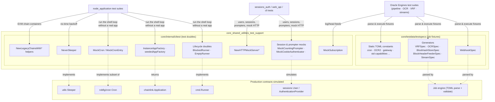
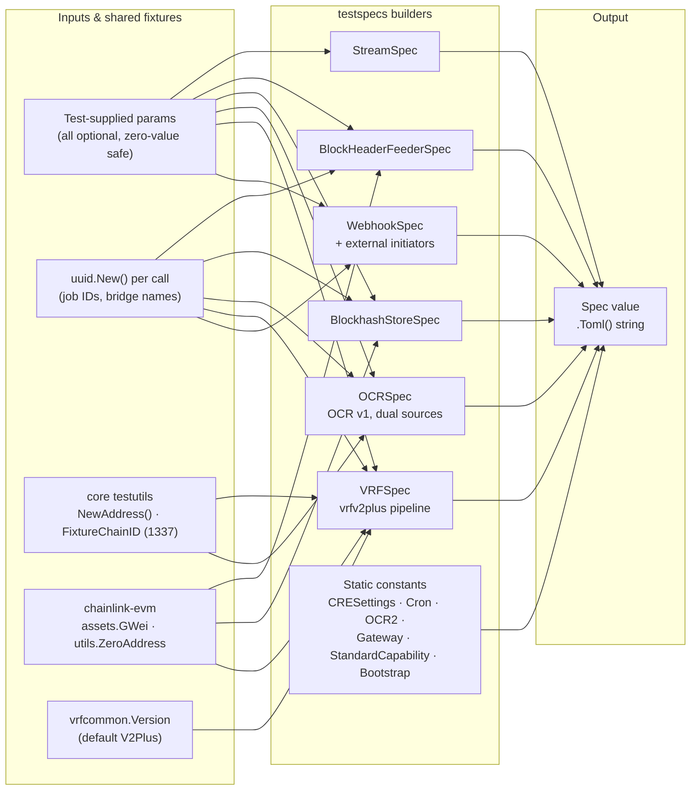
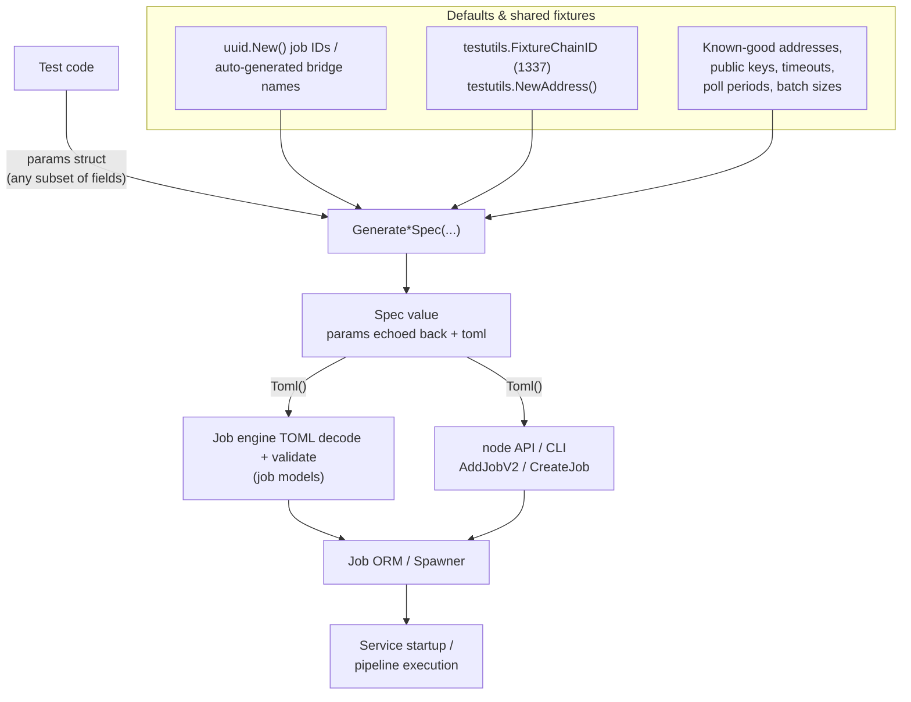
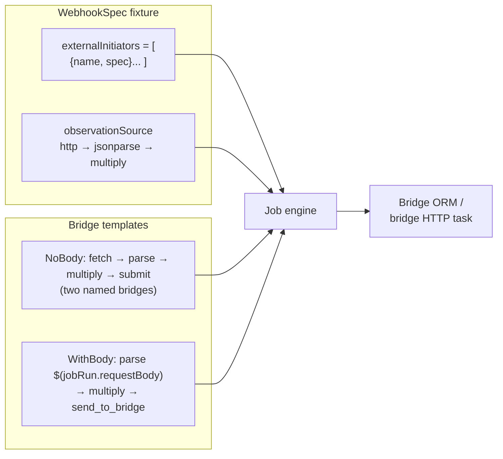
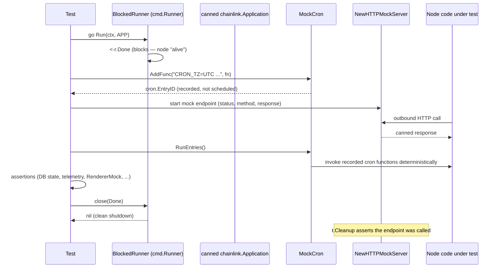
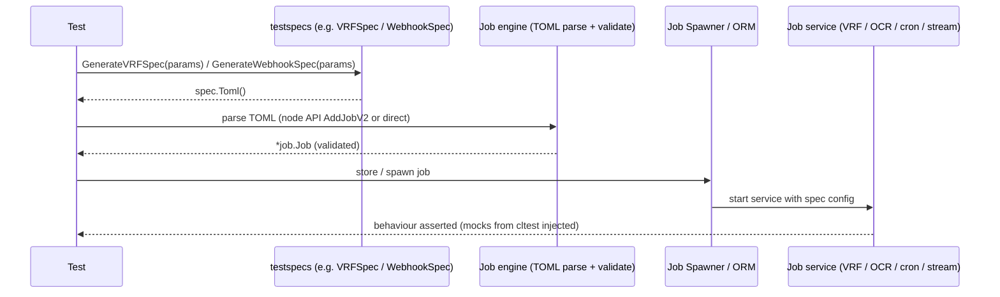

# Core Shared Utilities: Test Support (`cltest` & `testspecs`)

> **Module:** `core_shared_utilities_test_support`
> **Sources:** `chainlink/core/internal/cltest/mocks.go` · `chainlink/core/testdata/testspecs/v2_specs.go`
> **Parent:** [Core Shared Utilities](../core_shared_utilities.md)

## 1. Overview

`core_shared_utilities_test_support` is the **in-process test scaffolding of the Chainlink node**. It is a test-only corner of the `core_shared_utilities` family (see [Core Shared Utilities](../core_shared_utilities.md)): unlike the runtime utilities (logging, ABI helpers, config validation), nothing in this module runs in a production node. Instead, it provides two complementary toolkits that the node's Go test suites import to build fast, deterministic, hermetic tests:

| Package | Kind of support | Core components |
|---|---|---|
| `chainlink/core/internal/cltest` | **Hand-written test doubles** for the node's own contracts — lifecycle runners, cron, backoff sleepers, subscriptions, application factories, HTTP mock servers, sessions/auth/prompter mocks, user factories and legacy-chain builders | `BlockedRunner`, `MockCron`, `NeverSleeper` (+ a supporting cast of ~15 helpers) |
| `chainlink/core/testdata/testspecs` | **Parameterized job-spec fixtures** — ready-made TOML strings for every job type the node understands (webhook, VRF, OCR/OCR2, cron, gateway, streams, standard capabilities, CRE settings, blockhash store, block header feeder) | `WebhookSpec` (+ sibling spec builders) |

The two halves serve different layers of the test pyramid:

- `cltest` mocks replace the **plumbing** — they let a test run the node shell, schedulers and retry loops without a real application, real wall-clock time, or real network endpoints.
- `testspecs` fixtures supply the **payload** — valid TOML job definitions that can be parsed by the job engine, stored through the job ORM, and submitted through the node API, exactly as a production operator would.

> **Related pages**
> - Parent utilities index: [Core Shared Utilities](../core_shared_utilities.md)
> - Contracts being stood in for: [Node Application Lifecycle](../node_application/node_application_lifecycle.md), [Job Service](../../Node_Platform_Services/job_service.md), [Sessions & Auth](../sessions_auth.md), [CLI Commands](../cli_commands.md), [Web API](../web_api.md)
> - Subsystems exercised by the spec fixtures: [Pipeline](../../Oracle_Engines___Data_Pipelines/pipeline.md), [OCR](../../Oracle_Engines___Data_Pipelines/ocr.md), [VRF](../../Oracle_Engines___Data_Pipelines/vrf.md), [Streams](../../Oracle_Engines___Data_Pipelines/streams.md)
> - Larger-scale environments that build on these ideas: [Dev, Test & Simulation Environments](../../Dev,_Test___Simulation_Environments.md)
> - Sibling runtime utilities: [Logging](core_shared_utilities_logging.md), [ABI Helpers](core_shared_utilities_abi_helpers.md), [Config Validation](core_shared_utilities_config_validation.md)

---

## 2. Key Components

### 2.1 `chainlink/core/internal/cltest/mocks.go` (package `cltest`)

| Component | Kind | Purpose |
|---|---|---|
| `BlockedRunner` | **Core component** | A `Runner` whose `Run(ctx, chainlink.Application)` blocks on a `Done` channel — keeps a "node" alive in tests until the test explicitly releases it |
| `MockCron` | **Core component** | Cron scheduler stand-in that records `AddFunc` entries instead of scheduling; `RunEntries()` fires them deterministically |
| `NeverSleeper` | **Core component** | Backoff-sleeper no-op: `Reset`/`Sleep` do nothing, `After`/`Duration` return zero — makes retry loops burn no test time |
| `MockSubscription` / `EmptyMockSubscription` | Helper | Mock log/head subscription with buffered `Err()` channel and idempotent, type-aware `Unsubscribe` |
| `EmptyRunner` | Helper | Runner that returns `nil` immediately (node "exits" instantly) |
| `RendererMock` | Helper | Captures `Render(v, headers...)` calls for CLI output assertions |
| `InstanceAppFactory`, `seededAppFactory`, `noopStopApplication` | Helper | Application factories returning a canned `chainlink.Application`; the seeded variant makes `Stop()` a no-op |
| `MockCountingPrompter` | Helper | Scripted `Prompt`/`PasswordPrompt` returning queued strings in order; fails the test when exhausted |
| `NewHTTPMockServer` (+3 variants) | Helper | `httptest` servers with method/status/body assertions and `t.Cleanup` verification that the endpoint was called |
| `MustRandomUser`, `NewUserWithSession` | Helper | Creates a random admin `sessions.User` (and optionally a session) in the test DB |
| `MockAPIInitializer` | Helper | Sessions API initializer that finds or creates the admin user, counting creations |
| `MockCookieAuthenticator`, `NewMockAuthenticatedHTTPClient` | Helper | Cookie-based authentication stub for CLI `HTTPClient` tests |
| `MockSessionRequestBuilder`, `MockSecretGenerator` | Helper | Fixed `SessionRequest` builder and fixed session-secret generator |
| `MockPasswordPrompter`, `MockChangePasswordPrompter` | Helper | Fixed-password and `web.UpdatePasswordRequest` prompters |
| `NewLegacyChainsWithMockChain`, `NewLegacyChainsWithMockChainAndTxManager`, `NewLegacyChainsWithChain` | Helper | Builds a `legacyevm.LegacyChainContainer` around a mocked chain (optionally with a `TxManager`) |

### 2.2 `chainlink/core/testdata/testspecs/v2_specs.go` (package `testspecs`)

| Component | Kind | Purpose |
|---|---|---|
| `WebhookSpec` | **Core component** | Builder for webhook job TOML with external initiators (`GenerateWebhookSpec`, `Toml()`) |
| `WebhookSpecParams`, `TOMLWebhookSpecExternalInitiator` | Helper | Inputs: a list of `{name, spec}` external initiator TOML entries |
| Static TOML constants | Helper | `CRESettingsSpec`, `CronSpecTemplate`, `CronSpecDotSepTemplate`, `CronSpecEVMChainIDTemplate`, `OCR2EVMSpecMinimalTemplate`, `OCR2EVMDualTransmissionSpecMinimalTemplate`, `WebhookSpecNoBodyTemplate`, `WebhookSpecWithBodyTemplate`, `OCRBootstrapSpec`, `GatewaySpec`, `StandardCapabilitySpec` |
| Fixed-spec getters | Helper | `GetCRESettingsSpec`, `GetGatewaySpec`, `GetOCRBootstrapSpec`, `GetOCR2EVMSpecMinimal`, `GetWebhookSpecNoBody`, `GetStandardCapabilitySpec` |
| `VRFSpec` / `VRFSpecParams` / `GenerateVRFSpec` | Helper | VRF v2+ job spec with full observation pipeline and rich defaults |
| `OCRSpec` / `OCRSpecParams` / `GenerateOCRSpec` | Helper | OCR (v1) job spec with dual data sources and hermetic bridge mode |
| `BlockhashStoreSpec` / `GenerateBlockhashStoreSpec` | Helper | Blockhash-store job spec (VRF support job) |
| `BlockHeaderFeederSpec` / `GenerateBlockHeaderFeederSpec` | Helper | Block-header-feeder job spec (VRF support job) |
| `StreamSpec` / `GenerateStreamSpec` | Helper | Streams job spec with the canonical `http → jsonparse → multiply` pipeline |

---

## 3. Architecture

The module is two parallel test-support packages. Their consumers are the **test suites** of nearly every other module; the contracts they simulate are defined in the production modules documented elsewhere in this wiki.



### 3.1 Contract parity: production interface ↔ test double

The central design idea is **interface parity**: every double implements the same Go interface its production counterpart does, so test code paths are structurally identical to production ones.

| Production contract | Where defined | Test double(s) in this module |
|---|---|---|
| `cmd.Runner` (`Run(ctx, chainlink.Application) error`) | Node shell / [node_application_lifecycle](../node_application/node_application_lifecycle.md) | `BlockedRunner`, `EmptyRunner` |
| `chainlink.Application` | [node_application_lifecycle](../node_application/node_application_lifecycle.md) | canned instance returned by `InstanceAppFactory` / `seededAppFactory` (wrapped by `noopStopApplication`) |
| `cron.Cron` (Start/Stop/AddFunc) | Scheduler usage across services | `MockCron` + `MockCronEntry` |
| `utils.Sleeper` (Reset/Sleep/After/Duration) | Backoff loops in pipeline & services | `NeverSleeper` |
| Log/head subscription | Chain feeds (EVM heads, logs) | `MockSubscription` |
| `sessions.AuthenticationProvider`, `BasicAdminUsersORM` | [sessions_auth](../sessions_auth.md) | `MockAPIInitializer`, `NewUserWithSession`, `MustRandomUser` |
| CLI authenticator / renderer / prompter / secret generator | [cli_commands](../cli_commands.md) | `MockCookieAuthenticator`, `RendererMock`, `MockCountingPrompter`, `MockPasswordPrompter`, `MockChangePasswordPrompter`, `MockSessionRequestBuilder`, `MockSecretGenerator` |
| EVM `Chain` / `TxManager` | [Node Platform Services](../../Node_Platform_Services.md) | generated `evmmocks.Chain` composed by `NewLegacyChainsWith*` |
| Job spec TOML schema | Job engine ([job_service](../../Node_Platform_Services/job_service.md)) | all `testspecs` fixtures |

Note the one deliberate **dependency inversion**: `cltest` is a test-only package that imports `chainlink.Application` (and the EVM tx manager / keystore / web packages) purely to satisfy those contracts — it is never linked into production binaries.

### 3.2 `cltest` component relationships

```mermaid
classDiagram
    class cmd_Runner {
        <<interface>>
        +Run(ctx, app) error
    }
    class BlockedRunner {
        +Done chan struct{}
        +Run(ctx, app) error
    }
    class EmptyRunner {
        +Run(ctx, app) error
    }
    class Application {
        <<interface chainlink.Application>>
    }
    class AppFactory {
        <<interface>>
        +NewApplication(ctx, cfg, lggr, reg, ds, master) Application
    }
    class InstanceAppFactory {
        +App Application
    }
    class seededAppFactory
    class noopStopApplication {
        +Stop() error
    }
    class MockCron {
        +Entries []MockCronEntry
        -nextID cron.EntryID
        +Start()
        +Stop() context.Context
        +AddFunc(spec, fn) cron.EntryID
        +RunEntries()
    }
    class MockCronEntry {
        +Schedule string
        +Function func()
    }
    class utils_Sleeper {
        <<interface>>
        +Reset()
        +Sleep()
        +After() time.Duration
        +Duration() time.Duration
    }
    class NeverSleeper
    class MockSubscription {
        +Errors chan error
        -unsubscribed bool
        +Err() chan error
        +Unsubscribe()
    }
    class RendererMock {
        +Renders []any
        +Render(v, headers) error
    }

    cmd_Runner <|.. BlockedRunner
    cmd_Runner <|.. EmptyRunner
    AppFactory <|.. InstanceAppFactory
    AppFactory <|.. seededAppFactory
    seededAppFactory --|> InstanceAppFactory
    noopStopApplication --|> Application : embeds & overrides Stop
    InstanceAppFactory o-- Application : returns canned app
    MockCron o-- MockCronEntry : records
    utils_Sleeper <|.. NeverSleeper
    BlockedRunner ..> Application : receives via Run
```

### 3.3 `testspecs` fixture library

All builders share the same shape: a **params struct** (every field optional), a **generator** that fills production-quality defaults, and a value with a `Toml() string` accessor.



---

## 4. Deep dive: the `cltest` test-double toolkit

### 4.1 Lifecycle doubles — `BlockedRunner` and `EmptyRunner`

The node shell's entry point consumes a single `Runner` implementing `Run(context.Context, chainlink.Application) error` (the contract behind the shell startup flow documented in [node_application_lifecycle](../node_application/node_application_lifecycle.md)). `cltest` provides two implementations:

- **`BlockedRunner`** — `Run` does nothing but `<-r.Done`. A test launches it in a goroutine to simulate a live node; the node-under-test can then start, serve, and be observed. Closing `Done` unblocks the runner, which returns `nil`, simulating a clean stop. This is the standard way tests exercise "node is running" scenarios without constructing a real `Application`.
- **`EmptyRunner`** — `Run` returns `nil` immediately, for flows where the runner should exit at once (e.g. asserting shutdown sequencing).

### 4.2 `MockCron` — deterministic scheduling

`MockCron` implements the subset of the `robfig/cron` scheduler surface the node uses:

| Method | Behaviour |
|---|---|
| `Start()` | No-op — nothing runs in the background |
| `Stop()` | Returns an **already-cancelled** context (mirrors the "all jobs stopped" signal) |
| `AddFunc(spec, fn)` | Appends a `MockCronEntry{Schedule, Function}` to `Entries`, increments and returns a synthetic `cron.EntryID`; never errors |
| `RunEntries()` | *(test-only)* Executes every recorded function **synchronously and in order** |

The value proposition is determinism: cron-triggered logic is tested by asserting on `Entries` (what was scheduled, with what spec) and by calling `RunEntries()` at the exact moment the test chooses, instead of waiting on wall-clock schedules.

### 4.3 `NeverSleeper` — zero-time backoff

`NeverSleeper` satisfies the node's `Sleeper` contract (`Reset`, `Sleep`, `After`, `Duration`) used by retry/backoff loops (e.g. pipeline and service reconnect logic). All methods are no-ops: `Sleep` returns instantly and `After`/`Duration` return `0`. Retry loops therefore spin at full speed in tests while exercising the *same* backoff code paths as production — sleepers are injected, never hard-coded.

### 4.4 Feeds and subscriptions — `MockSubscription`

`EmptyMockSubscription(t)` returns a `MockSubscription` with a buffered `Errors` channel (capacity 1) and an untyped channel placeholder. `Err()` exposes the error channel as expected by feed consumers. `Unsubscribe()` is **idempotent** (guarded by a mutex + `unsubscribed` flag) and closes the underlying channel based on its concrete type — `chan struct{}`, `chan gethTypes.Log`, or `chan *evmtypes.Head` — panicking (via test logger `Fatalf`) on unsupported channel types, which surfaces misuse immediately in tests.

### 4.5 Application factories

Tests rarely want to construct a real `Application` (database, keystores, plugins). The factories satisfy the shell's application-factory contract and hand back a canned value:

- `InstanceAppFactory{App}` — returns the embedded app as-is.
- `seededAppFactory` — returns the app wrapped in `noopStopApplication`, whose `Stop()` is a no-op. This makes repeated shutdown paths (and double-stop scenarios) harmless in tests. (The source itself carries a `FIXME: Why bother with this wrapper?` note — treat the wrapper as a historical convenience.)

### 4.6 HTTP mock servers

Four `httptest` helpers cover the common shapes of outbound-HTTP testing:

| Helper | Extras |
|---|---|
| `NewHTTPMockServer(t, status, wantMethod, response, callback...)` | Asserts the request **method** matches `wantMethod`; optional `callback(header, body)` for inspection; **`t.Cleanup` asserts the endpoint was actually called** (atomic flag) |
| `NewHTTPMockServerWithRequest(t, status, response, callback)` | Callback receives the full `*http.Request` |
| `NewHTTPMockServerWithAlterableResponse(t, response func())` | Response body is produced by a closure — the test can change responses mid-flight |
| `NewHTTPMockServerWithAlterableResponseAndRequest(...)` | Combines dynamic responses with full-request inspection |

The `called` assertion in cleanup is the key hygiene feature: a test fails if the node under test never hit the endpoint it was supposed to call.

### 4.7 Sessions, auth and prompter mocks

These stand in for the contracts of [sessions_auth](../sessions_auth.md) and the CLI layer of [cli_commands](../cli_commands.md):

- **User/session factories**: `MustRandomUser(t)` builds a random admin user (`user-<n>@chainlink.test`, role admin), panicking via the test logger on failure; `NewUserWithSession(t, orm)` persists the user *and* creates a session through a real `sessions.AuthenticationProvider` — useful when the code under test must find an authenticated user.
- **`MockAPIInitializer`**: `Initialize` first tries to find the existing admin user (`APIEmailAdmin`) in the ORM; otherwise it creates a random admin and increments `Count` — tests can assert how many initializations happened.
- **`MockCookieAuthenticator`**: `Cookie()`/`Authenticate()` return a generated session cookie (or the injected `Error`); `Logout()` is a no-op. `NewMockAuthenticatedHTTPClient` wires it into a real `cmd.HTTPClient`, so CLI HTTP flows run against mock servers with a valid session cookie.
- **`MockSessionRequestBuilder`**: returns a fixed `SessionRequest{Email: APIEmailAdmin, Password: Password}` regardless of input, counting calls and supporting an injected error.
- **`MockSecretGenerator`**: always generates the fixed `SessionSecret` bytes.
- **Prompters**: `MockPasswordPrompter` returns a fixed password; `MockChangePasswordPrompter` returns a prepared `web.UpdatePasswordRequest` (the web API request type documented in [web_api](../web_api.md)) with an injectable error.

Package-level constants used across these helpers (`Password`, `APIEmailAdmin`, `SessionSecret`, `MustGenerateSessionCookie`, `NewRandomPositiveInt64`) are defined in the wider `cltest` package as shared fixtures.

### 4.8 Prompter with scripted input — `MockCountingPrompter`

Interactive CLI flows are tested by feeding an ordered list of `EnteredStrings`. Each `Prompt`/`PasswordPrompt` call consumes the next entry and increments `Count`; if the script runs dry the test fails immediately (`T.Errorf` + `FailNow`). `IsTerminal()` returns `!NotTerminal`, letting tests simulate both terminal and non-terminal stdin.

### 4.9 Legacy EVM chain builders

Three helpers assemble a `legacyevm.LegacyChainContainer` (the multi-chain registry) around generated gomock chain objects (`evmmocks.Chain`, produced via the mockery pipeline described in [chainlink_build_and_tooling](../../Build,_CI___Release_Infrastructure/chainlink_build_and_tooling.md)):

- `NewLegacyChainsWithMockChain(t, ethClient, cfg)` — mock chain returning the given `evmclient.Client`, a test logger, the chain ID from `evmtest.NewChainScopedConfig`, that scoped config, and a `nil` `HeadTracker`.
- `NewLegacyChainsWithMockChainAndTxManager(...)` — same, plus a `TxManager`.
- `NewLegacyChainsWithChain(ch)` — wraps any `legacyevm.Chain` into the container, keyed by `ch.ID().String()`.

---

## 5. Deep dive: the `testspecs` job-spec fixture library

### 5.1 The `WebhookSpec` core component

`WebhookSpec` is the named core component of this module: a builder for webhook job definitions with **external initiator** support (the mechanism by which third-party systems trigger Chainlink jobs).

```go
type WebhookSpec struct {
    WebhookSpecParams              // ExternalInitiators []TOMLWebhookSpecExternalInitiator
    toml string
}
func (ws WebhookSpec) Toml() string
func GenerateWebhookSpec(params WebhookSpecParams) (ws WebhookSpec)
```

- **`TOMLWebhookSpecExternalInitiator`** carries a `name` and a `spec` (`models.JSON`, the node's canonical JSON model) that are emitted into the `externalInitiators` TOML array as `{ name = "...", spec = '...' }` entries.
- **`GenerateWebhookSpec`** renders the `type = "webhook"` template with schemaVersion 1 and the canonical observation pipeline: `http (ETH-USD feed) → jsonparse (data,price) → multiply (×100)`.
- Related templates cover the bridge-driven variants used by webhook-triggered flows: `WebhookSpecNoBodyTemplate` (`fetch → parse_request → multiply → submit` through two named bridges) and `WebhookSpecWithBodyTemplate` (parses `$(jobRun.requestBody)` before forwarding), plus the convenience getter `GetWebhookSpecNoBody(u uuid, fetchBridge, submitBridge)`.

### 5.2 Fixture catalogue and the subsystems they exercise

| Fixture | Job type | Production subsystem exercised | Documentation |
|---|---|---|---|
| `WebhookSpec`, `WebhookSpec{NoBody,WithBody}Template` | `webhook` | Webhook jobs / external initiators | [web_api](../web_api.md) |
| `CRESettingsSpec`, `GetCRESettingsSpec` | `cresettings` | CRE settings job (workflows engine) | [workflows](../../Workflow___Capability_Runtime_(CRE_Engine)/workflows.md) |
| `CronSpecTemplate` (+dot-sep / EVM-chain-ID variants) | `cron` | Cron scheduler jobs | [pipeline](../../Oracle_Engines___Data_Pipelines/pipeline.md) |
| `OCRSpec`, `GenerateOCRSpec` | `offchainreporting` | OCR v1 reporting | [ocr](../../Oracle_Engines___Data_Pipelines/ocr.md) |
| `OCR2EVMSpecMinimalTemplate`, `GetOCR2EVMSpecMinimal`, dual-transmission variant | `offchainreporting2` | OCR2 median plugins | [ocr](../../Oracle_Engines___Data_Pipelines/ocr.md) |
| `OCRBootstrapSpec`, `GetOCRBootstrapSpec` | `bootstrap` | OCR bootstrap peers | [ocr](../../Oracle_Engines___Data_Pipelines/ocr.md) |
| `GatewaySpec`, `GetGatewaySpec` | `gateway` | Gateway service (DON members, rate limits, node/user servers) | [Node Platform Services](../../Node_Platform_Services.md) |
| `StandardCapabilitySpec`, `GetStandardCapabilitySpec` | `standardcapabilities` | Standard capabilities (CRE runtime) | [core_capabilities_runtime](../../Workflow___Capability_Runtime_(CRE_Engine)/core_capabilities_runtime.md) |
| `VRFSpec`, `GenerateVRFSpec` | `vrf` | VRF v2+ fulfilment pipeline | [vrf](../../Oracle_Engines___Data_Pipelines/vrf.md) |
| `BlockhashStoreSpec`, `BlockHeaderFeederSpec` | `blockhashstore` / `blockheaderfeeder` | VRF support jobs | [vrf](../../Oracle_Engines___Data_Pipelines/vrf.md) |
| `StreamSpec`, `GenerateStreamSpec` | `stream` | Streams service | [streams](../../Oracle_Engines___Data_Pipelines/streams.md) |

### 5.3 Spec generation data flow

Every generator follows the same data flow: zero-value-safe params are merged over production-quality defaults, then rendered into TOML that the real job engine can parse.



Highlights of the defaults, which make the fixtures realistic without being fragile:

- **`VRFSpec`**: defaults to `vrfcommon.V2Plus`, coordinator `0xABA5...eca7`, batch coordinator `0x5C7B...8Fea`, gas lane `GWei(100)` (with an `OmitGasLanePrice` switch to test nil-gas-lane paths), 6 confirmations, 24h request timeout, chunk size 20, 5s poll period (V2+ only), `fromAddresses` defaulting to `0x1111...1111`. The default observation source is the full VRF v2+ chain: `ethabidecodelog` (decoding `RandomWordsRequested`) → `vrfv2plus` (proof generation) → `estimategaslimit` → `ethcall` (fulfilment simulation with revert-reason extraction).
- **`OCRSpec`**: auto-generates bridge names (`automatically_generated_bridge_<uuid>`), uses `testutils.FixtureChainID`, a fixed peer ID/bootstrap list/key bundle, monitoring endpoint `chain.link:4321`, and standard tracker/confirmation intervals. When **both** bridge names are supplied, the second data source becomes a *bridge* instead of an HTTP call to `https://chain.link/...` — keeping pipeline-executing tests **hermetic** (no external network).
- **`BlockhashStoreSpec` / `BlockHeaderFeederSpec`**: sensible wait/lookback blocks, poll periods, run timeouts and batch sizes; coordinator addresses are emitted **only when provided** (conditional TOML lines), so tests can target code paths with/without them.
- **`GetOCR2EVMSpecMinimal`** plugs a fresh `testutils.NewAddress()` and the fixture chain ID into the OCR2 median template; the dual-transmission variant adds a `juelsPerFeeCoinSource` pipeline for fee-conversion paths.

### 5.4 External-initiator and bridge wiring (webhook family)



---

## 6. Usage flows

### 6.1 Test harness with `BlockedRunner` + `MockCron` + mock HTTP



### 6.2 Job-spec fixture → running service



---

## 7. How the module fits into the overall system

### 7.1 Test-time stand-in for the application lifecycle

The `Runner` and `Application` contracts mocked here are the ones assembled at node startup (documented in [node_application_lifecycle](../node_application/node_application_lifecycle.md)) and configured through `GeneralConfig` (see [node_application_config](../node_application/node_application_config.md)). `BlockedRunner` + the app factories let integration-flavoured tests drive the real shell code path with fake internals — the same seam the production `shell` uses to inject the real factory.

### 7.2 Feeding the job engine

The `testspecs` fixtures are consumed wherever TOML job specs enter the system: direct parsing by the job engine, storage through the job ORM/`Spawner` (see [job_service](../../Node_Platform_Services/job_service.md)), or submission through the node API ([web_api](../web_api.md)). They are the primary fixtures for the oracle-engine test suites — [pipeline](../../Oracle_Engines___Data_Pipelines/pipeline.md), [ocr](../../Oracle_Engines___Data_Pipelines/ocr.md), [vrf](../../Oracle_Engines___Data_Pipelines/vrf.md), [streams](../../Oracle_Engines___Data_Pipelines/streams.md) — and for CRE/workflow runtime tests ([workflows](../../Workflow___Capability_Runtime_(CRE_Engine)/workflows.md)). The same job shapes reappear as client models in the deployment tooling (e.g. `WebhookJobSpec`, `VRFJobSpec` in the nodeclient), described in [deployment-environment](../../Dev,_Test___Simulation_Environments/deployment-environment.md).

### 7.3 Supporting sessions, web API and CLI tests

The sessions/prompter/auth doubles directly support the modules that define those contracts: [sessions_auth](../sessions_auth.md) (users, sessions, API initializers), [web_api](../web_api.md) (password-change requests), and [cli_commands](../cli_commands.md) (renderers, prompters, authenticated HTTP clients). The bridge-related spec fixtures complement the bridges module ([bridges](../bridges.md)).

### 7.4 Relationship to larger test environments

This module covers **in-process** testing. At larger scales the project uses the dedicated environments documented in [Dev, Test & Simulation Environments](../../Dev,_Test___Simulation_Environments.md): dockerised dev environments ([devenv](../../Dev,_Test___Simulation_Environments/devenv.md)), multi-node [integration-tests](../../Dev,_Test___Simulation_Environments/integration-tests.md) and [system-tests](../../Dev,_Test___Simulation_Environments/system-tests.md). Those environments frequently reuse the *patterns* established here (canned specs, mock servers) against real processes.

### 7.5 Build & test tooling integration

The module's usage is wired into the repo's build tooling (`chainlink/GNUmakefile`):

- `mockery` (plus `chainlink/.mockery.yaml`) generates the gomock interfaces (e.g. `evmmocks.Chain`, `txmgr` mocks) that the hand-written `cltest` helpers compose — hand-written doubles for node contracts, generated mocks for framework interfaces.
- `test`, `testdb`/`setup-testdb`/`start-testdb`, and `testscripts` targets provision the test database and run the suites that depend on the session/ORM helpers and job fixtures.

---

## 8. Design principles

1. **Interface parity** — doubles implement the exact production interfaces (`cmd.Runner`, cron, `Sleeper`, app factory, sessions ORMs), so tests exercise real call paths; only the leaf behaviour (blocking, recording, zero-time) differs.
2. **Determinism & hermeticity** — `MockCron.RunEntries()` replaces wall-clock schedules; `NeverSleeper` removes backoff delay; fixture generators seed stable addresses/keys and default to the fixture chain ID; `OCRSpec` can route all data sources through bridges to avoid live `chain.link` HTTP calls.
3. **Hygiene by construction** — HTTP mock servers assert they were called via `t.Cleanup`; the prompter fails fast when its script is exhausted; `MockSubscription.Unsubscribe` is idempotent and panics loudly on unexpected channel types.
4. **Fixtures as code** — job specs are parameterized builders (params struct → defaults → TOML) rather than static files, letting each test tune exactly one knob (e.g. `OmitGasLanePrice`) while inheriting production-shaped defaults.
5. **Zero production footprint** — both packages are compiled into tests only; the single upward dependency (`cltest` → `chainlink.Application`) exists solely to satisfy the `Runner` contract and is never linked into the node binary.

---

## 9. Related modules

- [Core Shared Utilities](../core_shared_utilities.md) — parent index; runtime utilities these test doubles complement.
- [Node Application Lifecycle](../node_application/node_application_lifecycle.md) — the `Application`/`Runner` contracts simulated by the factories and runners.
- [Job Service](../../Node_Platform_Services/job_service.md) — the spawner/ORM layer that ingests the `testspecs` fixtures.
- [Pipeline](../../Oracle_Engines___Data_Pipelines/pipeline.md), [OCR](../../Oracle_Engines___Data_Pipelines/ocr.md), [VRF](../../Oracle_Engines___Data_Pipelines/vrf.md), [Streams](../../Oracle_Engines___Data_Pipelines/streams.md) — oracle engines exercised by the spec fixtures.
- [Sessions & Auth](../sessions_auth.md) and [CLI Commands](../cli_commands.md) — contracts behind the session, prompter and authenticator mocks.
- [Dev, Test & Simulation Environments](../../Dev,_Test___Simulation_Environments.md) — process-level and multi-node testing that scales up from these in-process fixtures.
- [Build, CI & Release Infrastructure](../../Build,_CI___Release_Infrastructure.md) — `GNUmakefile` test targets and the mockery pipeline that generates the generated mocks `cltest` composes.
