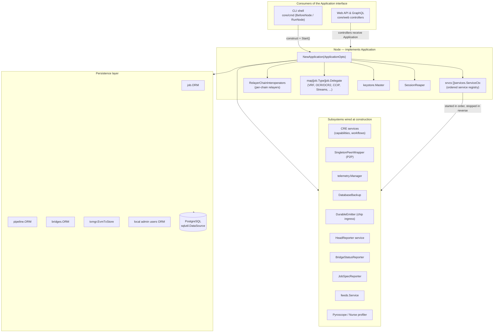
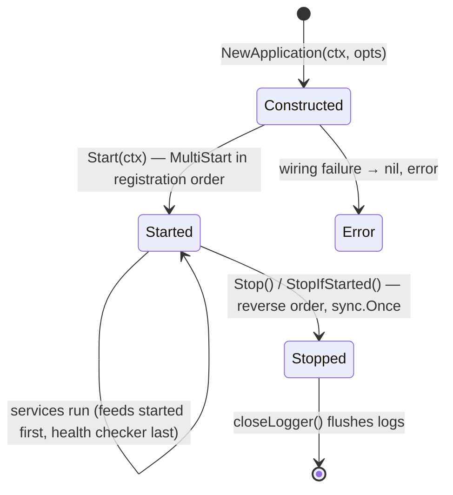
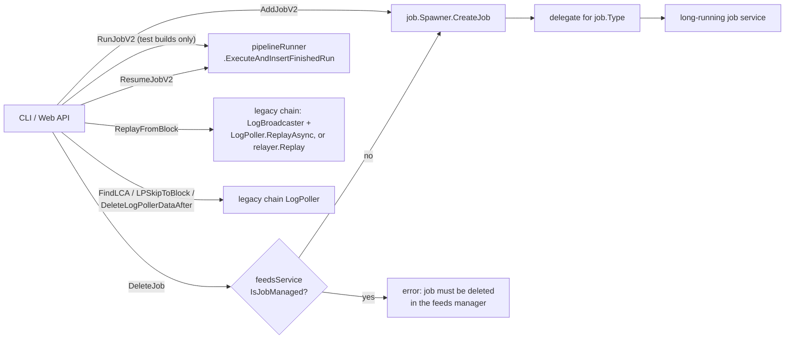
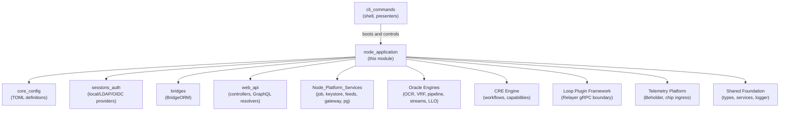

# Node Application — Composition Root & Lifecycle

> **Module scope:** `chainlink/core/services/chainlink` (Application, Node, `NewApplication`, `GeneralConfig`, tracing adapter) and `chainlink/core/services/relay/evm` (RelayAdapter).
> **Binary/module:** part of the `github.com/smartcontractkit/chainlink/v2` Go module, packaged into the `chainlink` node binary (see `chainlink/GNUmakefile`, target `chainlink`).
> **Detailed sub-module docs:** [Application Lifecycle](node_application/node_application_lifecycle.md) · [Configuration Surface](node_application/node_application_config.md) · [Relay Adapter](node_application/node_application_relay.md)

## 1. Purpose

The `node_application` module is the **composition root and lifecycle manager** of a Chainlink node. It answers three questions:

1. **What can the outside world do with a running node?** — the `Application` interface (implemented by `Node`, aliased `ChainlinkApplication` for backwards compatibility).
2. **How is the node assembled?** — `NewApplication(ctx, ApplicationOpts)` constructs and wires *every* subsystem: relayers for each chain family, the job spawner and its delegates, all ORMs, keystores, the session reaper, health checking, telemetry, database backups, profiling, and the CRE (Workflow/Capability Runtime) services.
3. **How do relayer implementations interoperate?** — `RelayerChainInteroperators` (same package, see `relayer_chain_interoperators.go`) plus the `RelayAdapter` in `relay/evm/loop_impl.go`, which bridges the LOOP plugin relayer protocol with the legacy in-process EVM chain implementation.

Everything a user touches — the CLI shell, the Web/GraphQL API, operators replaying logs — ultimately talks to a `Node` through the `Application` interface defined here.

## 2. Architecture Overview

### 2.1 The wiring model

`NewApplication` builds a flat, **ordered** list of `services.ServiceCtx` (`srvcs`). This list is the single source of truth for the node's runtime topology:

- **`Start(ctx)`** walks the list front-to-back using `services.MultiStart` (fail-fast, already-started services are closed on abort), then starts the `HealthChecker` **last** so all other services have time to pass readiness.
- **`Stop()`** walks the list **backwards** (`slices.Backward`), closes the SessionReaper, HealthChecker, Feeds Service and profiler, and finally flushes the logger. A `sync.Once` + `startStopMu` make stop idempotent; double-start or double-stop panics by design.

### 2.2 Assembly order (as coded in `NewApplication`)

| # | Step | Conditional on |
|---|------|----------------|
| 1 | Heartbeat + node platform build-info services | always |
| 2 | Mailbox monitor, capabilities registry, execution handlers, DonTimeStore defaults | always (some injectable via opts for tests) |
| 3 | Shard orchestrator (in-process server for shard 0, gRPC client otherwise) | `Sharding.ShardingEnabled()` |
| 4 | LOOP registry, relayer factory, EVM factory config, per-chain init funcs (`InitEVM` always + Solana/Starknet/Aptos/Tron/TON/Sui/Stellar when enabled) | chain-family config |
| 5 | `CoreRelayerChainInteroperators` + OCR `SingletonPeerWrapper` | OCR/OCR2 enabled ⇒ P2P required |
| 6 | Default workflow key + node JWT generator (nodeauth) | always |
| 7 | Durable emitter for chip ingress | `Telemetry.DurableEmitterEnabled` + endpoint |
| 8 | **CRE services** (`cre.NewServices`) — capabilities, workflow registry syncer, gateway connector | always |
| 9 | Audit logger (as a service) | `auditLogger.Ready() == nil` |
| 10 | Pyroscope profiler (+ OTel span-profile linking), Nurse auto-pprof | config |
| 11 | Telemetry manager, periodic database backup, Mercury pool, retirement report cache, LLO reaper | config / opts |
| 12 | Legacy EVM chains services, head reporters (Prometheus, telemetry, Beholder metrics) | always |
| 13 | Session authentication provider: **Local**, **LDAP** (with server-state syncer) or **OIDC** — plus matching session reaper | `WebServer.AuthenticationMethod` |
| 14 | ORMs: pipeline, bridges, job, txm; in-memory workflow store; pipeline runner; streams registry | always |
| 15 | Job delegates map (see below) + job spawner | always |
| 16 | Feeds service (or `feeds.NullService`), job-spec reporter, bridge-status reporter | feature flag |
| 17 | Health checker registration for **every** service | always |

### 2.3 Job delegates registered by the application

| job.Type | Delegate source | Related docs |
|----------|-----------------|--------------|
| `DirectRequest`, `Webhook`, `Workflow`, `FluxMonitor` | `job.DeprecatedDelegate` (surfaces visible UI errors instead of silently no-oping) | [job_service](../Node_Platform_Services/job_service.md) |
| `VRF` | `vrf.NewDelegate` | [vrf](../Oracle_Engines___Data_Pipelines/vrf.md) |
| `Cron` | `cron.NewDelegate` (runs pipelines) | [pipeline](../Oracle_Engines___Data_Pipelines/pipeline.md) |
| `BlockhashStore`, `BlockHeaderFeeder` | dedicated delegates over legacy EVM chains | [Oracle Engines](../Oracle_Engines___Data_Pipelines.md) |
| `Gateway` | `gateway.NewDelegate` | [gateway](../Node_Platform_Services/gateway.md) |
| `Stream` | `streams.NewDelegate` (stream registry + pipeline runner) | [streams](../Oracle_Engines___Data_Pipelines/streams.md) |
| `CCVCommitteeVerifier`, `CCVExecutor` | CCV delegates | [Oracle Engines](../Oracle_Engines___Data_Pipelines.md) |
| `StandardCapabilities` | `standardcapabilities.NewDelegate` (oracle factory, LOOP registrar config, CRE deps) | [workflows](../Workflow___Capability_Runtime_(CRE_Engine)/workflows.md) |
| `CRESettings` | `cresettings.NewDelegate` (atomic settings, shard assignment) | [workflows](../Workflow___Capability_Runtime_(CRE_Engine)/workflows.md) |
| `OffchainReporting` | `ocr.NewDelegate` | [ocr](../Oracle_Engines___Data_Pipelines/ocr.md) |
| `OffchainReporting2` | `ocr2.NewDelegate` (+ deps injected back into CRE services) | [ocr](../Oracle_Engines___Data_Pipelines/ocr.md) |
| `Bootstrap` | `ocrbootstrap.NewDelegateBootstrap` | [ocr](../Oracle_Engines___Data_Pipelines/ocr.md) |
| `CCIP` | `ccip.NewDelegate` | [ccip](../CCIP_Cross-Chain_Protocol/ccip.md) |

Delegates are handed to `job.NewSpawner`, which instantiates and supervises one service per enabled job — see [job_service](../Node_Platform_Services/job_service.md).

## 3. Sub-modules

| Sub-module | Components | What it covers |
|------------|-----------|----------------|
| **[Application Lifecycle](node_application/node_application_lifecycle.md)** | `Application` interface, `Node`, `NewApplication`, `ApplicationOpts`, `Start`/`Stop` | Construction wiring, service registry, lifecycle guarantees, operational methods (jobs, replay, LogPoller recovery) |
| **[Configuration Surface](node_application/node_application_config.md)** | `GeneralConfig`, `tracingConfig` | The config contract consumed by the app (per-chain-family configs, imported secrets, effective/user TOML) and the tracing adapter handed to the LOOP registry |
| **[Relay Adapter](node_application/node_application_relay.md)** | `RelayAdapter` (loop_impl.go) | Bridging the LOOP `Relayer` gRPC abstraction with the embedded legacy EVM chain (`Chain()` access) |

## 4. Operational surface (how the node is driven)

Key behaviours implemented on `Node`:

- **Job management** — `AddJobV2` delegates to the spawner; `DeleteJob` refuses to delete feeds-manager-owned jobs; `RunJobV2` is blocked on secure/prod builds (`build.IsProd()`) and fabricates a synthetic VRF log when force-running VRF jobs; `ResumeJobV2` resumes interrupted pipeline tasks. See [pipeline](../Oracle_Engines___Data_Pipelines/pipeline.md) for run semantics.
- **Log recovery / replay** — `ReplayFromBlock` special-cases EVM (legacy `LogBroadcaster` + optional LogPoller replay, forced broadcast supported) and falls back to `relayer.Replay` for LOOPP/other families. `FindLCA`, `LPSkipToBlock` and `DeleteLogPollerDataAfter` are LogPoller recovery primitives (EVM + `Feature.LogPoller` required; unsupported in LOOPP mode via `ErrUnsupportedInLOOPPMode`).
- **Identity & auth** — `ID()` is the configured AppID; `GetWebAuthnConfiguration` surfaces RPID/RPOrigin for MFA; `WakeSessionReaper` triggers session expiry; `AuthenticationProvider()` returns whichever provider `NewApplication` selected (local/LDAP/OIDC — details in [sessions_auth](sessions_auth.md)).
- **Cross-cutting accessors** — logger, audit logger, DB, config, keystore, capabilities registry, feeds service, LOOP registry/registrar config, secret generator.

## 5. How this module fits into the system

- **[core_config](core_config.md)** defines the TOML config structs (`TelemetryIngress`, `Tracing`, `Workflows`, `Dispatcher`, …) that `GeneralConfig` exposes and `NewApplication` reads.
- **[cli_commands](cli_commands.md)** — the `chainlink start` shell (`BeforeNode`/`RunNode` in `core/cmd/shell_local.go`) is the primary caller of `NewApplication`/`Start`/`Stop`, and uses presenters to render node state.
- **[web_api](web_api.md)** — HTTP/GraphQL controllers receive the running `Application` and exercise exactly the operational surface described in §4.
- **[sessions_auth](sessions_auth.md)** — the three `AuthenticationProvider` implementations instantiated in step 13 of the wiring order.
- **[bridges](bridges.md)** — `bridges.NewORM` built here feeds both the app's `BridgeORM()` and the pipeline runner (external adapters); bridge status reporting is a top-level service.
- **[Node_Platform_Services](../Node_Platform_Services.md)** — job spawner/ORM ([job_service](../Node_Platform_Services/job_service.md)), master keystore ([keystore](../Node_Platform_Services/keystore.md)), feeds manager ([feeds_service](../Node_Platform_Services/feeds_service.md)), gateway service ([gateway](../Node_Platform_Services/gateway.md)), and Postgres access ([database_persistence](../Node_Platform_Services/database_persistence.md)) are all wired and owned here.
- **[Oracle Engines & Data Pipelines](../Oracle_Engines___Data_Pipelines.md)** — OCR/OCR2/VRF/streams delegates and the pipeline runner are constructed as delegates in §2.3.
- **[Workflow & Capability Runtime (CRE Engine)](../Workflow___Capability_Runtime_(CRE_Engine).md)** — `cre.NewServices` is a first-class step of node construction; the app supplies it the capabilities registry, DonTimeStore, JWT generator, limits factory and shard-orchestrator client.
- **[Plugin Process Framework (Loop)](../Plugin_Process_Framework_(Loop).md)** — `plugins.NewLoopRegistry` + `RegistrarConfig` (built here) manage external plugin processes; the [Relay Adapter](node_application/node_application_relay.md) is the seam between LOOP relayers and legacy chains.
- **[Telemetry & Observability Platform](../Telemetry___Observability_Platform.md)** — the telemetry manager (ingress), Beholder meter/emitter, durable chip-ingress emitter and head reporters are all assembled in this module; ingress config types come from [core_config](core_config.md).
- **[Shared Foundation Libraries & Domain Types](../Shared_Foundation_Libraries___Domain_Types.md)** — `commonsrv` health checking, `sqlutil`, `settings/limits`, nodeauth JWT and LOOP types ([types-core](../Shared_Foundation_Libraries___Domain_Types/types-core.md)) are consumed throughout.
- **[Core shared utilities](core_shared_utilities.md)** — test helpers, null logger and ABI/config utilities used by this module and its tests.

## 6. Build & packaging notes

- The node binary and its LOOP plugin manifests are produced by `chainlink/GNUmakefile` (targets `chainlink`, `chainlink-dev`, `docker`, `install-loopinstall`, `install-plugins*`); version/commit injected at link time are what `healthCfg` (`static.Version`, `static.Sha`) and the build-info service report.
- `NewApplication` behaviour branches on secure/prod builds (`build.IsProd()` blocks `RunJobV2`) and on build modes (embedded vs LOOPP), so packaging choices directly affect the runtime surface documented above.
- Runtime container images for dev/test environments that boot this application are defined under `chainlink/tools/docker/` (see [docker-dev-environments](../Dev,_Test___Simulation_Environments/docker-dev-environments.md)).
