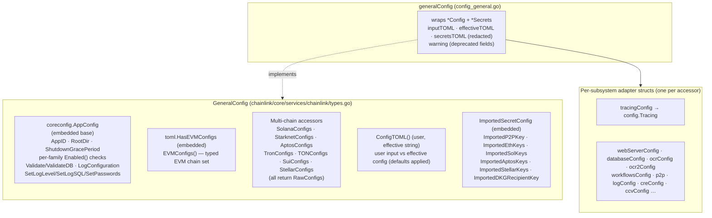
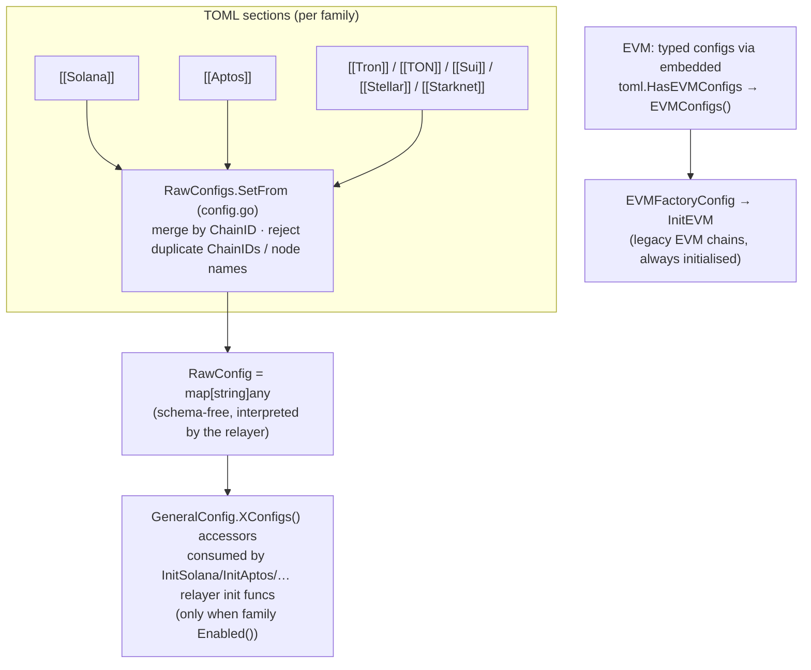
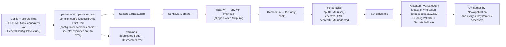
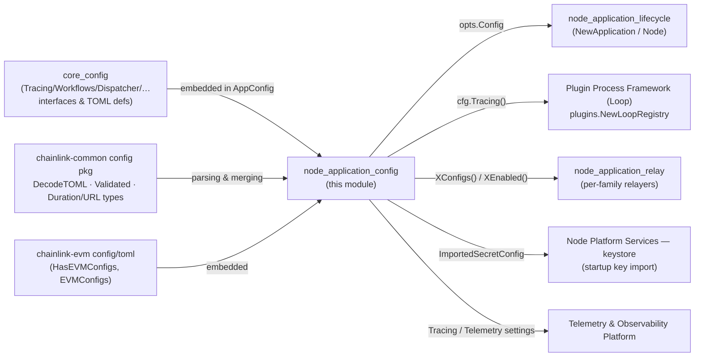

# Node Application — Configuration Surface

> **Module scope:** `chainlink/core/services/chainlink/types.go` (`GeneralConfig`) and `chainlink/core/services/chainlink/config_tracing.go` (`tracingConfig`).
> **Parent module:** [node_application](../node_application.md) — this is the *Configuration Surface* sub-module of the node's composition root.

## 1. Purpose

This module defines the **configuration contract** of a running Chainlink node:

1. **`GeneralConfig`** (`types.go`) — the single interface through which the `Application` and every subsystem (relayer factories, job delegates, the LOOP registry, ORMs, the web server, CRE services…) read settings. It is the *contract*; the concrete implementation (`generalConfig` in `config_general.go`, same package) wraps the parsed TOML `Config` + `Secrets` pair produced at boot.
2. **`tracingConfig`** (`config_tracing.go`) — a thin **adapter** that converts the TOML `[Tracing]` block (fields with pointer types, potentially unset) into the runtime `config.Tracing` interface, and is handed to the LOOP plugin registry so external plugin processes receive the node's tracing settings.

Everything the operator writes in the TOML config/secrets files is ultimately consumed through the types documented here.

## 2. Core components

| Component | File | Kind | Role |
|-----------|------|------|------|
| `GeneralConfig` | `chainlink/core/services/chainlink/types.go` | interface | The node-wide configuration contract consumed by `Application` (`GetConfig()`) and `NewApplication` |
| `tracingConfig` | `chainlink/core/services/chainlink/config_tracing.go` | struct (adapter) | Wraps `toml.Tracing` (TOML, pointer fields) and implements `config.Tracing` (runtime, dereferenced) |

Supporting implementation context (same package, not part of this module's public contract but essential to understand it):

- `generalConfig` (`config_general.go`) — the only production implementation of `GeneralConfig`; also builds the `user`/`effective` TOML strings, applies defaults/env overrides, and produces deprecation warnings.
- `GeneralConfigOpts` (`config_general.go`) — builder: reads config/secrets files, parses & merges TOML, validates, and constructs the `generalConfig`.
- `Config` / `Secrets` / `RawConfigs` / `RawConfig` (`config.go`) — root TOML types; `RawConfig` is a schema-free `map[string]any` used for chain families without an embedded config schema.
- The in-repo diagram `chainlink/core/services/chainlink/CONFIG.md` documents this whole transition (CLI → `RunNode` → `NewApplication`, TOML → `generalConfig`, EVM chain-scoped configs).

## 3. The `GeneralConfig` contract

`GeneralConfig` is an **interface composition** — it deliberately aggregates several orthogonal concerns:

### 3.1 Embedded base — `coreconfig.AppConfig`

Defined in `chainlink/core/config/app_config.go`, this base gives every consumer the app-level knobs: `AppID()`, `RootDir()`, `ShutdownGracePeriod()`, per-chain-family `*Enabled()` flags (EVM, Solana, StarkNet, Aptos, Tron, TON, Sui, Stellar), `Validate()`/`ValidateDB()`, runtime log mutation (`SetLogLevel`, `SetLogSQL`), password injection (`SetPasswords`), and ~30 sub-config accessors (`Database()`, `WebServer()`, `OCR()`, `OCR2()`, `P2P()`, `Tracing()`, `Telemetry()`, `TelemetryIngress()`, `Sharding()`, `LOOPP()`, `CRE()`, `CCV()`, …). The TOML *definitions* of those sub-configs belong to the [core_config](../core_config.md) module; this module is where they are aggregated and exposed to the application.

### 3.2 Multi-chain family configuration

EVM is special-cased: `GeneralConfig` embeds `toml.HasEVMConfigs` (from the `chainlink-evm` module) because EVM chains have a fully typed config schema and a legacy in-process implementation. All other families use **`RawConfigs`** — lists of `RawConfig map[string]any` that are schema-free and interpreted by the corresponding relayer. The merge semantics are implemented in `config.go`:

- `RawConfigs.SetFrom` merges TOML sections **by `ChainID`** (later entries override earlier ones for the same chain);
- `validateKeys` rejects **duplicate `ChainID`s** and duplicate node names within a family;
- `generalConfig` derives each family's `*Enabled()` flag from whether any raw config in that family reports enabled.

### 3.3 User vs effective TOML — `ConfigTOML()`

`ConfigTOML() (user, effective string)` returns two re-serialised views of the configuration, built by `GeneralConfigOpts.New()`:

- **`user`** — exactly what the operator provided (files, CLI TOML flags, and the config injected via environment variable), normalised by de/re-serialisation.
- **`effective`** — the same config after `setDefaults()` and environment overrides have been applied, i.e. what the node will actually run with.

Both are printed at boot by `LogConfiguration(log, warn)` together with the **redacted secrets TOML** and any parse **warnings** (e.g. deprecated fields, see §5). The same pair is what operators can inspect through the node's config-surfacing endpoints via `Application.GetConfig()`.

### 3.4 `ImportedSecretConfig` — keys imported into the keystore at startup

The embedded `ImportedSecretConfig` interface exposes secrets that must be **imported into the keystore on node startup** rather than managed through the UI/API:

| Accessor | Importable key |
|----------|----------------|
| `ImportedP2PKey()` | P2P peer key (`coreconfig.ImportableKey`) |
| `ImportedEthKeys()` / `ImportedSolKeys()` / `ImportedAptosKeys()` / `ImportedStellarKeys()` | Chain-specific signing keys (`coreconfig.ImportableChainKeyLister` of `ImportableChainKey`, which carries `ChainDetails() chain_selectors.ChainDetails`) |
| `ImportedDKGRecipientKey()` | DKG recipient key (OCR2/DKG) |

These are served from the `Secrets` TOML tree by dedicated adapters (`config_imported_*_key.go`). They are consumed during keystore bootstrap — see [keystore](../../Node_Platform_Services/keystore.md).

## 4. `tracingConfig` — the tracing adapter

TOML values are pointers (a field is either unset or set); runtime consumers need dereferenced values. `tracingConfig` bridges the two worlds. It wraps the TOML struct from `chainlink/core/config/toml/types.go` and implements the `Tracing` interface declared in `chainlink/core/config/tracing_config.go`:

| TOML field (`[Tracing]`) | `toml.Tracing` field | `tracingConfig` accessor |
|--------------------------|----------------------|--------------------------|
| `Enabled` | `*bool` | `Enabled() bool` |
| `CollectorTarget` | `*string` | `CollectorTarget() string` |
| `NodeID` | `*string` | `NodeID() string` |
| `SamplingRatio` | `*float64` | `SamplingRatio() float64` |
| `Mode` | `*string` | `Mode() string` |
| `TLSCertPath` | `*string` | `TLSCertPath() string` |
| `Attributes` | `map[string]string` | `Attributes() map[string]string` |

`generalConfig.Tracing()` returns `&tracingConfig{s: g.c.Tracing}` — every call re-reads the wrapped TOML struct, so the adapter is stateless and trivially safe for concurrent use.

**Who consumes it:**

- **LOOP plugin registry** — `NewApplication` passes `cfg.Tracing()` into `plugins.NewLoopRegistry(...)`, so every external plugin process launched via the [Loop framework](../../Plugin_Process_Framework_(Loop).md) receives the node's tracing settings (this is the "tracing adapter handed to the LOOP registry" mentioned in the [parent module](../node_application.md)).
- **Pyroscope span profiling** — when `Pyroscope.LinkTracesToProfiles` is set *and* `cfg.Tracing().Enabled()`, `NewApplication` wraps the global OTel tracer provider (`otel.SetTracerProvider(otelpyroscope…)`) to correlate OTel spans with continuous profiles.
- Any other subsystem that needs tracing knobs obtains it through the same `GeneralConfig` accessor — the [Telemetry & Observability Platform](../../Telemetry___Observability_Platform.md) documents the downstream exporters.

## 5. Configuration loading pipeline (boot-time data flow)

The concrete lifecycle, implemented by `GeneralConfigOpts` in `config_general.go` (the flow is also sketched in the in-repo doc `chainlink/core/services/chainlink/CONFIG.md`):

Notes on each stage:

- **Merging semantics** — configuration files are *last-wins* (`Config.SetFrom` overrides duplicate fields), while secrets *error* on overrides to avoid silently resolving ambiguous secret sources.
- **Environment** — a config TOML string can be supplied via an environment variable (`env.Config.Get()` in `Setup`); `setEnv` then applies per-field env overrides unless `GeneralConfigOpts.SkipEnv` is set. Conversely, `validateEnv()` **fails startup** when any legacy (v1) environment variable listed in the embedded `chainlink/core/services/chainlink/legacy.env` is still set — the canonical error is `toml.ErrUnsupported` ("unsupported with config v2").
- **Deprecation warnings** — deprecated TOML fields are collected as `DeprecatedError` values (`chainlink/core/utils/config/validate.go`, carrying the field `Name` and the `semver.Version` where it lost effect) and surfaced as warnings by `LogConfiguration` and `ConfigTOML` consumers — see [core_shared_utilities](../core_shared_utilities.md).
- **Validation** — `Validate()`/`ValidateDB()` join environment checks, `Config.Validate()` and the secrets' validation; errors are aggregated via `commonconfig.MultiErrorList` (the generic validation machinery is documented in [config-validation](../../Shared_Foundation_Libraries___Domain_Types/config-validation.md)).

## 6. Consumption by the application (component interaction)

`NewApplication` (see [Application Lifecycle](node_application_lifecycle.md)) receives the `GeneralConfig` as `opts.Config` and reads it *before and while* wiring every service. Representative access points, straight from `application.go`:

| Config read | Drives |
|-------------|--------|
| `cfg.Tracing()` → `tracingConfig` | `plugins.NewLoopRegistry(...)` — tracing settings propagated to all LOOP plugin processes |
| `cfg.Tracing().Enabled()` + `cfg.Pyroscope().LinkTracesToProfiles()` | wrapping the global OTel tracer provider with Pyroscope span profiling |
| `cfg.Sharding().ShardingEnabled()`, `ShardIndex()`, `ShardOrchestratorAddress()` | shard-orchestrator server (shard 0) vs gRPC client (other shards) |
| `cfg.EVMConfigs()`, `cfg.Database()`, `cfg.Feature()`, `cfg.Mercury()` | `EVMFactoryConfig` for legacy EVM chain construction |
| `cfg.SolanaEnabled() && cfg.SolanaConfigs()` (and the same pattern for StarkNet, Aptos, Tron, TON, Sui, Stellar) | conditional `Init*` relayer init funcs → `CoreRelayerChainInteroperators` (see [Relay Adapter](node_application_relay.md)) |
| `cfg.OCR().Enabled()` / `cfg.OCR2().Enabled()` / `cfg.P2P()` | OCR/OCR2 delegates and the P2P `SingletonPeerWrapper` (P2P required when OCR/OCR2 on) |
| `cfg.Telemetry()` | durable chip-ingress emitter setup |
| `cfg.TelemetryIngress()` | `telemetry.NewManager` |
| `cfg.WebServer().AuthenticationMethod()` (+ LDAP/OIDC sub-configs) | local / LDAP / OIDC authentication provider selection — see [sessions_auth](../sessions_auth.md) |
| `cfg.JobPipeline()`, `cfg.Capabilities()`, `cfg.CCV()`, `cfg.CRE()`-related accessors | pipeline runner, job delegates, CCV delegates, CRE services |
| `cfg.Database().Backup()` | periodic `DatabaseBackup` service |
| `cfg.Feature().FeedsManager()` + `cfg.JobDistributor()` | feeds service vs `feeds.NullService` |
| `cfg` (whole object) → delegates such as `blockhashstore.NewDelegate(cfg, …)` | job delegates that read many subsystems at once |

After construction, `Application.GetConfig()` exposes the same object to the [web API](../web_api.md) and [CLI commands](../cli_commands.md), so runtime surfaces (presenters, config endpoints) read the identical effective configuration.

## 7. How this module fits into the system

- **[core_config](../core_config.md)** owns the individual sub-config *interfaces and TOML type definitions*; this module aggregates them into the single `GeneralConfig` surface the application consumes. Don't look for field semantics here — look there.
- **[node_application_lifecycle](node_application_lifecycle.md)** is the primary consumer: `NewApplication` translates config values into service wiring (table in §6). `GeneralConfig` is deliberately interface-only so tests can substitute `mocks/general_config.go`.
- **[node_application_relay](node_application_relay.md)** — the per-family relayer init funcs receive the `RawConfigs`/`EVMConfigs` exposed here; the LOOP registry initialised with `tracingConfig` manages the plugin processes the relayers create.
- **[keystore](../../Node_Platform_Services/keystore.md)** — `ImportedSecretConfig` accessors feed the startup key-import path.
- **[Telemetry & Observability Platform](../../Telemetry___Observability_Platform.md)** — the tracing adapter is the configuration source for OTel/Pyroscope instrumentation; telemetry ingress settings follow the same `GeneralConfig` accessor pattern.
- **[Shared Foundation Libraries](../../Shared_Foundation_Libraries___Domain_Types/config-validation.md)** — `chainlink-common/pkg/config` provides the TOML decode/merge primitives (`DecodeTOML`, `SetFrom`, `Validated`, wrapper types) this pipeline is built on.

## 8. Operational & reference material

- **In-repo config transition diagram:** `chainlink/core/services/chainlink/CONFIG.md` (CLI → `RunNode` → `NewApplication`; TOML → `generalConfig`; EVM chain-scoped configs).
- **Generated field reference:** `chainlink/core/config/docs/` — generated TOML documentation (`core.toml`, `chains-evm.toml`, `chains-solana.toml`, `chains-starknet.toml`, `chains-tron.toml`, `secrets.toml`) plus `example-config.toml` / `example-secrets.toml`.
- **Canonical samples used by tests:** `chainlink/core/services/chainlink/testdata/` (`config-full.toml`, `config-multi-chain.toml`, `config-multi-chain-effective.toml`, `secrets-full.toml`, `secrets-multi.toml`, `config-invalid.toml`, …) — useful as executable documentation of the user/effective TOML split.
- **Legacy environment rejection list:** `chainlink/core/services/chainlink/legacy.env` (embedded; any variable still set fails `Validate()` with `ErrUnsupported`).
- **Adding a new config field:** follow the checklist in the `Config` doc-comment in `chainlink/core/services/chainlink/config.go` (unit suffixes, `TextMarshaler`-compatible types such as `commonconfig.Duration`/`big.Big`), regenerate the docs under `core/config/docs`, and remember TOML v2 rejects unset-with-default surprises — pointer fields + adapters (like `tracingConfig`) is the established pattern.
