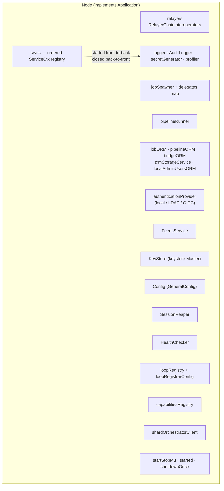
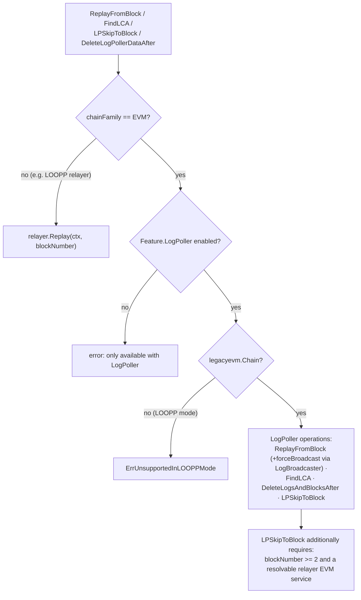

# Node Application Lifecycle

> **Module scope:** `chainlink/core/services/chainlink/application.go` — the `Application` interface, the concrete `Node` implementation (alias `ChainlinkApplication`), the `ApplicationOpts` construction inputs, and the `NewApplication` / `Start` / `Stop` lifecycle that boots and tears down every node subsystem.
> **Parent module:** [Node Application — Composition Root & Lifecycle](../node_application.md)

## 1. Introduction

This module implements the **runtime lifecycle** of a Chainlink node. The `Application` interface is the single contract through which the outside world (CLI shell, Web/GraphQL API, tests) drives a node: it exposes lifecycle control (`Start`/`Stop`), identity and observability, and accessors to every long-running subsystem. The `Node` struct is the sole production implementation and acts as the **composition root**: `NewApplication` constructs, wires and registers *all* node services into an ordered registry, `Start` brings them up in dependency order, and `Stop` tears them down in reverse order.

This page covers the lifecycle mechanics in depth: the interface contract, construction wiring, startup/shutdown sequences, guarantees and error semantics. For the module-level overview, the RelayAdapter seam and the config surface, see the parent page, [Configuration Surface](node_application_config.md) and [Relay Adapter](node_application_relay.md).

## 2. The `Application` contract

`Application` (defined at the top of `application.go`) groups its methods by concern:

| Concern | Methods | Detailed documentation |
|---------|---------|------------------------|
| **Lifecycle** | `Start(ctx)`, `Stop()` | §5, §6 of this page |
| **Identity & observability** | `ID()` (configured `AppID` UUID), `GetLogger()`, `GetAuditLogger()`, `GetHealthChecker()`, `SetLogLevel(lvl)` | [logger](../../Shared_Foundation_Libraries___Domain_Types/logger.md), [beholder-telemetry](../../Telemetry___Observability_Platform/beholder-telemetry.md) |
| **Config & storage** | `GetConfig()`, `GetDB()` | [Configuration Surface](node_application_config.md), [database_persistence](../../Node_Platform_Services/database_persistence.md) |
| **Keys & secrets** | `GetKeyStore()` (master keystore), `SecretGenerator()`, `GetWebAuthnConfiguration()` (MFA RPID/RPOrigin) | [keystore](../../Node_Platform_Services/keystore.md), [sessions_auth](../sessions_auth.md) |
| **Sessions** | `WakeSessionReaper()`, `BasicAdminUsersORM()`, `AuthenticationProvider()` | [sessions_auth](../sessions_auth.md) |
| **Jobs, pipelines, bridges** | `JobSpawner()`, `JobORM()`, `AddJobV2()`, `DeleteJob()`, `ResumeJobV2()`, `RunJobV2()` (test-only), `PipelineORM()`, `BridgeORM()` | [job_service](../../Node_Platform_Services/job_service.md), [pipeline](../../Oracle_Engines___Data_Pipelines/pipeline.md), [bridges](../bridges.md) |
| **Relayers & chain data** | `GetRelayers()`, `ReplayFromBlock()`, `FindLCA()`, `DeleteLogPollerDataAfter()`, `LPSkipToBlock()` | [Relay Adapter](node_application_relay.md), §8.2 of this page |
| **Transactions** | `TxmStorageService()` | [database_persistence](../../Node_Platform_Services/database_persistence.md) |
| **CRE / plugin runtime** | `GetCapabilitiesRegistry()`, `GetLoopRegistry()`, `GetLoopRegistrarConfig()` | [workflows](../../Workflow___Capability_Runtime_(CRE_Engine)/workflows.md), [loop-plugin-core](../../Plugin_Process_Framework_(Loop)/loop-plugin-core.md) |
| **Feeds** | `GetFeedsService()` | [feeds_service](../../Node_Platform_Services/feeds_service.md) |

The `ChainlinkApplication = Node` type alias exists purely for backwards compatibility with older callers.

## 3. `Node` — the concrete application

`Node` holds every subsystem reference plus the two structures that define the runtime topology:

- **`srvcs []services.ServiceCtx`** — the flat, **ordered** service registry. This list is the single source of truth for start order (§5) and, inverted, for stop order (§6).
- **`startStopMu sync.Mutex` + `started bool` + `shutdownOnce sync.Once`** — the concurrency guards that make lifecycle transitions safe and idempotent.



Fields not in `srvcs` are managed explicitly: `FeedsService` is started before everything else (§5), the `HealthChecker` starts last and is closed explicitly, the `SessionReaper` and `profiler` are stopped explicitly during shutdown, and `closeLogger` is the final deferred action.

## 4. Construction: `NewApplication(ctx, ApplicationOpts)`

### 4.1 Construction inputs (`ApplicationOpts`)

| Field | Role |
|-------|------|
| `Config`, `DS`, `KeyStore`, `Logger`, `Registerer`, `AuditLogger`, `CloseLogger` | Mandatory primitives: TOML config ([Configuration Surface](node_application_config.md)), Postgres handle, master keystore, logger factory, Prometheus registerer, audit logger with its close hook |
| `RestrictedHTTPClient` / `UnrestrictedHTTPClient` | Separated HTTP egress policies (restricted = blocklisted-IP-safe, used by the pipeline runner; unrestricted = trusted callers) |
| `GRPCOpts`, `MercuryPool`, `RetirementReportCache`, `LLOTransmissionReaper` | Connectivity for LOOP plugins, Mercury websockets and LLO retirement/reaping |
| `NewOracleFactoryFn`, `EVMFactoryConfigFn` | Extension hooks: custom oracle factory for standard capabilities; test hook to mutate `EVMFactoryConfig` before chain creation |
| `cre.Opts` (embedded) | CRE wiring: `CapabilitiesRegistry`, `CapabilitiesDispatcher`, `CapabilitiesSharedPeer`, `FetcherFunc`, `BillingClient`, `LinkingClient`, `StorageClient`, `DonTimeStore`, `UseLocalTimeProvider` |
| `SecretGenerator`, `Version`, `VersionTag`, `DockerTag` | Identity for the secret generator and build-info reporting |

Several fields have in-constructor fallbacks (`CapabilitiesRegistry`, `ExecutionHandlers`, `DonTimeStore`) that exist *for tests only* — in production they must be injected by the caller.

### 4.2 Wiring pipeline

`NewApplication` is a strictly sequential assembly: each phase may return a wrapped error that aborts construction (the caller receives `nil, err`). Config gates are read from `GeneralConfig` throughout.

```mermaid
flowchart TD
    A["ApplicationOpts + GeneralConfig"] --> B["1. Base services: Heartbeat,<br/>NodePlatformBuildInfo"]
    B --> C["2. Mailbox monitor, CapabilitiesRegistry,<br/>confidentialrelay handlers, DonTimeStore"]
    C --> D{"Sharding.ShardingEnabled()?"}
    D -->|"yes, mode = manual-only"| E["skip orchestrator infra"]
    D -->|"yes, shard 0"| F["in-process ring.Store +<br/>shardorchestrator local client"]
    D -->|"yes, shard > 0"| G["gRPC ShardOrchestrator client<br/>(address required, else error)"]
    D -->|"no"| E
    E --> H["3. LOOP registry, limits.Factory,<br/>Beholder auth, RelayerFactory, EVMFactoryConfig"]
    F --> H
    G --> H
    H --> I["4. Chain init ops: InitDummy + InitEVM always;<br/>Solana / Starknet / Aptos / Tron / TON / Sui / Stellar<br/>per config flags"]
    I --> J["CoreRelayerChainInteroperators"]
    J --> K{"OCR or OCR2 enabled?"}
    K -->|"yes"| L["require P2P enabled, validate config,<br/>SingletonPeerWrapper → srvcs"]
    K -->|"no"| M["no P2P stack"]
    L --> N["5. Default workflow key,<br/>node JWT generator (nodeauth)"]
    M --> N
    N --> O{"Telemetry.DurableEmitterEnabled<br/>+ ChipIngressEndpoint?"}
    O -->|"yes"| P["DurableEmitter over PgDurableEventStore<br/>→ srvcs"]
    O -->|"no"| Q["6. cre.NewServices(...) → srvcs"]
    P --> Q
    Q --> R["7. Audit logger (if Ready) → srvcs<br/>Pyroscope profiler + Nurse (if configured)<br/>TelemetryManager, DatabaseBackup (if enabled)<br/>MercuryPool, RetirementReportCache, LLO reaper → srvcs"]
    R --> S["8. Legacy EVM chains (nil ⇒ error);<br/>mailMon + relayer services → srvcs"]
    S --> T{"WebServer.AuthenticationMethod"}
    T -->|LDAP| U["ldapauth provider + server-state syncer<br/>+ SleeperTask reaper"]
    T -->|OIDC| V["oidcauth provider + session reaper"]
    T -->|local| W["localauth ORM + session reaper"]
    T -->|unknown| X["error: unsupported AuthenticationMethod"]
    U --> Y
    V --> Y
    W --> Y
    Y["9. ORM layer: pipeline, bridges, job, txm;<br/>streams registry, in-memory workflow store → srvcs;<br/>pipeline runner"]
    Y --> Z["10. Head reporters (Prometheus, telemetry,<br/>Beholder metrics) → HeadReporterService → srvcs;<br/>legacy chains subscribe + register ResumeRun"]
    Z --> AA["11. LOOP RegistrarConfig;<br/>job delegates map (all job types);<br/>CRE delegates deps injection"]
    AA --> AB["12. BridgeStatusReporter → srvcs;<br/>HealthChecker (prom + beholder + otel hooks);<br/>job.NewSpawner + pipelineRunner → srvcs;<br/>FeedsService or NullService;<br/>JobSpecReporter → srvcs"]
    AB --> AC["13. Register every service with HealthChecker<br/>(nil service ⇒ panic; failure ⇒ error)"]
    AC --> AD["&Node{...} returned"]
```



Key semantics per phase:

- **Chain families (step 4):** EVM is *always* initialised (`InitDummy` + `InitEVM` — required for backwards compatibility, see the `BCF-2510` TODO in the source); every other family is gated by its config flag (`SolanaEnabled()`, `AptosEnabled()`, `StellarEnabled()`, …) and receives its own keystore and per-chain configs. The resulting `CoreRelayerChainInteroperators` is the app's relayer registry — see [Relay Adapter](node_application_relay.md).
- **P2P (step 5):** the singleton `PeerWrapper` is a top-level service; enabling OCR/OCR2 without `P2P().Enabled()` is a hard construction error, as is an invalid peer config.
- **CRE (step 6):** `cre.NewServices` receives the workflow key, JWT generator, limits factory, shard-orchestrator client and shared peers; the returned bundle also exposes injection points (`SetDelegatesDeps`, `SetOCR2DelegatesDeps`) that are called back in step 11 so the CRE runtime can reach the standard-capabilities and OCR2 delegates — see [workflows](../../Workflow___Capability_Runtime_(CRE_Engine)/workflows.md).
- **Authentication (step 8):** exactly one `sessions.AuthenticationProvider` is selected by `WebServer.AuthenticationMethod()`; an unknown value aborts construction. Each choice pairs with its own session-reaping strategy — details in [sessions_auth](../sessions_auth.md).
- **Health registration (step 13):** every service in `srvcs` is registered with the health checker; a `nil` entry panics immediately ("service unexpectedly nil"), and a registration failure aborts construction.

### 4.3 Job delegates wiring

The delegates map (`map[job.Type]job.Delegate`) is the bridge between construction and the [job spawner](../../Node_Platform_Services/job_service.md). The parent page lists the complete mapping ([assembly order §2.3](../node_application.md)); the lifecycle-relevant points are:

- Deprecated job types (`DirectRequest`, `Webhook`, `Workflow`, `FluxMonitor`) get `job.DeprecatedDelegate` so existing specs surface a visible UI error instead of silently doing nothing.
- Feature/config-gated delegates: `OffchainReporting` only when `OCR().Enabled()`; `OffchainReporting2`, `Bootstrap` and `CCIP` only when `OCR2().Enabled()` ([ocr](../../Oracle_Engines___Data_Pipelines/ocr.md), [ccip](../../CCIP_Cross-Chain_Protocol/ccip.md)).
- The `StandardCapabilities` delegate is built with the LOOP registrar config, telemetry manager, pipeline runner, keystore, peer wrapper, oracle-factory hook, capability local config and the external-registry coordinates (address/chain ID, default bootstrappers) read via the `safe*` helpers — the `safe*` pattern tolerates unset config sections instead of panicking.

The spawner created from this map is itself a top-level service: it instantiates one service per enabled job and is registered for health checking like any other `srvcs` entry.

### 4.4 Ordered service registry (`srvcs`)

The exact registration order observed by `Start`/`Stop`:

| # | Service | Gate |
|---|---------|------|
| 1 | `Heartbeat` | always |
| 2 | `NodePlatformBuildInfo` service | always |
| 3 | `SingletonPeerWrapper` (P2P) | OCR or OCR2 enabled |
| 4 | `DurableEmitter` (chip ingress) | durable emitter enabled + endpoint set |
| 5 | CRE services bundle | always |
| 6 | `AuditLogger` (as a service) | `auditLogger.Ready() == nil` |
| 7 | `Nurse` (auto-pprof) | `AutoPprof.Enabled()` |
| 8 | `telemetry.Manager` | always |
| 9 | `periodicbackup.DatabaseBackup` | backup mode ≠ none and frequency > 0 |
| 10 | Mercury wsRPC pool | opts-supplied |
| 11 | Retirement report cache | opts-supplied |
| 12 | LLO transmission reaper | opts-supplied |
| 13 | Mailbox monitor | always |
| 14 | Relayer chain services (per initialised chain) | per chain-family config |
| 15 | In-memory workflow store | always |
| 16 | `NodePlatformJobInfo` service | always |
| 17 | `HeadReporterService` (+ per-chain head subscription) | always |
| 18 | `pipeline.ORM` | always |
| 19 | `BridgeStatusReporter` | always |
| 20 | `job.Spawner` | always |
| 21 | `pipeline.Runner` | always |
| 22 | `JobSpecReporter` | always |

Notable ordering constraints encoded in the source: the Mercury pool **must start before all relayers and stop after them** (comment in `NewApplication`), and the health checker deliberately starts *last* so every other service has time to pass readiness.

## 5. Startup: `Start(ctx)`

```mermaid
sequenceDiagram
    autonumber
    participant C as Caller (CLI shell / tests)
    participant N as Node
    participant F as FeedsService
    participant S as srvcs[i] (ServiceCtx)
    participant H as HealthChecker

    C->>N: Start(ctx)
    N->>N: lock startStopMu (panic if already started)
    N->>N: OTel span "Start"<br/>(app-id, version, commit)
    N->>F: Start(ctx)
    alt failure
        N->>N: log error; FeedsService = feeds.NullService{}<br/>(so Stop() will not Close() a dead service)
    end
    loop each service in srvcs (registration order)
        N->>S: Start(ctx) via services.MultiStart
        alt ctx cancelled before start
            N->>S: Close() already-started services (ms.Close)
            N-->>C: errors.Join(ctx.Err(), close errors)
        else start failure
            N-->>C: error (MultiStart unwinds started services)
        end
    end
    N->>H: Start() — last, after all services
    N->>N: started = true
    N-->>C: nil
```

Guarantees:

- **Fail-fast, ordered start.** `services.MultiStart` starts services strictly in `srvcs` order and closes the already-started prefix if any start fails or the context is cancelled (`errors.Join` aggregates the abort error with close errors).
- **Feeds failure containment.** A failing feeds service does not abort startup; it is swapped for `feeds.NullService{}` so later `Close()` never touches a dead instance — see [feeds_service](../../Node_Platform_Services/feeds_service.md).
- **Readiness after services.** The `HealthChecker` starts only after every service, so its readiness checks observe fully-initialised subsystems.
- **Panic contract.** Calling `Start` on an already-started application panics — lifecycle misuse is treated as a programming error, not a recoverable condition.

The node binary reaches `Start` through the `chainlink node start` command path; in container deployments that is the compose `entrypoint` of the `node` service (see §10).

## 6. Shutdown: `Stop()` and `StopIfStarted()`

```mermaid
sequenceDiagram
    autonumber
    participant C as Caller
    participant N as Node
    participant S as srvcs[i]
    participant R as SessionReaper
    participant H as HealthChecker
    participant F as FeedsService
    participant P as Pyroscope profiler
    participant L as closeLogger

    C->>N: Stop() / StopIfStarted()
    N->>N: lock startStopMu
    Note over N: StopIfStarted() is a no-op<br/>if never started
    N->>N: shutdownOnce.Do — shutdown runs once
    N->>N: log "Gracefully exiting..." (t0)
    loop srvcs in REVERSE order (slices.Backward)
        N->>S: Close()
    end
    N->>R: Stop()
    N->>H: Close()
    N->>F: Close()
    N->>P: Stop() (if profiler != nil)
    N->>L: closeLogger() (deferred; errors joined)
    N->>N: started = false; log shutdown duration
    N-->>C: first/joined error
```

Guarantees:

- **Reverse-order teardown.** Services are closed exactly in the inverse of registration order, honouring the dependency constraints (e.g. relayers close before the Mercury pool; the pipeline ORM closes after the runner that uses it).
- **Idempotence.** `shutdownOnce` ensures the shutdown body executes once even if `Stop` is called from multiple paths; `StopIfStarted()` converts the "not started" panic into a benign no-op, which is what signal handlers and test harnesses typically call.
- **Error aggregation.** Every close error is accumulated with `stderrors.Join`, so one failing service never masks the rest of the teardown — the caller receives all failures at once.
- **Logger last.** `closeLogger` runs in a `defer` inside the shutdown body, guaranteeing log flush even if earlier close calls panic or fail, and its error is joined into the result.
- **Panic contract.** `stop()` panics if the application was never started (reachable only by calling `Stop()` directly on a fresh instance).

## 7. Concurrency & invariants summary

| Invariant | Mechanism |
|-----------|-----------|
| No concurrent start/stop | `startStopMu` held for the whole transition |
| Single start / single shutdown | `started` flag + `shutdownOnce` |
| Misuse is loud, not silent | panics on double-start and on stop-before-start |
| Partial-failure cleanup | `services.MultiStart` unwinds on aborted `Start`; `errors.Join` on shutdown |
| Construct-then-use | all wiring errors surface from `NewApplication` before any service exists |

## 8. Operational methods on `Node`

### 8.1 Job management

- `AddJobV2` → `jobSpawner.CreateJob(ctx, nil, job)` — the async job service instantiation path.
- `DeleteJob` → refuses to delete jobs managed by the Feeds Manager (`FeedsService.IsJobManaged`), otherwise `jobSpawner.DeleteJob`.
- `ResumeJobV2` → `pipelineRunner.ResumeRun` for interrupted pipeline tasks ([pipeline](../../Oracle_Engines___Data_Pipelines/pipeline.md)).
- `RunJobV2` — **testing only** (`build.IsProd()` returns an error on secure builds): finds the job, fabricates a synthetic VRF log (key hash, seed, sender, fee, request-ID topics at block 10) when force-running VRF specs, and executes the pipeline spec via `ExecuteAndInsertFinishedRun` with `jobRun.meta` variables (VRF runs persist task state).

### 8.2 Log replay & LogPoller recovery



`ReplayFromBlock` is the only recovery primitive available to non-EVM families (delegated to the relayer, see [Relay Adapter](node_application_relay.md)); the remaining three (`FindLCA`, `DeleteLogPollerDataAfter`, `LPSkipToBlock`) are legacy-EVM + LogPoller-only operational tools, each returning wrapped errors rather than panicking.

### 8.3 Identity, config & session helpers

- `ID()` returns the configured `AppID` UUID (also stamped on the startup OTel span and mailbox monitor).
- `SetLogLevel` propagates a `zapcore.Level` into both `GeneralConfig` and the process logger.
- `GetWebAuthnConfiguration` surfaces MFA `RPID`/`RPOrigin` from `WebServer.MFA()`, logging a warning when either is unset (WebAuthn will misbehave).
- `WakeSessionReaper` forces the session-expiry sleeper task to run immediately — used by session-affecting API operations ([sessions_auth](../sessions_auth.md)).

## 9. Testing & extension hooks

- Injectable `ApplicationOpts` fields (`CapabilitiesRegistry`, `ExecutionHandlers`, `DonTimeStore` with in-constructor defaults, `EVMFactoryConfigFn`, `MercuryPool`, `RetirementReportCache`, `LLOTransmissionReaper`, `NewOracleFactoryFn`, both HTTP clients) let tests substitute subsystems without forking the wiring — see [Core shared utilities](../core_shared_utilities.md) for the mock ecosystem (`MockCron`, `BlockedRunner`, …).
- `RunJobV2` is the programmatic job-execution backdoor, explicitly disabled on secure production builds.
- The `shardOrchestratorClient` supports an in-process server/client pair for shard 0, so sharded topologies can be exercised inside a single process.

## 10. Build & deployment context

- **Binary & image.** The `chainlink` binary (module `github.com/smartcontractkit/chainlink/v2`) is built by `chainlink/GNUmakefile` (targets `chainlink`, `chainlink-dev`, `docker`); link-time-injected version/commit are what the build-info service and the `HealthCheckerConfig` report at runtime — see [chainlink_build_and_tooling](../../Build,_CI___Release_Infrastructure/chainlink_build_and_tooling.md).
- **Container entrypoint.** In `chainlink/tools/docker/docker-compose.yaml`, the `node`/`node-2` services (image built from `core/chainlink.Dockerfile`) run `chainlink -c config node start -d -p node_password -a apicredentials` — this command path is what ultimately invokes `NewApplication` and `Start` documented above, with keystore/password/API credentials supplied as Docker secrets. Related dev topologies are catalogued in [docker-dev-environments](../../Dev,_Test___Simulation_Environments/docker-dev-environments.md).
- **Config-driven topology.** Every phase gate in §4.2 (chain families, OCR/OCR2, P2P, sharding, telemetry, backups, authentication method, feeds manager) is a `GeneralConfig` decision — the TOML types behind them are documented in [Configuration Surface](node_application_config.md) and [core_config](../core_config.md).

## 11. Related modules

| Area | Why it matters to the lifecycle |
|------|---------------------------------|
| [Node Application parent](../node_application.md) | Module overview, complete delegate table, system fit |
| [Configuration Surface](node_application_config.md) / [core_config](../core_config.md) | `GeneralConfig` and TOML types gating every wiring decision |
| [Relay Adapter](node_application_relay.md) | LOOP↔legacy-EVM relayer seam built during construction |
| [job_service](../../Node_Platform_Services/job_service.md) | Consumer of the delegates map; supervises per-job services |
| [keystore](../../Node_Platform_Services/keystore.md) | Master keystore wired into relayers, OCR delegates, node auth |
| [database_persistence](../../Node_Platform_Services/database_persistence.md) | `sqlutil.DataSource` and ORM plumbing used throughout §4 |
| [p2p](../../Node_Platform_Services/p2p.md) | Singleton peer wrapper semantics for OCR deployments |
| [feeds_service](../../Node_Platform_Services/feeds_service.md) / [gateway](../../Node_Platform_Services/gateway.md) | Optional services with explicit failure containment |
| [OCR](../../Oracle_Engines___Data_Pipelines/ocr.md), [pipeline](../../Oracle_Engines___Data_Pipelines/pipeline.md), [streams](../../Oracle_Engines___Data_Pipelines/streams.md) | Delegate-owned oracle engines and the shared pipeline runner |
| [workflows (CRE)](../../Workflow___Capability_Runtime_(CRE_Engine)/workflows.md) | `cre.NewServices` — the largest construction dependency |
| [loop-plugin-core](../../Plugin_Process_Framework_(Loop)/loop-plugin-core.md) | `plugins.LoopRegistry` / `RegistrarConfig` for plugin processes |
| [telemetry_ingress](../../Telemetry___Observability_Platform/telemetry_ingress.md) / [beholder-telemetry](../../Telemetry___Observability_Platform/beholder-telemetry.md) | Telemetry manager, durable emitter and Beholder hooks |
| [services (foundation)](../../Shared_Foundation_Libraries___Domain_Types/services.md) | `MultiStart`, health-checker config, `ServiceCtx` contract |
| [settings](../../Shared_Foundation_Libraries___Domain_Types/settings.md) | CRE settings and limits factory wired in step 3 |
| [sessions_auth](../sessions_auth.md) / [bridges](../bridges.md) / [web_api](../web_api.md) | Auth providers, bridge ORM and the HTTP controllers that consume `Application` |
