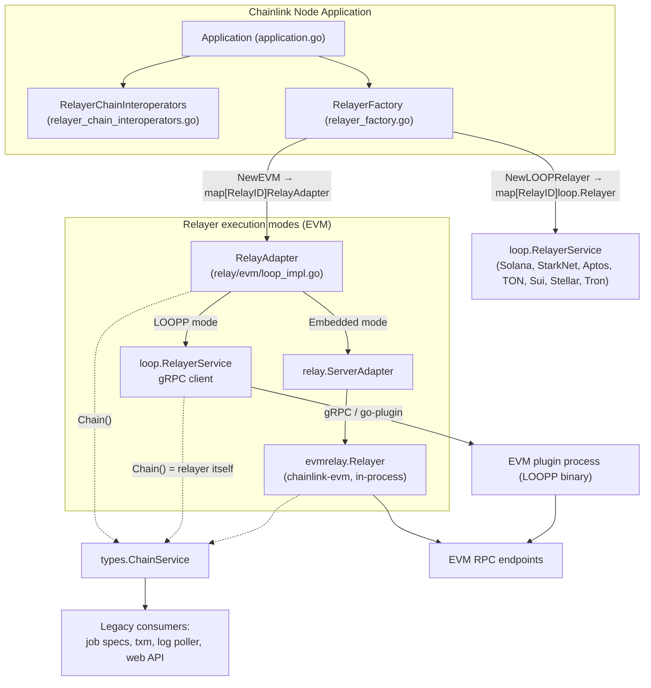
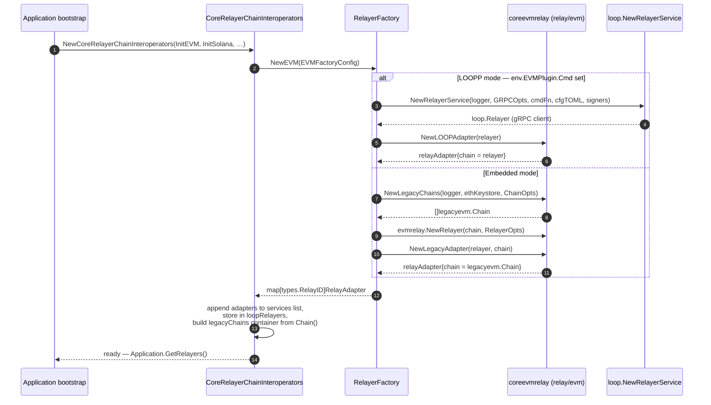
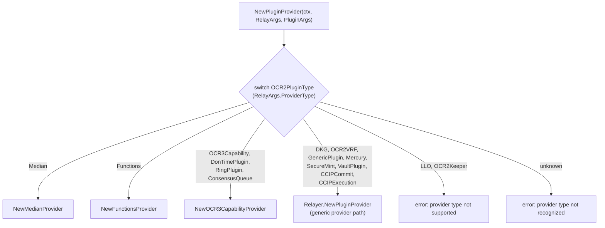
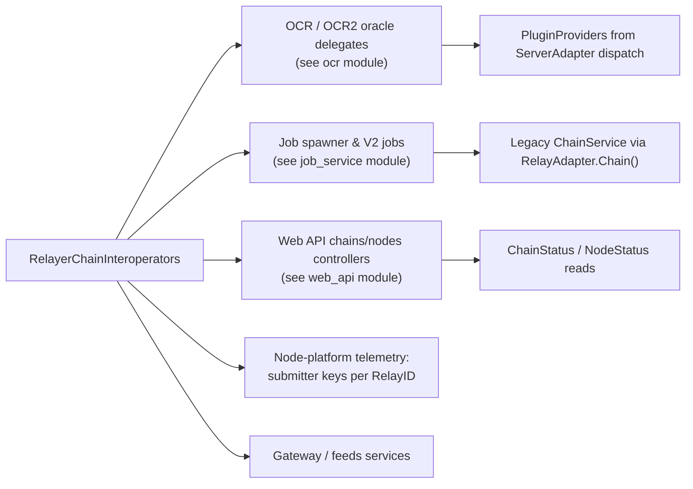

# Node Application — Relay Layer (`node_application_relay`)

> **Scope:** `chainlink/core/services/relay/**`, with the EVM relay adapter in `chainlink/core/services/relay/evm/loop_impl.go` as the core component.
> Part of the [Node Application Core & Interfaces](../../Node_Application_Core___Interfaces.md) documentation set — child of [node_application](../node_application.md).

## 1. Introduction

The `node_application_relay` module defines **how the Chainlink node application binds its chain-agnostic subsystems to chain-specific blockchain connectivity**. All access to blockchains (RPC connections, head tracking, signing, contract reading/writing, and reporting-plugin providers) is funneled through *relayers* that implement the chain-agnostic `loop.Relayer` interface from the LOOP plugin framework.

The module's core component, **`RelayAdapter`** (`chainlink/core/services/relay/evm/loop_impl.go`), is the seam between two relayer execution models:

1. **Embedded mode** — the relayer runs inside the node process (the "legacy" EVM relayer from the `chainlink-evm` module, wired directly to a `legacyevm.Chain`).
2. **LOOPP mode** (*LOOP Plugin Process*) — the relayer runs in a separate OS process and communicates with the node over gRPC (see [loop-plugin-core](../../Plugin_Process_Framework_(Loop)/loop-plugin-core.md)).

Because some long-lived consumers (job types, legacy services) still require the legacy `types.ChainService` object, `RelayAdapter` extends `loop.Relayer` with a `Chain()` accessor, so a single registry entry can serve both interfaces:

```go
// chainlink/core/services/relay/evm/loop_impl.go
// RelayAdapter extends loop.Relayer with a method for accessing the internal legacy chain type.
// Only available in embedded mode, not LOOPP mode.
type RelayAdapter interface {
	loop.Relayer
	Chain() types.ChainService
}

type relayAdapter struct {
	loop.Relayer
	chain types.ChainService
}

var _ RelayAdapter = &relayAdapter{}

func NewLOOPAdapter(r loop.Relayer) *relayAdapter {
	return &relayAdapter{Relayer: r, chain: r}
}

func NewLegacyAdapter(r *evmrelay.Relayer, chain legacyevm.Chain) *relayAdapter {
	return &relayAdapter{
		Relayer: relay.NewServerAdapter(r),
		chain:   chain,
	}
}

func (la *relayAdapter) Chain() types.ChainService {
	return la.chain
}
```

### Where this module fits

| Concern | Module |
|---|---|
| Application lifecycle that starts/stops relayer services | [node_application_lifecycle](node_application_lifecycle.md) |
| `GeneralConfig` / chain configs that parameterize relayers | [node_application_config](node_application_config.md) |
| LOOP gRPC/goplugin transport used by LOOPP relayers | [loop-plugin-core](../../Plugin_Process_Framework_(Loop)/loop-plugin-core.md) |
| `types.Relayer`, `RelayArgs`, `PluginArgs`, `RelayerSet` contracts | [types-core](../../Shared_Foundation_Libraries___Domain_Types/types-core.md) |
| Chain-specific service types (`EVMService`, `SolanaService`, …) | [types-chains](../../Shared_Foundation_Libraries___Domain_Types/types-chains.md) |

## 2. Architecture

The relay layer sits between the node application and either in-process relayer implementations or out-of-process LOOPP plugins. The `Application` exposes relayers through `GetRelayers() RelayerChainInteroperators`; the EVM relayers it hands out are always `RelayAdapter` instances produced by `RelayerFactory.NewEVM`.



### High-level responsibilities

| Responsibility | Component | File |
|---|---|---|
| Unified `loop.Relayer` + `Chain()` access for EVM | `RelayAdapter` / `relayAdapter` | `core/services/relay/evm/loop_impl.go` |
| Network identifier registry + `ServerAdapter` provider dispatch | `ServerAdapter`, `Network*` constants, `SupportedNetworks` | `core/services/relay/relay.go` |
| Legacy chain construction for embedded mode | `NewLegacyChains`, `LegacyChainsAndConfig` | `core/services/relay/evm/relayer_extender.go` |
| Relayer creation per network (embedded vs LOOPP decision) | `RelayerFactory` | `core/services/chainlink/relayer_factory.go` |
| Relayer registry, service lifecycle, status reads | `CoreRelayerChainInteroperators` | `core/services/chainlink/relayer_chain_interoperators.go` |
| Test-only relayer | `dummy.NewRelayer` | `core/services/relay/dummy/` |

## 3. Core Component: `RelayAdapter`

### 3.1 Interface contract

```mermaid
classDiagram
    class RelayAdapter {
        <<interface>>
        +Chain() types.ChainService
    }
    class loop_Relayer {
        <<interface>>
        loop.Relayer
        +NewPluginProvider(ctx, RelayArgs, PluginArgs) PluginProvider
        +NewContractReader(ctx, config) ContractReader
        +NewContractWriter(ctx, config) ContractWriter
        +GetChainStatus(ctx) ChainStatus
        +ListNodeStatuses(ctx, limit, name) []NodeStatus
    }
    class relayAdapter {
        -chain types.ChainService
        +Chain() types.ChainService
    }
    class ChainService {
        <<interface>>
        types.ChainService
    }
    class legacyChain {
        legacyevm.Chain
        (embedded mode)
    }
    class relayerService {
        loop.RelayerService / gRPC client
        (LOOPP mode)
    }
    RelayAdapter --|> loop_Relayer : extends
    relayAdapter ..|> RelayAdapter : implements
    relayAdapter *-- loop_Relayer : embeds
    relayAdapter o-- ChainService : chain
    ChainService <|.. legacyChain
    ChainService <|.. relayerService
```

Key design points:

- **Interface embedding** — `RelayAdapter` *is-a* `loop.Relayer`; anything that consumes a relayer (oracle delegates, job spawner, capabilities) works unchanged. The chain-agnostic `Relayer` contract itself is documented in [types-core](../../Shared_Foundation_Libraries___Domain_Types/types-core.md) and its LOOP plumbing in [loop-plugin-core](../../Plugin_Process_Framework_(Loop)/loop-plugin-core.md).
- **`Chain()` escape hatch** — deprecated-direction compatibility for consumers that have not yet migrated to the relayer interface. The `LegacyChainer` interface in `relayer_chain_interoperators.go` is explicitly marked `Deprecated: use the Relayer interface`, and `Chain()` exists to serve those consumers during migration.
- **Compile-time check** — `var _ RelayAdapter = &relayAdapter{}` guarantees the unexported struct satisfies the interface.

### 3.2 Constructors and the mode decision

| Constructor | Mode | Wiring | `Chain()` returns |
|---|---|---|---|
| `NewLOOPAdapter(r loop.Relayer)` | LOOPP (out-of-process plugin) | `r` is a `loop.RelayerService` created via `loop.NewRelayerService` (gRPC to a plugin binary) | the relayer itself (`chain: r`) — the LOOPP relayer satisfies `types.ChainService` |
| `NewLegacyAdapter(r *evmrelay.Relayer, chain legacyevm.Chain)` | Embedded (in-process) | `r` is wrapped by `relay.NewServerAdapter` so `NewPluginProvider` dispatches by provider type | the concrete `legacyevm.Chain` |

> **Note:** the `Chain()` accessor is documented as *"Only available in embedded mode, not LOOPP mode"* in the sense that only in embedded mode is it backed by the full legacy chain implementation. In LOOPP mode it still compiles and returns the relayer, which serves as its own `ChainService` façade.

## 4. Operating Modes in Depth

### 4.1 Embedded mode (legacy, in-process)

`RelayerFactory.NewEVM` takes the embedded path when no EVM LOOPP plugin command is configured (`env.EVMPlugin.Cmd` unset):

1. `coreevmrelay.NewLegacyChains(...)` (`relayer_extender.go`) validates per-chain TOML configs (`chainlink-evm/pkg/config/toml.EVMConfig`), rejects duplicate chain IDs, skips disabled chains, and builds a `legacyevm.Chain` per chain via `legacyevm.NewTOMLChain` with an ETH-keystore-backed `keys.ChainStore`.
2. For each chain, `evmrelay.NewRelayer(...)` builds the in-process relayer with `RelayerOpts` (data source, metrics registerer, EVM key store, CSA keystore, Mercury pool/config, capabilities registry, HTTP client, retirement report cache).
3. `coreevmrelay.NewLegacyAdapter(relayer, chain)` wraps it, applying `relay.NewServerAdapter` so provider creation is dispatched correctly (§5).

Because the relayer lives in-process, callers may pass legacy customization hooks (`GenChainStore`, `GenEthClient`, `GenLogBroadcaster`, `GenLogPoller`, `GenHeadTracker`, `GenTxManager`, `GenGasEstimator`) — these are **rejected with `errors.ErrUnsupported` when LOOPP mode is active**, since a remote process cannot accept injected in-process generators.

### 4.2 LOOPP mode (plugin process)

When `env.EVMPlugin.Cmd` is set, `NewEVM` instead:

1. Marshals each chain's EVM config to TOML.
2. Builds a plugin command factory (`plugins.NewCmdFactory`) from the configured command name and env file.
3. Creates the gRPC relayer client: `loop.NewRelayerService(logger, GRPCOpts, cmdFn, cfgTOML, ethSigner, csaKeystore, capabilitiesRegistry)`.
4. Wraps it with `NewLOOPAdapter`.

All non-EVM networks (`Solana`, `StarkNet`, `Aptos`, `TON`, `Sui`, `Stellar`, `Tron`) are **LOOPP-only** and go through the generic `NewLOOPRelayer` helper, which additionally deduplicates chain IDs, skips disabled chains, and passes network-specific LOOP keystore signers (`keystore.SolanaLooppSigner`, `keystore.CSASigner`, …). Key management for LOOPP processes is described in [keystore](../../Node_Platform_Services/keystore.md).

### 4.3 Bootstrap sequence



After construction, the relayer adapters are ordinary `services.ServiceCtx` values: the application lifecycle (see [node_application_lifecycle](node_application_lifecycle.md)) starts and stops them together with the rest of the node's services.

## 5. Provider Dispatch — `relay.ServerAdapter`

`core/services/relay/relay.go` declares the canonical network identifiers used to key relayers and validates chain families:

`evm`, `solana`, `starknet`, `aptos`, `tron`, `ton`, `sui`, `stellar`, plus a `dummy` network used by tests.

`ServerAdapter` wraps any `types.Relayer` that does **not** run via gRPC in a LOOPP and overrides `NewPluginProvider` so that the correct product provider is selected from `RelayArgs.ProviderType`:



These providers feed the OCR/OCR2 oracle machinery described in [ocr](../../Oracle_Engines___Data_Pipelines/ocr.md) and are the same contracts consumed by reporting plugins over LOOP (see [loop-grpc-bindings](../../Plugin_Process_Framework_(Loop)/loop-grpc-bindings.md)).

## 6. Registry & Consumers — `RelayerChainInteroperators`

`CoreRelayerChainInteroperators` (`core/services/chainlink/relayer_chain_interoperators.go`) is the node's primary entry point for relayer access. It is assembled from `CoreRelayerChainInitFunc` hooks (`InitEVM`, `InitSolana`, `InitStarknet`, `InitAptos`, `InitTron`, `InitTON`, `InitSui`, `InitStellar`, `InitDummy`) and exposes:

- **`Get(RelayID)` / `Slice()` / `GetIDToRelayerMap()`** — lookup of `loop.Relayer` instances keyed by `types.RelayID{Network, ChainID}`; `dummy` relayers are created lazily on first access.
- **`Services()`** — the relayers (and, for embedded EVM, the chains they own) as startable services for the application lifecycle.
- **`ChainStatus` / `ChainStatuses` / `NodeStatuses` / `Node`** — status reads delegated to relayers, surfaced to operators via the [web_api](../web_api.md) (e.g. the chains/nodes controllers) and consumed by node-platform telemetry (`nodePlatformSubmitterKeyReader` in `node_platform.go` maps `RelayID`s to submitter keys per network).
- **`List(FilterFn)` / `FilterRelayersByType(network)`** — filtered sub-registries for network-scoped consumers (e.g. `NetworkScopedNodeStatuser` in the web layer).
- **`LegacyEVMChains()`** — *deprecated* legacy-chain container built from `RelayAdapter.Chain()` during `InitEVM`.

Typical consumers of relayers/`ChainService`:



The job layer that ultimately drives oracle lifecycles per relayer is documented in [job_service](../../Node_Platform_Services/job_service.md); the OCR engines that consume plugin providers in [ocr](../../Oracle_Engines___Data_Pipelines/ocr.md).

## 7. Configuration & Build Integration

The mode decision and gRPC behavior are driven by configuration and build artifacts in the repository:

- **Plugin command selection** — `RelayerFactory` reads per-network plugin settings from `chainlink/v2/core/config/env` (`env.EVMPlugin`, `env.SolanaPlugin`, `env.StarknetPlugin`, `env.AptosPlugin`, `env.TONPlugin`, `env.SuiPlugin`, `env.StellarPlugin`, `env.TronPlugin`). Each exposes a command name and an env file parsed by `plugins.ParseEnvFile`; for non-EVM networks a `CmdDefault` fallback applies.
- **LOOPP gRPC tuning** — `chainlink/core/services/chainlink/config_loopp.go` exposes `looppConfig.GRPCServerMaxRecvMsgSizeBytes()` backed by the `toml.LOOPP` configuration (`GRPCServerMaxRecvMsgSize`), bounding message sizes between node and plugin processes.
- **Plugin binaries** — LOOPP relayer executables are built and installed by the repository's build tooling: the `install-loopinstall`, `install-plugins-public`, `install-plugins-private`, `install-plugins-testing`, and `install-plugins-local` targets in `chainlink/GNUmakefile` invoke the `loopinstall` tool against the `plugins/plugins.*.yaml` manifests (see [chainlink_build_and_tooling](../../Build,_CI___Release_Infrastructure/chainlink_build_and_tooling.md)).
- **Module dependency** — `chainlink/go.mod` declares the `chainlink-evm` module that supplies `evmrelay.Relayer` and `legacyevm.Chain` for embedded mode; the LOOP framework lives in `chainlink-common` ([loop-plugin-core](../../Plugin_Process_Framework_(Loop)/loop-plugin-core.md)).

## 8. Testing Support

- **Dummy relayer** — `core/services/relay/dummy` provides a no-op `loop.Relayer` (relayer, config provider/tracker/digester, LLO provider) created lazily through `RelayerFactory.NewDummy`; the `dummy` network is registered in `SupportedNetworks`.
- **EVM interface testers** — `core/services/relay/evm/evmtesting` contains reusable harnesses (`chain_components_interface_tester.go`, `run_tests.go`, `bindings_test_adapter.go`) that exercise relayer/chain implementations against expected behavior.
- **Mocks** — generated mocks for `RelayerChainInteroperators` (`core/services/chainlink/mocks`) and the evm relay types package support unit tests (`config_poller_test.go`, `chain_components_test.go`, `write_target_test.go`).

## 9. Key File Reference

| File | Contents |
|---|---|
| `core/services/relay/evm/loop_impl.go` | `RelayAdapter` interface, `relayAdapter` struct, `NewLOOPAdapter`, `NewLegacyAdapter`, `Chain()` — **core component** |
| `core/services/relay/relay.go` | Network constants, `SupportedNetworks`, `ServerAdapter` + `NewPluginProvider` dispatch |
| `core/services/relay/evm/relayer_extender.go` | `NewLegacyChains`, `LegacyChainsAndConfig` (embedded chain construction) |
| `core/services/chainlink/relayer_factory.go` | `RelayerFactory`, `EVMFactoryConfig`, `NewEVM`, `NewLOOPRelayer`, per-network constructors |
| `core/services/chainlink/relayer_chain_interoperators.go` | `RelayerChainInteroperators`, `CoreRelayerChainInteroperators`, init hooks, status readers |
| `core/services/chainlink/application.go` | `Application.GetRelayers()` — public accessor for the registry |
| `core/services/chainlink/config_loopp.go` | LOOPP gRPC configuration (`GRPCServerMaxRecvMsgSizeBytes`) |
| `core/services/relay/dummy/*` | Test-only dummy relayer implementations |

## 10. Related Modules

- [node_application](../node_application.md) — parent module: application assembly and interfaces.
- [node_application_lifecycle](node_application_lifecycle.md) — `Application.Start/Stop` owns the relayer services registered here.
- [node_application_config](node_application_config.md) — `GeneralConfig` chain configs consumed by the factory.
- [loop-plugin-core](../../Plugin_Process_Framework_(Loop)/loop-plugin-core.md) · [loop-grpc-bindings](../../Plugin_Process_Framework_(Loop)/loop-grpc-bindings.md) — LOOP framework: `loop.Relayer`, `RelayerService`, gRPC transports.
- [types-core](../../Shared_Foundation_Libraries___Domain_Types/types-core.md) · [types-chains](../../Shared_Foundation_Libraries___Domain_Types/types-chains.md) — `Relayer`, `RelayerSet`, provider args, and per-chain service types.
- [ocr](../../Oracle_Engines___Data_Pipelines/ocr.md) — primary consumer of relay-provided plugin providers.
- [job_service](../../Node_Platform_Services/job_service.md) — job execution that binds specs to relayers.
- [web_api](../web_api.md) — REST/GraphQL exposure of chain & node statuses sourced from relayers.
