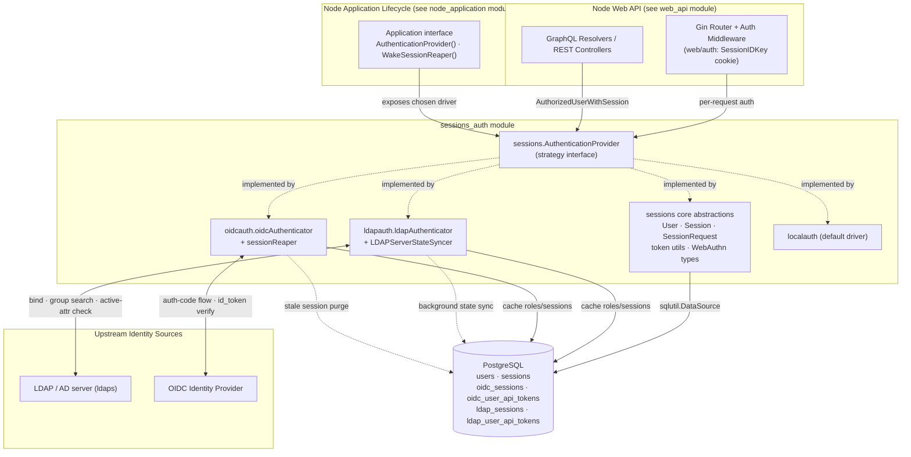
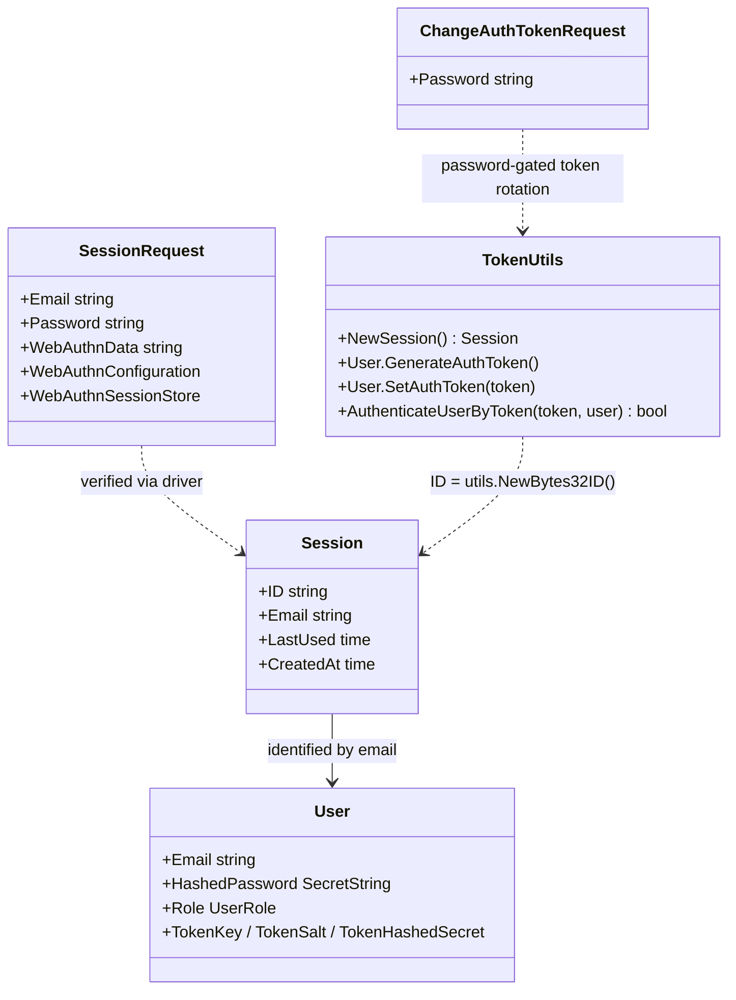
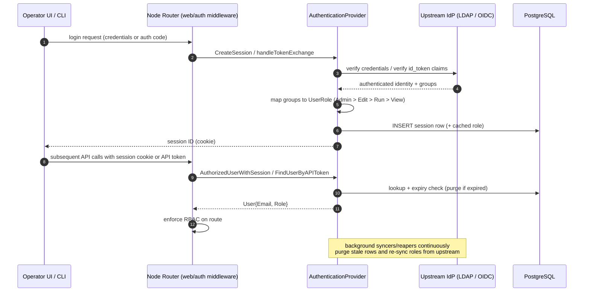

# Sessions & Authentication (`sessions_auth`)

> **Module scope:** `chainlink/core/sessions/*` — the pluggable authentication, session-management and RBAC layer that protects the Chainlink node's operator API (REST + GraphQL + v2 web routes).

## 1. Purpose

The `sessions_auth` module answers one question for every incoming operator request: **who is this user, and what are they allowed to do?**

It provides:

- **A provider-agnostic authentication contract** (`sessions.AuthenticationProvider`) so the node can delegate identity verification to different backends.
- **Three interchangeable drivers:**
  - `localauth` — the default driver backed by the local `users` table (email + hashed password + optional WebAuthn MFA).
  - [`ldapauth`](sessions_auth/sessions_auth_ldap.md) — forwards credentials to an upstream **LDAP/Active Directory** server and mirrors directory groups to local RBAC roles.
  - [`oidcauth`](sessions_auth/sessions_auth_oidc.md) — performs an **OpenID Connect** authorization-code flow against an external Identity Provider and maps group claims to local RBAC roles.
- **Session primitives** — `Session`, `SessionRequest`, `User`, API-token generation/verification, and stale-session reaping, all persisted in PostgreSQL.

A key design property: the remote drivers (`ldapauth`, `oidcauth`) are **read-only with respect to user identity**. Users are not created or mutated locally; instead the node *caches* role and session state locally and continuously re-validates it against the upstream identity source (via background syncers/reapers).

## 2. Architecture Overview

### How a driver is selected

At node startup the application resolves one `sessions.AuthenticationProvider` from configuration and exposes it through the [`Application` interface](node_application/node_application_lifecycle.md) (`AuthenticationProvider()`, plus `WakeSessionReaper()` and `BasicAdminUsersORM()`). The web server then builds its login/session routes and middleware on top of that single instance. When an LDAP or OIDC driver is active, it also **registers extra routes** via `ExtendRouter(api *gin.RouterGroup)` (e.g. `/oidc-enabled`, `/oidc-login`, `/oidc-exchange`); the route/middleware mechanics themselves are documented in [web_api_auth_rbac](web_api/web_api_auth_rbac.md).

## 3. Core Abstractions (`chainlink/core/sessions`)

The shared contract and value types all live in the `sessions` package and are consumed identically by every driver.

### 3.1 `AuthenticationProvider` — the strategy interface

Declared in `chainlink/core/sessions/authentication.go` and implemented by all three drivers (the LDAP and OIDC files assert this at compile time: `var _ sessions.AuthenticationProvider = (*ldapAuthenticator)(nil)`). Its ~20 methods fall into five concern groups:

| Concern | Key methods | Notes |
|---|---|---|
| **Web session lifecycle** | `CreateSession`, `AuthorizedUserWithSession`, `DeleteUserSession`, `ClearNonCurrentSessions`, `Sessions` | `CreateSession` returns a session ID persisted server-side; `AuthorizedUserWithSession` is the hot path for every authenticated request and enforces expiry. |
| **User lookup** | `FindUser`, `FindUserByAPIToken`, `ListUsers` | Remote drivers fall back to the local `users` table for admin/CLI users, and consult the `<driver>_user_api_tokens` cache for API-token auth. |
| **API tokens** | `CreateAndSetAuthToken`, `SetAuthToken`, `DeleteAuthToken` | Tokens are salted + hashed (`auth.HashedSecret`) before storage; remote drivers support at most one token per user, honoring `UserAPITokenEnabled`/`UserAPITokenDuration` config. |
| **Identity mutation** | `CreateUser`, `DeleteUser`, `UpdateRole`, `SetPassword`, `TestPassword` | Mutations are fully supported by `localauth`; remote drivers mostly return `sessions.ErrNotSupported`, with narrow exceptions (e.g. OIDC `SetPassword` works only for local admin users). |
| **MFA + external initiators** | `GetUserWebAuthn`, `SaveWebAuthn`, `FindExternalInitiator` | WebAuthn records power the MFA hooks; `FindExternalInitiator` resolves `bridges.ExternalInitiator` records by access key (see [bridges](bridges.md)). |

The final method, `ExtendRouter(r *gin.RouterGroup) error`, lets a driver inject its own HTTP endpoints into the node's router.

### 3.2 Value types (`session.go`, `user.go`)

- **`SessionRequest`** — login payload (email, password, optional WebAuthn data) submitted to create a new session.
- **`Session`** — the authenticated-session record; `NewSession()` generates a random `bytes32` ID. Persisted in `sessions` (local) or `<driver>_sessions` tables.
- **`User`** — the domain user with `Role` (`UserRoleAdmin` > `UserRoleEdit` > `UserRoleRun` > `UserRoleView`, enforced by all drivers' RBAC middleware) and API-token credential fields (`TokenKey`, `TokenSalt`, `TokenHashedSecret`).
- **`ChangeAuthTokenRequest`** — the JSON payload (`{"password": ...}`) required when a user rotates their authentication/API token; the password check gates token mutation.
- **Token helpers** — `GenerateAuthToken` / `SetAuthToken` create an `auth.Token`, generate a per-token salt, and store only a **hashed secret**; `AuthenticateUserByToken` verifies candidates using a **constant-time comparison** (`subtle.ConstantTimeCompare`) to prevent timing attacks. The same pattern is reused inside the remote drivers' `SetAuthToken` implementations.
- **`webauthn.go`** — WebAuthn (FIDO2) configuration and session-store types used by `localauth` for MFA; remote drivers delegate MFA to the upstream identity provider.

## 4. Sub-modules

| Sub-module | Package | Documentation |
|---|---|---|
| **LDAP authentication** | `chainlink/core/sessions/ldapauth` | [sessions_auth_ldap.md](sessions_auth/sessions_auth_ldap.md) |
| **OIDC authentication** | `chainlink/core/sessions/oidcauth` | [sessions_auth_oidc.md](sessions_auth/sessions_auth_oidc.md) |

- **[LDAP driver](sessions_auth/sessions_auth_ldap.md)** — `ldapAuthenticator` binds as a read-only directory user, authenticates session requests against the upstream LDAP server, maps group CNs (`*_UserGroupCN` config) to node roles, supports remote MFA, and runs `LDAPServerStateSyncer` (a `services.Runnable` style syncer) which periodically purges expired `ldap_sessions`/`ldap_user_api_tokens` rows and re-syncs roles and active-directory flags from the upstream directory.
- **[OIDC driver](sessions_auth/sessions_auth_oidc.md)** — `oidcAuthenticator` performs a standard authorization-code flow: `/oidc-login` issues a CSRF `state` and redirects to the provider, `/oidc-exchange` (payload type `ExchangeTokenRequest`) trades the authorization code for a verified `id_token`, extracts group claims, maps them to a role, and writes an `oidc_sessions` row. A `sessionReaper` (`utils.SleeperTask`) deletes expired `oidc_sessions` rows. Local-admin login remains available through the standard login endpoint as a fallback for CLI users.

### Shared authentication flow (remote drivers)

Every successful/failed login and API-token change is recorded through the node's **audit logger** (`audit.AuthLoginSuccessNo2FA`, `AuthLoginFailedEmail`, `AuthLoginFailedPassword`, `APITokenCreated`, …), giving an operator audit trail independent of application logs.

## 5. Configuration & Operational Notes

Driver configuration is expressed as the `config.LDAP` and `config.OIDC` interfaces, filled from the node's TOML/env configuration pipeline (see [core_config](core_config.md) and [node_application_config](node_application/node_application_config.md)). Highlights enforced by the drivers at construction time:

- **LDAP** (`NewLDAPAuthenticator`): requires a `ServerAddress`, a read-only bind login, and an explicit group CN mapping for **all four** roles. TLS is **mandatory outside dev mode** (`ServerTLS` unless `chainlink dev`); a failing initial bind/connection aborts startup. `QueryTimeout` overrides the go-ldap library default. Cache behavior is tuned by `SessionTimeout`, `UserAPITokenDuration`, `UpstreamSyncInterval` and `UpstreamSyncRateLimit` (the latter rate-limits upstream queries during background syncs).
- **OIDC** (`NewOIDCAuthenticator`): requires `ClientID`, `ClientSecret`, `ProviderURL`, `RedirectURL`, a `ClaimName` (the claim carrying group memberships) and group-name mappings for all four roles (`AdminClaim`, `EditClaim`, `RunClaim`, `ReadClaim`). Provider discovery (`oidc.NewProvider`) runs at startup.
- **Database tables**: both drivers own driver-prefixed tables (`ldap_sessions`, `ldap_user_api_tokens`, `oidc_sessions`, `oidc_user_api_tokens`) alongside the shared `users`/`sessions` tables. All persistence flows through `sqlutil.DataSource` transactions (see [database_persistence](../Node_Platform_Services/database_persistence.md)).
- **Testing**: each package ships a `TestConfig` plus `NewTestLDAPAuthenticator` / `NewTestOIDCAuthenticator` constructors and LDAP client mocks (`ldapauth/mocks`) so drivers can be exercised without a real directory or IdP.

## 6. Relationship to Other Modules

| Module | Relationship |
|---|---|
| [web_api](web_api.md) — especially [web_api_auth_rbac](web_api/web_api_auth_rbac.md) | Consumes `AuthenticationProvider` for route rules, session-cookie middleware (`webauth.SessionIDKey`) and RBAC enforcement; hosts the routes drivers inject via `ExtendRouter`. |
| [node_application](node_application.md) — [node_application_lifecycle](node_application/node_application_lifecycle.md) | Constructs the configured driver, starts/stops the LDAP `LDAPServerStateSyncer` and OIDC `sessionReaper`, and exposes them through the `Application` interface. |
| [core_config](core_config.md) | Supplies the `config.LDAP` / `config.OIDC` configuration interfaces nested in `GeneralConfig`. |
| [bridges](bridges.md) | `FindExternalInitiator` authenticates external initiator requests using `bridges.ExternalInitiator` records. |
| Node Platform Services — [database_persistence](../Node_Platform_Services/database_persistence.md) | Underlying PostgreSQL access layer (`pg.Queryer`, `sqlutil`) used for all session/token tables. |

## 7. Source Map

| File | Role |
|---|---|
| `core/sessions/authentication.go` | `AuthenticationProvider` interface |
| `core/sessions/session.go` | `Session`, `SessionRequest`, `ChangeAuthTokenRequest`, token generate/verify helpers |
| `core/sessions/user.go` | `User`, `UserRole` definitions |
| `core/sessions/webauthn.go` | WebAuthn MFA types |
| `core/sessions/localauth/` | Default local-users driver + its reaper/ORM |
| `core/sessions/ldapauth/` (`ldap.go`, `client.go`, `sync.go`, `helpers_test.go`) | LDAP driver, client abstraction, upstream state syncer, test config ([docs](sessions_auth/sessions_auth_ldap.md)) |
| `core/sessions/oidcauth/` (`oidc.go`, `reaper.go`, `helpers_test.go`) | OIDC driver, HTTP handlers (`ExchangeTokenRequest`), session reaper, test config ([docs](sessions_auth/sessions_auth_oidc.md)) |
