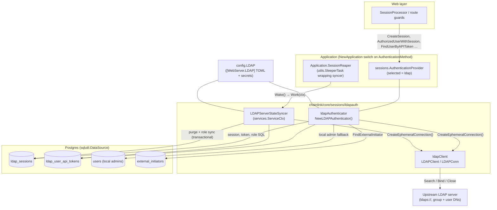
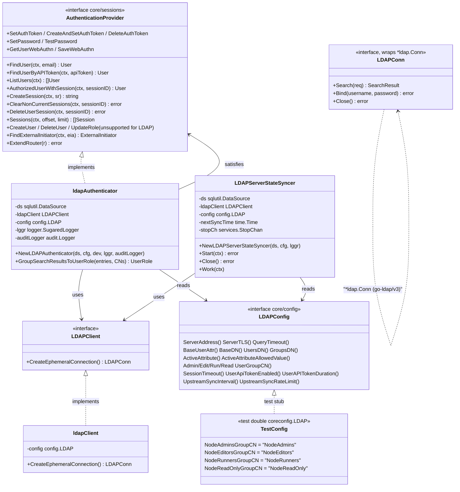
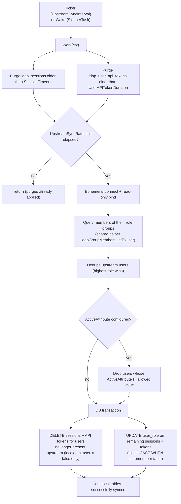
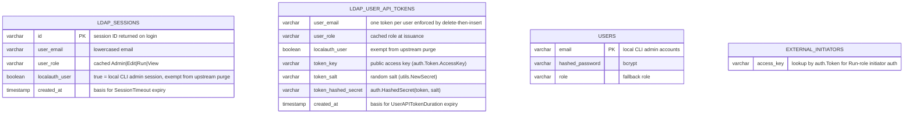

# Sessions Auth — LDAP (`core/sessions/ldapauth`)

The `ldapauth` package provides a read-only, LDAP-backed implementation of the node's pluggable authentication layer. It is one of three interchangeable `sessions.AuthenticationProvider` implementations selectable through the `WebServer.AuthenticationMethod` setting (`local`, `ldap`, `oidc`) — see the parent module [Sessions & Authentication](../sessions_auth.md) and the sibling [Sessions Auth — OIDC](sessions_auth_oidc.md) page.

Its purpose is to let node operators delegate GUI/API authentication and role assignment to a corporate LDAP directory (e.g. Active Directory, OpenLDAP), while keeping the Chainlink node's local RBAC model (Admin / Edit / Run / View) intact. The package forwards login credentials to the configured upstream LDAP server, maps LDAP group membership (`uniqueMember` of `ou=groups` entries) onto node roles, caches sessions and API tokens in two local Postgres tables, and continuously re-validates that cached state against the upstream directory.

> **Design at a glance**
> - **Read-only identity model** — user/role mutation (`CreateUser`, `DeleteUser`, `UpdateRole`, `SaveWebAuthn`) returns `sessions.ErrNotSupported`; the directory is the source of truth.
> - **Local fallback** — the local `users` table (CLI admin accounts managed by `localauth`) remains usable for emergency/CLI access.
> - **Cached sessions** — after a successful login, the upstream server is *not* queried per request; role/session state is read from `ldap_sessions`/`ldap_user_api_tokens` and re-synced in the background.
> - **MFA delegated upstream** — the LDAP bind is blocking with a configurable timeout so push-notification MFA from the identity provider can complete; local WebAuthn is stubbed out.

---

## 1. Architecture

### 1.1 Placement in the node

The module is instantiated by `NewApplication` in `chainlink/core/services/chainlink/application.go` (lines ~580–616). Based on `cfg.WebServer().AuthenticationMethod()`, the application selects the authentication provider; for `ldap` it:

1. Constructs the `ldapAuthenticator` via `NewLDAPAuthenticator(ds, cfg.WebServer().LDAP(), cfg.Insecure().DevWebServer(), logger, auditLogger)` — failing fast on invalid configuration.
2. Constructs an `LDAPServerStateSyncer` and appends it to the node's service list, so it participates in the standard Start/Close lifecycle (see [Node Application Lifecycle](../node_application/node_application_lifecycle.md)).
3. Wraps the syncer in `utils.NewSleeperTaskCtx` and exposes it as the `Application.SessionReaper` (wakeable via `WakeSessionReaper()` after auth events).

The resulting provider is served to the web layer through `Application.AuthenticationProvider()` and consumed by the session processor and route guards described in [Web API — Auth & RBAC](../web_api/web_api_auth_rbac.md).



### 1.2 Source files

| File | Component | Responsibility |
|---|---|---|
| `chainlink/core/sessions/ldapauth/ldap.go` | `ldapAuthenticator` | Full `sessions.AuthenticationProvider` implementation: login, user/role lookup, session and API-token lifecycle, external-initiator lookup, unsupported-operation stubs. |
| `chainlink/core/sessions/ldapauth/client.go` | `ldapClient`, `LDAPClient`, `LDAPConn` | Thin wrapper over `github.com/go-ldap/ldap/v3`: dial + read-only bind, exposes `Search`, `Bind`, `Close` for test mocking. |
| `chainlink/core/sessions/ldapauth/sync.go` | `LDAPServerStateSyncer` | Background service that purges expired rows and reconciles local session/token state with the upstream directory. |
| `chainlink/core/sessions/ldapauth/helpers_test.go` | `TestConfig`, `NewTestLDAPAuthenticator` | Test doubles: config stub implementing `config.LDAP`, bypass-constructor, and `SetLDAPClient` mock injection hook. |

### 1.3 Type relationships

The authenticator implements the shared `sessions.AuthenticationProvider` contract (defined in `chainlink/core/sessions/authentication.go`) that the web layer consumes, and depends on the `config.LDAP` interface (implemented by `core/services/chainlink/ldapConfig` in production and `TestConfig` in tests).



---

## 2. Startup & configuration validation

`NewLDAPAuthenticator` is the single construction point and acts as the first line of defense against misconfiguration:

1. **TLS enforcement** — refuses to start unless `ServerTLS` is set *or* the node runs in dev mode (`cfg.Insecure().DevWebServer()`): *"LDAP Authentication driver requires TLS when running in Production mode"*.
2. **RBAC group mapping completeness** — all four `_UserGroupCN` fields (`AdminUserGroupCN`, `EditUserGroupCN`, `RunUserGroupCN`, `ReadUserGroupCN`) must be non-empty, because every node RBAC role must map to an LDAP group.
3. **Required settings** — `ServerAddress` and `ReadOnlyUserLogin` must be present.
4. **Library timeout override** — sets the package-global `ldap.DefaultTimeout` from `QueryTimeout()`.
5. **Connectivity smoke test** — dials the server and performs a read-only bind once (`CreateEphemeralConnection()`), then closes the connection. No persistent connection is kept; every subsequent operation opens an ephemeral connection (no reconnect bookkeeping required).

Failures here abort node startup (`NewApplication` wraps the error with *"failed to initialize LDAP Authentication module"*).

### 2.1 Configuration reference

Values are declared in the `[WebServer.LDAP]` TOML section (documented defaults in `chainlink/core/config/docs/core.toml`; interface `config.LDAP` in `chainlink/core/config/web_config.go`). Sensitive values (`ServerAddress`, `ReadOnlyUserLogin`, `ReadOnlyUserPass`) are resolved from the secrets TOML (`WebServerLDAPSecrets`) and are blank unless supplied.

| Setting | Default | Effect in this module |
|---|---|---|
| `SessionTimeout` | `15m` | TTL of `ldap_sessions` rows; used for expiry checks in `AuthorizedUserWithSession` and reaper purges. |
| `QueryTimeout` | `2m` | Passed to every LDAP `SearchRequest` (and the global `ldap.DefaultTimeout`); must be long enough to accommodate blocking MFA push flows. |
| `BaseUserAttr` | `uid` | Attribute holding the user's email (also used for the read-only service-account bind DN). |
| `BaseDN` / `UsersDN` / `GroupsDN` | — / `ou=users` / `ou=groups` | DN scaffolding for user and group search bases. |
| `ActiveAttribute` + `ActiveAttributeAllowedValue` | `''` | Optional "user is active" check (e.g. `organizationalStatus == ACTIVE`). Empty = group membership is sufficient. |
| `AdminUserGroupCN` … `ReadUserGroupCN` | `NodeAdmins` / `NodeEditors` / `NodeRunners` / `NodeReadOnly` | Group CN → node RBAC role mappings. |
| `UserApiTokenEnabled` | `false` | Gates `FindUserByAPIToken`, `SetAuthToken`/`CreateAndSetAuthToken`, `DeleteAuthToken`. |
| `UserAPITokenDuration` | `240h` | TTL of `ldap_user_api_tokens` rows. |
| `UpstreamSyncInterval` | `0s` | Interval for the background sync ticker in `sync.go`; `0s` = no ticker, one manual sync at `Start` (sync still occurs on every auth event). |
| `UpstreamSyncRateLimit` | `2m` | Minimum spacing between *upstream* query sweeps within `Work` to protect the directory from load. |

Selection of the provider itself: `WebServer.AuthenticationMethod = 'ldap'` (constants `sessions.LocalAuth` / `LDAPAuth` / `OIDCAuth` in `core/sessions/authentication.go`). For the analogous OIDC configuration, see [Sessions Auth — OIDC](sessions_auth_oidc.md); for general config plumbing, see [Core Config](../core_config.md).

---

## 3. Authentication flows

### 3.1 Login (`CreateSession`)

The login is a *bind-as-user* operation: the module constructs the user's DN (`BaseUserAttr=email,UsersDN,BaseDN`), attempts an LDAP bind with the submitted password, and only resolves the role after authentication succeeds. The bind is blocking with the configured `QueryTimeout`, which is what allows remote MFA (e.g., a push notification) to complete inside the request.

```mermaid
sequenceDiagram
    autonumber
    actor U as Node operator (UI/CLI)
    participant W as Web layer<br/>(session processor)
    participant A as ldapAuthenticator
    participant L as Upstream LDAP server
    participant DB as Postgres

    U->>W: POST /sessions {email, password}
    W->>A: CreateSession(ctx, SessionRequest)
    A->>L: CreateEphemeralConnection() — dial + bind as read-only service account
    A->>L: Bind("uid=<email>,ou=users,<BaseDN>", password)
    alt bind succeeds
        A->>L: Search groups where uniqueMember = user (role resolution)
        L-->>A: matched group CNs → sessions.UserRole (Admin > Edit > Run > View)
        Note over A: ErrUserNoLDAPGroups if user is in none → login fails
    else bind fails
        A->>DB: localLoginFallback(): SELECT * FROM users (local CLI admin)
        Note over A: constant-time email compare + bcrypt check;<br/>audit AuthLoginFailedEmail / AuthLoginFailedPassword on failure
    end
    A->>DB: INSERT INTO ldap_sessions (id, user_email, user_role, localauth_user, created_at)
    A-->>W: session ID
    W-->>U: session cookie
    Note over A: audit AuthLoginSuccessNo2FA
```

Key behaviors:

- If the LDAP bind fails, the module falls back to `localLoginFallback`, which authenticates against the local `users` table (hashed password check via `utils.CheckPasswordHash` and `constantTimeEmailCompare`). Such sessions are flagged `localauth_user = true` so the syncer never purges them based on upstream directory state.
- Sessions are cached rows; the upstream server is not contacted again for session validation (only by the syncer).

### 3.2 Authenticated request handling

Every subsequent API request resolves the caller from the local cache — no LDAP traffic on the hot path:

- `AuthorizedUserWithSession(sessionID)` — selects `user_email, user_role, created_at + SessionTimeout >= now() AS valid` from `ldap_sessions`. Expired or unknown sessions are deleted on the spot and `sessions.ErrUserSessionExpired` is returned (enforcing re-login). The query is also the *per-request revalidation trigger*: the Application's session reaper (`WakeSessionReaper`) performs the full upstream sync described in §4.
- `FindUserByAPIToken(apiToken)` — same pattern against `ldap_user_api_tokens`, gated by `UserApiTokenEnabled`; expired tokens are purged and `ErrUserSessionExpired` returned. Cached role is honored; no upstream query.
- `FindUser(email)` — used during login and listing: checks the local `users` table first (CLI admins bypass the directory), otherwise verifies the optional `ActiveAttribute`, opens an ephemeral connection, and searches for groups whose `uniqueMember` matches the (filter-escaped) email. The matched group CNs are mapped to a role by `GroupSearchResultsToUserRole` with strict precedence **Admin → Edit → Run → View**; membership in no mapped group yields `ErrUserNoLDAPGroups`. If the email exists in no upstream group but exists in the local `users` table, the local role is returned.
- `ListUsers` — aggregates members of all four configured groups (deduplicated, preserving highest-role order), optionally filters by the active attribute, then appends the local admin users.

Role changes made in the directory therefore propagate to the node without any user action, either lazily (on the next login/sync) or via the background syncer.

---

## 4. Upstream state synchronization (`sync.go`)

`LDAPServerStateSyncer` is the reaper described in the package header: a `services.ServiceCtx` with a `Work` function that keeps the local cache consistent with the upstream identity server.

- **Start** — if `UpstreamSyncInterval` is non-zero, a goroutine ticks and calls `Work(ctx)`; otherwise a single `Work(ctx)` runs at startup.
- **Close** — closes the `services.StopChan` and blocks on the `done` channel for clean shutdown.
- **SessionReaper integration** — the syncer is wrapped in `utils.NewSleeperTaskCtx` in `application.go`, so in addition to the interval ticker, auth events (login/logout) wake it; the `UpstreamSyncRateLimit` then throttles how often *upstream* sweeps actually execute.



Important semantics:

- The comparison set is built from the four configured groups — a user removed from every mapped group (or deactivated via `ActiveAttribute`) loses all local sessions and API tokens on the next sync, fulfilling the "changes to the upstream identity server propagate" guarantee in the package docs.
- Rows with `localauth_user = true` are exempt from upstream purging (they belong to local CLI admin accounts), though time-based expiry still applies.
- Role updates are batched into a single `UPDATE … SET user_role = CASE … END` per table, executed inside `sqlutil.TransactDataSource` together with the purge deletes — either the whole reconciliation lands or nothing does.

---

## 5. Data model

The module owns two tables and interoperates with two existing ones (all accessed through `sqlutil.DataSource`):



- **`ldap_sessions`** — one row per login (`CreateSession`); validated by `AuthorizedUserWithSession`; enumerated by `Sessions(offset, limit)`; removed by `DeleteUserSession`, `ClearNonCurrentSessions` (all sessions for the same email except the current one), expiry purges, and upstream reconciliation.
- **`ldap_user_api_tokens`** — created by `SetAuthToken` (which first deletes any existing token for the user, enforcing *one API token at a time*), validated by `FindUserByAPIToken`, revoked by `DeleteAuthToken`. Secrets are stored salted+hashed, never in plaintext.
- **`users`** — read-only for this module except `SetPassword`/`TestPassword`, which only operate when the target email exists in this table (preserving local admin password rotation); `CreateUser`/`DeleteUser`/`UpdateRole` remain unsupported.
- **`external_initiators`** — `FindExternalInitiator` supports legacy external-initiator header authentication for the `Run` role.

---

## 6. Security model

| Concern | Mechanism |
|---|---|
| Transport | TLS required in production; `ServerAddress` is an `ldaps://` URL (`ServerTLS` config gate at startup). |
| Credential exposure | User passwords are only used for the upstream `Bind`; local passwords are bcrypt-hashed (`utils.HashPassword` / `CheckPasswordHash`). |
| API token storage | Random salt + `auth.HashedSecret`; only `token_key` (public part) is stored in clear. |
| LDAP injection | All user-supplied filters are escaped with `ldap.EscapeFilter`. |
| Timing attacks on local fallback | `constantTimeEmailCompare` pads both inputs to a fixed 256-byte length before `subtle.ConstantTimeCompare`. |
| Privilege revocation | Upstream group removal / deactivation propagates via the syncer; expired sessions and tokens are purged on touch and by the reaper. |
| Blast-radius control | Read-only service account is used for all directory queries; the node never writes to the directory. |
| Audit trail | `audit.AuthLoginSuccessNo2FA`, `audit.APITokenCreated`, `audit.AuthLoginFailedEmail`, `audit.AuthLoginFailedPassword` emitted through the injected `audit.Logger`. |
| MFA | Delegated to the directory provider; blocking bind with `QueryTimeout` accommodates push-based flows. `GetUserWebAuthn` returns an empty stub and `SaveWebAuthn` is unsupported. |

Because users and roles cannot be created or mutated through this provider, the node keeps the `localauth`-managed `users` table alive for bootstrap/emergency admin access (see `BasicAdminUsersORM` in `core/sessions/authentication.go` and the [Sessions & Authentication](../sessions_auth.md) overview).

---

## 7. Testing

The package ships dedicated test affordances in `helpers_test.go` and `mocks/`:

- **`TestConfig`** — a complete `coreconfig.LDAP` stub (`ldaps://MOCK` server, `dc=custom,dc=example,dc=com` DNs, group CNs `NodeAdmins`/`NodeEditors`/`NodeRunners`/`NodeReadOnly`, `organizationalStatus == ACTIVE` active check) that also serves as the canonical example of a valid configuration.
- **`NewTestLDAPAuthenticator`** — builds an `ldapAuthenticator` without the startup validation/connectivity check so tests can control setup.
- **`SetLDAPClient`** — test-only setter (unexported-field access from the external `_test` package) to inject the generated mocks from `mocks/ldap_client.go` / `mocks/ldap_conn.go`, which implement `LDAPClient` and `LDAPConn` (mocking `Search`/`Bind` instead of a real directory).
- `ldap_test.go` exercises login, role mapping, sync, and token behaviors against those mocks.

---

## 8. Related modules

- [Sessions & Authentication](../sessions_auth.md) — shared `sessions` package: `AuthenticationProvider` contract, `SessionProcessor`, session types (`Session`, `SessionRequest`, `User`, `UserRole`), and the pluggable-provider selection.
- [Sessions Auth — OIDC](sessions_auth_oidc.md) — the sibling OIDC provider (`ExchangeTokenRequest`, `sessionReaper`) used when `AuthenticationMethod = 'oidc'`.
- [Web API — Auth & RBAC](../web_api/web_api_auth_rbac.md) — HTTP layer that consumes the provider for route guarding and session cookies.
- [Node Application Lifecycle](../node_application/node_application_lifecycle.md) — where the authenticator and syncer are constructed, started, and stopped.
- [Core Config](../core_config.md) — configuration plumbing; LDAP settings are documented in `chainlink/core/config/docs/core.toml` under `[WebServer.LDAP]`.
