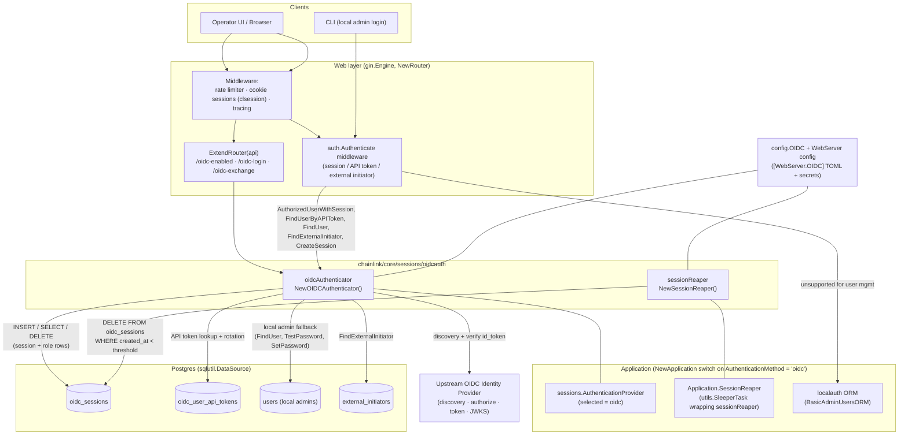
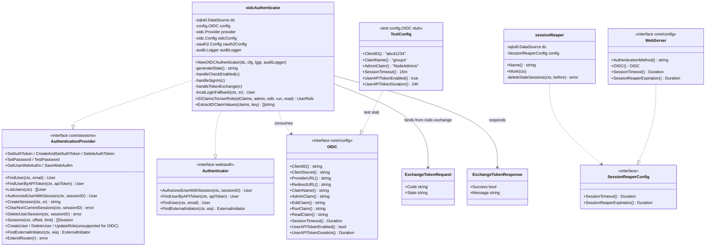
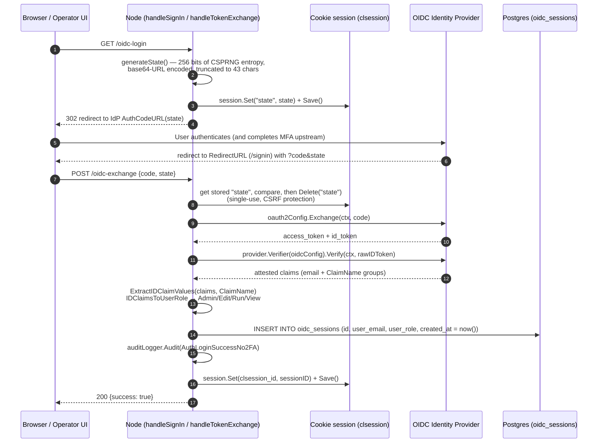
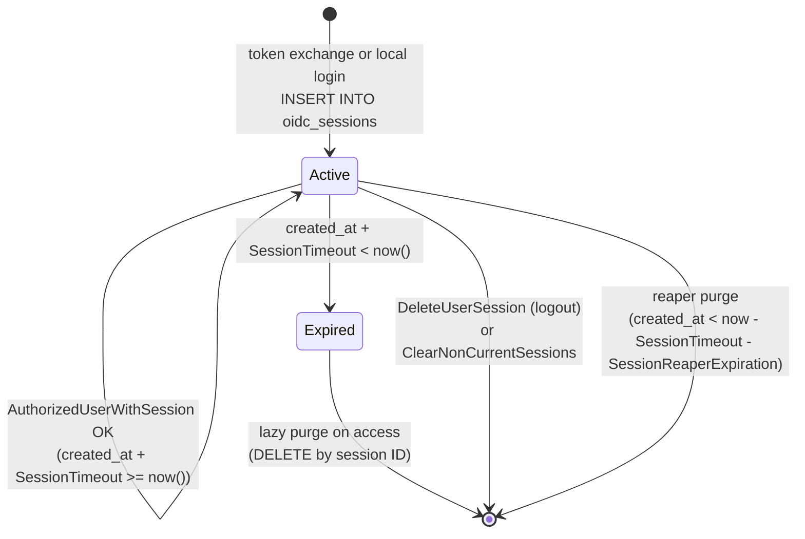

# Sessions Auth — OIDC (`core/sessions/oidcauth`)

## 1. Introduction

The `oidcauth` package provides an **OpenID Connect (OIDC)**-backed implementation of the node's pluggable authentication layer. It is one of three interchangeable `sessions.AuthenticationProvider` implementations selectable through the `WebServer.AuthenticationMethod` setting (`local`, `ldap`, `oidc`) — see the parent module [Sessions & Authentication](../sessions_auth.md) and the sibling [Sessions Auth — LDAP](sessions_auth_ldap.md) page.

Its purpose is to let node operators delegate GUI/API authentication and role assignment to an external OIDC Identity Provider (IdP) such as Okta, Auth0 or Keycloak, while keeping the Chainlink node's local RBAC model (Admin / Edit / Run / View) intact. Instead of verifying passwords locally, the node redirects browsers to the IdP's authorization endpoint, exchanges the returned authorization code for an attested `id_token`, reads the user's group claims from it, maps those claims onto a node role, and issues a node-local session backed by Postgres.

> **Design at a glance**
> - **Read-only identity model** — user/role mutation (`CreateUser`, `DeleteUser`, `UpdateRole`, `SaveWebAuthn`) returns `sessions.ErrNotSupported`; the IdP is the source of truth.
> - **Browser redirect flow** — authentication uses the OAuth2/OIDC authorization-code flow with CSRF `state` protection; the token exchange is performed server-side by the node.
> - **Cached sessions** — after login, the IdP is *not* queried per request; role/session state is read from the local `oidc_sessions` / `oidc_user_api_tokens` tables and validated purely by expiry.
> - **Local admin fallback** — the local `users` table (CLI admin accounts managed by `localauth`) remains usable through the standard `POST /sessions` endpoint.
> - **MFA delegated upstream** — local WebAuthn is stubbed out; multi-factor enforcement is the IdP's responsibility.
> - **Background reaping** — a `utils.SleeperTask` periodically deletes stale rows from `oidc_sessions`.

---

## 2. Architecture

### 2.1 Placement in the node

The module is instantiated by `NewApplication` in `chainlink/core/services/chainlink/application.go` (lines ~580–616). Based on `cfg.WebServer().AuthenticationMethod()`, the application selects the authentication provider; for `oidc` it:

1. Constructs the `oidcAuthenticator` via `NewOIDCAuthenticator(ds, cfg.WebServer().OIDC(), logger, auditLogger)` — failing fast on invalid configuration (a failed discovery call against `ProviderURL` aborts node startup).
2. Constructs the session reaper via `oidcauth.NewSessionReaper(opts.DS, cfg.WebServer(), logger)` and exposes it as the `Application.SessionReaper` (`*utils.SleeperTask`), which is stopped during `Node.stop()` and woken via `WakeSessionReaper()` after login/logout events.
3. Publishes the provider through `Application.AuthenticationProvider()`, where it is consumed by the web router: `NewRouter` (`chainlink/core/web/router.go`) calls `app.AuthenticationProvider().ExtendRouter(api)` to mount the OIDC browser endpoints, and the `auth.Authenticate` middleware uses the same object as its `webauth.Authenticator` (see [Web API — Auth & RBAC](../web_api/web_api_auth_rbac.md)).

### 2.2 Source files

| File | Component | Responsibility |
|---|---|---|
| `chainlink/core/sessions/oidcauth/oidc.go` | `oidcAuthenticator`, `ExchangeTokenRequest`, `ExchangeTokenResponse` | Full `sessions.AuthenticationProvider` implementation: OIDC browser flow endpoints, claim→role mapping, session and API-token lifecycle, local admin fallback, external-initiator lookup, unsupported-operation stubs. |
| `chainlink/core/sessions/oidcauth/reaper.go` | `sessionReaper`, `SessionReaperConfig` | Periodic background task that deletes stale rows from `oidc_sessions` based on `SessionTimeout` + `SessionReaperExpiration`. |
| `chainlink/core/sessions/oidcauth/helpers_test.go` | `TestConfig`, `NewTestOIDCAuthenticator`, `NewMockProvider` | Test doubles: config stub implementing `coreconfig.OIDC`, a bypass constructor that skips config validation, and a canned OIDC discovery provider. |

### 2.3 Type relationships

The authenticator implements the shared `sessions.AuthenticationProvider` contract (defined in `chainlink/core/sessions/authentication.go`) that the web layer consumes, and depends on the `config.OIDC` interface (implemented by the generated web-server config in production and `TestConfig` in tests). The reaper depends on the narrower `SessionReaperConfig` interface, which `config.WebServer` satisfies.

The `oidcAuthenticator` consumes the `config.OIDC` interface (implemented by the web-server config in production and `TestConfig` in tests); the full set of keys is documented in [§6 Configuration](#6-configuration).

---

## 3. Component Reference: `oidcAuthenticator`

### 3.1 Construction and startup validation

`NewOIDCAuthenticator(ds, oidcCfg, lggr, auditLogger)` performs fail-fast validation, requiring all of the following fields from `config.OIDC`:

- Role claim mappings: `AdminClaim()`, `EditClaim()`, `RunClaim()`, `ReadClaim()` (all four must be non-empty)
- `ClientID()`, `ClientSecret()`, `ProviderURL()`, `RedirectURL()`, `ClaimName()`

It then executes the **OpenID Connect discovery** handshake (`oidc.NewProvider(ctx, ProviderURL)`), which fetches the provider's `/.well-known/openid-configuration` document. This is a *blocking network call performed at node startup*; if discovery fails the process exits via `log.Fatalf`. From the discovered endpoints it builds:

- an `oidc.Config` (verifier bound to `ClientID`), and
- an `oauth2.Config` with scopes `openid profile email <ClaimName>` and the configured `RedirectURL`.

The struct is tagged as a provider at compile time: `var _ clsessions.AuthenticationProvider = (*oidcAuthenticator)(nil)`.

### 3.2 Browser (authorization-code) flow

`ExtendRouter(api)` mounts three unauthenticated endpoints on the node's rate-limited, cookie-session-enabled API group:

| Route | Handler | Purpose |
|---|---|---|
| `GET /oidc-enabled` | `handleCheckEnabled` | Feature probe for the UI; returns `{"enabled": true}`. |
| `GET /oidc-login` | `handleSignIn` | Starts the flow: generates a CSRF `state`, stores it in the gin cookie session, and issues a `302` redirect to the IdP's authorization URL (`AuthCodeURL` with `oauth2.AccessTypeOffline`). |
| `POST /oidc-exchange` | `handleTokenExchange` | Completes the flow: consumes the frontend's `ExchangeTokenRequest`, exchanges the code, verifies the ID token, and creates a node session. |

**Claim → role mapping.** `IDClaimsToUserRole` scans the extracted claim values with strict precedence — a user belonging to multiple mapped groups receives the most privileged role:

| Position in claim list | Resulting `clsessions.UserRole` |
|---|---|
| contains `AdminClaim` | `admin` |
| else contains `EditClaim` | `edit` |
| else contains `RunClaim` | `run` |
| else contains `ReadClaim` | `view` |
| else | `ErrUserNoOIDCGroups` (request rejected with `400`) |

`ExtractIDClaimValues` tolerates the three common IdP encodings of a claim: `[]any` of strings, `[]string`, or a single `string` (any other type, or a missing claim key, is an error).

**Failure modes.** A state mismatch, failed token exchange, unverifiable ID token, missing/unparseable claims, absent `email` claim, or unmatched group all short-circuit with an HTTP error; failed exchanges never create a session row.

### 3.3 Session and API-token lifecycle (local cache)

After login, all authentication decisions are resolved locally against the Postgres tables — the IdP is not consulted per request. Validity is computed in SQL as `created_at + <duration> >= now()`.

- **`AuthorizedUserWithSession(ctx, sessionID)`** — runs in a transaction: selects `(user_email, user_role, valid)` from `oidc_sessions` where `id = $1`; if `valid` is false or the row is missing it returns `clsessions.ErrUserSessionExpired` and deletes the row. Session IDs of length zero are rejected outright. This method is what the session-cookie middleware calls on every request.
- **`Sessions(ctx, offset, limit)`** — paginated listing of all `oidc_sessions` rows (ordered by `created_at, id`) for the UI session manager.
- **`DeleteUserSession`** — removes one row by ID (logout). **`ClearNonCurrentSessions`** deletes all rows for the same email except the current session ID.
- **API tokens (`FindUserByAPIToken`, `SetAuthToken`, `CreateAndSetAuthToken`, `DeleteAuthToken`)** — when `UserAPITokenEnabled()` is set, operators can provision headless credentials (`POST /v2/user/token`). `SetAuthToken` generates a salt (`utils.NewSecret`), hashes the token secret (`auth.HashedSecret`) and replaces the user's previous token in a transaction (delete-then-insert into `oidc_user_api_tokens`), emitting `audit.APITokenCreated`. `FindUserByAPIToken` resolves the cached `(email, role)` by `token_key` and treats `created_at + UserAPITokenDuration < now()` as `ErrUserSessionExpired`, purging the stale row. Because the email/role are cached at issue time, no upstream IdP call is made for token authentication — roles refresh only when a new session or token is issued.

### 3.4 Local admin fallback and external initiators

- **`CreateSession(ctx, SessionRequest)`** — backs the standard `POST /sessions` endpoint used by the CLI and by the UI's non-OIDC login path. It *only* authenticates local admin accounts: `localLoginFallback` looks the email up in the `users` table, compares emails with a constant-time algorithm (`constantTimeEmailCompare`, padded to 256 bytes via `crypto/subtle`), verifies the bcrypt password hash, and audits `AuthLoginFailedEmail` / `AuthLoginFailedPassword` on failure. On success a row is written to `oidc_sessions` (same table as browser sessions) and `AuthLoginSuccessNo2FA` is audited.
- **`SetPassword` / `TestPassword`** — operate exclusively on the local `users` table (remote OIDC users have no node-side password). `SetPassword` re-hashes and updates the stored hash; `TestPassword` verifies credentials for CLI login.
- **`FindUser` / `ListUsers`** — resolve against the local `users` table (case-insensitive email).
- **`FindExternalInitiator`** — resolves `external_initiators` rows by `access_key`, preserving the legacy 'Run'-role external-initiator header authentication (see the middleware in [Web API — Auth & RBAC](../web_api/web_api_auth_rbac.md)).

### 3.5 Unsupported operations

Consistent with a read-only, IdP-owned identity model:

| Method | Behavior |
|---|---|
| `CreateUser`, `DeleteUser`, `UpdateRole` | return `clsessions.ErrNotSupported` |
| `SaveWebAuthn` | returns `clsessions.ErrNotSupported` |
| `GetUserWebAuthn` | returns an empty slice (MFA is delegated to the IdP) |

---

## 4. Component Reference: `sessionReaper`

`NewSessionReaper(ds, config, lggr)` wraps a `sessionReaper` in a `utils.SleeperTaskCtx`, producing the wakeable task stored as `Application.SessionReaper`.

- **Scheduling** — the reaper is *event-and-interval driven*: `SessionsController.Create` and `SessionsController.Destroy` `defer App.WakeSessionReaper()` around login/logout (see `chainlink/core/web/sessions_controller.go`), in addition to the SleeperTask's own periodic wake-ups. The task is stopped explicitly in `Node.stop()`.
- **Work** — each run computes `recordCreationStaleThreshold = now − SessionTimeout − SessionReaperExpiration` (via `commonconfig.Duration.Before`) and executes `DELETE FROM oidc_sessions WHERE created_at < $1`. The extra `SessionReaperExpiration` grace period (default `240h`, see `chainlink/core/config/docs/core.toml`) guarantees rows are only deleted well after their validity window has lapsed, complementing the lazy per-access purge performed by `AuthorizedUserWithSession`.
- **Configuration** — the `SessionReaperConfig` interface (`SessionTimeout()`, `SessionReaperExpiration()`) is satisfied by the top-level `config.WebServer` interface, which is why `NewApplication` passes `cfg.WebServer()` directly.

---

## 5. Test Support (`helpers_test.go`)

| Helper | Description |
|---|---|
| `NewTestOIDCAuthenticator` | Builds a real `oidcAuthenticator` **without** config validation, wired to a mocked provider. |
| `NewMockProvider` | Constructs an `oidc.Provider` from a canned `oidc.ProviderConfig` (discovery endpoints synthesized from the issuer URL: `/v1/authorize`, `/v1/token`, `/v1/clients`, `/v1/userinfo`, `/v1/keys`), avoiding live network discovery in tests. |
| `TestConfig` | Implements `coreconfig.OIDC` with deterministic defaults: `ClientID`/`ClientSecret` = `abcd1234`, `ProviderURL` = `https://id.example.com/oauth2/default`, `RedirectURL` = `http://localhost:8080/signin`, `ClaimName` = `groups`, role claims `NodeAdmins` / `NodeEditors` / `NodeRunners` / `NodeReadOnly`, `SessionTimeout` = 15m, `UserAPITokenEnabled` = true, `UserAPITokenDuration` = 24h. |

These defaults mirror the production examples documented in the generated configuration reference (`chainlink/core/config/docs/core.toml`).

---

## 6. Configuration

Enable the module by setting `WebServer.AuthenticationMethod = 'oidc'` and populating `[WebServer.OIDC]` (keys below are from the generated reference `chainlink/core/config/docs/core.toml`; the Go contract is the `config.OIDC` interface in `chainlink/core/config/web_config.go`). For how TOML values reach `config.OIDC`, see [Core Config](../core_config.md).

| TOML key | Purpose | Default / example |
|---|---|---|
| `WebServer.AuthenticationMethod` | Selects the pluggable provider; must be `oidc` for this module (`sessions.OIDCAuth`). | `'local'` |
| `[WebServer.OIDC] ClientID` | Registered application ID at the IdP. | `'abcd1234'` (example) |
| `[WebServer.OIDC] ProviderURL` | Base URL of the IdP; used for discovery at startup. | `'https://id[.]example[.]com/oauth2/default'` (example) |
| `[WebServer.OIDC] RedirectURL` | Must be `<NODE_BASE_URL>/signin` and match the IdP application configuration. | `'http://localhost:8080/signin'` (example) |
| `[WebServer.OIDC] ClaimName` | Name of the `id_token` claim holding the user's group memberships. | `'groups'` |
| `[WebServer.OIDC] AdminClaim` / `EditClaim` / `RunClaim` / `ReadClaim` | Group labels mapping to node roles `admin` / `edit` / `run` / `view`. | `'NodeAdmins'` / `'NodeEditors'` / `'NodeRunners'` / `'NodeReadOnly'` |
| `[WebServer.OIDC] SessionTimeout` | Session validity window used by `AuthorizedUserWithSession` and the reaper. | `'15m0s'` |
| `[WebServer.OIDC] UserAPITokenEnabled` | Enables per-user API tokens (`SetAuthToken`, `FindUserByAPIToken`). | `false` |
| `[WebServer.OIDC] UserAPITokenDuration` | Validity window for issued API tokens. | `'240h0m0s'` |
| `WebServer.SessionReaperExpiration` | Reaper grace period; stale sessions older than `SessionTimeout + SessionReaperExpiration` are deleted. | `'240h'` |

Note: `ClientSecret` is a secret and is supplied via the secrets TOML / environment rather than the plain config file (see the node's configuration docs).

---

## 7. Security Properties

- **CSRF protection** — a cryptographically random `state` (256 bits of entropy from `crypto/rand`) is bound to the operator's cookie session on `GET /oidc-login`, checked on `POST /oidc-exchange`, and deleted immediately after use (single-use).
- **Server-side token exchange** — the `ClientSecret` never leaves the node; the browser only ever sees the authorization code.
- **ID token verification** — the `id_token` signature, audience (`ClientID`) and issuer are verified by the `go-oidc` verifier before any claim is trusted.
- **Privilege mapping** — role assignment happens exclusively at login from *attested* claims; the highest-privilege matching group wins, and unmapped users are rejected (`ErrUserNoOIDCGroups`).
- **Constant-time comparisons** — email comparison during local login uses `crypto/subtle.ConstantTimeCompare` to avoid timing oracles; API-token secrets are stored as salted hashes (`auth.HashedSecret`), never in plaintext.
- **Least-privilege mutations** — identity CRUD is disabled (`ErrNotSupported`); failed logins, successful logins and API-token creation are recorded through the audit logger (`AuthLoginFailedEmail`, `AuthLoginFailedPassword`, `AuthLoginSuccessNo2FA`, `APITokenCreated`).
- **Session hygiene** — expired sessions/tokens are purged lazily on access and proactively by the reaper; `ClearNonCurrentSessions` allows a user to invalidate older sessions.

---

## 8. Related Documentation

- Parent module: [Sessions & Authentication](../sessions_auth.md) — the `AuthenticationProvider` contract, `User`/`Session` types, and shared RBAC roles.
- Sibling provider: [Sessions Auth — LDAP](sessions_auth_ldap.md) — the LDAP-backed alternative, including its upstream state syncer (which the OIDC module replaces with a pure expiry-based reaper).
- Consumer: [Web API — Auth & RBAC](../web_api/web_api_auth_rbac.md) — the middleware that invokes `AuthorizedUserWithSession`, `FindUserByAPIToken` and `FindExternalInitiator`, and the route guards enforcing the mapped roles.
- Lifecycle: [Node Application Lifecycle](../node_application/node_application_lifecycle.md) — where `NewApplication` selects and constructs the provider and reaper, and how they are started/stopped with the node.
- Configuration: [Core Config](../core_config.md) — how `[WebServer.OIDC]` TOML values satisfy the `config.OIDC` interface.
- Broader web surface: [Web API](../web_api.md) and the top-level [Node Application Core & Interfaces](../../Node_Application_Core___Interfaces.md).
