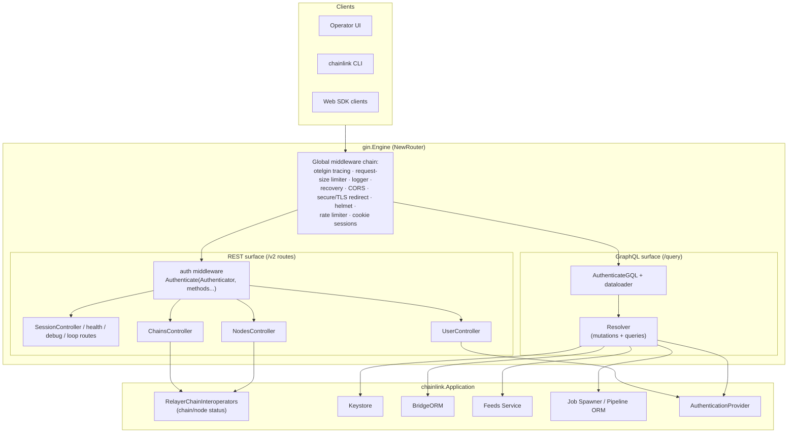
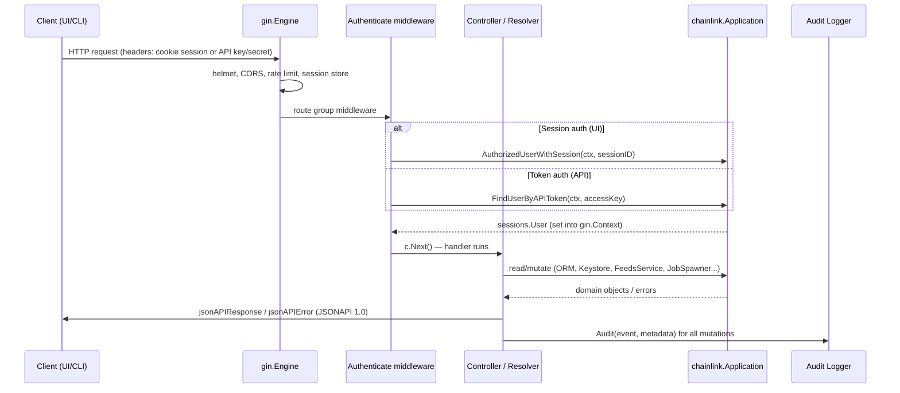
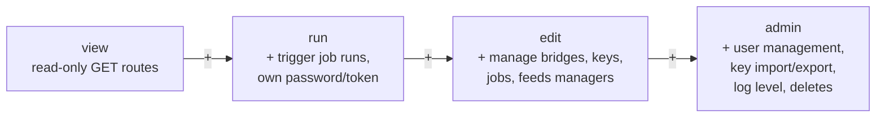
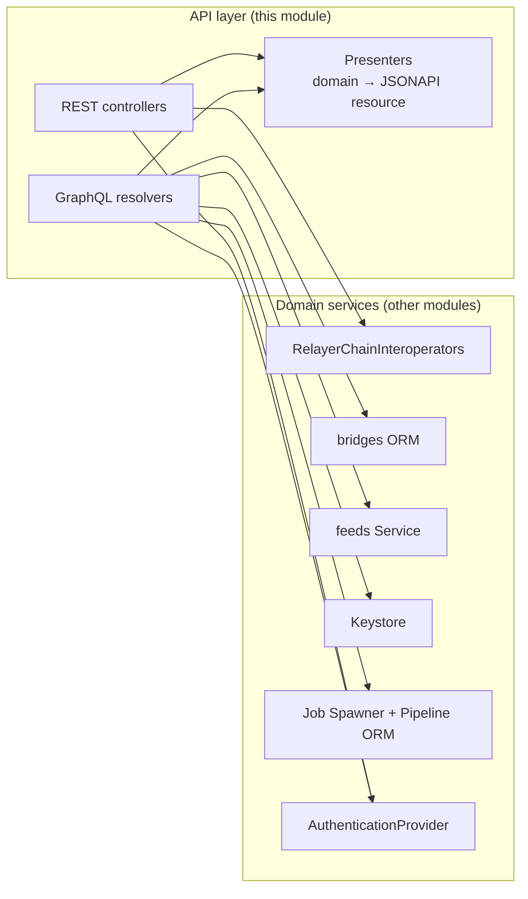

# Web API (`chainlink/core/web`)

## 1. Introduction

The **web_api** module implements the node operator–facing interface of a Chainlink node. It exposes the node's management and observability capabilities over two API surfaces that share a single HTTP server:

| API surface | Transport | Primary consumers |
|---|---|---|
| **REST / JSONAPI v2** (`/v2/...`, `/health`, `/debug`, ...) | HTTP + gin, JSONAPI:1.0 documents | Operator UI, CLI (`chainlink` binary), automation scripts |
| **GraphQL** (`/query`) | HTTP POST, graph-gophers/graphql-go | Operator UI (v2 jobs/keys/managers management), Web SDK clients |

Both surfaces are served by one `gin.Engine` constructed in `chainlink/core/web/router.go::NewRouter`, and both are guarded by the same authentication middleware and Role-Based Access Control (RBAC) policy. The module itself is presentation-oriented: it **does not** contain business logic; it validates input, delegates to the [Application](node_application.md) and its services, and renders responses as JSONAPI resources.

### Where it fits in the system

- Parent module: [Node Application Core & Interfaces](../Node_Application_Core___Interfaces.md)
- It is the *user-facing network interface* of the node application created by [node_application](node_application.md): the `Application` shell wires controllers and resolvers to the running services.
- Session/token authentication delegates to the pluggable authentication providers documented in [sessions_auth](sessions_auth.md) (local sessions, LDAP, OIDC).
- REST chain/node controllers read state through `chainlink.RelayerChainInteroperators`, the multi-relayer abstraction of the node application.
- GraphQL resolvers mutate jobs, bridges, keys and feeds managers via the Application's ORMs and services (e.g. the [feeds service](../Node_Platform_Services/feeds_service.md), [bridges ORM](bridges.md)).

## 2. Architecture Overview

### Sub-modules

The module is organized into four sub-modules, each documented on its own page (with component diagrams and detailed responsibilities):

| Sub-module | Documentation | Contents |
|---|---|---|
| **REST controllers** | [web_api_rest_controllers.md](web_api/web_api_rest_controllers.md) | `ChainsController` & `chainDisabledError` (`chains_controller.go`), `NodesController` / `NetworkScopedNodeStatuser` (`nodes_controller.go`), `UserController` with `newUserRequest` / `updateUserRequest` binding types (`user_controller.go`) |
| **GraphQL API** | [web_api_graphql_api.md](web_api/web_api_graphql_api.md) | `Resolver` mutations and input structs — `createBridgeInput`, `updateBridgeInput`, `createFeedsManagerInput`, `updateFeedsManagerInput`, `createFeedsManagerChainConfigInput`, `updateFeedsManagerChainConfigInput` (`resolver/mutation.go`), user/password resolvers with `UpdatePasswordInput` (`resolver/user.go`), GraphQL schema (`schema/schema.graphql`) |
| **Auth & RBAC** | [web_api_auth_rbac.md](web_api/web_api_auth_rbac.md) | `routeRules` RBAC route matrix (`auth/auth_test.go`) — the authoritative verb/path → role contract enforced by the auth middleware |
| **Presenters** | [web_api_presenters.md](web_api/web_api_presenters.md) | `TronChainResource`, `TronNodeResource` (`presenters/tron_chain.go`) and the JSONAPI resource pattern they follow |

## 3. Request Lifecycle

The sequence below shows a typical authenticated REST request and a GraphQL mutation:

Key behaviors:

1. **Dual authentication methods.** The `Authenticate(store, methods...)` middleware tries each `authMethod` in order; only `auth.ErrAuthFailed` causes it to fall through to the next method, while any other error (e.g. a DB failure) immediately aborts with `401`. This lets session-cookie auth and `AuthenticateByToken` coexist on the same routes.
2. **Untrusted proxy headers.** `NewRouter` sets `engine.RemoteIPHeaders = nil`, so `X-Forwarded-For`/`X-Real-IP` are never trusted for rate limiting or client IP determination.
3. **Uniform error rendering.** All handlers funnel errors through `jsonAPIError` / `jsonAPIResponse` helpers, producing JSONAPI-compliant documents with correct HTTP status codes.
4. **Audit trail.** Every state-changing resolver/controller action emits an audit event (e.g. `audit.BridgeCreated`, `audit.PasswordResetSuccess`, `audit.JobCreated`) via the node's audit logger.
5. **RBAC.** Route groups are wrapped with role-checking middleware (admin / edit / run / view); the authoritative route→role matrix is `routesRolesMap` in `auth/auth_test.go`, exercised by the `TestRBAC_Routemap_*` suites.

## 4. Role-Based Access Control

The node defines four user roles with strictly increasing capability:

- `view` — can call read-only endpoints (chains, nodes, jobs, keys listing, health).
- `run` — additionally can run jobs, change own password, create/delete own API token.
- `edit` — additionally can manage bridges, OCR/P2P/VRF key creation, job creation and the feeds manager configuration.
- `admin` — full access, including user management (`/v2/users`), key import/export, key deletion and log-level changes. Self-modification is blocked in `UserController` (an admin cannot change role or delete their own account).

The full verb/path → role table lives in `chainlink/core/web/auth/auth_test.go::routeRules` and is validated on every run by the `TestRBAC_Routemap_Admin`, `TestRBAC_Routemap_Edit`, `TestRBAC_Routemap_Run` and `TestRBAC_Routemap_ViewOnly` tests, which assert that no route ever returns `401/403` for an allowed role and that forbidden roles receive `403`.

## 5. Data Flow

Read paths fetch domain objects from the services above and wrap them in presenter resources (e.g. `presenters.ChainResource` carrying network/enabled/TOML config, or chain-specific resources such as `TronChainResource`). Write paths translate GraphQL input structs (`createBridgeInput`, `createFeedsManagerInput`, `UpdatePasswordInput`, ...) into validated domain requests before delegating.

## 6. Dependency Map

| web_api component | Depends on | Module / package |
|---|---|---|
| `ChainsController`, `NodesController` | `chainlink.RelayerChainInteroperators`, `FilterRelayersByType` | [node_application](node_application.md) |
| `UserController` | `chainlink.AuthenticationProvider` (sessions, LDAP, OIDC) | [sessions_auth](sessions_auth.md) |
| GraphQL `Resolver` mutations | `BridgeORM`, `GetFeedsService`, `GetKeyStore`, `AddJobV2`, `RunJobV2`, `GetAuditLogger` | [bridges](bridges.md), [feeds service](../Node_Platform_Services/feeds_service.md), [keystore](../Node_Platform_Services/keystore.md), [job service](../Node_Platform_Services/job_service.md) |
| `Resolver.UpdateUserPassword` / `CreateAPIToken` | `AuthenticationProvider`, `webauth.GetGQLAuthenticatedSession` | [sessions_auth](sessions_auth.md) |
| Presenters | `api2go` EntityNamer contract | `chainlink/core/web/presenters` |
| Router (`NewRouter`) | `otelgin`, `helmet`, `ginprom.Prometheus`, cookie session store | Observability: [telemetry ingress](../Telemetry___Observability_Platform/telemetry_ingress.md) |

## 7. Configuration Touchpoints

The HTTP surface is configured through the node's web-server configuration (`config.WebServer()` in `NewRouter`): session options, allowed CORS origins, TLS force-redirect, request-size limit (`HTTPMaxSize`) and authenticated-rate limits. These settings belong to the node application's `GeneralConfig` tree described in [node_application_config](node_application/node_application_config.md). GraphQL feature toggles (e.g. OCR/OCR2 being required to create the corresponding jobs) come from the same config, enforced inside `Resolver.CreateJob`.

## 8. Related Documentation

- [Node Application Core & Interfaces](../Node_Application_Core___Interfaces.md) — parent module
- [node_application](node_application.md) — application assembly and lifecycle that owns the web server
- [node_application_config](node_application/node_application_config.md) — `GeneralConfig` fields consumed by the web layer
- [sessions_auth](sessions_auth.md) — authentication providers backing `Authenticator`
- [bridges](bridges.md) — bridge types created/updated through the GraphQL API
- [feeds service](../Node_Platform_Services/feeds_service.md) — feeds manager/chain-config persistence used by resolvers
- [Telemetry & Observability Platform](../Telemetry___Observability_Platform.md) — tracing/telemetry middleware integrations
