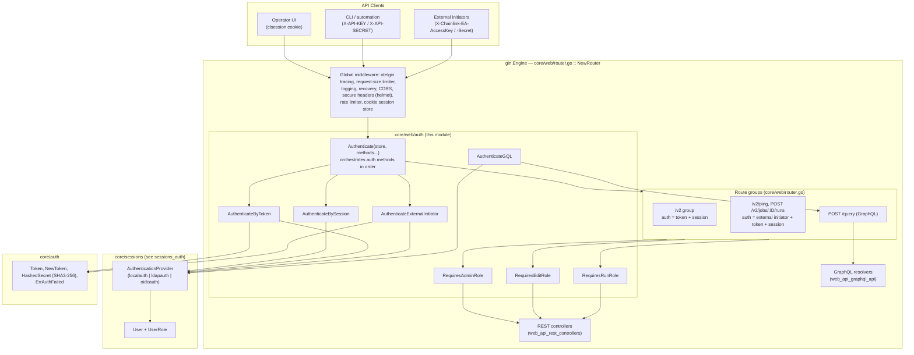
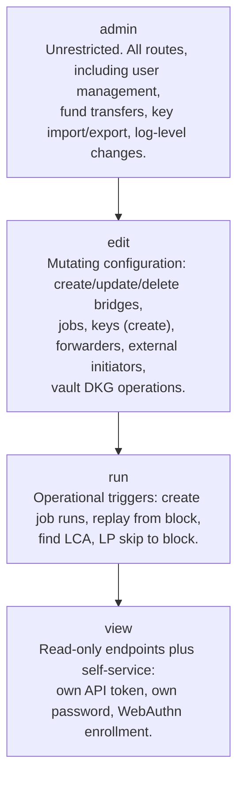
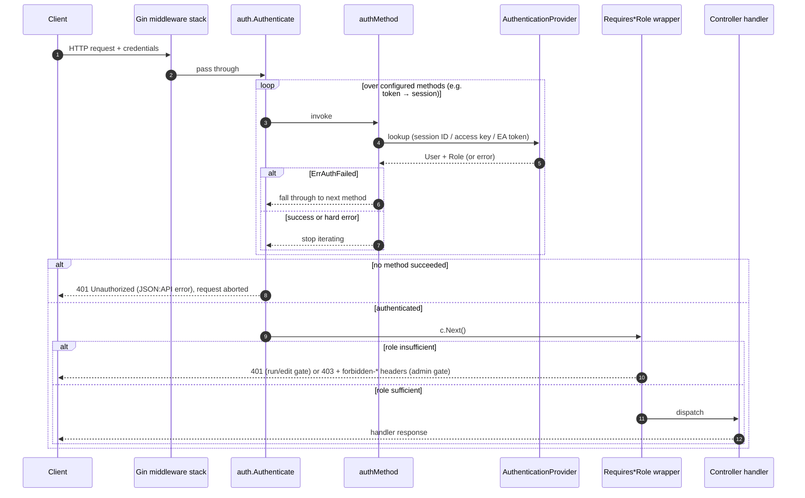
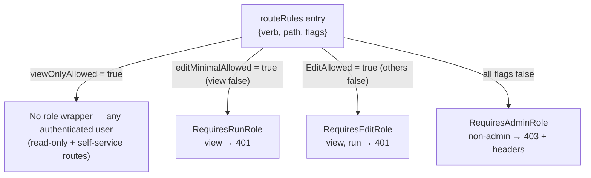
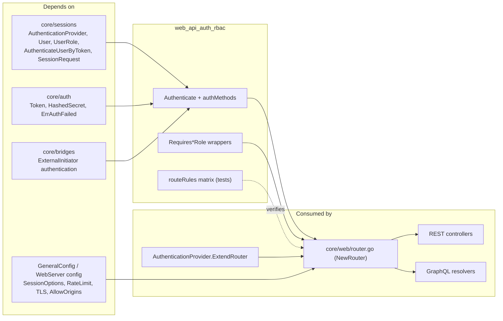

# Web API — Authentication & RBAC (`web_api_auth_rbac`)

## Introduction

The `web_api_auth_rbac` module is the security gate of the Chainlink node's HTTP interface. Implemented in `chainlink/core/web/auth/` (package `auth`, imported as `webauth` in tests and `auth` by the router), it provides:

1. **Pluggable authentication middleware** that resolves *who* is calling — via session cookie, API token, or external-initiator credentials.
2. **Role-Based Access Control (RBAC) wrappers** that decide *what* the caller may do, based on the user's role (`admin`, `edit`, `run`, `view`).
3. **An executable RBAC route map** — the `routeRules` matrix in `chainlink/core/web/auth/auth_test.go` — which is the canonical, test-enforced specification of which role may access which REST route.

The module is consumed by the Gin router ([`NewRouter`](../../../chainlink/core/web/router.go)) and therefore sits in front of every REST controller and GraphQL resolver:

- Parent module: [web_api](../web_api.md) (part of [Node Application Core & Interfaces](../../Node_Application_Core___Interfaces.md))
- Sibling modules: [REST controllers](web_api_rest_controllers.md), [GraphQL API](web_api_graphql_api.md), [Presenters](web_api_presenters.md)
- Identity backends behind the middleware: [sessions_auth](../sessions_auth.md) (local DB, LDAP, OIDC)

---

## Architecture

The module is a small, composable middleware layer built on [gin-gonic](https://github.com/gin-gonic/gin). The router composes a chain of `authMethod` functions into a single `Authenticate` middleware, and then wraps individual route handlers with role-enforcing decorators.



### Module at a glance

| Concern | Component | Location |
|---|---|---|
| Middleware orchestrator | `Authenticate` | `chainlink/core/web/auth/auth.go` |
| Session authentication | `AuthenticateBySession` | `chainlink/core/web/auth/auth.go` |
| API-token authentication | `AuthenticateByToken` | `chainlink/core/web/auth/auth.go` |
| External-initiator authentication | `AuthenticateExternalInitiator` | `chainlink/core/web/auth/auth.go` |
| RBAC wrappers | `RequiresRunRole`, `RequiresEditRole`, `RequiresAdminRole` | `chainlink/core/web/auth/auth.go` |
| Context accessors | `GetAuthenticatedUser`, `GetAuthenticatedExternalInitiator` | `chainlink/core/web/auth/auth.go` |
| GraphQL authentication | `AuthenticateGQL`, `GQLSession` | `chainlink/core/web/auth/gql.go` |
| Error helpers & 403 headers | `jsonAPIError`, `addForbiddenErrorHeaders` | `chainlink/core/web/auth/helpers.go` |
| Role model | `User`, `UserRole` | `chainlink/core/sessions/user.go` |
| Token hashing & comparison | `Token`, `HashedSecret`, `AuthenticateUserByToken` | `chainlink/core/auth/auth.go`, `chainlink/core/sessions/session.go` |
| RBAC route map (executable spec) | `routeRules`, `routesRolesMap`, `TestRBAC_Routemap_*` | `chainlink/core/web/auth/auth_test.go` |
| Router wiring | `NewRouter`, `v2Routes`, `sessionRoutes` | `chainlink/core/web/router.go` |

---

## Authentication

### The `authMethod` abstraction

An `authMethod` is `func(ctx *gin.Context, store Authenticator) error`. Implementations either succeed (user stored in the Gin context under `auth.SessionUserKey`), return the sentinel `auth.ErrAuthFailed` (try the next method), or return any other error (abort immediately).

`Authenticator` decouples the middleware from persistence:

```go
type Authenticator interface {
    AuthorizedUserWithSession(ctx, sessionID) (sessions.User, error)
    FindExternalInitiator(ctx, eia *auth.Token) (*bridges.ExternalInitiator, error)
    FindUser(ctx, email) (sessions.User, error)
    FindUserByAPIToken(ctx, apiToken) (sessions.User, error)
}
```

In production this is satisfied by the application's `AuthenticationProvider` (local DB, LDAP, or OIDC — see [sessions_auth](../sessions_auth.md)). In tests, hand-rolled stubs (`userFindSuccess`, `userFindFailure` in `auth_test.go`) implement only the needed lookups.

### Authentication methods

| Method | Credentials | Mechanism |
|---|---|---|
| `AuthenticateBySession` | `clsession` cookie (`clsession_id`) | Resolves the session ID via `AuthorizedUserWithSession`; expired/unknown sessions fail. |
| `AuthenticateByToken` | `X-API-KEY` + `X-API-SECRET` headers | Loads the user row by access key (needed for the stored salt), then verifies the secret with `sessions.AuthenticateUserByToken` (SHA3-256 over `"v0-<key>-<secret>-<salt>"`, constant-time compare). Blank key or secret is rejected outright. |
| `AuthenticateExternalInitiator` | `X-Chainlink-EA-AccessKey` + `X-Chainlink-EA-Secret` headers | Verifies the EA via `bridges.AuthenticateExternalInitiator` and **implicitly assumes the `run` role** (required to trigger job runs). |
| `AuthenticateGQL` | session cookie only | Non-blocking: stores a `GQLSession` in the request context if a valid session exists; each GraphQL resolver decides whether authentication is required (see [web_api_graphql_api](web_api_graphql_api.md)). |

### `Authenticate` composition semantics

`Authenticate(store, methods...)` iterates the supplied methods:

- On `ErrAuthFailed`, it falls through to the next method (a request may satisfy several schemes).
- On any other error (e.g. datastore failure), iteration stops and the request is rejected — later methods are not attempted.
- If every method fails, the request is aborted with **`401 Unauthorized`** (JSON:API error body). No handler runs.

This behaviour is pinned down by `TestRequireAuth_*` and `TestAuthenticateByToken_*` in `auth_test.go`, including the edge case that a hard error does *not* cascade to the next method (`TestRequireAuth_Error`).

### Session lifecycle (context)

Sessions are created outside this module but are inseparable from it:

- `POST /sessions` (`SessionsController.Create`, unauthenticated group) binds a `SessionRequest`, optionally performing WebAuthn (2FA) challenges, and calls `AuthenticationProvider.CreateSession`. The returned session ID is stored in the encrypted cookie store (`cookie.NewStore(secret)`), with options from `config.WebServer().SessionOptions()`.
- `DELETE /sessions` destroys the session (requires session authentication).
- Session reaping/expiration and provider pluggability (local / LDAP / OIDC) are documented in [sessions_auth](../sessions_auth.md).

---

## Role-Based Access Control (RBAC)

### Role model

Roles are defined in `chainlink/core/sessions/user.go` as `UserRole` constants and travel with the `User` object placed in the request context. Access is **cumulative**: a user can do everything a lower-privileged role can do.



### Enforcement wrappers

The wrappers are handler decorators applied per route in `v2Routes` (`core/web/router.go`). They first verify an authenticated user exists (otherwise `401 "not a valid session"`), then check the role:

| Wrapper | Grants access to | Denies | Denial response |
|---|---|---|---|
| `RequiresRunRole` | `admin`, `edit`, `run` | `view` | `401 Unauthorized` |
| `RequiresEditRole` | `admin`, `edit` | `view`, `run` | `401 Unauthorized` |
| `RequiresAdminRole` | `admin` only | everyone else | **`403 Forbidden`** + diagnostic headers |

Note the asymmetry, which the RBAC tests assert precisely: insufficient role for run/edit-gated routes yields `401` (the middleware deliberately does not reveal route existence), whereas failing an admin check yields `403` enriched with `forbidden-required-role`, `forbidden-provided-role` and `forbidden-provided-email` headers (`addForbiddenErrorHeaders` in `helpers.go`) so remote clients can render actionable messages.

### Request lifecycle



---

## The RBAC route map (`routeRules`)

The core artifact of this module is the `routeRules` matrix in `chainlink/core/web/auth/auth_test.go`:

```go
type routeRules struct {
    verb               string
    path               string
    viewOnlyAllowed    bool // minimum role: view
    editMinimalAllowed bool // minimum role: run
    EditAllowed        bool // minimum role: edit
}
```

`routesRolesMap` lists every authenticated `/v2` route with the flags **cumulatively** set for the *minimum* role allowed (`admin` is implicit and always allowed). The matrix is the executable specification of RBAC: it is iterated by four integration tests (`TestRBAC_Routemap_Admin/Edit/Run/ViewOnly`) that boot a real application (`cltest.NewApplicationEVMDisabled`) and a real router (`web.Router`, the test wrapper around `NewRouter` in `core/web/helpers.go`), then assert, per role, that each route returns neither `401` when it should be reachable, and exactly `403`/`401` when it should not.

How the flags map to enforcement:



### Complete route matrix by minimum role

**Minimum role: `view`** — authentication only, no role wrapper (read-only inventory + self-service):

| Method | Route |
|---|---|
| PATCH | `/v2/user/password` |
| POST | `/v2/user/token`, `/v2/user/token/delete` |
| GET / POST | `/v2/enroll_webauthn` |
| GET | `/v2/external_initiators` |
| GET | `/v2/bridge_types`, `/v2/bridge_types/:name` |
| GET | `/v2/config`, `/v2/config/v2` |
| GET | `/v2/tx_attempts`, `/v2/tx_attempts/evm` |
| GET | `/v2/transactions`, `/v2/transactions/:hash`, `/v2/transactions/evm`, `/v2/transactions/evm/:hash` |
| GET | `/v2/keys/csa`, `/v2/keys/eth`, `/v2/keys/ocr`, `/v2/keys/ocr2`, `/v2/keys/p2p`, `/v2/keys/vrf` |
| GET | `/v2/keys/{solana, starknet, aptos, stellar, tron, ton}` |
| GET | `/v2/jobs`, `/v2/jobs/:ID`, `/v2/pipeline/runs`, `/v2/jobs/:ID/runs`, `/v2/jobs/:ID/runs/:runID` |
| GET | `/v2/features`, `/v2/log`, `/v2/build_info`, `/v2/ping` |
| GET | `/v2/chains/evm`, `/v2/chains/solana`, `/v2/chains/stellar`, `/v2/chains/:network/:ID` |
| GET | `/v2/nodes/`, `/v2/nodes/evm`, `/v2/nodes/solana`, `/v2/nodes/stellar`, `/v2/nodes/evm/forwarders`, `/v2/chains/:network/:ID/nodes` |

**Minimum role: `run`** — wrapped in `RequiresRunRole` (view denied with `401`):

| Method | Route |
|---|---|
| POST | `/v2/replay_from_block/:number` |
| POST | `/v2/jobs/:ID/runs` *(also reachable by external initiators, who implicitly hold the run role)* |

**Minimum role: `edit`** — wrapped in `RequiresEditRole` (view and run denied with `401`):

| Method | Route |
|---|---|
| POST / DELETE | `/v2/external_initiators`, `/v2/external_initiators/:name` |
| POST / PATCH / DELETE | `/v2/bridge_types`, `/v2/bridge_types/:name` |
| POST | `/v2/keys/csa`, `/v2/keys/eth`, `/v2/keys/ocr`, `/v2/keys/ocr2/:chainType`, `/v2/keys/p2p`, `/v2/keys/vrf` |
| POST | `/v2/keys/{solana, starknet, aptos, stellar, tron, ton}` |
| POST / DELETE | `/v2/jobs`, `/v2/jobs/:ID` |
| DELETE | `/v2/pipeline/job_spec_errors/:ID` |
| POST / DELETE | `/v2/nodes/evm/forwarders/track`, `/v2/nodes/evm/forwarders/:fwdID` |

**Minimum role: `admin`** — wrapped in `RequiresAdminRole` (everyone else denied with `403`):

| Method | Route |
|---|---|
| GET / POST / PATCH / DELETE | `/v2/users`, `/v2/users`, `/v2/users`, `/v2/users/:email` |
| POST | `/v2/transfers`, `/v2/transfers/evm`, `/v2/transfers/solana` |
| POST | `/v2/keys/csa/import`, `/v2/keys/csa/export/:ID` |
| DELETE / POST | `/v2/keys/eth/:keyID`, `/v2/keys/eth/import`, `/v2/keys/eth/export/:address` |
| DELETE / POST | `/v2/keys/ocr/:keyID`, `/v2/keys/ocr/import`, `/v2/keys/ocr/export/:ID` |
| DELETE / POST | `/v2/keys/ocr2/:keyID`, `/v2/keys/ocr2/import`, `/v2/keys/ocr2/export/:ID` |
| DELETE / POST | `/v2/keys/p2p/:keyID`, `/v2/keys/p2p/import`, `/v2/keys/p2p/export/:ID` |
| DELETE / POST | `/v2/keys/vrf/:keyID`, `/v2/keys/vrf/import`, `/v2/keys/vrf/export/:keyID` |
| DELETE / POST | `/v2/keys/{solana, starknet, aptos, stellar, tron, ton}/:keyID`, `.../import`, `.../export/:ID` |
| PATCH | `/v2/log` |

> **Maintenance note.** The matrix is maintained by hand and must be extended whenever a route is added to `v2Routes`. A few router registrations are not yet mirrored in `routesRolesMap` (e.g. `PUT /v2/jobs/:ID`, `POST /v2/vault/dkg_results/*`, `GET /v2/find_lca`, `POST /v2/lp_skip_to_block`, and the dev-only `POST /v2/execute_capability`); their effective policy is whatever wrapper they carry in `router.go`. When adding routes, register the handler with the appropriate `Requires*Role` wrapper **and** add the corresponding `routeRules` entry.

### Routes outside the RBAC matrix

| Group | Auth policy |
|---|---|
| `/readyz`, `/public-readyz`, `/health`, `/health.txt` | Public (no auth) — used by orchestration and load balancers. |
| `POST /sessions` | Unauthenticated (login); subject to the *unauthenticated* rate-limit tier. |
| `DELETE /sessions` | Session-authenticated (logout). |
| `PATCH /v2/resume/:runID` | Unauthenticated pipeline-run resume endpoint. |
| `/debug/vars` | Session-authenticated only (`debugRoutes`). |
| `/discovery`, `/plugins/:name/*` (loop plugin routes) | Unauthenticated plugin infrastructure endpoints. |
| Operator UI assets (`/assets/:file`, SPA fallback) | Unauthenticated static serving. |

---

## GraphQL authentication

The GraphQL endpoint (`POST /query`) uses a different model because a single request may fan out into many resolvers with different requirements:

- `AuthenticateGQL` attempts session-cookie authentication only (no token/EI support). Failure is **not** fatal — the request proceeds unauthenticated.
- The resolved `GQLSession{SessionID, User}` is stored in the `context.Context` via `WithGQLAuthenticatedSession` and read by resolvers with `GetGQLAuthenticatedSession`.
- Authorization (which resolvers require which role) is implemented per-resolver and covered by `gql_test.go`; the schema itself is documented in [web_api_graphql_api](web_api_graphql_api.md).

This split means RBAC for REST is centralized in the route map, while RBAC for GraphQL is decentralized into resolvers — a deliberate trade-off documented in the module's test comments.

---

## Testing & verification

The module's tests double as its specification. They run as standard Go tests within the `chainlink` module (invoke with `make test ARGS="./core/..."` from [`chainlink/GNUmakefile`](../../../chainlink/GNUmakefile); integration tests need the Postgres test database provided by the `start-testdb` target).

**Unit-level middleware tests** (`auth_test.go`) use `gin.TestMode`, `httptest.NewRecorder`, and stub `Authenticator` implementations:

- `TestAuthenticateByToken_Success` — valid `X-API-KEY`/`X-API-SECRET` reach the handler.
- `TestAuthenticateByToken_AuthFailed` / `_RejectsBlankAccessKey` — bad or blank credentials yield `401` and never reach the handler.
- `TestRequireAuth_NoneRequired` — `Authenticate` with zero methods is a pass-through.
- `TestRequireAuth_AuthFailed` / `_LastAuthSuccess` / `_Error` — pin the composition semantics (fall-through on `ErrAuthFailed`, stop on hard error, `401` on total failure).

**RBAC routemap integration tests** (`TestRBAC_Routemap_Admin`, `_Edit`, `_Run`, `_ViewOnly`) boot the full application via `cltest.NewApplicationEVMDisabled`, build the production router via `web.Router`, create a user of the target role (`sessions.UserRoleEdit/Run/View`; admin is the default), and fire every request in `routesRolesMap`, asserting:

- admin: never `401`/`403` anywhere;
- edit: no `401`/`403` on any route with any flag set, `403` on admin-only routes;
- run: no `401`/`403` on view/run routes, `401` on edit-gated and `403` on admin-gated routes;
- view: no `401`/`403` on view routes only, `401` on edit/run-gated and `403` on admin-gated routes.

Because handlers are not mocked, a passing assertion only checks the auth layer (i.e., the request reaches a controller); this keeps the tests focused purely on authentication and authorization outcomes.

**Router-level token tests** (`core/web/router_test.go`) verify credential-required behaviour end to end: missing credentials → `401`, session credentials accepted, external-initiator credentials accepted on `/v2/ping` with the `X-Chainlink-EA-*` headers, and bad EA secrets rejected.

---

## Dependencies & integration



- **Upstream (identity)**: the `AuthenticationProvider` interface and its `localauth`/`ldapauth`/`oidcauth` implementations — see [sessions_auth](../sessions_auth.md). The provider also extends the router with its own routes via `ExtendRouter`.
- **Upstream (primitives)**: `core/auth` (token generation/hashing, `ErrAuthFailed`) and `core/bridges` (external-initiator verification).
- **Configuration**: session cookie options, authenticated/unauthenticated rate limits, request size, TLS redirection and CORS all originate from the node `GeneralConfig` — see [node_application_config](../node_application/node_application_config.md) and [core_config](../core_config.md). The application object that supplies config, logger, and the `AuthenticationProvider` is assembled as described in [node_application](../node_application.md).
- **Downstream**: route groups and handlers live in [web_api_rest_controllers](web_api_rest_controllers.md); resolvers in [web_api_graphql_api](web_api_graphql_api.md); serialized responses in [web_api_presenters](web_api_presenters.md).

### Extending the module

When adding a new REST endpoint:

1. Register it in `v2Routes` (`core/web/router.go`) inside the `authv2` group.
2. Wrap the handler with the appropriate `RequiresRunRole` / `RequiresEditRole` / `RequiresAdminRole`; leave unwrapped only if any authenticated user may call it.
3. Add a matching `routeRules` entry to `routesRolesMap` in `chainlink/core/web/auth/auth_test.go` so the RBAC routemap tests enforce the new policy.
4. If the route must be reachable by external initiators, add it to the `userOrEI` group (which prepends `AuthenticateExternalInitiator`).

Security invariants to preserve: never accept a blank API key or secret; keep secret comparison constant-time (`AuthenticateUserByToken`); do not trust proxy headers for client IP (`engine.RemoteIPHeaders = nil`); and keep the `401`-for-role-mismatch behaviour on run/edit routes, reserving `403` (with the diagnostic headers) for the admin gate.
