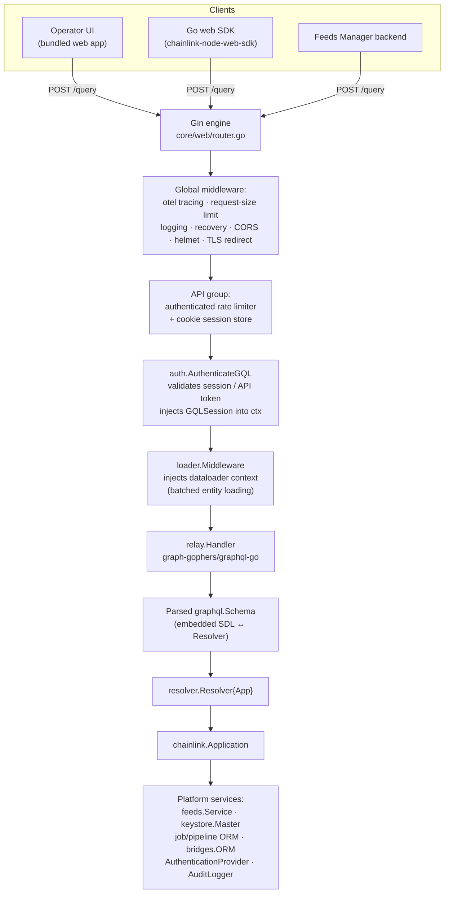
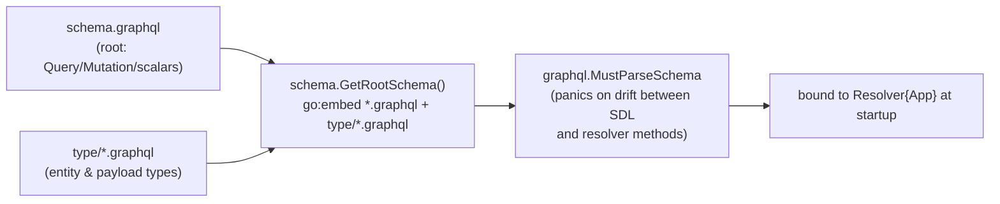
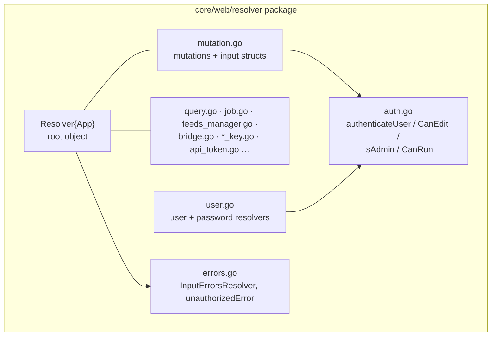
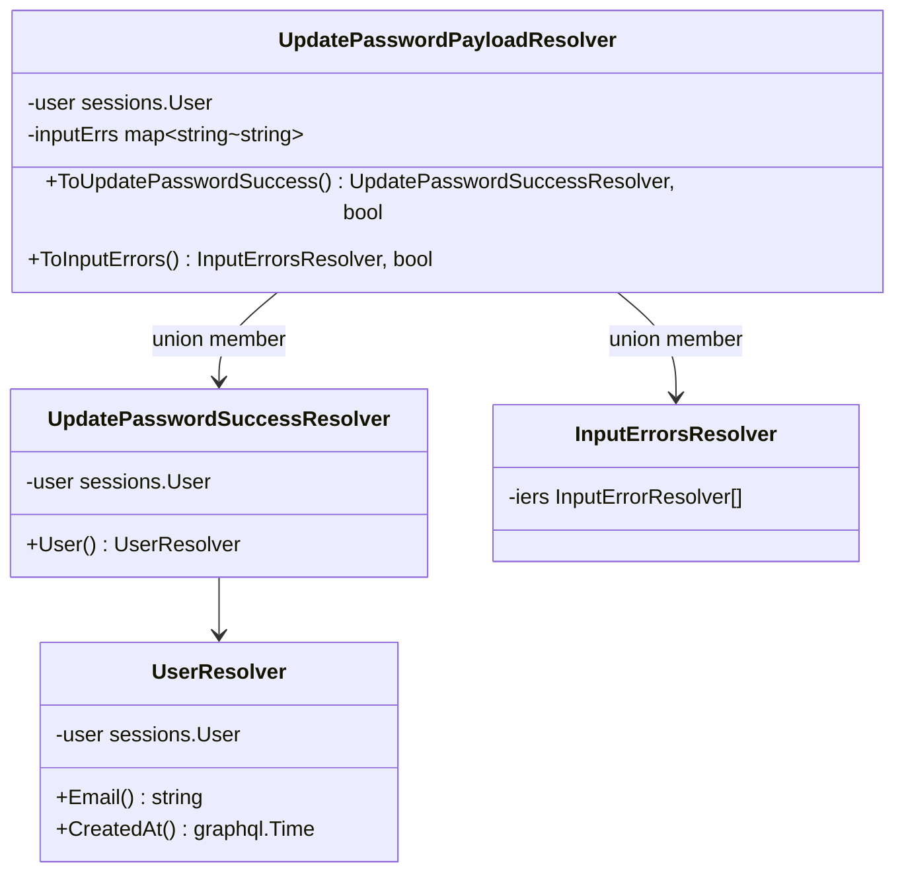
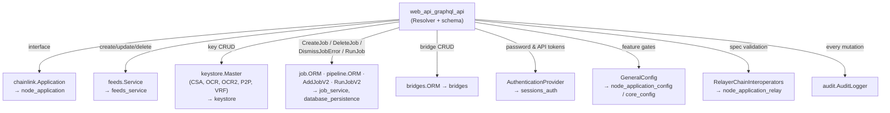
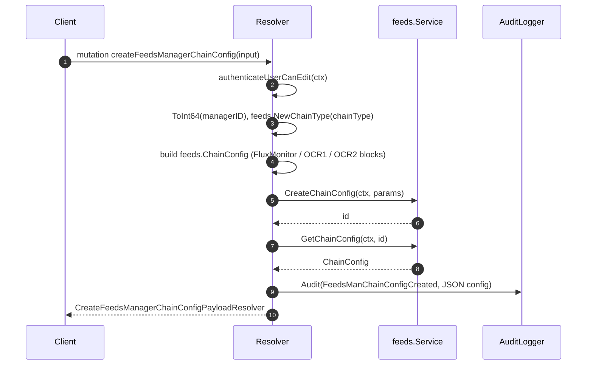
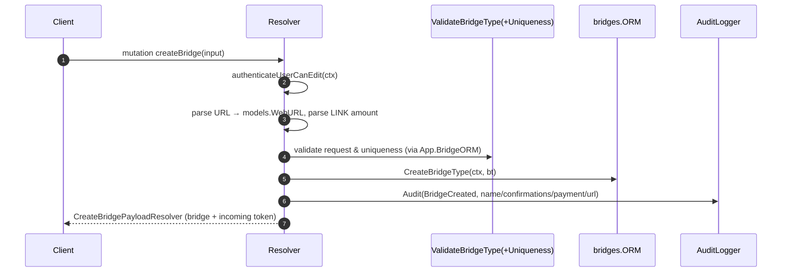
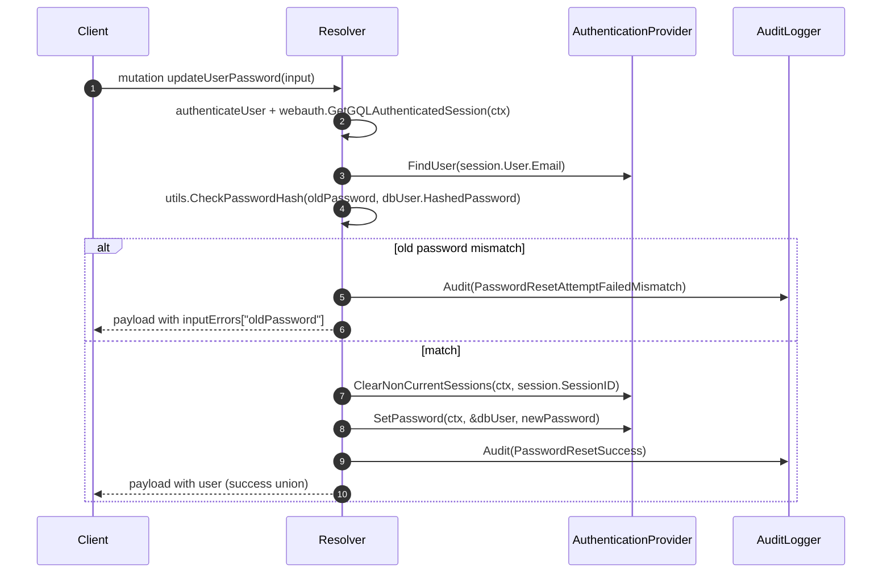
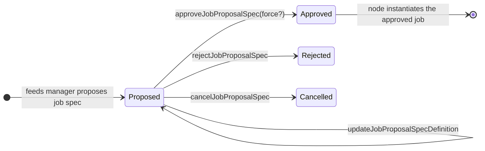

# Web API — GraphQL Interface (`web_api_graphql_api`)

## 1. Overview

The `web_api_graphql_api` module implements the Chainlink node's **GraphQL interface**: a single GraphQL endpoint (`POST /query`) through which privileged clients — the bundled **Operator UI**, the Go **web SDK** used by test/deployment tooling, and external **Feeds Manager** backends — read node state and mutate node configuration (jobs, bridges, key bundles, feeds managers, logging, sessions and API tokens).

The module is composed of three tightly-coupled artifacts plus runtime glue:

| Artifact | Path | Role |
|---|---|---|
| Root GraphQL SDL | `chainlink/core/web/schema/schema.graphql` | Declares the `Query` and `Mutation` root types and the `Time`, `Map`, `Bytes` scalars |
| Mutation resolvers | `chainlink/core/web/resolver/mutation.go` | `Resolver` root object, mutation input structs, and every mutation implementation |
| User resolvers | `chainlink/core/web/resolver/user.go` | `UpdatePasswordInput`, `UserResolver`, and the password payload/error union |
| Schema loader (glue) | `chainlink/core/web/schema/schema.go` | Embeds the SDL via `go:embed` and merges root + type files into one schema string |
| Endpoint wiring (glue) | `chainlink/core/web/router.go` | Registers `POST /query` with auth, dataloader and rate-limit middleware and binds the schema to the resolver |

Design intent:

- **One privileged surface.** All configuration *writes* go through GraphQL mutations; the REST controllers ([web_api_rest_controllers](web_api_rest_controllers.md)) mostly expose read-only/entity-level operations, while the Operator UI uses GraphQL as its primary write path.
- **Schema-first, code-second.** The SDL is the contract; resolver methods must match it exactly or `graphql.MustParseSchema` fails at startup (fail-fast).
- **Audited by default.** Every state-changing mutation emits a structured event through the node's `audit.AuditLogger`, including failed sensitive attempts (wrong password, wrong API-token password).

## 2. Position in the System

This module is a child of the [Web API](../web_api.md) layer of the node application ([Node Application Core & Interfaces](../../Node_Application_Core___Interfaces.md)). Its siblings are:

- [web_api_auth_rbac](web_api_auth_rbac.md) — authentication middleware (`auth.AuthenticateGQL`) that runs *before* this module and injects the authenticated `GQLSession` into the request context.
- [web_api_rest_controllers](web_api_rest_controllers.md) — REST/JSON:API controllers sharing the same `chainlink.Application` backend.
- [web_api_presenters](web_api_presenters.md) — JSON:API presenters used by the REST side (the GraphQL side uses its own resolver payload types instead).

Downstream, the module is a *consumer* of most platform services; see [§8 Dependencies](#8-dependencies).

## 3. Core Components

| Component | File | Description |
|---|---|---|
| `schema.graphql` | `chainlink/core/web/schema/schema.graphql` | Root SDL: 25+ root queries, 34 root mutations, scalars `Time` / `Map` / `Bytes`. Entity types live in `chainlink/core/web/schema/type/*.graphql` and are merged at startup. |
| `Resolver` | `chainlink/core/web/resolver/mutation.go` | Root GraphQL object. Holds a single field — `App chainlink.Application` — through which every resolver reaches backend services. |
| `createBridgeInput` / `updateBridgeInput` | `mutation.go` | Input for bridge create/update: name, URL, confirmations, minimum contract payment (LINK), connection-manager flag. |
| `createFeedsManagerInput` / `updateFeedsManagerInput` | `mutation.go` | Input for feeds-manager registration/update: name, URI, Ed25519 public key (hex). |
| `createFeedsManagerChainConfigInput` / `updateFeedsManagerChainConfigInput` | `mutation.go` | Per-chain config for a feeds manager: account/admin addresses, FluxMonitor toggle, and full OCR1/OCR2 sub-configurations (bootstrap flag, multiaddr, peer ID, key-bundle ID, forwarder address, plugins blob). |
| `UpdatePasswordInput` | `chainlink/core/web/resolver/user.go` | `OldPassword` / `NewPassword` pair for `updateUserPassword`. |
| `UserResolver`, `UpdatePasswordPayloadResolver`, `UpdatePasswordSuccessResolver`, `InputErrorsResolver` | `user.go`, `errors.go` | Payload union resolvers implementing the errors-first response pattern (see [§7](#7-error-handling-pattern)). |

> Query-side resolvers (`query.go`, `job.go`, `feeds_manager.go`, `bridge.go`, `*_key.go`, …) live in the same `resolver` package but are documented at the parent [web_api](../web_api.md) level; this page focuses on the mutation surface and the schema/resolver binding.

## 4. Architecture

### 4.1 Request Pipeline

Every GraphQL request passes through the Gin middleware stack before reaching the resolver tree:

Key wiring in `chainlink/core/web/router.go`:

1. `api.POST("/query", auth.AuthenticateGQL(...), loader.Middleware(app), graphqlHandler(app))`.
2. `graphqlHandler` calls `schema.MustGetRootSchema()` once at startup and parses it with
   `graphql.MustParseSchema(rootSchema, &resolver.Resolver{App: app}, schemaOpts...)`.
3. A `graphql.MaxDepth(10)` option is applied **unless** the insecure config flag `InfiniteDepthQueries()` is set — a guard against runaway nested queries.
4. The parsed schema is served through `relay.Handler{Schema: schema}`, the standard `graphql-go` HTTP relay.
5. After route registration, `app.AuthenticationProvider().ExtendRouter(api)` lets pluggable auth providers (e.g. LDAP/OIDC, see [sessions_auth](../sessions_auth.md)) append their own routes to the same API group.

### 4.2 Schema Composition & Embedding

The SDL is compiled into the node binary — schema changes require a rebuild (node image targets: `chainlink/GNUmakefile`, see [chainlink_build_and_tooling](../../Build,_CI___Release_Infrastructure/chainlink_build_and_tooling.md)):

- `//go:embed *.graphql type/*.graphql` in `chainlink/core/web/schema/schema.go` guarantees the schema ships with the binary; `MustGetRootSchema` concatenates the root file with every `type/` file.
- Scalar mappings (`Time`, `Map`, `Bytes`) are implemented in the `core/web/gqlscalar` package.

### 4.3 Component Structure

## 5. GraphQL Surface

The root schema declares (excerpted from `schema.graphql`):

- **Scalars:** `Time`, `Map`, `Bytes`.
- **Queries (root `Query`):** bridges, chains, config v2, key bundles (CSA, ETH, OCR, OCR2, P2P, VRF, Solana, Aptos, Sui, StarkNet, Tron, TON, Stellar), eth transactions (+ attempts), features, feeds manager(s), global log level, jobs, job proposals, job runs, nodes, sql logging, vrf keys.
- **Mutations (root `Mutation`):** 34 operations grouped in the table below. Every mutation returns a **non-null payload** (`...Payload!`) implementing a success/inputErrors union.

### 5.1 Mutation Domains

| Domain | Mutations | Min. authorization | Audit events |
|---|---|---|---|
| Bridges | `createBridge`, `updateBridge`, `deleteBridge` | canEdit | `BridgeCreated` / `BridgeUpdated` / `BridgeDeleted` |
| Feeds managers | `createFeedsManager`, `updateFeedsManager`, `enableFeedsManager`, `disableFeedsManager` | canEdit | `FeedsManCreated` / `FeedsManUpdated` / `FeedsManEnabled` / `FeedsManDisabled` |
| Feeds chain configs | `createFeedsManagerChainConfig`, `updateFeedsManagerChainConfig`, `deleteFeedsManagerChainConfig` | canEdit | `FeedsManChainConfigCreated` / `Updated` / `Deleted` |
| Job proposals | `approveJobProposalSpec`, `cancelJobProposalSpec`, `rejectJobProposalSpec`, `updateJobProposalSpecDefinition` | canEdit | `JobProposalSpecApproved` / `Canceled` / `Rejected` / `Updated` |
| Jobs | `createJob`, `deleteJob`, `dismissJobError`, `runJob` | canEdit (`runJob`: canRun) | `JobCreated` / `JobDeleted` / `JobRunSet` / `JobErrorDismissed` |
| Keys | `createCSAKey` (canEdit) / `deleteCSAKey` (admin); `createOCRKeyBundle` / `deleteOCRKeyBundle` (admin); `createOCR2KeyBundle` / `deleteOCR2KeyBundle` (admin); `createP2PKey` / `deleteP2PKey` (admin); `createVRFKey` / `deleteVRFKey` (admin) | mixed | `CSAKeyCreated/Deleted`, `OCRKeyBundleCreated/Deleted`, `OCR2KeyBundleCreated/Deleted`, `KeyCreated` / `KeyDeleted` |
| Sessions & tokens | `updateUserPassword`, `createAPIToken`, `deleteAPIToken` | authenticated user | `PasswordResetSuccess`, `PasswordResetAttemptFailedMismatch`, `APITokenCreated/Deleted`, `APITokenCreate/DeleteAttemptPasswordMismatch` |
| Operational controls | `setGlobalLogLevel`, `setSQLLogging` | admin | `GlobalLogLevelSet`, `ConfigSQLLoggingEnabled/Disabled` |

Notable behavioral rules encoded in the resolvers:

- **Key hygiene:** *creating* key bundles requires only `canEdit`, while *deleting* them requires `admin` — a deliberate asymmetry to make destructive operations harder to trigger.
- **Bridge deletion guard:** `deleteBridge` refuses (as an `inputError`, not a transport error) when any job references the bridge (`JobORM().FindJobIDsWithBridge`).
- **Removed job types:** `createJob` hard-rejects `DirectRequest`, `FluxMonitor`, `Webhook` and `Workflow` specs with `job.ErrJobTypeRemoved`; all remaining types are dispatched to their per-type validators (`ocr`, `ocr2/validate`, `cresettings`, `cron`, `vrfcommon`, `blockhashstore`, `blockheaderfeeder`, `ocrbootstrap`, `gateway`, `standardcapabilities`, `streams`, `ccip/validate`, `ccv*`), each of which also enforces its feature flag (e.g. OCR / OCR2 must be enabled in config).
- **Password rotation:** `updateUserPassword` verifies the old password, then clears all *other* sessions for the user before setting the new password.

## 6. Input Types

### 6.1 `createBridgeInput` / `updateBridgeInput`

Identical shapes; update additionally takes the bridge name as the `ID` argument.

| Field | Type | Semantics |
|---|---|---|
| `Name` | `String` | Bridge name (becomes `bridges.BridgeName`; update uses the `id` arg via `ParseBridgeName`). |
| `URL` | `String` | Must parse as a URI (`url.ParseRequestURI`) → stored as `models.WebURL`. |
| `Confirmations` | `Int32` | Clamped to ≥ 0 (`max(0, ...)`), stored as `uint32`. |
| `MinimumContractPayment` | `String` | Parsed into `assets.Link` — invalid LINK text fails the mutation. |
| `UseConnectionManager` | `*Boolean` | Optional; `nil` or `false` ⇒ disabled. |

### 6.2 `createFeedsManagerInput` / `updateFeedsManagerInput`

| Field | Type | Semantics |
|---|---|---|
| `Name` | `String` | Display name of the manager. |
| `URI` | `String` | Callback/management URI. |
| `PublicKey` | `String` | Hex-encoded Ed25519 public key; **invalid hex is surfaced as an input error** (`input/publicKey: "invalid hex value"`) rather than a transport error. |

`createFeedsManager` enforces single-manager invariants through the feeds service: `feeds.ErrSingleFeedsManager` and `feeds.ErrDuplicateFeedsManager` are returned as input errors.

### 6.3 `createFeedsManagerChainConfigInput`

| Field | Type | Semantics |
|---|---|---|
| `FeedsManagerID` | `String` | Numeric ID of the owning manager (`stringutils.ToInt64`). |
| `ChainID`, `ChainType` | `String` | Target chain; type parsed via `feeds.NewChainType`. |
| `AccountAddr`, `AccountAddrPubKey?`, `AdminAddr` | `String`/`*String` | On-chain account/admin identity; public key optional (`null.StringFromPtr`). |
| `FluxMonitorEnabled` | `Boolean` | Toggles the `feeds.FluxMonitorConfig` block. |
| `OCR1Enabled`, `OCR1IsBootstrap?`, `OCR1Multiaddr?`, `OCR1P2PPeerID?`, `OCR1KeyBundleID?` | `Boolean` / `*String` | OCR1 sub-config; only populated when `OCR1Enabled` is true (bootstrap pointer is dereferenced in that branch). |
| `OCR2Enabled`, `OCR2IsBootstrap?`, `OCR2Multiaddr?`, `OCR2ForwarderAddress?`, `OCR2P2PPeerID?`, `OCR2KeyBundleID?`, `OCR2Plugins` | `Boolean` / `*String` / `String` | OCR2 sub-config; `OCR2Plugins` is a JSON blob deserialized via `feeds.Plugins.Scan`. |

### 6.4 `updateFeedsManagerChainConfigInput`

Same fields as the create input **minus** `FeedsManagerID`, `ChainID` and `ChainType` — the chain config is identified by the `ID` argument; the same pointer-optional and OCR1/OCR2 population rules apply.

### 6.5 `UpdatePasswordInput`

| Field | Type |
|---|---|
| `OldPassword` | `String` |
| `NewPassword` | `String` |

## 7. Error-Handling Pattern

All mutations use an **errors-first payload union** so that *expected* domain failures reach the client as typed GraphQL data instead of transport errors:

Rules applied consistently across `mutation.go`:

| Failure class | Example | Result |
|---|---|---|
| Authorization failure | no/insufficient `GQLSession` | Go `error` → GraphQL transport error (`unauthorizedError` from `resolver/auth.go`) |
| Entity not found | `sql.ErrNoRows` from ORM/service | Payload with `inputErrors` (union resolves to `InputErrors`) |
| Domain constraint | `feeds.ErrSingleFeedsManager`, `ErrDuplicateFeedsManager`, bridge-in-use, invalid hex public key, wrong old password | Payload with `inputErrors` mapping a path (e.g. `input/publicKey`, `oldPassword`) to a message |
| Unexpected infrastructure failure | DB error other than no-rows, key-store failure | Go `error` → transport error |

The payload resolvers implement Go interface methods like `ToCreateBridgeSuccess(...) (*CreateBridgeSuccessResolver, bool)` and `ToInputErrors() (*InputErrorsResolver, bool)`, which `graphql-go` uses to resolve the SDL union at runtime.

## 8. Dependencies

Integration notes:

- The **feeds** mutations (`Service` interface: `RegisterManager`, `CreateChainConfig`, `ApproveSpec`, …) are the only write path for feeds-manager workflows; read side is `feedsManager`/`feedsManagers` queries ([feeds_service](../../Node_Platform_Services/feeds_service.md)).
- **Key** mutations delegate to the master keystore's per-key sub-stores; key material never crosses the resolver boundary in plaintext (payloads expose public data only) ([keystore](../../Node_Platform_Services/keystore.md)).
- **Job** mutations exercise `job.ValidateSpec` and per-type validators, then `Application.AddJobV2` (5-second timeout) / `DeleteJob` / `RunJobV2`; run payloads expose pipeline runs via `PipelineORM().FindRun` ([job_service](../../Node_Platform_Services/job_service.md), [database_persistence](../../Node_Platform_Services/database_persistence.md)).
- **Session** mutations use `AuthenticationProvider` (`FindUser`, `TestPassword`, `SetPassword`, `ClearNonCurrentSessions`, `CreateAndSetAuthToken`, `DeleteAuthToken`) ([sessions_auth](../sessions_auth.md)).

## 9. Execution Flows

### 9.1 `createFeedsManagerChainConfig`

`sql.ErrNoRows` at either step short-circuits into a not-found `inputError` payload.

### 9.2 `createBridge`

### 9.3 `updateUserPassword`

### 9.4 Job-Proposal Spec Lifecycle (logical)

The four job-proposal mutations drive the spec state machine held by the feeds service:

Each transition is performed by `feeds.Service` (`ApproveSpec`, `RejectSpec`, `CancelSpec`, `UpdateSpecDefinition`) and audited with the marshalled spec.

## 10. Security Model

| Layer | Mechanism | Where |
|---|---|---|
| Authentication | `auth.AuthenticateGQL` middleware validates cookie sessions / API-token credentials and stores a `*GQLSession` in the request context (retrieved via `webauth.GetGQLAuthenticatedSession`) | [web_api_auth_rbac](web_api_auth_rbac.md) |
| Authorization | Per-resolver helpers: `authenticateUser` (any user), `authenticateUserCanEdit` (edit-capable), `authenticateUserIsAdmin` (admin), `authenticateUserCanRun` (`runJob`) | `resolver/auth.go` |
| Query hardening | `graphql.MaxDepth(10)` unless `InfiniteDepthQueries()`; introspection left to the library defaults | `router.go` |
| Transport hardening | Helmet headers, frame-deny, optional SSL redirect, CORS allow-list, request-size limiter (`HTTPMaxSize`), per-IP rate limiting on the authenticated group | `router.go` |
| Sensitive-operation auditing | Failed password / API-token attempts and all state changes are audited with actor and metadata | `mutation.go` |

Authorization failures never leak payload data: they return before any backend call is made.

## 11. Configuration Touchpoints

Behavior of the GraphQL endpoint is governed by the node's [GeneralConfig](../node_application/node_application_config.md) and [core config](../core_config.md):

| Config element | Effect |
|---|---|
| `WebServer().RateLimit()` (`AuthenticatedPeriod`, `Authenticated`) | Rate-limit window and quota applied to the `/query` route group |
| `WebServer().HTTPMaxSize()` | Maximum request body size (request-size limiter middleware) |
| `WebServer().SessionOptions()`, `RootDir()` + `SecretGenerator()` | Cookie session store options and the HMAC secret |
| `WebServer().TLS()`, `WebServer().AllowOrigins()` | TLS redirect and CORS for UI clients |
| `Insecure().InfiniteDepthQueries()` | Disables the `MaxDepth(10)` guard (dev/test only) |
| `OCR().Enabled()`, `OCR2().Enabled()` | Feature gates enforced by `createJob` for OCR job types |
| `GetConfig().SetLogSQL(...)` | Runtime toggle behind `setSQLLogging` mutation |

## 12. Consumers

- **Operator UI** — the bundled single-page app (assets served by the same web server) drives nearly all node administration through these mutations.
- **Go web SDK** — `chainlink/deployment/environment/web/sdk` contains a generated client matching this schema (`CreateFeedsManager*`, `ApproveJobProposalSpec`, `CreateOCR2KeyBundle`, …); used by deployment/test tooling. See [chainlink-node-web-sdk](../../Dev,_Test___Simulation_Environments/chainlink-node-web-sdk.md).
- **Feeds Manager backend** — external service that registers itself, manages chain configs, and drives job-proposal lifecycle through authenticated API access.

## 13. Testing

The `resolver` package carries a per-file test suite (`mutation`-adjacent: `bridge_test.go`, `feeds_manager_test.go`, `feeds_manager_chain_config_test.go`, `user_test.go`, `api_token_test.go`, `ocr2_keys_test.go`, …) plus `resolver_test.go`, which parses the full embedded schema against the live `Resolver` so that any drift between `schema.graphql` / `type/*.graphql` and resolver method signatures fails CI immediately. Build and test entry points for the `core` module are in `chainlink/GNUmakefile` ([chainlink_build_and_tooling](../../Build,_CI___Release_Infrastructure/chainlink_build_and_tooling.md)).

## 14. Related Documentation

- Parent layer: [Web API](../web_api.md)
- Siblings: [web_api_auth_rbac](web_api_auth_rbac.md) · [web_api_rest_controllers](web_api_rest_controllers.md) · [web_api_presenters](web_api_presenters.md)
- Application host: [node_application](../node_application.md) — [lifecycle](../node_application/node_application_lifecycle.md) · [config](../node_application/node_application_config.md) · [relay](../node_application/node_application_relay.md)
- Downstream services: [feeds_service](../../Node_Platform_Services/feeds_service.md) · [keystore](../../Node_Platform_Services/keystore.md) · [job_service](../../Node_Platform_Services/job_service.md) · [database_persistence](../../Node_Platform_Services/database_persistence.md)
- Cross-cutting: [sessions_auth](../sessions_auth.md) · [bridges](../bridges.md) · [core_config](../core_config.md)
- Consumers/tooling: [chainlink-node-web-sdk](../../Dev,_Test___Simulation_Environments/chainlink-node-web-sdk.md)