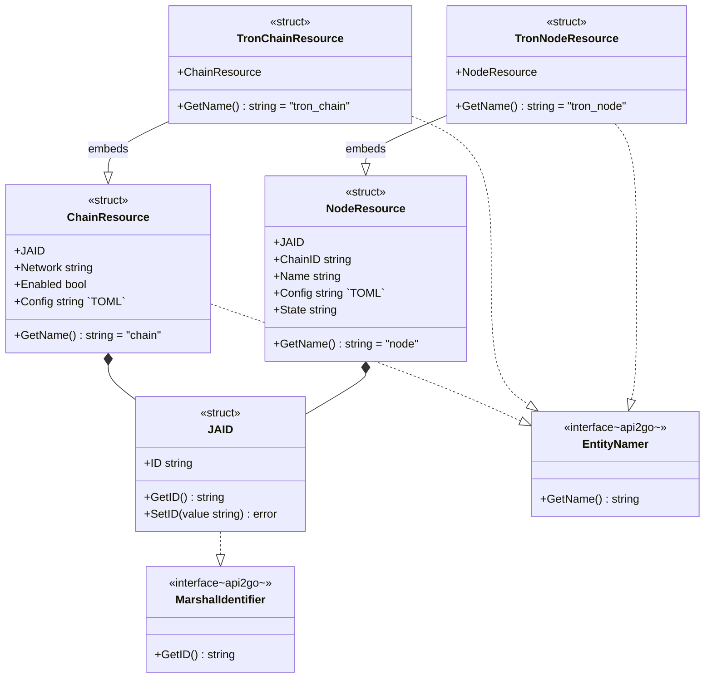
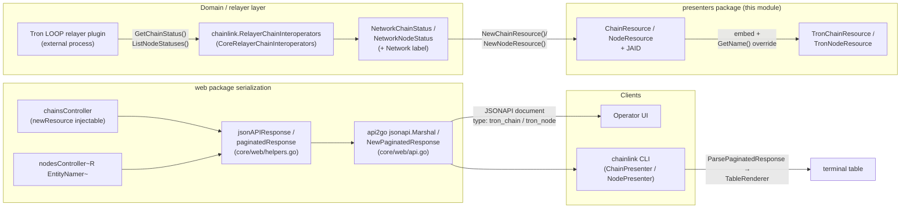
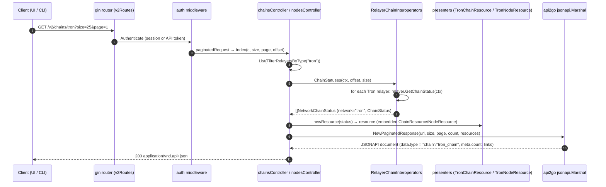

# Web API Presenters (`chainlink/core/web/presenters`)

## 1. Introduction

The **web_api_presenters** module defines the *JSONAPI resource* types — the wire-format DTOs — that the Chainlink node returns from its REST endpoints (documented in [web_api](../web_api.md)). Every object the node exposes over HTTP (chains, nodes, keys, jobs, users, bridges, …) is first translated into a presenter resource and then serialized into a [JSON:API 1.0](https://jsonapi.org) document by the `api2go` marshaller.

This page focuses on the Tron-specific resources declared in `chainlink/core/web/presenters/tron_chain.go`, and uses them to explain the presenter pattern that the whole package follows:

| Component | File | Purpose |
|---|---|---|
| `TronChainResource` | `presenters/tron_chain.go` | JSONAPI resource for a **Tron chain**; emits `data.type = "tron_chain"` |
| `TronNodeResource` | `presenters/tron_chain.go` | JSONAPI resource for a **Tron RPC node**; emits `data.type = "tron_node"` |
| `ChainResource` / `NodeResource` | `presenters/chain.go` | Base resources that the Tron types embed |
| `JAID` | `presenters/jsonapi.go` | JSONAPI resource identifier (implements `MarshalIdentifier` / `UnmarshalIdentifier`) |

### Where it fits in the system

- Parent module: [web_api](../web_api.md), which owns the HTTP server, routing, auth and RBAC (see [web_api_auth_rbac](web_api_auth_rbac.md)).
- **Consumers of presenter output:**
  - The [REST controllers](web_api_rest_controllers.md) (`ChainsController`, `NodesController`) construct resources from relayer status and marshal them into responses.
  - The [CLI chain/node commands](../cli_commands.md) fetch the same JSONAPI documents over HTTP and unmarshal them back into these resource types for table rendering (see [cli_commands_renderer](../cli_commands/cli_commands_renderer.md)).
  - The Operator UI renders the `data` documents directly.
- **Upstream data source:** chain/node status comes from the multi-relayer abstraction `chainlink.RelayerChainInteroperators` of the node application (see [node_application](../node_application.md) and the Tron relayer wiring in [node_application_relay](../node_application/node_application_relay.md)). Tron itself is served by an external LOOP plugin relayer; the node only *presents* its status here.

## 2. Architecture Overview

The package uses an *embed-to-rename* pattern: network-specific resources embed the generic resource — inheriting all attributes and identity behaviour — and override only the `GetName()` method, which `api2go` uses as the JSON:API `data.type`.



Key observations:

- **Identity.** All resources carry a `JAID` (JSONAPI ID). Chains use `NewJAID(chainID)`; nodes use `NewPrefixedJAID(name, chainID)`, producing a `"<chainID>/<name>"` id that is unique across networks.
- **Reused attributes.** `TronChainResource` inherits `network`, `enabled` and `config` (the effective chain configuration rendered as TOML); `TronNodeResource` inherits `chainID`, `name`, `config` and `state`.
- **No dedicated constructors.** `tron_chain.go` declares no `NewTron*Resource` builders; instances are produced by composing the base constructors (`NewChainResource`, `NewNodeResource`) inside the embedded field.

## 3. Component Reference

### 3.1 `JAID` — `presenters/jsonapi.go`

The shared resource identifier. It implements `api2go`'s `MarshalIdentifier` (`GetID`) and `UnmarshalIdentifier` (`SetID`), so the marshaller can read and hydrate resource ids. Helper constructors:

| Constructor | Produced ID |
|---|---|
| `NewJAID(id string)` | the raw id |
| `NewPrefixedJAID(id, prefix string)` | `"<prefix>/<id>"` — used for nodes so `chainID/name` is globally unique |
| `NewJAIDInt32(id)` / `NewJAIDInt64(id)` | integer ids stringified |

### 3.2 Base resources — `presenters/chain.go`

`ChainResource` and `NodeResource` are built by the generic controllers from relayer status objects:

- `NewChainResource(chain chainlink.NetworkChainStatus)` — `NetworkChainStatus` = `{Network string; types.ChainStatus}` where `types.ChainStatus = {ID, Enabled, Config (TOML)}` (defined in `chainlink-common/pkg/types/relayer.go`).
- `NewNodeResource(node types.NodeStatus)` — `types.NodeStatus = {ChainID, Name, Config (TOML), State}`.

Both implement `GetName()` returning the generic entity names `"chain"` and `"node"`.

### 3.3 Tron resources — `presenters/tron_chain.go`

```go
// TronChainResource is an Tron chain JSONAPI resource.
type TronChainResource struct {
        ChainResource
}

// GetName implements the api2go EntityNamer interface
func (r TronChainResource) GetName() string {
        return "tron_chain"
}

// TronNodeResource is a Tron node JSONAPI resource.
type TronNodeResource struct {
        NodeResource
}

// GetName implements the api2go EntityNamer interface
func (r TronNodeResource) GetName() string {
        return "tron_node"
}
```

The only behavioural difference from the base types is the entity name. This is deliberate: it lets clients — the Operator UI, the CLI and integration tooling — discriminate Tron documents from generic `chain`/`node` documents in a JSONAPI collection, while the attribute set, id semantics and unmarshalling behaviour remain identical. The file follows the same per-network pattern as the other presenters in the package (e.g. `tron_key.go::TronKeyResource` for Tron keys, `solana_key.go::SolanaKeyResource`, etc.), which together give every supported network in `relay.SupportedNetworks` (`evm`, `solana`, `starknet`, `aptos`, `tron`, `ton`, `sui`, `stellar`) typed resources.

An example document produced by marshalling a `TronChainResource`:

```json
{
  "data": {
    "type": "tron_chain",
    "id": "728126428",
    "attributes": {
      "network": "tron",
      "enabled": true,
      "config": "# TOML chain configuration"
    }
  }
}
```

And a Tron node (note the compound `JAID`):

```json
{
  "data": {
    "type": "tron_node",
    "id": "728126428/tron-main-full-1",
    "attributes": {
      "chainID": "728126428",
      "name": "tron-main-full-1",
      "config": "# TOML node configuration",
      "state": "alive"
    }
  }
}
```

## 4. Data Flow



## 5. Request Lifecycle (REST)

The sequence below traces `GET /v2/chains/tron` and `GET /v2/nodes/tron` from the [router](web_api_rest_controllers.md) through the presenter layer to the client:



Notes on the wiring (all in `chainlink/core/web/router.go::v2Routes`):

1. `chains.GET("", ...)` / `chains.GET("/:network", ...)` / `chains.GET("/:network/:ID", ...)` route to `ChainsController.Index` / `Show`, which delegates to `RelayerChainInteroperators.ChainStatuses` / `ChainStatus`.
2. `nodes.GET("", ...)`, `nodes.GET("/:network", ...)` and `chains.GET("/:network/:ID/nodes", ...)` route to the generic `nodesController[R jsonapi.EntityNamer]`, whose `newResource` function and resource type `R` are template parameters — `presenters.NodeResource` is the default instantiation, and network-specific resources such as `TronNodeResource` satisfy the same `EntityNamer` constraint.
3. Pagination (`size`, `page` query params, default 25) is parsed by `paginatedRequest` and reflected in the response's `meta.count` and `links.next` / `links.prev`, which the CLI follows page by page.

## 6. Consumers & Integration

| Consumer | How it uses presenters | Reference |
|---|---|---|
| **REST controllers** | Build resources from relayer status (`newResource` constructors) and marshal via `jsonAPIResponse` / `paginatedResponse`. The `chainsController` injects `presenters.NewChainResource` as its `newResource` function, keeping resource construction swappable per network. | [web_api_rest_controllers](web_api_rest_controllers.md) |
| **CLI** | `ChainPresenter` wraps `presenters.ChainResource` and `NodePresenter` wraps `presenters.NodeResource`; the CLI's `getPage` unmarshals JSONAPI responses (via `ParsePaginatedResponse`) into these embedded resources and renders them as tables through the [TableRenderer](../cli_commands/cli_commands_renderer.md). Commands are generated per network from `relay.SupportedNetworks` (`chainlink chains tron list`, `chainlink nodes tron list`). | [cli_commands_remote_resources](../cli_commands/cli_commands_remote_resources.md) |
| **Operator UI** | Consumes the JSONAPI documents directly, keyed on `data.type`. | — |
| **Keys controllers** | The same package also defines per-network key resources (e.g. `TronKeyResource` in `tron_key.go`) consumed by the generic `KeysController[K, R]`, including `/v2/keys/tron` routes. | [web_api_rest_controllers](web_api_rest_controllers.md) |

## 7. Extending the Pattern

Adding a resource for a new network follows three steps, of which `tron_chain.go` demonstrates the last:

1. **Domain status** — ensure the relayer plugin reports `types.ChainStatus` / `types.NodeStatus` (TOML config included); register the relayer with `InitTron`-style init funcs in `core/services/chainlink/relayer_chain_interoperators.go`.
2. **Routing / commands** — the network is added to `relay.SupportedNetworks`; `/v2/chains/<network>` routes and `chainlink chains <network>` CLI subcommands are then generated automatically.
3. **Presenter** — if clients need a distinct JSONAPI entity type, declare two thin embedders exactly as in `tron_chain.go` (embed the base resource, override `GetName()`), and have the controller's injectable `newResource` (or a generic `nodesController[R]` instantiation) produce them.

## 8. Dependency Map

| Presenter component | Depends on | Provider |
|---|---|---|
| `JAID` | `api2go` `MarshalIdentifier` / `UnmarshalIdentifier` | `github.com/manyminds/api2go/jsonapi` |
| `ChainResource` / `NodeResource` | `types.ChainStatus`, `types.NodeStatus`, `chainlink.NetworkChainStatus` | [chainlink-common types](../../Shared_Foundation_Libraries___Domain_Types/types-core.md), [node_application](../node_application.md) |
| `TronChainResource` / `TronNodeResource` | `ChainResource` / `NodeResource` embedding | this package |
| Marshalling | `jsonapi.Marshal`, `MarshalToStruct` | `core/web/api.go`, `core/web/helpers.go` |
| Tron status source | `loop.Relayer` (`GetChainStatus`, `ListNodeStatuses`) | [node_application_relay](../node_application/node_application_relay.md), [Plugin Process Framework (Loop)](<../../Plugin_Process_Framework_(Loop).md>) |

## 9. Related Documentation

- [web_api](../web_api.md) — parent module: HTTP server, routing, request lifecycle
- [web_api_rest_controllers](web_api_rest_controllers.md) — the controllers that construct and serialize these resources
- [web_api_auth_rbac](web_api_auth_rbac.md) — authentication and role checks guarding the endpoints that serve them
- [web_api_graphql_api](web_api_graphql_api.md) — the sibling GraphQL surface (uses its own resolvers, not these resources)
- [cli_commands](../cli_commands.md) — CLI consumers wrapping `ChainResource` / `NodeResource` in table presenters
- [node_application](../node_application.md) — application assembly providing `RelayerChainInteroperators`
