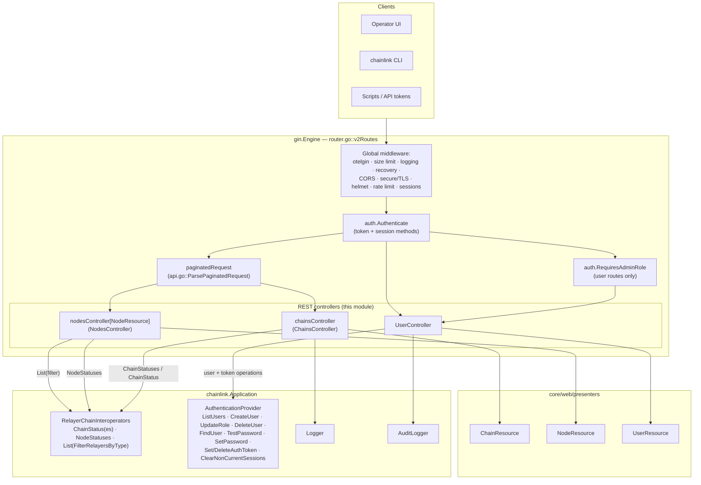
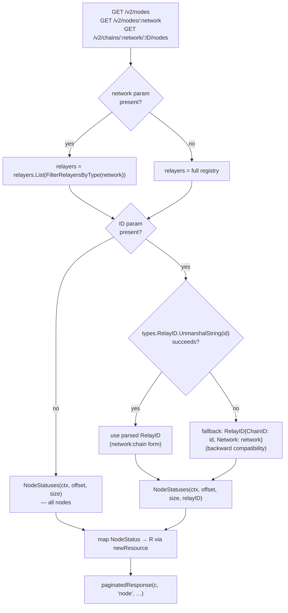
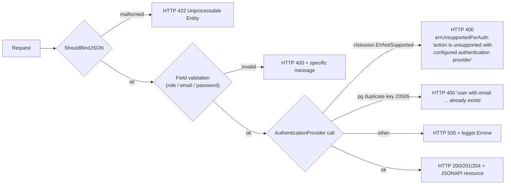
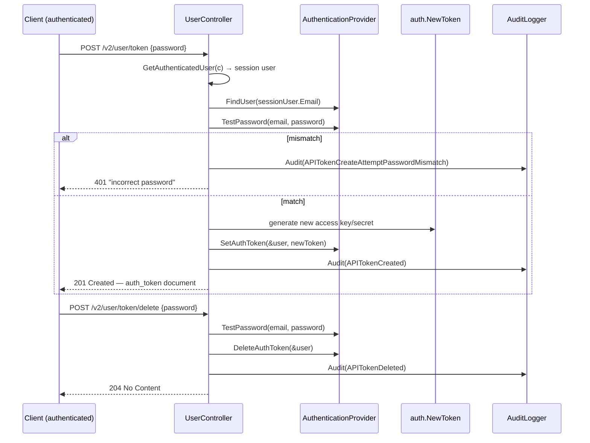
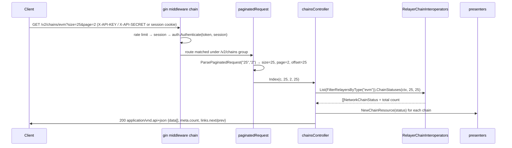

# REST Controllers (`chainlink/core/web` — chains, nodes, users)

## 1. Introduction

The **web_api_rest_controllers** module implements the stateless `gin` handler layer behind the node's JSONAPI REST surface (`/v2/...`). Its scope within the [web_api](../web_api.md) module is the operator-facing resource API for:

- **Chains** — inspect the configured chains of every active relayer (`chains_controller.go`).
- **Nodes** — inspect the RPC nodes (remote peers) backing those chains (`nodes_controller.go`).
- **Users & credentials** — manage API users, roles, passwords and API tokens for the node operator account system (`user_controller.go`).

The controllers are deliberately thin: they parse and validate request input, delegate to the [node application](../node_application.md) (`chainlink.Application`) and its services, and render responses as [JSONAPI:1.0](https://jsonapi.org) documents using the resource types documented in [web_api_presenters](web_api_presenters.md). Authentication, session handling, rate limiting and RBAC enforcement are applied by the router and middleware layers — see [web_api](../web_api.md) and [web_api_auth_rbac](web_api_auth_rbac.md) for that contract.

### Components in this module

| Component | File | Kind | Purpose |
|---|---|---|---|
| `ChainsController` | `core/web/chains_controller.go` | interface + `chainsController` impl | `Index` (paginated chain list, optional network filter) and `Show` (single chain by relay ID) |
| `chainDisabledError` | `core/web/chains_controller.go` | error type | Feature-gate sentinel: renders *"\<feature\> is disabled: Set \<tomlKey\>=true to enable"*; shared with the transfer controllers (e.g. `ErrSolanaNotEnabled` in `core/web/solana_transfer_controller.go`) |
| `NodesController` | `core/web/nodes_controller.go` | interface + generic `nodesController[R]` impl | `Index` over `presenters.NodeResource`; supports network scoping and chain-scoped (backward-compatible) queries |
| `NetworkScopedNodeStatuser` | `core/web/nodes_controller.go` | adapter struct | Minimal `StatusReader`-style wrapper exposing `NodeStatuses` over the relayer registry for consumers that need node stats without the controller machinery |
| `UserController` | `core/web/user_controller.go` | struct | CRUD for API users, role updates, password changes, API-token issue/revoke |
| `newUserRequest` / `updateUserRequest` | `core/web/user_controller.go` | request binding structs | JSON bodies for `Create` (`email`,`password`,`role`) and `UpdateRole` (`email`,`newRole`) |
| `UpdatePasswordRequest` | `core/web/user_controller.go` | request binding struct | JSON body for `UpdatePassword` (`oldPassword`,`newPassword`) |
| `errUnsupportedForAuth` | `core/web/user_controller.go` | error sentinel | Returned (HTTP 400) when an operation is not supported by the configured authentication provider |

### Where it fits in the system

- Parent module: [web_api](../web_api.md) — owns the `gin.Engine`, global middleware, session store and GraphQL surface.
- Handlers are registered by `NewRouter` → `v2Routes` in `chainlink/core/web/router.go` (lines 237–454), all inside the authenticated `/v2` group.
- Chain/node data originates from `chainlink.RelayerChainInteroperators` (`core/services/chainlink/relayer_chain_interoperators.go`), the multi-relayer registry populated during application startup (see [node_application_relay](../node_application/node_application_relay.md)).
- User data flows through the pluggable `AuthenticationProvider` — local session store, LDAP or OIDC — documented in [sessions_auth](../sessions_auth.md). Every handler gracefully degrades with `errUnsupportedForAuth` when the active provider cannot serve an operation.
- The same JSONAPI documents are consumed by the Operator UI and by the `chainlink` CLI, which unmarshals `ChainResource`/`NodeResource` into table rows (see [cli_commands_remote_resources](../cli_commands/cli_commands_remote_resources.md) and [cli_commands_renderer](../cli_commands/cli_commands_renderer.md)).

## 2. Architecture Overview



### Route catalog

Registered in `chainlink/core/web/router.go` (`v2Routes`); RBAC wrappers come from `core/web/auth/auth.go`:

| Method & path | Handler | RBAC | Notes |
|---|---|---|---|
| `GET /v2/chains` | `chainsController.Index` | authenticated | All chains, all networks |
| `GET /v2/chains/:network` | `chainsController.Index` | authenticated | Relayers pre-filtered by `FilterRelayersByType(:network)` |
| `GET /v2/chains/:network/:ID` | `chainsController.Show` | authenticated | Single chain by relay ID |
| `GET /v2/nodes` | `nodesController.Index` | authenticated | All nodes |
| `GET /v2/nodes/:network` | `nodesController.Index` | authenticated | Network-scoped |
| `GET /v2/chains/:network/:ID/nodes` | `nodesController.Index` | authenticated | Chain-scoped (ID parsed as chain ID) |
| `GET /v2/users` | `UserController.Index` | `RequiresAdminRole` | List all API users |
| `POST /v2/users` | `UserController.Create` | `RequiresAdminRole` | Create user (`newUserRequest`) |
| `PATCH /v2/users` | `UserController.UpdateRole` | `RequiresAdminRole` | Change role (`updateUserRequest`) |
| `DELETE /v2/users/:email` | `UserController.Delete` | `RequiresAdminRole` | Delete user + sessions |
| `PATCH /v2/user/password` | `UserController.UpdatePassword` | authenticated (any role) | Self-service password change |
| `POST /v2/user/token` | `UserController.NewAPIToken` | authenticated | Issue/rotate API token (201) |
| `POST /v2/user/token/delete` | `UserController.DeleteAPIToken` | authenticated | Revoke API token (204) |

All collection endpoints accept `size` and `page` query parameters (default `size=25`, per `PaginationDefault` in `core/web/api.go`) and return `application/vnd.api+json` documents with `meta.count` plus `links.next`/`links.prev` (see [§5](#5-wire-format--pagination)).

## 3. ChainsController

### Construction

`NewChainsController(chainStats chainlink.RelayerChainInteroperators, lggr logger.Logger, auditLogger audit.AuditLogger)` — wired in `router.go` from `app.GetRelayers()`, `app.GetLogger()` and `app.GetAuditLogger()`. The `newResource` field is set to `presenters.NewChainResource` and is injectable for tests.

### Index — paginated chain listing

```go
Index(c *gin.Context, size, page, offset int)
```

1. Starts from the full relayer registry. If the route captured a `:network` param, the registry is narrowed with `chainStats.List(chainlink.FilterRelayersByType(network))` (`core/services/chainlink/relayer_chain_interoperators.go`) — a filtered *view* of the same registry, not a copy of state.
2. Calls `ChainStatuses(ctx, offset, size)` on the view. The underlying `CoreRelayerChainInteroperators` iterates relayers sorted by `RelayID`, joins any per-relayer errors with `errors.Join`, and applies in-memory offset/limit slicing.
3. Maps each `chainlink.NetworkChainStatus` (network + `types.ChainStatus`) to a `presenters.ChainResource` (`JAID`, `Network`, `Enabled`, TOML `Config`).
4. Responds through `paginatedResponse(c, "chain", …)` (`core/web/helpers.go`). Any non-`sql.ErrNoRows` error is rendered as HTTP 500 wrapped in a JSONAPI error; per-route failures upstream surface as HTTP 400 from the handler.

### Show — single chain

Builds a `types.RelayID{Network: c.Param("network"), ChainID: c.Param("ID")}`, fetches `ChainStatus`, wraps it as a `NetworkChainStatus`, and responds with `jsonAPIResponse(c, resource, "chain")`. Errors map to HTTP 400.

### chainDisabledError — shared feature gate

```go
type chainDisabledError struct { name, tomlKey string } // "X is disabled: Set Y=true to enable"
```

Although declared in `chains_controller.go`, this type is a package-level sentinel consumed by the *transfer* controllers to reject operations on disabled network stacks — for example `ErrSolanaNotEnabled = chainDisabledError{name: "Solana", tomlKey: "Solana.Enabled"}` in `core/web/solana_transfer_controller.go`. It ties HTTP errors directly to the TOML configuration keys that enable a feature, making misconfiguration self-diagnosing for operators.

## 4. NodesController & NetworkScopedNodeStatuser

### Generic controller

`nodesController[R jsonapi.EntityNamer]` is generic over the JSONAPI resource type; `NewNodesController` instantiates it with `presenters.NodeResource` (fields: `JAID`, `ChainID`, `Name`, TOML `Config`, `State`). It captures the relayer registry and audit logger but performs no mutations on these routes (the audit logger field exists for interface symmetry with the other controllers).

### Index decision flow



Notable behaviors:

- **Backward-compatible chain scoping.** The legacy `/v2/chains/:network/:ID/nodes` route passes the chain ID as the `ID` param. The controller first attempts to parse it as a full `network:chain` relay identifier; on failure it treats the raw value as a chain ID combined with the `:network` param.
- **In-memory pagination.** `CoreRelayerChainInteroperators.NodeStatuses` gathers statuses per relayer (`loop.Relayer.ListNodeStatuses`), appends network tags, sorts deterministically and slices by `offset`/`limit`; the `count` returned is the *pre-pagination* total across relayers, which drives `meta.count` and the `next`/`prev` links.
- **Error aggregation.** Per-relayer failures are joined (`errors.Join`) and surfaced as a single error, rendered by `paginatedResponse` as an HTTP 500 JSONAPI error.

### NetworkScopedNodeStatuser

A one-method adapter (`NodeStatuses(ctx, offset, limit, relayIDs...)`) that delegates to the relayer registry. It exists so that consumers needing node status (tests, tools, other services) can take the narrow status-reader surface rather than the whole `RelayerChainInteroperators` interface, and so the status source can be scoped/mocked independently of HTTP concerns.

## 5. UserController

`UserController{App chainlink.Application}` manages the node's operator accounts. **Every** data operation goes through `u.App.AuthenticationProvider()` — the controller never touches the user store directly, which is what makes it work transparently with the pluggable auth backends (local, LDAP, OIDC — see [sessions_auth](../sessions_auth.md)).

### Error model



Key defensive rules baked into the handlers:

- **Self-protection.** `UpdateRole` and `Delete` compare the target email with `webauth.GetAuthenticatedUser(c)` (case-insensitive) and reject with HTTP 400 if they match — an admin can neither demote nor delete the account they are logged in with.
- **Token operations require password re-entry.** `NewAPIToken` and `DeleteAPIToken` accept `clsession.ChangeAuthTokenRequest` (documented in [sessions_auth](../sessions_auth.md)) and call `TestPassword` first; mismatches are audited (`APITokenCreateAttemptPasswordMismatch` / `APITokenDeleteAttemptPasswordMismatch`) and rejected with HTTP 401.
- **Password hygiene.** `UpdatePassword` verifies the old password hash (`utils.CheckPasswordHash`), enforces complexity (`utils.VerifyPasswordComplexity`), then invalidates all *other* sessions via `ClearNonCurrentSessions` (session ID read from the `clsession` cookie store, key `webauth.SessionIDKey`) before persisting with `SetPassword`. Success and failed attempts are both audited (`audit.PasswordResetSuccess`, `audit.PasswordResetAttemptFailedMismatch`).
- **Input validation.** `Create` validates the role via `clsession.GetUserRole`, the email via `clsession.ValidateEmail`, and password complexity before constructing `clsession.NewUser`. `UpdateRole` validates the target role and produces actionable messages listing the valid roles (`admin`, `edit`, `run`, `view`).

### Token lifecycle



The issued token replaces any existing one (single active API token per user); the plaintext secret is returned exactly once, in the `auth_token` document of the `201` response.

## 6. Request lifecycle example

Typical read path for a chain listing (the same shape applies to node listings):



## 7. Wire format & pagination

Responses are JSONAPI 1.0 documents (`Content-Type: application/vnd.api+json`, `MediaType` in `core/web/api.go`). Pagination is implemented once in `core/web/api.go` and `core/web/helpers.go` and reused by both chain and node collections:

- **Request params:** `size` (default 25, must be ≥ 1) and `page` (default 1, must be ≥ 1); `offset = (page-1) * size`. Invalid values yield HTTP 422 from `paginatedRequest`.
- **Response envelope:** `data` array of resources, `meta.count` = total matching records (pre-pagination), and `links.next` / `links.prev` HREFs that preserve the original query string with updated `size`/`page`.

Resource shapes emitted by this module (full details and the embed-to-rename pattern in [web_api_presenters](web_api_presenters.md)):

| Resource | `data.type` | Attributes |
|---|---|---|
| `ChainResource` | `chain` | `network`, `enabled`, `config` (redacted chain TOML) |
| `NodeResource` | `node` | `chainID`, `name`, `config` (node TOML), `state` |
| `UserResource` | `user` | `email`, `role`, `hasActiveApiToken`, `createdAt`, `updatedAt` |
| API token | `auth_token` | `accessKey`/`secret` on create; empty on delete (204) |

## 8. Dependencies

| Dependency | Direction | Usage |
|---|---|---|
| [node_application](../node_application.md) (`chainlink.Application`) | consumer | `GetRelayers()`, `AuthenticationProvider()`, `GetLogger()`, `GetAuditLogger()`, `GetConfig()` |
| Relayer registry (`core/services/chainlink/relayer_chain_interoperators.go`) | consumer | `List(FilterFn)`, `ChainStatus(es)`, `NodeStatuses`; relayers are created at startup — see [node_application_relay](../node_application/node_application_relay.md) |
| [web_api_presenters](web_api_presenters.md) | consumer | `NewChainResource`, `NewNodeResource`, `NewUserResource(s)` |
| [web_api_auth_rbac](web_api_auth_rbac.md) (`core/web/auth`) | consumer | `Authenticate`, `RequiresAdminRole`, `GetAuthenticatedUser`, `SessionIDKey` |
| [sessions_auth](../sessions_auth.md) (`core/sessions`) | consumer | `User`, `GetUserRole`, `ValidateEmail`, `NewUser`, `ErrNotSupported`, `ChangeAuthTokenRequest` |
| [bridges](../bridges.md) | indirect | external-initiator auth types shared with the auth middleware |
| CLI ([cli_commands](../cli_commands.md)) | downstream | chain/node command output is unmarshalled from these controllers' JSONAPI documents |
| PostgreSQL | indirect | user storage; duplicate-email detection keys on `pgconn.PgError` code `23505` |

## 9. Design & operational notes

1. **No business logic here.** All state changes are delegated to the `AuthenticationProvider` / relayer registry; the controllers own only binding, validation, error mapping and audit emission. This keeps the REST layer swappable (e.g., the GraphQL surface in [web_api_graphql_api](web_api_graphql_api.md) reuses the same application services for overlapping operations such as password updates).
2. **Auth-provider portability.** The repeated `errors.Is(err, clsession.ErrNotSupported)` → `errUnsupportedForAuth` pattern means adding a new authentication backend (LDAP/OIDC — [sessions_auth](../sessions_auth.md)) cannot partially break the user API: unsupported capabilities degrade to explicit HTTP 400s.
3. **Pagination is best-effort in-memory.** Chain/node pagination slices results after aggregation across relayers, so `size` does not limit per-relayer queries; for very large multi-chain deployments the cost is bounded by the number of configured relayers, not rows in a table.
4. **Deterministic ordering.** Both `ChainStatuses` and `NodeStatuses` sort relayer IDs before iterating, so paginated listings are stable across requests.
5. **Auditing.** Every credential-affecting action (password reset attempt/success, API token create/delete attempt/success) emits a structured audit event via `core/logger/audit`; read-only chain/node listings do not.
6. **Feature gating via TOML.** `chainDisabledError` converts configuration state into operator-actionable HTTP errors — the message names the exact TOML key to flip, and the keys themselves live in the node configuration (see [core_config](../core_config.md)).
7. **Testing.** Handler behavior is covered by `core/web/chains_controller_test.go`, `core/web/chains_controller_integration_test.go`, `core/web/nodes_controller.go` consumers via `core/web/testutils/mock_relayer.go`, and `core/web/user_controller_test.go`; the route/RBAC matrix contract is asserted in `core/web/auth/auth_test.go` ([web_api_auth_rbac](web_api_auth_rbac.md)).
