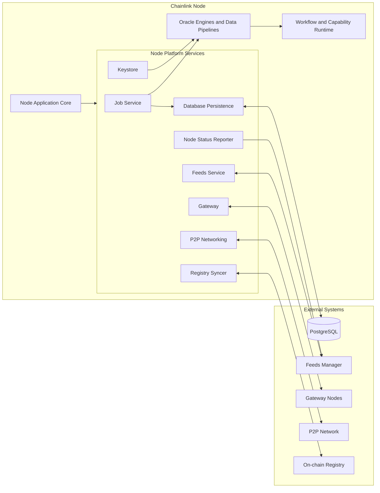
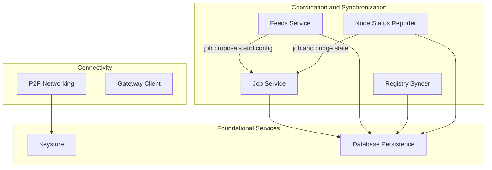

# Node Platform Services (`chainlink/core/services`) — Module Overview

## Purpose

`Node_Platform_Services` contains the shared infrastructure services that every Chainlink node requires to operate, regardless of which oracle product or workload it serves. It is the platform layer that sits between:

- the **Node Application Core** (`chainlink/core/services/chainlink`, `core/config`, …), which wires configuration, the relay abstraction and the application lifecycle, and
- the **product engines** (OCR, VRF, LLO, Pipelines, Streams — documented separately under *Oracle Engines & Data Pipelines*) and the **Workflow & Capability Runtime**, which consume these platform services to do their work.

Concretely, the module provides:

- **Job management** — the canonical job domain model, its lifecycle (validation, start/stop, spawning of job engines) and persistence.
- **Database persistence** — the PostgreSQL layer used by virtually every other service: connection handling, schema migrations, backups and versioning.
- **Key management (Keystore)** — the node keyring, core signing keys and KMS-backed storage exposed to services and relays.
- **Peer-to-peer networking (P2P)** — libp2p-based peer discovery and gossip transport shared by consensus protocols.
- **Registry synchronization** — keeping a local, persisted copy of on-chain registry state.
- **Operational reporting & integrations** — node status reporting (jobs, bridges), the Feeds Manager connection (job proposals / config distribution) and the Gateway client used to reach Gateway node networks.

> **Boundary note:** the sibling packages `ocr`, `vrf`, `llo`, `pipeline` and `streams` also live under `chainlink/core/services` but are documented separately as *Oracle Engines & Data Pipelines* and are out of scope here.

## Architecture

### System context

The application core instantiates the platform services at startup and hands them their dependencies (config, database, keystore, logger). Product engines and the workflow runtime are then built on top of them.

### Internal layering

Internally the services fall into three tiers: **coordination** services that manage jobs and synchronize configuration/state; **connectivity** services that talk to the outside world; and **foundational** services (keystore, database) consumed by everything else.

## Core Components

| Component | Code Path | Description |
|---|---|---|
| [Job Service](<Node_Platform_Services/job_service.md>) | `chainlink/core/services/job` | Job spec domain model, lifecycle orchestration (create/update/delete, engine spawning) and job persistence. |
| [Database Persistence](<Node_Platform_Services/database_persistence.md>) | `chainlink/core/services/pg` | PostgreSQL abstraction layer: connection management, migrations, backups and versioning. |
| [P2P](<Node_Platform_Services/p2p.md>) | `chainlink/core/services/p2p` | Peer-to-peer networking layer providing peer discovery, connection management and gossip transport for consensus protocols. |
| [Keystore](<Node_Platform_Services/keystore.md>) | core keystore packages | Node keyring: core keys (CSA, OCR, P2P, relay-specific), KMS integration and the runtime keyring exposed to services and relays. |
| [Registry Syncer](<Node_Platform_Services/registry_syncer.md>) | `chainlink/core/services/registrysyncer` | Watches on-chain registry contracts and persists registry state (v1/v2) locally for other services to consume. |
| [Node Status Reporter](<Node_Platform_Services/node_status_reporter.md>) | `chainlink/core/services/nodestatusreporter` | Collects job spec and bridge status information and reports it (e.g., to the Feeds Manager). |
| [Feeds Service](<Node_Platform_Services/feeds_service.md>) | `chainlink/core/services/feeds` | Maintains the connection to the Feeds Manager: lifecycle, connections, config distribution and persistence of feed/job configurations. |
| [Gateway](<Node_Platform_Services/gateway.md>) | `chainlink/core/services/gateway` | Client stack for Gateway node networks: API surface, connector to remote gateways, request handlers and the network layer. |

## Interactions with Other Modules

- **Node Application Core** — starts/stops all platform services as part of the application lifecycle and supplies configuration via `core/config`.
- **Oracle Engines & Data Pipelines** — engines are instantiated per job by the Job Service and receive the database, keystore and P2P dependencies from this module.
- **Workflow & Capability Runtime / CCIP** — higher-level runtimes rely on the same foundational services (DB, keystore, P2P) provided here.