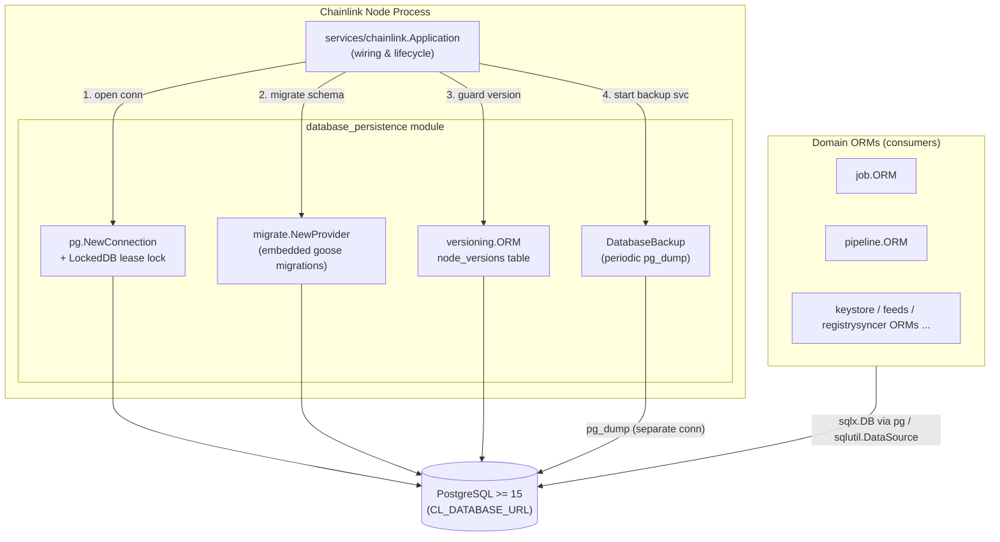
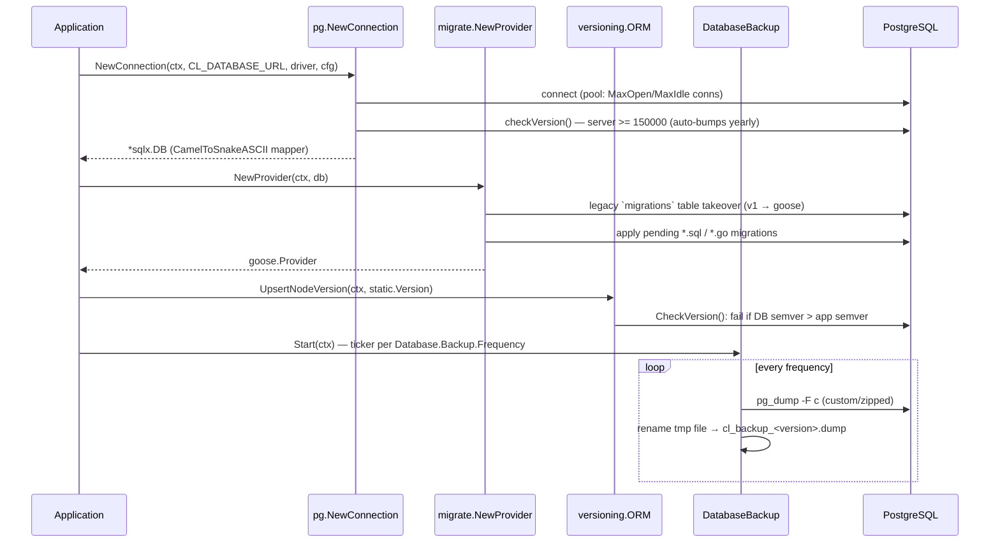
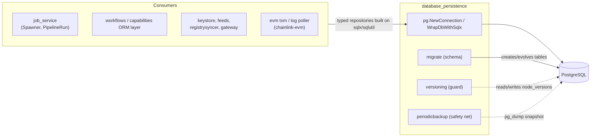

# Database Persistence

> **Module path:** `chainlink/core/services/pg` · `chainlink/core/services/periodicbackup` · `chainlink/core/services/versioning` · `chainlink/core/store/migrate`

## 1. Purpose and Scope

The **database_persistence** module provides the foundational data-tier infrastructure of the Chainlink node. Every other service in `Node_Platform_Services` (see [Node_Platform_Services](../Node_Platform_Services.md)) — the [job service](job_service.md), [keystore](keystore.md), [registry syncer](registry_syncer.md), [feeds service](feeds_service.md), [gateway](gateway.md) — ultimately stores its state in a single PostgreSQL database. This module owns *how* that database is reached, kept schema-consistent, version-guarded, and protected by backups:

| Concern | Package | Responsibility |
|---|---|---|
| **Connection & query layer** | `core/services/pg` | Opens pooled `sqlx` connections, enforces PostgreSQL server version requirements, wraps the raw `*sql.DB` for ORM consumption, and provides an exclusive lease-lock mechanism for single-writer deployments. |
| **Schema migrations** | `core/store/migrate` | Applies the embedded, ordered goose migration set (300+ SQL/Go migrations) that evolves the schema across node versions, including legacy-migration takeover. |
| **Node version tracking** | `core/services/versioning` | Records the application version in the `node_versions` table and refuses to start a downgraded binary against a newer database schema. |
| **Periodic backup** | `core/services/periodicbackup` | Runs scheduled `pg_dump` backups to compressed archive files, with a "lite" mode that excludes high-churn pipeline run tables. |

The module is deliberately low-level and dependency-light: it consumes configuration and logging primitives from [Shared Foundation Libraries](../Shared_Foundation_Libraries___Domain_Types.md) (`sqlutil`, `logger`, `services`) and is consumed by every domain ORM in the node.

## 2. Architecture Overview

### 2.1 Startup sequence

The node's boot order (wired in `chainlink/core/services/chainlink/application.go`, see [node_application_lifecycle](../Node_Application_Core___Interfaces/node_application/node_application_lifecycle.md)) makes these components strictly ordered:

### 2.2 Design principles

1. **Single shared connection pool.** `pg.NewConnection` builds one `*sqlx.DB` with configured pool sizes; all ORMs share it. `Queryer` (deprecated) historically defined the widest common interface implemented by that pool.
2. **Schema migrations are embedded.** `//go:embed migrations/*.sql migrations/*.go` ships the full migration history inside the binary — no external migration artifacts at deploy time.
3. **Forward-compatibility guard, not rollback tool.** `versioning.CheckVersion` *blocks downgrades* (DB newer than binary) but never upgrades; schema evolution is exclusively the job of goose migrations.
4. **Backups are a node service.** `DatabaseBackup` implements the standard `services.Service` lifecycle (`Start`/`Close`/`HealthReport`), so it participates in the node's [service framework](../Shared_Foundation_Libraries___Domain_Types/services.md) health reporting.

## 3. Sub-modules

The module is decomposed into four documented sub-modules, each generated as a standalone wiki page under [`Node_Platform_Services/database_persistence/`](database_persistence/). Together they cover all core components of this module; use the table below as the navigation hub.

| Sub-module | Documentation | Core components | Summary |
|---|---|---|---|
| **Connection & Query Layer** | [database_persistence_pg_layer.md](database_persistence/database_persistence_pg_layer.md) | `pg.Queryer`, `pg.WrapDbWithSqlx`, `pg.NewConnection`, `pg.LockedDB` | Opens and wraps PostgreSQL connections, enforces minimum server version (PG 15+, auto-raising after EOL dates), and provides the lease-lock that guarantees a single active writer per database. |
| **Schema Migrations** | [database_persistence_migrations.md](database_persistence/database_persistence_migrations.md) | `migrate.NewProvider`, `migrate.Migrate/Rollback/Current/Status`, migration tests (`PluginValues`) | Goose-based, embedded migration framework covering ~310 ordered migrations, legacy `migrations`-table takeover from pre-0.9.10 nodes, and CLI/test entry points. |
| **Node Version Tracking** | [database_persistence_versioning.md](database_persistence/database_persistence_versioning.md) | `versioning.ORM`, `versioning.CheckVersion`, `NodeVersion` | Upserts the running app version into `node_versions` and aborts startup when the database was written by a strictly newer release; supports `SKIP_APP_VERSION_CHECK` / `IGNORE_PRE_RELEASE` escape hatches. |
| **Periodic Backup** | [database_persistence_backup.md](database_persistence/database_persistence_backup.md) | `periodicbackup.DatabaseBackup`, `BackupConfig` | Long-running service that schedules `pg_dump` snapshots into `<root>/backup/cl_backup_<version>.dump`, with mode `lite` excluding `pipeline_runs` / `pipeline_task_runs` data. |

**Reading order for newcomers:** [Connection & Query Layer](database_persistence/database_persistence_pg_layer.md) → [Schema Migrations](database_persistence/database_persistence_migrations.md) → [Node Version Tracking](database_persistence/database_persistence_versioning.md) → [Periodic Backup](database_persistence/database_persistence_backup.md) — mirroring the runtime startup sequence in §2.1.

## 4. How the rest of the node uses this module

* **Domain ORMs** ([job_service_persistence](job_service.md), [registry_syncer](registry_syncer.md), [feeds_service](feeds_service.md), workflow artifact ORMs in [Workflow & CRE Engine](../Workflow___Capability_Runtime_(CRE_Engine)/workflows.md)) receive the shared `*sqlx.DB` / `sqlutil.DataSource` and never manage connections themselves.
* **The [job service](job_service.md)** depends on this module's migration output directly: its `jobs`, `pipeline_specs`, `pipeline_runs` tables are created by migrations `0052`, `0056`, `0231`+, and `DatabaseBackup`'s `lite` mode deliberately excludes that run-history data (see `excludedDataFromTables` in `periodicbackup/backup.go`).
* **Deployment**: the reference deployment in [`chainlink/tools/docker/docker-compose.postgres.yaml`](https://github.com/smartcontractkit/chainlink/blob/main/chainlink/tools/docker/docker-compose.postgres.yaml) runs `postgres:15` containers and injects `CL_DATABASE_URL=postgresql://…` into the node container — the same URI parsed by `pg.NewConnection`. The `postgres:15` image matches the module's `MinRequiredPGVersion = 150000` floor.

## 5. Configuration surface

| Setting | Env / TOML | Consumer | Effect |
|---|---|---|---|
| Database URL | `CL_DATABASE_URL` (via `config.Database`) | `pg.NewConnection`, `DatabaseBackup` | Connection string for the primary pool and for `pg_dump`. `Database.Backup.URL` may override the backup target. |
| Pool sizing | `Database.Listener...`/`config.MaxOpenConns()` etc. | `pg.NewConnection` | `MaxOpenConns`, `MaxIdleConns`, `IdleInTxSessionTimeout`, `LockTimeout` |
| Skip version check | `SKIP_PG_VERSION_CHECK=true` | `pg.NewConnection` | Bypasses the PostgreSQL server-version floor (dev only). |
| Schema override | `CL_MIGRATIONS_SCHEMA_OVERRIDE` | `migrate.NewProvider` | Forces the `goose_migrations` table resolution schema for NOPs where `current_schema() != public`. |
| Migration SQL logging | `CL_LOG_SQL_MIGRATIONS` | `migrate.NewProvider` | Enables verbose goose output. |
| App version guards | `SKIP_APP_VERSION_CHECK`, `IGNORE_PRE_RELEASE_VERSION_CHECK` envs | `versioning.ORM` | Relaxes the downgrade guard (see [database_persistence_versioning](database_persistence/database_persistence_versioning.md)). |
| Backup settings | `Database.Backup.{URL,Dir,Mode,Frequency}` | `DatabaseBackup` | Frequency `0` disables backups; mode `none` disables entirely; `lite` excludes pipeline run tables. |

## 6. Operational notes & failure modes

* **Downgrade protection.** Starting an older binary against a newer database fails with *"Application version (%s) is lower than database version (%s)"*. Operators must restore a backup (this module's) or run the newer binary.
* **Backup secrecy.** `pg_dump` arguments are logged only after masking the database URL (`databaseURL.Redacted()`); failures surface both masked and raw argument sets in the returned error for diagnosis.
* **No triggers policy.** The migration test suite (`TestNoTriggers`) asserts the schema contains zero triggers — migrations must not rely on database-side triggers (they were removed in favour of application-level logic, e.g. migration `0206_remove_tx_insert_trigger`).
* **Legacy takeover is one-way.** `ensureMigrated` refuses to proceed on databases older than the 0.9.10 squash point ("This upgrade is NOT REVERSIBLE, so it is STRONGLY RECOMMENDED that you take a database backup") — the exact scenario `DatabaseBackup` exists to cover.

## 7. Related modules

* [Node Platform Services](../Node_Platform_Services.md) — parent module and sibling services.
* [job_service](job_service.md) — primary consumer; its [persistence sub-module](job_service/job_service_persistence.md) documents `job.ORM` on top of this module's connection layer.
* [sqlutil](../Shared_Foundation_Libraries___Domain_Types/sqlutil.md) — shared `DataSource` / `TransactDataSource` primitives that supersede the deprecated `pg.Queryer`.
* [logger](../Shared_Foundation_Libraries___Domain_Types/logger.md) and [services](../Shared_Foundation_Libraries___Domain_Types/services.md) — lifecycle (`Start`/`Close`/`StateMachine`) and logging contracts implemented by `DatabaseBackup` and `versioning.orm`.
* [docker-dev-environments](../Dev,_Test___Simulation_Environments/docker-dev-environments.md) — containerized PostgreSQL + node topologies used to exercise this module.
