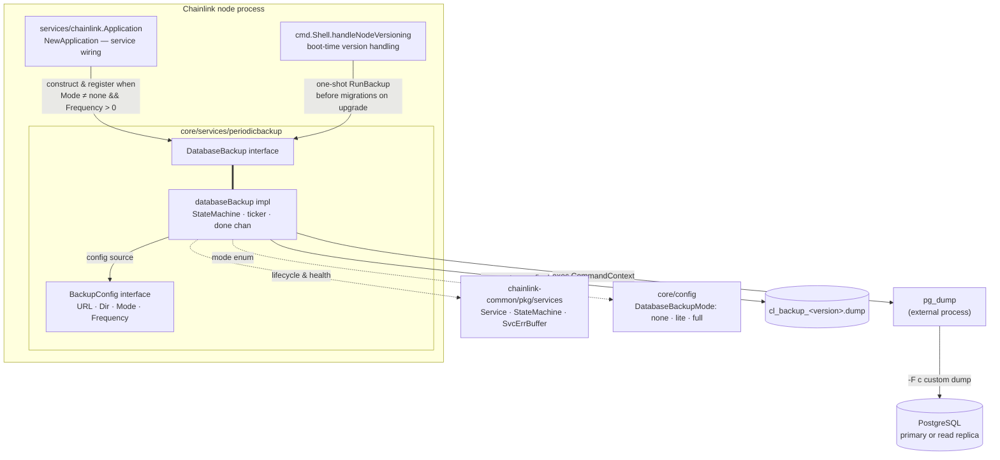
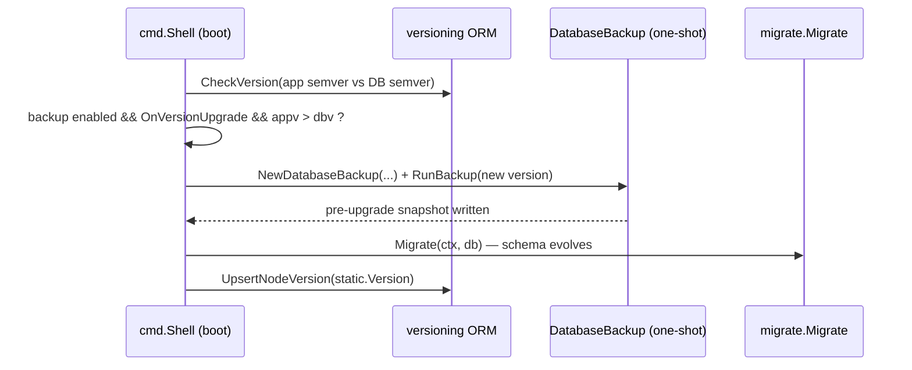
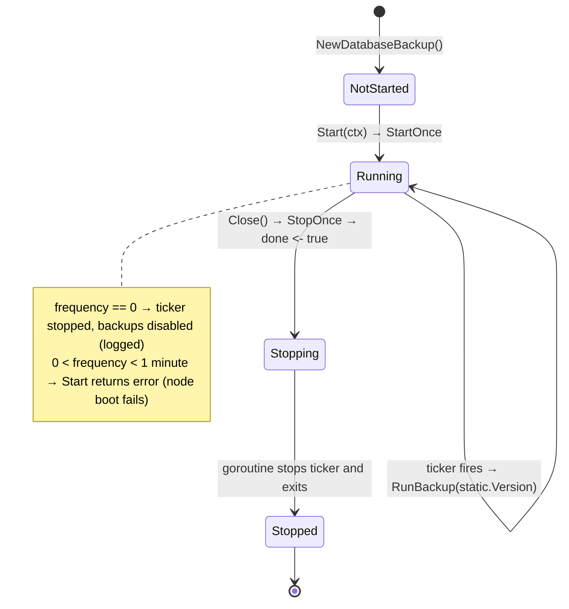
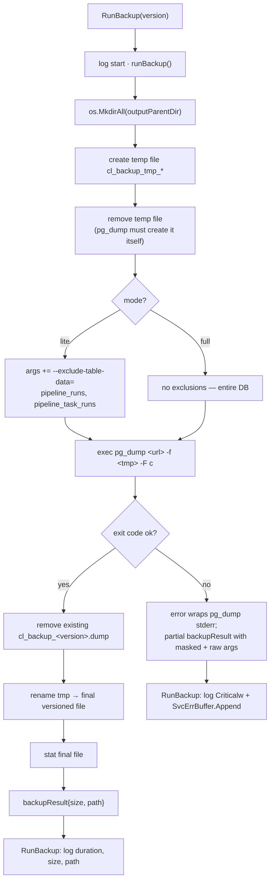

# Database Persistence — Periodic Backup

> **Module path:** `chainlink/core/services/periodicbackup`
> **Parent:** [database_persistence](../database_persistence.md)

## 1. Purpose and Scope

The **database_persistence_backup** module implements `DatabaseBackup`, a long-running node service that protects the single PostgreSQL database every Chainlink node depends on (see [database_persistence](../database_persistence.md)). It shells out to the PostgreSQL client tool **`pg_dump`** to write compressed, custom-format (`-F c`) archive snapshots of the database to disk:

- **Periodic backups** — while the node runs, a ticker fires every `Database.Backup.Frequency` and overwrites one dump file per node version: `<outputDir>/cl_backup_<VERSION>.dump`.
- **Upgrade backups** — on node boot, the startup path runs a **one-shot** backup *before* schema migrations whenever a version upgrade is detected, guaranteeing a restorable pre-upgrade image.

It is deliberately minimal: it owns **no database connection of its own** (it only holds a URL for `pg_dump`), no schema knowledge beyond two "lite mode" exclusions, and no scheduling infrastructure beyond a `time.Ticker`. Failure to back up never crashes the node — it is surfaced through logging, the service error buffer, and health reporting.

### 1.1 Design goals

| Goal | How it is achieved |
|---|---|
| Zero-interference with node DB pool | `pg_dump` runs as a separate OS process with its own connection; the node's `*sqlx.DB` pool (see [database_persistence_pg_layer](database_persistence_pg_layer.md)) is never used or blocked. |
| Restorable, compact snapshots | Custom format `-F c` (zipped, restorable with `pg_restore`), one file per node version so upgrade points are retained. |
| Predictable disk usage | Each cycle replaces the same target file (`os.Remove` + `os.Rename`) instead of accumulating timestamped dumps. |
| Credential hygiene | `pg_dump` arguments are only ever logged with the database URL redacted (`url.URL.Redacted()`). |
| Observability | Implements the standard `services.Service` contract (`Start`/`Close`/`Name`/`HealthReport`) and buffers critical errors in `SvcErrBuffer`. |

## 2. Core Components

All functionality lives in a single file, `chainlink/core/services/periodicbackup/backup.go`:

| Component | Kind | Role |
|---|---|---|
| `DatabaseBackup` | interface | `services.Service` (Start/Close/Name/HealthReport) **plus** `RunBackup(version string) error` for on-demand backups. |
| `databaseBackup` | struct (unexported) | The implementation: embeds `services.StateMachine` for lifecycle/health, holds `databaseURL`, `mode`, `frequency`, `outputParentDir`, and a `done chan bool` for shutdown. |
| `BackupConfig` | interface | The configuration surface consumed by the constructor: `URL() *url.URL`, `Dir() string`, `Mode() config.DatabaseBackupMode`, `Frequency() time.Duration`. The node's `config.Backup` (which additionally exposes `OnVersionUpgrade()`) satisfies it structurally. |
| `backupResult` | struct (unexported) | Outcome of a dump: `size`, `path`, `maskedArguments`, and `pgDumpArguments` (raw — used only for error diagnosis). |
| `NewDatabaseBackup` | constructor | Resolves the effective database URL and output directory, wraps the logger as `"DatabaseBackup"`. |
| `excludedDataFromTables` | package var | `{"pipeline_runs", "pipeline_task_runs"}` — the tables whose *data* (not schema) is dropped in `lite` mode. |
| `minBackupFrequency` | package var | `time.Minute` — guard against accidental high-frequency dumps. |
| `filePattern` | package var | `"cl_backup_%s.dump"` — the versioned dump filename template. |

### 2.1 Constructor semantics

```go
NewDatabaseBackup(dbURL url.URL, rootDir string, backupConfig BackupConfig, lggr logger.Logger) (DatabaseBackup, error)
```

1. **Database URL override** — if `backupConfig.URL()` is non-nil it replaces `dbURL`. This is how operators point backups at a **read replica** (strongly recommended; see [Operations](#6-operational-notes--failure-modes)).
2. **Output directory** — defaults to `<rootDir>/backup`; `backupConfig.Dir()` overrides it (resolved to an absolute path, failing startup if invalid).

## 3. Architecture and Relationships



### 3.1 Where the module plugs into the node

Two call sites, both in the node's boot/wiring path:

| Call site | File | Trigger | Mode of use |
|---|---|---|---|
| **Service wiring** | `chainlink/core/services/chainlink/application.go` (`NewApplication`) | `Mode() != DatabaseBackupModeNone && Frequency() > 0` | Full lifecycle: appended to the node's `srvcs` slice; `Start`/`Close` are driven by the [Application lifecycle](../../Node_Application_Core___Interfaces/node_application/node_application_lifecycle.md). |
| **Boot-time upgrade backup** | `chainlink/core/cmd/shell.go` (`handleNodeVersioning` → `takeBackupIfVersionUpgrade`) | `Mode() != DatabaseBackupModeNone && OnVersionUpgrade()` **and** app semver > DB semver | One-shot: a throwaway instance is constructed and `RunBackup(newVersion)` is called synchronously **before** `migrate.Migrate` runs. |



Because this runs *before* migrations, the dump captures the **old schema and data** under the **new version's filename** — exactly the artifact needed to roll back a bad upgrade (the generated config reference in [`chainlink/core/config/docs/core.toml`](https://github.com/smartcontractkit/chainlink/blob/main/chainlink/core/config/docs/core.toml) documents this as: *"If you upgrade the node, it will keep the backup taken right before the upgrade migration so you can restore to an older version if necessary"*). A start-up health reporter is held open during the dump so long backups don't trip container health checks. Missing version rows (`sql.ErrNoRows`) and a not-yet-created `node_versions` table (fresh install) are tolerated at debug level.

## 4. Service Lifecycle

`databaseBackup` embeds `services.StateMachine` from the shared [services](../../Shared_Foundation_Libraries___Domain_Types/services.md) library, giving it `StartOnce`/`StopOnce` guards, a `Healthy()` check, and the `SvcErrBuffer`.



- **`Start`** validates the frequency *synchronously* (an invalid value < `minBackupFrequency` aborts node startup), then spawns the ticker goroutine and returns promptly, per the `services.Service` contract.
- **`Close`** signals the goroutine over the `done` channel. Because the goroutine only services that channel between backups, **shutdown blocks until any in-flight `pg_dump` completes** — graceful, but potentially slow with a large database.
- **`HealthReport`** returns `{name: Healthy()}`; the health check fails once the service is stopped or once `SvcErrBuffer` has captured critical errors (e.g., failed backup cycles).

## 5. Backup Execution Flow

Both the ticker loop and the boot-time path funnel into `RunBackup(version)` → `runBackup(version)`:



Key behaviours:

- **Atomic-ish publication.** The dump lands in a temp file first and is renamed onto the final path only after `pg_dump` exits successfully, so a reader never sees a half-written dump under the versioned name.
- **Lite mode excludes data, not schema.** `--exclude-table-data` keeps the (small) table definitions for `pipeline_runs` / `pipeline_task_runs` but drops their high-churn rows — configuration and keys remain, historical run data does not. These are the tables owned by the [job service](../job_service.md) pipeline persistence layer.
- **One file per version.** Periodic backups always target `cl_backup_<static.Version>.dump`; upgrade backups target `cl_backup_<newAppVersion>.dump`. An empty version string falls back to `"unknown"`.
- **Credential masking.** Only the log line shows `maskedArguments` (index 0 replaced by the redacted URL). On failure, the returned `backupResult` carries both masked and raw argument vectors for offline diagnosis — the raw URL is never logged.

## 6. Operational Notes & Failure Modes

- **Runtime dependency: `pg_dump` must be on `PATH`.** The module does not link a PostgreSQL client library; it shells out. Operators building custom node images must ship a `pg_dump` whose version is compatible with the server (the connection layer enforces a PostgreSQL ≥ 15 floor — see [database_persistence_pg_layer](database_persistence_pg_layer.md); the reference `postgres:15` deployment in [`chainlink/tools/docker/docker-compose.postgres.yaml`](https://github.com/smartcontractkit/chainlink/blob/main/chainlink/tools/docker/docker-compose.postgres.yaml) matches it).
- **Backup load.** Dumps cause high database load and latency spikes. The generated config reference recommends pointing `Database.Backup.URL` at a **read replica** when automatic backups are enabled.
- **Sensitive contents.** Dump files include encrypted keystores, keys, and configuration. Keep them under the node root directory (`RootDir` is created with `700` permissions) or on equally protected storage; treat backup directories as secrets.
- **Failures don't take the node down.** A failed cycle logs a *critical* message, appends to `SvcErrBuffer` (which degrades `HealthReport`), and the ticker keeps going. Persistent failures mean the "restore point" silently ages — monitor the node's health checks and the `Backup completed successfully` / `Backup failed` log events.
- **Disk sizing.** A `full` dump is roughly the size of the database compressed; ensure the output directory (default `<RootDir>/backup`) has headroom, especially since a stale file for the previous version may coexist with the current one after an upgrade.
- **Restoring.** Files are standard custom-format archives: `pg_restore -F c -d <target> cl_backup_<version>.dump`. Downgrade *restores* from a pre-upgrade backup are the supported path back (the version guard in [database_persistence_versioning](database_persistence_versioning.md) will refuse to start an older binary against a newer schema otherwise).
- **Disabling.** Set `Database.Backup.Frequency = 0` to stop only the periodic cycle, or `Database.Backup.Mode = none` to disable all backups, including the pre-upgrade snapshot.

## 7. Configuration Surface

Consumed via the `BackupConfig` interface; values come from the `[Database.Backup]` TOML section (reference: [`chainlink/core/config/docs/core.toml`](https://github.com/smartcontractkit/chainlink/blob/main/chainlink/core/config/docs/core.toml), interface in `chainlink/core/config/database_config.go`):

| Setting | Type / values | Default | Effect on this module |
|---|---|---|---|
| `Database.Backup.Mode` | `none` \| `lite` \| `full` (`config.DatabaseBackupMode`) | `none` | `none` → service never constructed (and no upgrade backup); `lite` → excludes `pipeline_runs`/`pipeline_task_runs` data; `full` → entire database. |
| `Database.Backup.Frequency` | duration | `1h` | Ticker interval. `0` disables periodic backups; values < `1m` fail node startup. |
| `Database.Backup.Dir` | path | `<RootDir>/backup` | Output directory for dump files. |
| `Database.Backup.URL` | URL | *(node's `CL_DATABASE_URL`)* | Override — typically a read replica used by `pg_dump`. |
| `Database.Backup.OnVersionUpgrade` | bool | `true` | Checked at the boot call site (not inside this module): enables the pre-migration upgrade snapshot. |

## 8. Dependencies

| Dependency | Direction | Notes |
|---|---|---|
| [services](../../Shared_Foundation_Libraries___Domain_Types/services.md) (`chainlink-common/pkg/services`) | inbound | `Service`, `StateMachine` (`StartOnce`/`StopOnce`/`Healthy`/`SvcErrBuffer`), `logger.Named`. |
| [logger](../../Shared_Foundation_Libraries___Domain_Types/logger.md) (`chainlink-common/pkg/logger`) | inbound | Structured logging; `logger.Sugared` for `Criticalw` on failures. |
| `core/config` (`DatabaseBackupMode`, `Backup`) | inbound | Mode enum + configuration getters (see [core_config](../../Node_Application_Core___Interfaces/core_config.md) for the config framework). |
| `core/static` | inbound | `static.Version` supplies the periodic dump filename. |
| PostgreSQL server | outbound | Touched only through `pg_dump` — never through the node's [connection layer](database_persistence_pg_layer.md). |
| [Schema migrations](database_persistence_migrations.md) | ordering | Boot-time backup is sequenced *before* migration; the module has no compile-time dependency on `core/store/migrate`. |

## 9. Related Modules

- [database_persistence](../database_persistence.md) — parent module: connection layer, migrations, versioning.
- [database_persistence_pg_layer](database_persistence_pg_layer.md) — the connection pool and lease lock this module deliberately bypasses.
- [database_persistence_migrations](database_persistence_migrations.md) — the migration machinery the pre-upgrade backup protects against.
- [database_persistence_versioning](database_persistence_versioning.md) — the version comparison (`appv > dbv`) that triggers upgrade backups.
- [job_service](../job_service.md) — owner of the `pipeline_runs`/`pipeline_task_runs` tables excluded in `lite` mode.
- [docker-dev-environments](../../Dev,_Test___Simulation_Environments/docker-dev-environments.md) — reference containerized PostgreSQL deployments.
