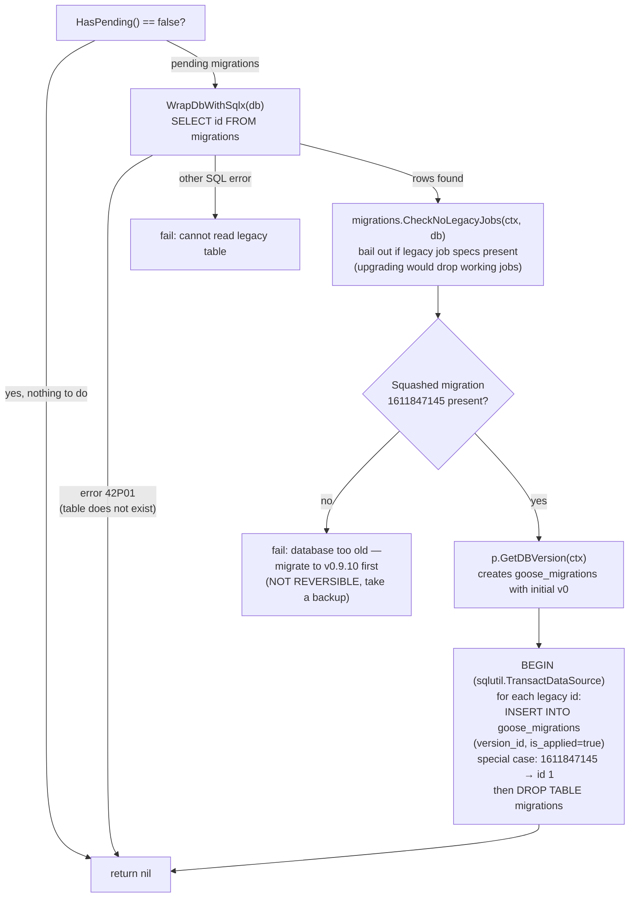
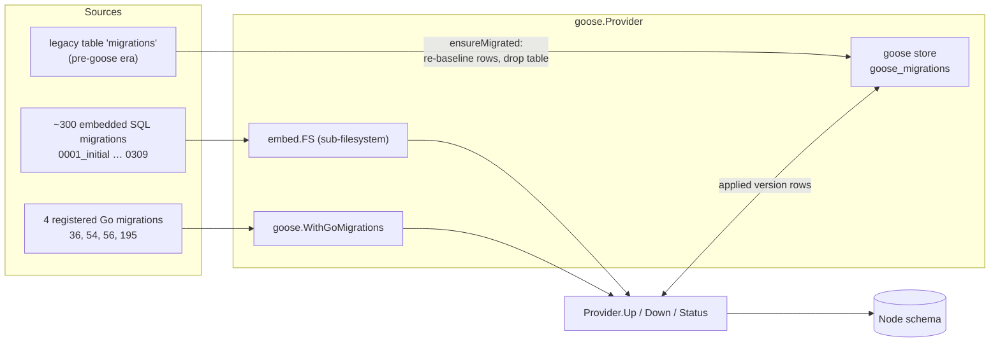
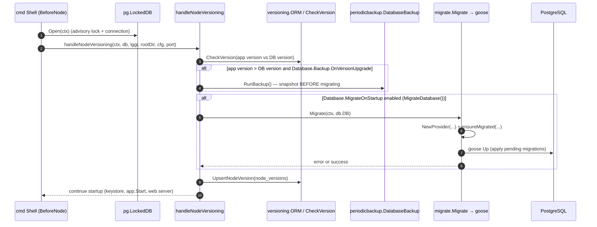
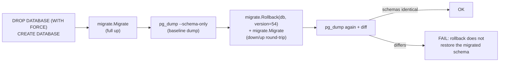
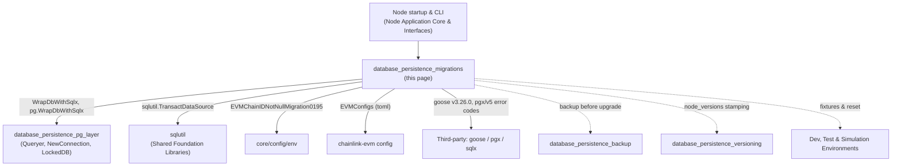

# Database Persistence — Migrations

The `database_persistence_migrations` module (package `chainlink/core/store/migrate`) owns **schema lifecycle management** for the Chainlink node's PostgreSQL database. It wraps the [pressly/goose/v3](https://github.com/pressly/goose) migration engine (pinned at `v3.26.0` in [`chainlink/go.mod`](../../repo/chainlink/go.mod)), embeds the node's versioned SQL/Go migrations into the binary, provisions the migration bookkeeping table (`goose_migrations`), and exposes a small API (`Migrate`, `Rollback`, `Current`, `Status`, `Create`) that is consumed by:

- **Node startup** — automatic schema upgrades when the node boots (see [Node Application Lifecycle](../../Node_Application_Core___Interfaces.md)).
- **The operator CLI** — the `chainlink node db ...` command family for manual migration control.
- **The test infrastructure** — database reset/rollback verification and migration regression tests.

This module is one of four sub-modules of [Database Persistence](../database_persistence.md). It relies on the connection/locking primitives provided by the [PostgreSQL Layer](database_persistence_pg_layer.md), records applied versions in cooperation with [Versioning](database_persistence_versioning.md), and is preceded (on upgrade) by safety snapshots taken by [Backup](database_persistence_backup.md).

---

## 1. Purpose and Core Functionality

| Capability | Implementation | Notes |
|---|---|---|
| Schema upgrade to latest version | `migrate.Migrate(ctx, db)` | `goose.Provider.Up` |
| Rollback (one step or to a target version) | `migrate.Rollback(ctx, db, version)` | `Down` / `DownTo` |
| Report current schema version | `migrate.Current(ctx, db)` | Reads `goose_migrations` |
| Report per-migration status | `migrate.Status(ctx, db)` | Version, path, type, state, applied-at |
| Scaffold a new migration file | `migrate.Create(db, name, migrationType)` | SQL (default) or Go template |
| Bootstrap migration state from the legacy (pre-goose) era | `ensureMigrated` (internal) | One-time `migrations` → `goose_migrations` conversion |
| Pass runtime values into migrations | `migrate.SetMigrationENVVars(cfg)` | Exports `CL_EVM_CHAINID_NOT_NULL_MIGRATION_0195` |

Key properties of the design:

- **Migrations are embedded at build time** via `//go:embed migrations/*.sql migrations/*.go` (`EmbedMigrations`). The shipped binary is self-contained; no migration files are read from disk at runtime.
- **Goose is configured in provider mode** (`goose.NewProvider`), not global mode. Because goose's global migration registry is a process-wide singleton, `goose.ResetGlobalMigrations()` is called before provider construction (workaround for [goose#782](https://github.com/pressly/goose/issues/782)), and only the four hand-registered Go migrations (`Migration36`, `Migration54`, `Migration56`, `Migration195`) plus all embedded SQL files are visible to the provider.
- **Migration state lives in a dedicated table** (`goose_migrations`) managed by a Postgres-dialect `database.NewStore`. The `CL_MIGRATIONS_SCHEMA_OVERRIDE` environment variable can prefix the table with an explicit schema (e.g. `public.goose_migrations`) to work around `current_schema()` resolution issues in goose ≥ 3.23.0 ([goose#1017](https://github.com/pressly/goose/issues/1017)).
- **Legacy compatibility**: nodes upgrading from chainlink v0.9.x-era databases are detected and transparently re-baselined into the goose bookkeeping table.

### Architecture overview

```mermaid
flowchart TB
    subgraph Consumers["Consumers of the migrate package"]
        STARTUP["Node startup<br/>cmd.BeforeNode → handleNodeVersioning<br/>(core/cmd/shell.go)"]
        CLI["Operator CLI<br/>chainlink node db {migrate,rollback,version,status,create-migration,reset}<br/>(core/cmd/shell_local.go)"]
        RESET["store.ResetDatabase / PrepareTestDB<br/>(core/store/store.go)"]
        APPFAC["ChainlinkAppFactory.NewApplication<br/>→ migrate.SetMigrationENVVars"]
    end

    subgraph Module["core/store/migrate (this module)"]
        API["Public API<br/>Migrate / Rollback / Current / Status / Create / SetMigrationENVVars"]
        PROVIDER["NewProvider<br/>goose.Provider construction"]
        ENSURE["ensureMigrated<br/>legacy v1 → goose re-baselining"]
        EMBED["EmbedMigrations (embed.FS)<br/>migrations/*.sql + migrations/*.go"]
        ENVCFG["env.EVMChainIDNotNullMigration0195<br/>CL_EVM_CHAINID_NOT_NULL_MIGRATION_0195"]
    end

    subgraph Goose["pressly/goose/v3 (vendored engine)"]
        STORE["database.NewStore<br/>(Postgres dialect, goose_migrations table)"]
        EXEC["Provider.Up / UpTo / UpByOne<br/>Down / DownTo / GetDBVersion / Status"]
        CREATE["goose.Create"]
    end

    subgraph DB[("PostgreSQL")]
        MIGTABLE[("goose_migrations")]
        LEGACYTABLE[("migrations (legacy, dropped)")]
        SCHEMA[("Node schema<br/>jobs, pipeline specs, log poller, txm, …")]
    end

    subgraph Siblings["Related sub-modules (see sibling pages)"]
        PG["pg layer<br/>WrapDbWithSqlx / NewConnection / LockedDB"]
        VER["versioning ORM<br/>node_versions"]
        BKP["periodicbackup<br/>DatabaseBackup"]
    end

    STARTUP --> API
    CLI --> API
    CLI --> CREATE
    RESET --> API
    APPFAC --> ENVCFG
    ENVCFG -.->|"os.Setenv"| EMBED

    API --> PROVIDER
    PROVIDER --> ENSURE
    PROVIDER --> STORE
    PROVIDER --> EXEC
    CREATE --> CREATECLI["goose.Create (file scaffolding)"]

    EMBED --> PROVIDER
    ENSURE --> PG
    ENSURE --> LEGACYTABLE
    ENSURE --> MIGTABLE
    STORE --> MIGTABLE
    EXEC --> SCHEMA
    EXEC --> MIGTABLE

    PG --> SCHEMA
    STARTUP --> PG
    STARTUP -.->|"version check"| VER
    STARTUP -.->|"pre-upgrade snapshot"| BKP
```

---

## 2. Core Components

### 2.1 `NewProvider` — provider construction (`chainlink/core/store/migrate/migrate.go`)

`NewProvider(ctx, db *sql.DB) (*goose.Provider, error)` is the single construction point for every operation in this module. It performs, in order:

1. **Schema override resolution** — reads `CL_MIGRATIONS_SCHEMA_OVERRIDE`; if set, the bookkeeping table name becomes `<schema>.goose_migrations`. This is needed in no-op (NOP) deployment modes where `current_schema()` ≠ `public` but goose creates the table in `public`.
2. **Store creation** — `database.NewStore(goose.DialectPostgres, tableName)`.
3. **Go migration registration** — the `goMigrations` slice registers the hand-written Go migrations:

   ```go
   goMigrations := []*goose.Migration{
       migrations.Migration36,   // external_job_id column + constraints (data backfill in Go)
       migrations.Migration54,
       migrations.Migration56,
       migrations.Migration195,  // SET NOT NULL on evm_chain_id, driven by env var
   }
   ```

   Importing the `migrations` package (blank import) triggers its `init()` functions, which are required for the SQL files to be embedded and for the Go migrations to be compiled in.
4. **Filesystem setup** — `fs.Sub(EmbedMigrations, MigrationsDir)` exposes the embedded `migrations/` directory to goose.
5. **Provider construction** — `goose.NewProvider("", db, fys, goose.WithStore(...), goose.WithGoMigrations(...), goose.WithVerbose(...))`. Verbosity is opt-in through `CL_LOG_SQL_MIGRATIONS`.
6. **Legacy re-baselining** — `ensureMigrated(...)` (see [§2.2](#22-ensuremigrated--legacy-database-compatibility)).

### 2.2 `ensureMigrated` — legacy database compatibility

Older node databases tracked applied migrations in a table named `migrations`. `ensureMigrated` migrates that bookkeeping into the goose world **without re-running any SQL**:



Safety gates built into this path:

- **No legacy job specs**: `migrations.CheckNoLegacyJobs` aborts the upgrade so that working jobs are not silently dropped — operators must read the release notes first.
- **Minimum upgrade floor**: a database older than the squashed migration `1611847145` (v0.9.10) refuses to upgrade, with an explicit warning that the upgrade is not reversible and a backup is strongly recommended.
- **Transactional conversion**: legacy version rows are inserted and the legacy table dropped inside one transaction supplied by `sqlutil.TransactDataSource` ([sqlutil](../../Shared_Foundation_Libraries___Domain_Types/sqlutil.md)).

### 2.3 Operation API

All operations construct a fresh provider via `NewProvider` and delegate to goose:

| Function | Goose call | Behaviour |
|---|---|---|
| `Migrate(ctx, db)` | `provider.Up(ctx)` | Apply every pending migration. |
| `Rollback(ctx, db, version)` | `DownTo(version)` if `version.Valid`, else `Down(ctx)` | Roll back to a target version or a single step. |
| `Current(ctx, db)` | `provider.GetDBVersion(ctx)` | Returns current version (or `-1` on error). |
| `Status(ctx, db)` | `provider.Status(ctx)` | Prints `version, path, type, state, appliedAt` per migration to stdout. |
| `Create(db, name, migrationType)` | `goose.Create(db, "core/store/migrate/migrations", ...)` | Scaffolds a new SQL (default) or Go migration on disk — developer-time only. |

### 2.4 `SetMigrationENVVars` — config-to-migration plumbing

Some migrations need values that only exist in node configuration. `SetMigrationENVVars(generalConfig toml.EVMConfigs)` exports the first enabled EVM chain ID as `CL_EVM_CHAINID_NOT_NULL_MIGRATION_0195` (constant defined in [`chainlink/core/config/env/env.go`](../../repo/chainlink/core/config/env/env.go)). It is invoked from:

- `ChainlinkAppFactory.NewApplication` in [`core/cmd/shell.go`](../../repo/chainlink/core/cmd/shell.go) — before the application (and hence any startup migration) is created.
- The `chainlink node db migrate` CLI action in [`core/cmd/shell_local.go`](../../repo/chainlink/core/cmd/shell_local.go).

Migration `0195` then consumes the variable at execution time (see [§3.2](#32-go-migrations)).

---

## 3. Migration Sources

### 3.1 SQL migrations (the overwhelming majority)

Files live in `chainlink/core/store/migrate/migrations/` and follow the goose naming/annotation convention `NNNN_description.sql` with `-- +goose Up` / `-- +goose Down` sections. Examples:

```sql
-- 0280_create_keystore_table.sql (storage table for chainlink-common/keystore entries)
-- +goose Up
CREATE TABLE IF NOT EXISTS encrypted_keystore (
    id SERIAL PRIMARY KEY,
    name TEXT NOT NULL UNIQUE,
    created_at timestamptz NOT NULL DEFAULT NOW(),
    updated_at timestamptz NOT NULL DEFAULT NOW(),
    encrypted_data BYTEA NOT NULL
);

-- +goose Down
DROP TABLE IF EXISTS encrypted_keystore;
```

The catalog spans the full history of the node — from `0001_initial.sql` through job-type specific tables (flux monitor, keeper, OCR/OCR2, VRF/VRFv2+, direct request, cron, stream, gateway, workflow specs v2…), relay schemas (`0194_evm_schema.sql`, `0262_add_solana_schema.sql`, `0282_add_ton_schema.sql`), log poller evolution, transaction manager state, CCIP/LLO/Mercury caches, and authentication tables (WebAuthn, LDAP sessions, OIDC). Two repository conventions apply to authoring:

> - **No `CREATE EXTENSION`**: node operators do not always run migrations with superuser privileges (see [`core/store/migrate/README.md`](../../repo/chainlink/core/store/migrate/README.md)). Migrations such as `0036` generate UUIDs in Go instead of relying on the `uuid-ossp` extension.
> - **No triggers**: the shipped schema is trigger-free by design. `TestNoTriggers` asserts `information_schema.triggers` is empty after a full `Up`, which also verifies that trigger-based cleanup (e.g. the removed `0206_remove_tx_insert_trigger` / `0219_drop_notifytxinsertion`) is not reintroduced.

### 3.2 Go migrations

Complex, data-carrying migrations are written in Go and registered in `NewProvider`'s `goMigrations` list. They use `goose.NewGoMigration(version, upFn, downFn)` with transactional functions:

- **`Migration195`** (`0195_add_not_null_to_evm_chain_id_in_job_specs.go`): backfills `evm_chain_id` on seven legacy job-spec tables from the `CL_EVM_CHAINID_NOT_NULL_MIGRATION_0195` environment variable (only if set), then applies `SET NOT NULL` constraints. The down path simply drops the constraints.
- **`Migration36`** (`0036_external_job_id.go`): drops `on_chain_job_spec_id` columns, adds `jobs.external_job_id` with uniqueness/not-null/check constraints, and backfills UUIDs for every existing job in Go (avoiding the Postgres UUID extension).

### 3.3 Migration lineage diagram



---

## 4. Runtime Integration & Process Flows

### 4.1 Node startup (automatic migration)

On `chainlink node start`, the CLI `BeforeNode` hook opens the database under an advisory lock (see [PostgreSQL Layer](database_persistence_pg_layer.md)) and then runs `handleNodeVersioning`:



Key sequencing guarantees:

- **Backup precedes migration** when the application version is newer than the recorded database version ([Backup](database_persistence_backup.md)).
- **Migration is gated by configuration**: `Database.Migrations` (`MigrateDatabase()` in `core/services/chainlink/config_database.go`). Operators who run migrations out-of-band (e.g. via `chainlink node db migrate` in a pipeline) may disable it.
- **The whole startup runs under the DB lock**, so concurrent node replicas cannot migrate simultaneously.
- **Version stamping follows migration** so that the next boot's version comparison sees the upgraded schema.

### 4.2 Operator CLI

`chainlink node db <subcommand>` (definitions in [`core/cmd/shell_local.go`](../../repo/chainlink/core/cmd/shell_local.go), `initLocalSubCmds`):

| Command | Action | Module entry point |
|---|---|---|
| `db migrate` | Migrate to latest (`SetMigrationENVVars` first) | `MigrateDatabase` → `migrateDB` → `migrate.Migrate` |
| `db rollback [version]` | Roll back one step, or to `<version>` | `RollbackDatabase` → `migrate.Rollback` |
| `db version` | Print current schema version | `VersionDatabase` → `migrate.Current` |
| `db status` | Print per-migration state table | `StatusDatabase` → `migrate.Status` |
| `db create-migration <name> [--type=go]` | Scaffold a migration file | `CreateMigration` → `migrate.Create` |
| `db reset` | Drop + create + migrate (test databases by default; `--dangerWillRobinson` otherwise) | `ResetDatabase` → `store.ResetDatabase` |
| `db preparetest` | Reset + load fixtures | `PrepareTestDatabase` |

Local Postgres for development is provisioned by [`chainlink/tools/docker/docker-compose.postgres.yaml`](../../repo/chainlink/tools/docker/docker-compose.postgres.yaml) (`node-db` / `node-db-2` services on `postgres:15`), which the `node` services reach via `CL_DATABASE_URL`.

### 4.3 `db reset` — self-verifying reset path

`store.ResetDatabase` in [`core/store/store.go`](../../repo/chainlink/core/store/store.go) is notable because it uses this module to *verify its own migrations*:



This catches migrations whose `Down` scripts are inconsistent with their `Up` scripts (the base version for the round-trip is currently `54`).

---

## 5. Testing & Verification

Migration tests live in [`chainlink/core/store/migrate/migrate_test.go`](../../repo/chainlink/core/store/migrate/migrate_test.go) and run against real PostgreSQL instances via the `heavyweight.FullTestDBEmptyV2` / `FullTestDBV2` helpers (see [Dev, Test & Simulation Environments](../../Dev,_Test___Simulation_Environments.md)). Tests are explicitly non-parallel because they mutate the shared schema and goose global state.

| Test | What it proves |
|---|---|
| `TestMigrate` | `Migrate` / `Status` / `Current` / `Rollback` round-trip at the API level (up to 100, roll back to 99). |
| `TestMigrate_0100_BootstrapConfigs` | Migration `0100` extracts legacy bootstrap OCR2 jobs into `bootstrap_specs` (up), and the down migration merges them back into `offchainreporting2_oracle_specs` preserving all fields. |
| `TestMigrate_101_GenericOCR2` | Migration `0101` converts OCR2 specs to the generic form — the `PluginValues` struct (this file's registered core component) asserts `plugin_type = Median` and that the `juelsPerFeeCoinSource` pipeline is moved into `plugin_config`; the down path restores the original column. |
| `TestSetMigrationENVVars` | `SetMigrationENVVars` exports the chain ID for migration 195 (also when the EVM config is absent). |
| `TestNoTriggers` | A fully migrated schema contains zero triggers (repository-wide invariant). |
| `TestRollback_247_TxStateEnumUpdate` | Migration `247` (transaction-state enum change) round-trips cleanly from version 54. |
| `BenchmarkBackfillingRecordsWithMigration202` | Benchmarks the `202` backfill migration against ~100k `evm.log_poller_blocks` rows per chain — the pessimistic log-poller retention case. |

Rollback correctness is additionally enforced end-to-end by the schema-diff test in `store.ResetDatabase` ([§4.3](#43-db-reset--self-verifying-reset-path)).

---

## 6. Configuration Reference

| Setting | Source | Effect |
|---|---|---|
| `Database.Migrations` (`MigrateOnStartup` TOML field) | `core/services/chainlink/config_database.go` (`MigrateDatabase()`) | Run migrations automatically at node startup. |
| `Database.URL` / `CL_DATABASE_URL` | secrets TOML / env | Target database for all migration commands. |
| `CL_MIGRATIONS_SCHEMA_OVERRIDE` | env | Schema-qualify the `goose_migrations` table (goose ≥3.23 `current_schema()` workaround). |
| `CL_LOG_SQL_MIGRATIONS` | env (boolean) | Enable verbose goose logging of executed migrations. |
| `CL_EVM_CHAINID_NOT_NULL_MIGRATION_0195` | env (set by `SetMigrationENVVars`) | Backfill value for `evm_chain_id NOT NULL` backfills in migration 195. |
| `Database.Backup.OnVersionUpgrade` / `Mode` | TOML | Trigger a pre-migration snapshot when the app version is newer ([Backup](database_persistence_backup.md)). |

---

## 7. Dependencies and Related Modules



- **[Database Persistence (parent)](../database_persistence.md)** — module family overview.
- **[PostgreSQL Layer](database_persistence_pg_layer.md)** — connection handling, advisory locking (`LockedDB`) that serializes migrations in HA deployments, and the sqlx wrapper used by `ensureMigrated`.
- **[Versioning](database_persistence_versioning.md)** — `node_versions` table written after successful migration; `CheckVersion` gate that runs before migration.
- **[Backup](database_persistence_backup.md)** — `DatabaseBackup`, invoked by `handleNodeVersioning` before an upgrade migration.
- **[sqlutil](../../Shared_Foundation_Libraries___Domain_Types/sqlutil.md)** — `TransactDataSource` used for the legacy bookkeeping conversion.
- **[Node Application Core & Interfaces](../../Node_Application_Core___Interfaces.md)** — CLI shell (`cmd`) and application lifecycle that consume this module.

---

## 8. Adding a New Migration (Maintainer Guide)

1. **Scaffold**: run `chainlink node db create-migration <name>` (add `--type=go` for a Go migration), or create `migrations/NNNN_description.sql` manually with the next sequential number.
2. **Write both directions**: every migration must implement `-- +goose Up` and `-- +goose Down`. Rollback symmetry is machine-checked by `store.ResetDatabase` ([§4.3](#43-db-reset--self-verifying-reset-path)) and per-migration tests (e.g. `TestMigrate_0100_BootstrapConfigs`).
3. **Avoid `CREATE EXTENSION`** — migrations may run without superuser privileges ([README](../../repo/chainlink/core/store/migrate/README.md)); compute values in Go instead (see `0036`).
4. **Avoid triggers** — the invariant is asserted by `TestNoTriggers`; replace trigger-based logic with application-level or scheduled processing.
5. **Go migrations must be registered** — add the generated `MigrationNNNN` variable to the `goMigrations` slice in `NewProvider`; SQL migrations are picked up automatically from the embedded directory.
6. **Need config at migration time?** Extend `SetMigrationENVVars` and the constants in `core/config/env`, and make the migration read `os.LookupEnv` (pattern: migration `0195`).
7. **Test**: add a focused up/down test against `heavyweight.FullTestDBEmptyV2` if the migration transforms data; keep tests non-parallel (they mutate shared goose state).
8. **Large backfills**: benchmark them (pattern: `BenchmarkBackfillingRecordsWithMigration202`) — log-poller scale (~100k rows/chain) is the historical worst case.

## 9. Operational Notes & Known Constraints

- **Provider-per-operation**: each `Migrate`/`Rollback`/`Current`/`Status` call constructs a new goose provider and re-runs `ensureMigrated`; this is cheap and stateless but means the legacy check runs on every invocation (it no-ops once `goose_migrations` is authoritative).
- **Version floor enforcement**: databases older than the `1611847145` squashed migration are rejected with an explicit "migrate to v0.9.10 first" error; the check exists because the upgrade is irreversible.
- **Legacy job-spec gate**: `CheckNoLegacyJobs` prevents upgrading a database that still contains legacy-format job specs, protecting users from dropping working jobs during upgrade.
- **Schema resolution (NOPs)**: if migrations appear to no-op because goose cannot find `goose_migrations`, set `CL_MIGRATIONS_SCHEMA_OVERRIDE=public`.
- **HA safety**: migrations always execute under the `LockedDB` advisory lock at startup, preventing concurrent migrations from replicas; manual CLI runs against a database without an active node lock should be done with the node stopped.
