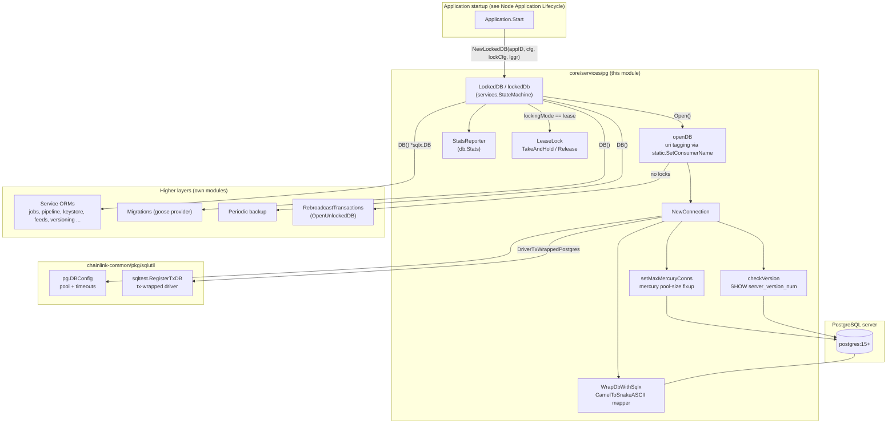
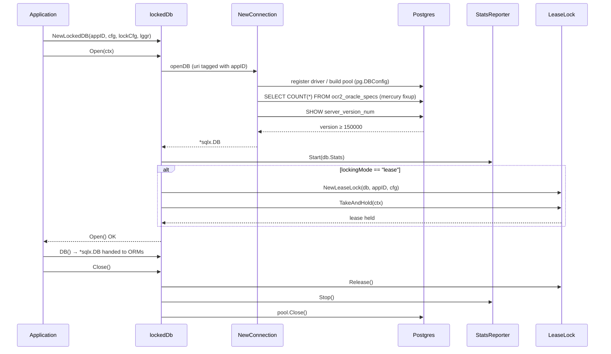
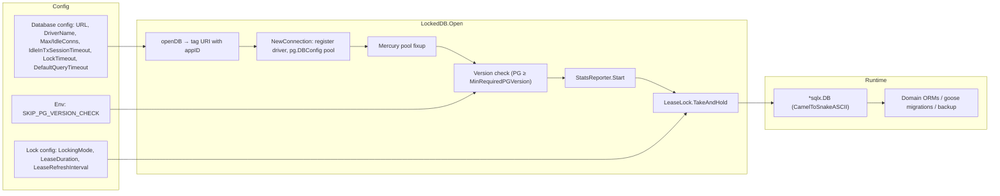
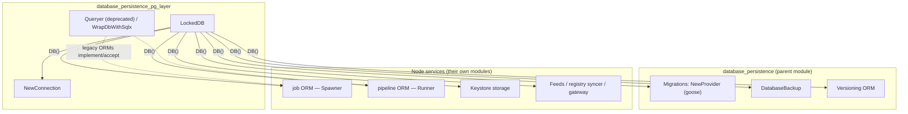

# Database Persistence — PostgreSQL Layer (`core/services/pg`)

## 1. Introduction

The **PostgreSQL layer** (`chainlink/core/services/pg`) is the lowest-level building block of the node's [database persistence stack](../database_persistence.md). It is responsible for exactly three concerns:

1. **Establishing connections** to the Postgres server using the shared `chainlink-common/pkg/sqlutil/pg` connection factory, with pool sizing, statement timeouts, and a server-version safety check (`connection.go::NewConnection`).
2. **Mediating exclusive access** to the database through a lifecycle-managed wrapper that optionally takes a **lease lock** before any application service may use the handle, and reports pool statistics while running (`locked_db.go::LockedDB`).
3. **Providing the sqlx query surface** that node ORMs historically program against (`sqlx.go::Queryer`, `WrapDbWithSqlx`), including the CamelCase→snake_case struct-to-column mapping convention used across the codebase.

Everything above this layer — schema [migrations](database_persistence_migrations.md), [periodic backups](database_persistence_backup.md), [node-version persistence](database_persistence_versioning.md), and the domain ORMs of services such as the [job service](../job_service/job_service_persistence.md) — is built on top of the `*sqlx.DB` handle that this layer produces.

### Key facts

| Aspect | Detail |
| --- | --- |
| Source package | `chainlink/core/services/pg` |
| Database | PostgreSQL (pgx v5 driver registered via `stdlib`) |
| Minimum supported server | **PG 15** (`MinRequiredPGVersion = 150000`, auto-raised as versions reach EOL) |
| Exposed handle | `*sqlx.DB` (jmoiron/sqlx over `database/sql`) |
| Locking modes | `lease` (default single-writer guard); other modes = no DB-level lock |
| Override switches | `SKIP_PG_VERSION_CHECK=true` (version check), `CL_DATABASE_URL` (deployment) |
| Consumers | Application lifecycle, job/pipeline/versioning/keystore/feeds ORMs, migrations, backup |

---

## 2. Architecture Overview



The layer sits between the node **application lifecycle** (which decides *when* the database is opened, see [Node Application Lifecycle](../../Node_Application_Core___Interfaces/node_application/node_application_lifecycle.md)) and the **Postgres server**. All database *semantics* (schema, queries, transactions) belong to the consuming modules; this module only guarantees a correctly configured, exclusively held, version-checked connection pool.

---

## 3. Components

### 3.1 `LockedDB` — lifecycle-managed, lock-guarded database handle

Source: `chainlink/core/services/pg/locked_db.go`

```go
type LockedDB interface {
    Open(ctx context.Context) error
    Close() error
    DB() *sqlx.DB
}
```

`NewLockedDB(appID uuid.UUID, cfg LockedDBConfig, lockCfg config.Lock, lggr logger.Logger)` builds an instance that embeds the shared [services state machine](../../Shared_Foundation_Libraries___Domain_Types/services.md), so `Open`/`Close` are idempotent (`StartOnce` / `StopOnce`, treating `ErrAlreadyStopped` as success on double-close).

`Open` performs three ordered steps, rolling back everything if any step fails:

1. **Open the connection pool** via `openDB` → `NewConnection`.
2. **Start the `StatsReporter`** over `db.Stats` so pool saturation is visible in logs.
3. **Acquire the DB lock** when `lockCfg.LockingMode() == "lease"`: a `LeaseLock` is created with `DefaultQueryTimeout`, `LeaseDuration` and `LeaseRefreshInterval` from config, then `TakeAndHold(ctx)` blocks until the lease is held. The lease marks this node instance (identified by `appID`) as the single writer.

`Close` releases the lease (if held), stops the reporter and closes the pool; all fields are nilled out so `DB()` afterwards returns `nil`.

**Unlocked variant.** `OpenUnlockedDB(ctx, appID, cfg)` opens a plain pool without lease semantics. It is deliberately restricted — currently used only by the `RebroadcastTransactions` command — because bypassing the lease can violate the single-writer guarantee.



**Configuration surface.** `LockedDBConfig` extends `ConnectionConfig` with:

| Method | Purpose |
| --- | --- |
| `URL() url.URL` | DSN of the database (e.g. from `CL_DATABASE_URL` in deployments — see [`tools/docker/docker-compose.postgres.yaml`](#7-deployment--environment)) |
| `DriverName() string` | Which `database/sql` driver to open; may be the tx-wrapped driver |
| `DefaultQueryTimeout() time.Duration` | Applied inside the lease-lock query context |

And `config.Lock` supplies `LockingMode()`, `LeaseDuration()` and `LeaseRefreshInterval()` for the lease algorithm.

### 3.2 `NewConnection` — connection factory with guardrails

Source: `chainlink/core/services/pg/connection.go`

`NewConnection(ctx, uri, driverName, config)` is the single place a raw pool is created:

1. **Driver selection.** If `driverName == commonpg.DriverTxWrappedPostgres`, `sqltest.RegisterTxDB(uri)` registers the transaction-wrapped driver first, allowing the node to run DB access inside one controlled transaction (used by tests and special tooling).
2. **Pool construction.** Delegates to the shared `chainlink-common` factory:

   ```go
   commonpg.DBConfig{
       IdleInTxSessionTimeout: config.DefaultIdleInTxSessionTimeout(),
       LockTimeout:            config.DefaultLockTimeout(),
       MaxOpenConns:           config.MaxOpenConns(),
       MaxIdleConns:           config.MaxIdleConns(),
   }.New(ctx, uri, driverName)
   ```

   This is where session-level `idle_in_transaction_session_timeout` and `lock_timeout` statement settings get baked into the connection. See [sqlutil](../../Shared_Foundation_Libraries___Domain_Types/sqlutil.md).
3. **Mercury connection fixup** (`setMaxMercuryConns`). Mercury (OCR2) jobs historically require *one dedicated connection per job*. Because node operators frequently forget to raise pool defaults, `NewConnection` counts rows in `ocr2_oracle_specs WHERE plugin_type = 'mercury'` and, if that count exceeds the configured `MaxOpenConns`/`MaxIdleConns`, raises both limits to the job count (logged). Missing table (SQLSTATE `42P01`) is treated as "no mercury jobs"; other query errors are logged and ignored. This is an explicitly marked HACK, scheduled to disappear with the LLO plugin replacing Mercury.
4. **Server version check** (`checkVersion`, skipped when `SKIP_PG_VERSION_CHECK=true`):
   * `SHOW server_version_num` is read through the tiny `Getter` interface (kept for testability).
   * If the query fails or yields a suspiciously small value (`< 10000`), the check is *skipped* (logged), never fatal.
   * If the server version is below `MinRequiredPGVersion`, startup fails with an actionable error recommending an upgrade or the override switch.

#### Version policy (`MinRequiredPGVersion`)

`MinRequiredPGVersion` starts at `150000` (PG 15) and is bumped at compile time by an `init()` that inspects the wall clock, following the [Postgres EOL calendar](https://www.postgresql.org/support/versioning/):

| Build year | Minimum server version |
| --- | --- |
| ≤ 2025 (default) | 150000 (PG 15) |
| 2026 | 150000 (PG 15) |
| 2028 | 160000 (PG 16) |
| 2029 | 170000 (PG 17) |
| > 2029 | 180000 (PG 18) |

Version numbers use the `server_version_num` encoding (e.g. `150000` = 15.0). Production deployments should therefore run `postgres:15` or newer — matching the images used in the repository's [docker compose files](#7-deployment--environment).

### 3.3 `Queryer` and `WrapDbWithSqlx` — the sqlx surface

Source: `chainlink/core/services/pg/sqlx.go`

* **`Queryer` (deprecated).** Historically the interface implemented by `*sqlx.DB` that all ORMs accepted. It composes `sqlx.Ext`, `ExtContext`, `Preparer`, `PreparerContext`, `Queryer` and adds `Select`/`Get`/`NamedExec`/`NamedQuery`/`QueryRow` variants. **New code must use `sqlutil.DataSource` from `chainlink-common/pkg/sqlutil`** (see [sqlutil](../../Shared_Foundation_Libraries___Domain_Types/sqlutil.md)); `Queryer` remains only for backwards compatibility.
* **`WrapDbWithSqlx(rdb *sql.DB) *sqlx.DB`.** Wraps an existing `*sql.DB` into sqlx for the `postgres` dialect and installs the canonical column-name convention:

  ```go
  db.MapperFunc(reflectx.CamelToSnakeASCII)
  ```

  so Go struct fields such as `PipelineRunID` map to column `pipeline_run_id` in all `Select`/`Get`/`Named*` calls codebase-wide. Any code that bypasses `NewConnection` (e.g. attaching to an externally created handle) must use this wrapper to keep the mapping consistent.

---

## 4. Data Flow: from config to first query



1. Application startup builds `LockedDBConfig` (URL + driver + pool/timeout knobs) and `config.Lock` and calls `NewLockedDB` (see [Node Application Lifecycle](../../Node_Application_Core___Interfaces/node_application/node_application_lifecycle.md)).
2. `Open` produces a fully configured `*sqlx.DB`; on any failure the revert path closes the pool so no half-open resources leak.
3. The handle is injected into every persistence consumer — the [job service ORM](../job_service/job_service_persistence.md), the [pipeline engine](../../Oracle_Engines___Data_Pipelines/pipeline.md), the [versioning ORM](database_persistence_versioning.md), keystores, feeds, etc. — which then own schema- and query-level concerns.
4. Cross-cutting persistence processes operate on the same handle: the [migrations provider](database_persistence_migrations.md) (goose, `*sql.DB` view) and the [periodic backup service](database_persistence_backup.md).

---

## 5. Component Interaction Map



Notes on the edges:

* Migrations accept a plain `*sql.DB` (goose provider), obtained from the same handle — see [database_persistence_migrations](database_persistence_migrations.md).
* `DatabaseBackup` and the versioning ORM are thin `services.Service`/interface wrappers around the shared handle — see [database_persistence_backup](database_persistence_backup.md) and [database_persistence_versioning](database_persistence_versioning.md).
* Legacy ORMs typed against `pg.Queryer` keep working because `*sqlx.DB` satisfies it; migration to `sqlutil.DataSource` is per-consumer and does not change this layer's behavior.

---

## 6. Failure Semantics & Operational Notes

| Scenario | Behavior |
| --- | --- |
| Version below minimum | `Open` fails fast with an error naming both versions and the `SKIP_PG_VERSION_CHECK=true` override |
| `SHOW server_version_num` fails | Check skipped (logged) — e.g. proxies that don't support `SHOW` don't block startup |
| `ocr2_oracle_specs` missing | Treated as "no mercury jobs" (SQLSTATE `42P01`) — schema may legitimately not exist yet before first migration |
| Lease acquisition fails/cancelled | `Open` reverts: reporter stopped, pool closed, error wrapped as `"failed to take initial lease on database"` |
| Double `Close` | Returns `nil` (`ErrAlreadyStopped` suppressed) |
| `DB()` after `Close` | Returns `nil`, never a closed handle |

Two behaviors deserve special attention:

* **Single-writer discipline.** With `lockingMode = "lease"`, a second node pointing at the same database will block (or fail) in `Open` until the first node's lease expires — the intended guard against split-brain, dual-node corruption of job/pipeline state.
* **Pool sizing side effects.** `MaxOpenConns`/`MaxIdleConns` are soft limits in Mercury deployments: the observed job count overrides them upward, so monitoring of actual pool usage should rely on the `StatsReporter` output rather than config values.

---

## 7. Deployment & Environment

The layer's runtime behavior is tied to a few environment-level inputs:

* **`CL_DATABASE_URL`** — the DSN handed to `LockedDBConfig.URL()`. In the repository's container stack each node pairs with its own PG 15 server: `node → node-db`, `node-2 → node-db-2` (see `chainlink/tools/docker/docker-compose.postgres.yaml`, `image: postgres:15`, credentials via `CHAINLINK_PGUSER` / `CHAINLINK_PGPASSWORD` / `CHAINLINK_DB_NAME`).
* **`SKIP_PG_VERSION_CHECK`** — set to `true` to bypass the EOL-version guard in `NewConnection` (only for short-lived test environments; upgrading the server is the correct fix).
* **`CL_MIGRATIONS_SCHEMA_OVERRIDE`** — not read by this layer, but by the [migrations module](database_persistence_migrations.md) that runs on the handle produced here; listed for completeness of the DB bootstrap chain.

Because the minimum version is raised automatically in future builds, pinning `postgres:15` images today is safe but plan upgrades to PG 16/17 as they enter the support window.

---

## 8. Related Modules

* [database_persistence (parent)](../database_persistence.md) — overview of the whole persistence stack and how the pg layer, migrations, backup and versioning fit together.
* [database_persistence_migrations](database_persistence_migrations.md) — goose provider consuming the `*sql.DB` view of the handle created here.
* [database_persistence_backup](database_persistence_backup.md) — `DatabaseBackup` service for periodic dumps.
* [database_persistence_versioning](database_persistence_versioning.md) — `NodeVersion` ORM built on the shared handle.
* [job_service_persistence](../job_service/job_service_persistence.md) — example of a domain ORM (`ORMConfig`) layered on top.
* [sqlutil](../../Shared_Foundation_Libraries___Domain_Types/sqlutil.md) — `sqlutil.DataSource` (the `Queryer` successor), `pg.DBConfig` factory, `DriverTxWrappedPostgres`.
* [services](../../Shared_Foundation_Libraries___Domain_Types/services.md) — `StateMachine` (`StartOnce`/`StopOnce`) used by `lockedDb`.
* [logger](../../Shared_Foundation_Libraries___Domain_Types/logger.md) — structured logging conventions (`logger.Named(lggr, "LockedDB")`).
* [Node Application Lifecycle](../../Node_Application_Core___Interfaces/node_application/node_application_lifecycle.md) — where `NewLockedDB`/`Open` are invoked during node start/stop.
