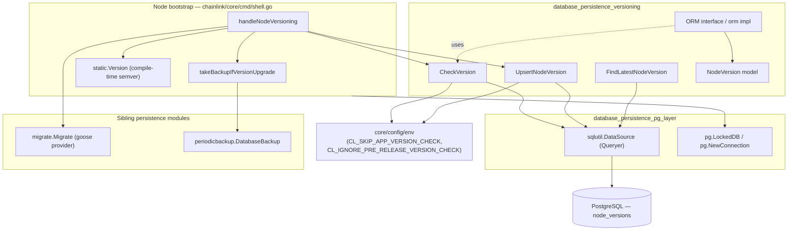
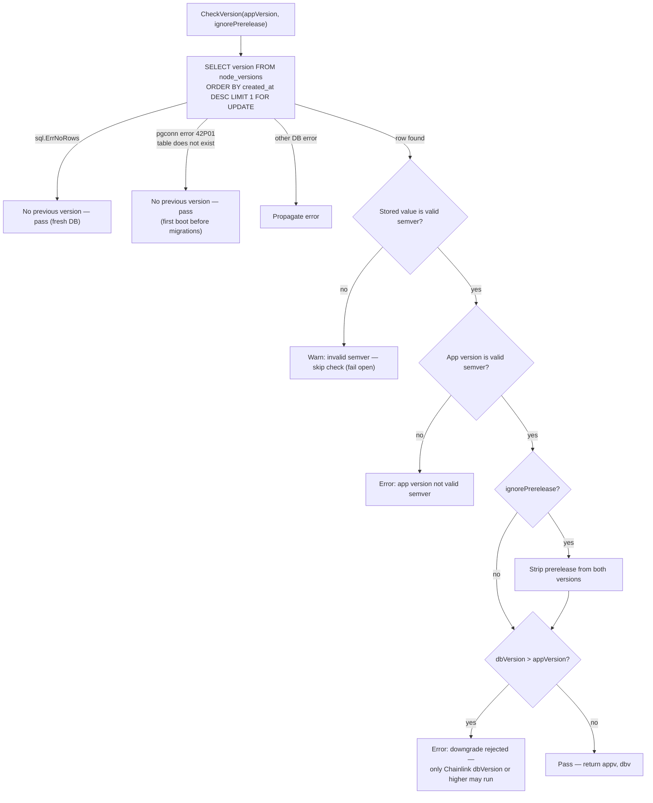
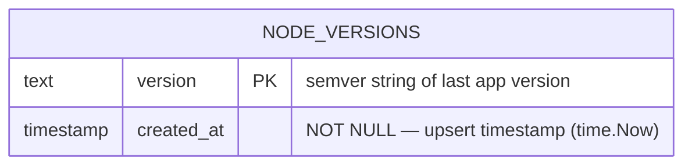
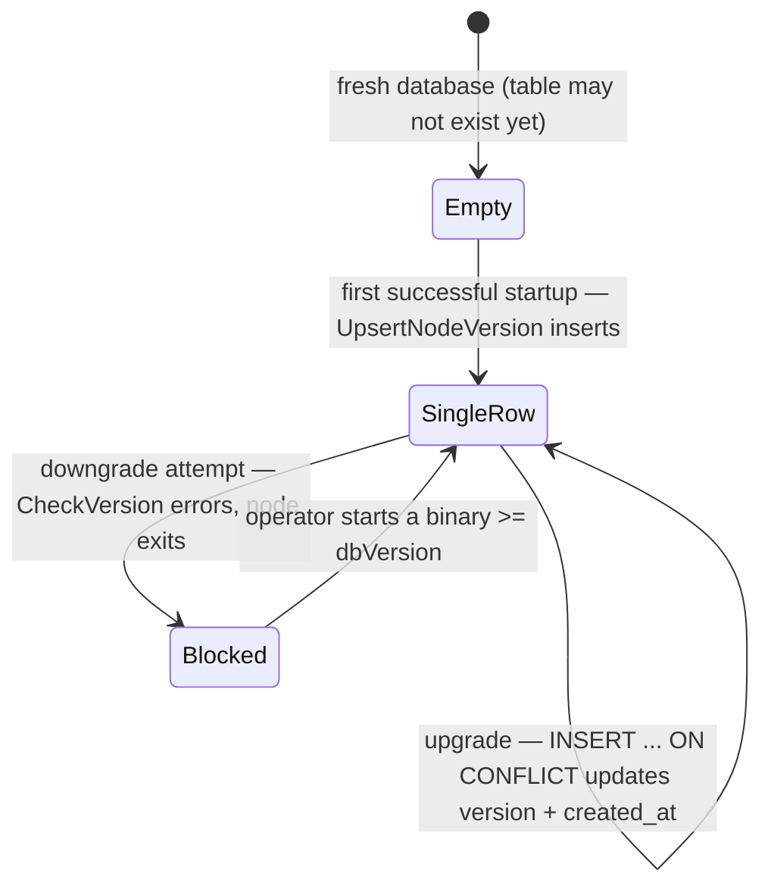

# Database Persistence — Versioning (`database_persistence_versioning`)

## 1. Overview

The **versioning** module is a small but safety-critical part of the Chainlink node's database persistence layer. It records the **application version that most recently ran against a database** in the `node_versions` table and uses that record to enforce a **forward-only compatibility contract** between the running binary and the database state.

Its two responsibilities are:

1. **Downgrade protection** — refuse to start an *older* binary against a database that was already migrated and written by a *newer* binary. Schema (see [database_persistence_migrations](database_persistence_migrations.md)) and data written by a newer release may not be understood by an older one, so the node exits immediately *before touching the database*.
2. **Version bookkeeping** — atomically upsert the current application version after a successful startup sequence, so subsequent starts (and the [periodic backup](database_persistence_backup.md) flow) can compare against it.

> **Important:** The database version is *only* useful for versioning concerns specific to the database (backups, migrations). If you just need the current application version, use `static.Version` instead. This note is repeated in the source (`chainlink/core/services/versioning/orm.go`) because it is the most common misuse of the module.

| Aspect | Detail |
|---|---|
| Source location | `chainlink/core/services/versioning/` |
| Core types | `ORM` (interface), `orm` (implementation), `CheckVersion` (package function), `NodeVersion` (model) |
| Storage | Single-row `node_versions` table (PostgreSQL) |
| Primary consumer | Node bootstrap — `handleNodeVersioning` in `chainlink/core/cmd/shell.go` |
| Depends on | `sqlutil.DataSource` (see [pg layer](database_persistence_pg_layer.md)), `semver`, `pgconn`, `core/config/env` |
| Feeds into | Pre-migration backup decision, migration execution, version upsert |

---

## 2. Position in the System

This module is one of four siblings under [database_persistence](../database_persistence.md):

- [database_persistence_pg_layer](database_persistence_pg_layer.md) — supplies the `sqlutil.DataSource` / `pg.LockedDB` connection abstractions this module writes through.
- [database_persistence_migrations](database_persistence_migrations.md) — the goose-based schema migrations that *run after* the version check and *before* the version upsert.
- [database_persistence_backup](database_persistence_backup.md) — the `DatabaseBackup` service that takes a pre-migration backup keyed by the application version.

At the process level, the module is invoked by the node bootstrap sequence (`chainlink/core/cmd/shell.go`, function `handleNodeVersioning`) which itself sits under the [Application lifecycle](../../Node_Application_Core___Interfaces/node_application/node_application_lifecycle.md) — i.e., it runs **before** the [Application](../../Node_Application_Core___Interfaces/node_application/node_application_lifecycle.md) is constructed, while only a raw database connection exists.

---

## 3. Core Components

### 3.1 `ORM` interface and `orm` implementation (`versioning/orm.go`)

```go
type ORM interface {
    FindLatestNodeVersion(ctx context.Context) (*NodeVersion, error)
    UpsertNodeVersion(ctx context.Context, version NodeVersion) error
}
```

- **`NewORM(ds sqlutil.DataSource, lggr logger.Logger)`** — constructs the ORM; the logger is wrapped as `VersioningORM` for consistent log attribution.
- **`FindLatestNodeVersion(ctx)`** — `SELECT version, created_at FROM node_versions ORDER BY created_at DESC`; returns the most recent row, or the raw SQL error (`sql.ErrNoRows` on an empty table).
- **`UpsertNodeVersion(ctx, version)`** — validates the version string is valid semver, then, inside a transaction (`sqlutil.TransactDataSource`):
  1. Re-runs `CheckVersion` against the transaction (defense-in-depth), unless `env.SkipAppVersionCheck` is set;
  2. Executes `INSERT INTO node_versions (version, created_at) VALUES ($1, $2) ON CONFLICT ((version IS NOT NULL)) DO UPDATE SET version = EXCLUDED.version, created_at = EXCLUDED.created_at`.

  The `ON CONFLICT ((version IS NOT NULL))` clause matches the partial unique functional index created by migration `0078`, which guarantees the table holds **at most one row** (see [Data model](#6-data-model)).

### 3.2 `CheckVersion` (package function in `versioning/orm.go`)

```go
func CheckVersion(ctx, ds, lggr, appVersion string, ignorePrerelease bool) (appv, dbv *semver.Version, err error)
```

This is the guard used at startup:

- Locks the latest row with `SELECT version FROM node_versions ORDER BY created_at DESC LIMIT 1 FOR UPDATE` — the row lock serializes concurrent node starts sharing the same database.
- **Tolerates a fresh/empty database**: returns success (`nil, nil, nil`) when there are no rows (`sql.ErrNoRows`) or when the table does not yet exist (`pgconn.PgError` code `42P01`, relation `"node_versions"` missing).
- **Fails open on corrupt stored versions**: if the stored value is not valid semver, it logs a warning and *skips* the check (rather than bricking an upgradeable node).
- **Fails closed on an invalid application version**: a non-semver `static.Version` is a hard error.
- **Prerelease handling**: when `ignorePrerelease` is true, prerelease identifiers are stripped from *both* sides (`SetPrerelease("")`) before comparison — e.g. `v2.19.0-rc1` compares equal to `v2.19.0`.
- **Downgrade rejection**: if `dbv > appv` it returns an error of the form:
  > `Application version (X) is lower than database version (Y). Only Chainlink Y or higher can be run on this database`

  On success it returns both parsed versions, which the caller uses for the backup decision.

### 3.3 `NodeVersion` model (`versioning/models.go`)

```go
type NodeVersion struct {
    Version   string
    CreatedAt time.Time
}

func NewNodeVersion(version string) NodeVersion // stamps CreatedAt with time.Now()
```

Field names map directly to the `node_versions` columns.

---

## 4. Architecture

### 4.1 Component and dependency view



### 4.2 External dependencies

| Dependency | Used for |
|---|---|
| `github.com/Masterminds/semver/v3` | Parsing and comparing versions (`NewVersion`, `GreaterThan`, `SetPrerelease`) |
| `github.com/jackc/pgx/v5/pgconn` | Inspecting `PgError` code `42P01` (missing table) |
| `github.com/smartcontractkit/chainlink-common/pkg/sqlutil` | `DataSource` abstraction and `TransactDataSource` transaction helper |
| `github.com/smartcontractkit/chainlink-common/pkg/logger` | Named/`Nop` loggers |
| `github.com/smartcontractkit/chainlink/v2/core/config/env` | Runtime toggles (`CL_SKIP_APP_VERSION_CHECK`, `CL_IGNORE_PRE_RELEASE_VERSION_CHECK`) |

The ORM is deliberately written against `sqlutil.DataSource` rather than a concrete `*sqlx.DB`, so it works with the tx-wrapped drivers and can be exercised with `sqlmock`/`sqltest` utilities from the [pg layer](database_persistence_pg_layer.md).

---

## 5. Startup Flow: `handleNodeVersioning`

The module's runtime behavior is best understood through the bootstrap sequence in `chainlink/core/cmd/shell.go::handleNodeVersioning`. A **startup health report** is started first so container orchestrators do not kill the node during a potentially long backup.

```mermaid
sequenceDiagram
    autonumber
    participant H as handleNodeVersioning (core/cmd/shell.go)
    participant HR as StartUpHealthReport
    participant V as versioning.ORM / CheckVersion
    participant DB as PostgreSQL (node_versions)
    participant PB as periodicbackup.DatabaseBackup
    participant M as migrate (goose)

    H->>HR: Start (keep health check alive)
    opt static.Version is set
        H->>V: CheckVersion(ctx, db, static.Version, ignorePrerelease)
        V->>DB: SELECT version ... ORDER BY created_at DESC LIMIT 1 FOR UPDATE
        alt db version > app version
            V-->>H: error (downgrade attempt)
            Note over H: Exit immediately — database is NOT touched
        else db version <= app version (or empty)
            V-->>H: appv, dbv
            opt backup enabled AND appv > dbv
                H->>PB: NewDatabaseBackup(...) + RunBackup(appv)
                Note over PB: Pre-migration backup, tagged with appv
            end
        end
        opt MigrateDatabase enabled
            H->>M: Migrate(ctx, db)
        end
        H->>V: NewNodeVersion(static.Version) + UpsertNodeVersion(ctx, version)
        V->>DB: BEGIN; CheckVersion (re-check); INSERT ... ON CONFLICT UPDATE; COMMIT
    end
    H->>HR: Stop
```

Key ordering guarantees, all from `handleNodeVersioning` (`chainlink/core/cmd/shell.go`):

1. **Check before write** — a failing `CheckVersion` aborts startup with the database untouched.
2. **Backup before migration** — the pre-migration backup only runs when the backup mode is enabled, `Database.Backup.OnVersionUpgrade` is true, *and* `appv > dbv` (a genuine upgrade). It is tagged with the **application** version (`RunBackup(appv.String())`).
3. **Upsert after migration** — the stored version is only advanced once migrations succeeded, and the upsert itself re-validates inside its own transaction.

### 5.1 `CheckVersion` decision logic



---

## 6. Data Model

The state is a **single-row table**: the newest version record *is* the database version.



Schema history (files in `chainlink/core/store/migrate/migrations/`):

| Migration | Effect |
|---|---|
| `0018_add_node_version_table.sql` (`chainlink/core/store/migrate/migrations/`) | `CREATE TABLE node_versions (version TEXT PRIMARY KEY, created_at timestamp without time zone NOT NULL)` |
| `0078_only_one_version.sql` (`chainlink/core/store/migrate/migrations/`) | Deletes all but the newest row, then adds the partial unique functional index `idx_only_one_node_version ON node_versions ((version IS NOT NULL))` — enforcing the single-row invariant the upsert's `ON CONFLICT` clause targets |

State lifecycle of the record:



---

## 7. Configuration

Runtime toggles are defined in `chainlink/core/config/env/env.go` and honored in *both* `CheckVersion` (via the bootstrap) and `UpsertNodeVersion` (internally):

| Variable / setting | Type | Effect |
|---|---|---|
| `CL_SKIP_APP_VERSION_CHECK` (`env.SkipAppVersionCheck`) | env var, `true` to enable | Bypasses the compatibility guard entirely; logs a warning. Intended for dev/test pipelines, **not** production. |
| `CL_IGNORE_PRE_RELEASE_VERSION_CHECK` (`env.IgnorePrereleaseVersionCheck`) | env var, `true` to enable | Compares versions with prerelease identifiers stripped (rc/beta builds of the same release are allowed). |
| `Database.Backup.Mode` / `Database.Backup.OnVersionUpgrade` | TOML config (`config.Database`) | Governs whether `takeBackupIfVersionUpgrade` snapshots the DB before migration (see [backup module](database_persistence_backup.md)). |
| `MigrateDatabase` setting | node config / CLI | Whether `migrate.Migrate` runs between the check and the upsert (see [migrations module](database_persistence_migrations.md)). |

Note: `SKIP_PG_VERSION_CHECK` (used in `core/services/pg/connection.go`) guards the *PostgreSQL server* minimum version and is a separate concern owned by the [pg layer](database_persistence_pg_layer.md) — do not confuse it with the app-version check.

---

## 8. Error Handling & Edge Cases

| Condition | Behavior | Rationale |
|---|---|---|
| No rows in `node_versions` | Check passes, `(nil, nil, nil)` | Fresh database — nothing to compare against |
| `node_versions` table missing (`42P01`) | Check passes | First boot occurs before migrations create the table |
| Stored version not valid semver | Warning logged, check skipped | Fail-open: never brick a node over a corrupt single field |
| Application version not valid semver | Hard error | The binary itself is mis-versioned; cannot reason about compatibility |
| `dbVersion > appVersion` | Hard error; startup aborts **before** any DB write, backup, or migration | Downgrade protection — newer schema/data may be unreadable by an older binary |
| `UpsertNodeVersion` with invalid semver | Error before opening a transaction | Keep garbage out of the table |
| Skip env var set | Warning logged in both check and upsert paths | Explicit operator opt-out is always auditable in logs |
| Concurrent node starts | Serialized by `FOR UPDATE` row lock inside the check | Avoids two binaries racing the version/backup decision |

---

## 9. Interaction with Sibling Modules

- **Backup ([database_persistence_backup](database_persistence_backup.md))** — `takeBackupIfVersionUpgrade` constructs a `periodicbackup.DatabaseBackup` and calls `RunBackup(appv)` only when an upgrade (`appv > dbv`) is detected. The versions compared here come from `CheckVersion`'s return values.
- **Migrations ([database_persistence_migrations](database_persistence_migrations.md))** — runs strictly *after* the version check (and optional backup) and *before* the upsert, so the stored version only advances when the schema is known-good. The module itself never runs migrations.
- **PG layer ([database_persistence_pg_layer](database_persistence_pg_layer.md))** — provides the `sqlutil.DataSource` the ORM is constructed with; bootstrap obtains it from `pg.LockedDB` / `pg.NewConnection`.

---

## 10. Operational Guidance

- **"Application version (X) is lower than database version (Y)..."** — you are starting an older binary against an upgraded database. Start a binary of version `Y` or higher (or restore the pre-upgrade backup and downgrade consistently).
- **Dev/test loops stuck on version errors** — set `CL_SKIP_APP_VERSION_CHECK=true` for ephemeral environments only.
- **Release-candidate testing** — set `CL_IGNORE_PRE_RELEASE_VERSION_CHECK=true` so `vX.Y.Z-rcN` can start against an `X.Y.Z` database.
- **Backups** — if automatic pre-upgrade backups are undesired, set `Database.Backup.OnVersionUpgrade=false` (or `Database.Backup.Mode=none` to disable backups entirely); both are logged explicitly by the bootstrap when an upgrade is detected.
- **Version reporting** — the `node_versions` table is the source of truth for "what ran last against this DB"; do not mutate it manually. It is intentionally *not* a general-purpose version API — use `static.Version` for the running binary's version.

Because the ORM depends only on the `sqlutil.DataSource` interface, unit tests can substitute `sqlmock`-based data sources (see the `sqltest` utilities alongside the [pg layer](database_persistence_pg_layer.md)); integration behavior is covered by the migration test harness in `chainlink/core/store/migrate/migrate_test.go`.

---

## 11. Related Documentation

- Parent: [database_persistence](../database_persistence.md) · [Node_Platform_Services](../../Node_Platform_Services.md)
- Siblings: [database_persistence_pg_layer](database_persistence_pg_layer.md) · [database_persistence_migrations](database_persistence_migrations.md) · [database_persistence_backup](database_persistence_backup.md)
- Consumers: [Node Application — lifecycle](../../Node_Application_Core___Interfaces/node_application/node_application_lifecycle.md)
