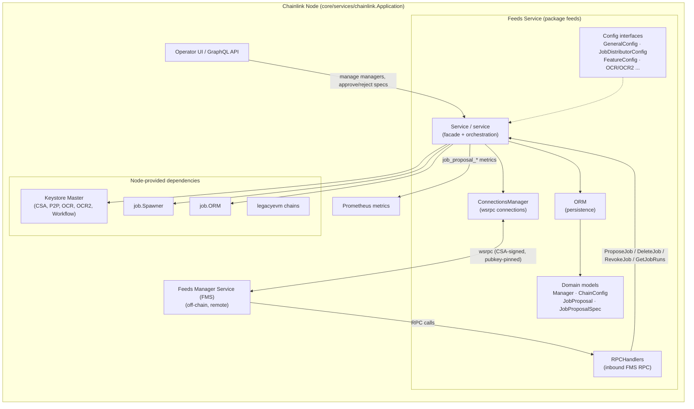
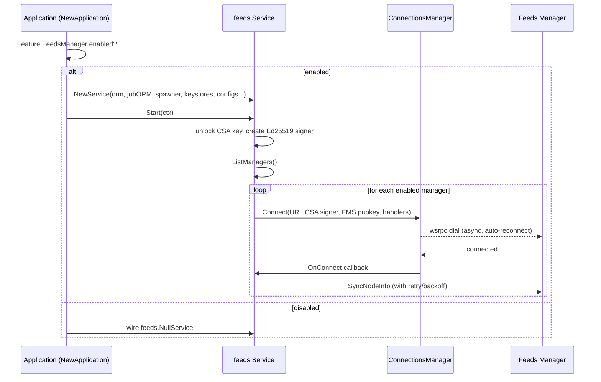
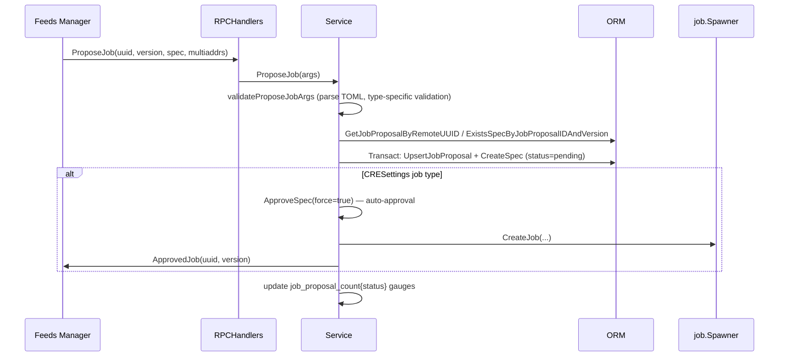
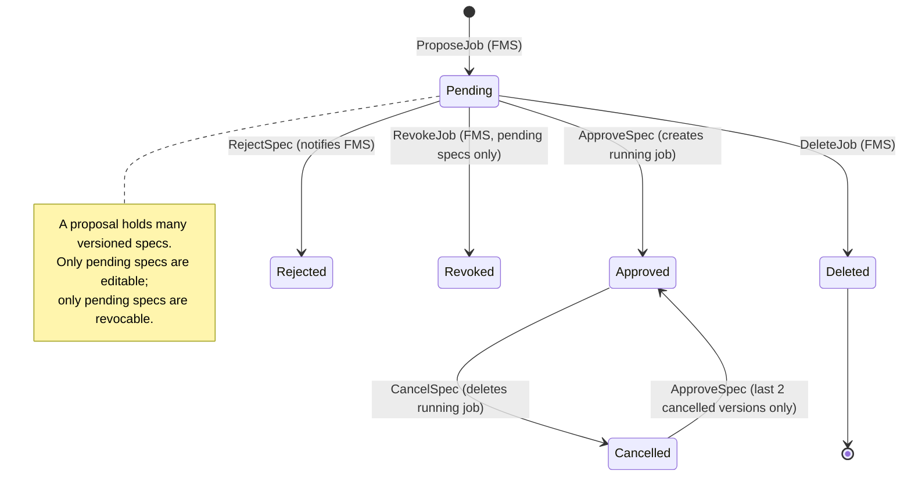

# Feeds Service (`core/services/feeds`)

## 1. Overview

The **feeds service** (`chainlink/core/services/feeds`) is the node-side counterpart of Chainlink's **Feeds Manager Service (FMS)** — the off-chain management plane used by data-feeds teams to operate OCR/OCR2 price feeds and CRE workflows at scale.

The service gives a Chainlink node the ability to:

- **Register and manage Feeds Managers** — the remote FMS instances this node is allowed to talk to (name, URI, authenticating public key, enable/disable state).
- **Maintain mutually-authenticated connections** to registered Feeds Managers over [`wsrpc`](https://github.com/smartcontractkit/wsrpc) (WebSocket-based RPC), signed with the node's **CSA key** and pinned to the FMS public key.
- **Receive job proposals** from FMS (OCR, OCR2, Bootstrap, CCIP, Gateway, Streams, Standard Capabilities, CRE Settings, ...), version them, and drive the **approval workflow** that materializes approved specs into running jobs via the [Job Service](job_service.md).
- **Report node information** back to FMS — node version, per-manager chain configurations, P2P key bundles, OCR1/OCR2 key bundles and the workflow public key.
- **Expose operational data** to FMS, such as recent pipeline run summaries for managed jobs, and report job-proposal metrics to Prometheus.

The service is **feature-gated**: it is only instantiated when `Feature.FeedsManager = true` is set in the node TOML config; otherwise a no-op `NullService` is wired in (all mutating calls return `ErrFeedsManagerDisabled`).

> **Where it fits:** the feeds service is one of the platform services hosted by the node application. See the [Node Application lifecycle](../Node_Application_Core___Interfaces/node_application/node_application_lifecycle.md) for how services are started/stopped, and the [Web API](../Node_Application_Core___Interfaces/web_api/web_api_graphql_api.md) for the GraphQL surface (resolvers and schema) that operators use to manage feeds managers and job proposals through the node's UI.

## 2. Architecture

### 2.1 Component overview

### 2.2 Layering

| Layer | Responsibility |
|---|---|
| **Orchestration** (`service.go`) | Implements the `Service` facade: manager registration, chain-config CRUD, job proposal lifecycle, spec approval/cancellation, node info sync, metrics. |
| **Connectivity** (`connection_manager.go`, `rpc_handlers.go`) | Owns the wsrpc dial/reconnect loop per manager and dispatches inbound FMS RPCs into the service. |
| **Persistence** (`orm.go`, `models.go`) | Transactional storage for managers, chain configs and versioned job proposals/specs; canonical domain types. |
| **Configuration** (`config.go`) | Narrow interfaces the service consumes from node configuration (`GeneralConfig`, `JobDistributorConfig`, `FeatureConfig`, `InsecureConfig`, `JobConfig`, `OCRConfig`, `OCR2Config`). |

### 2.3 Sub-modules

Detailed documentation per sub-module (generated under `feeds_service/`):

| Sub-module | Scope | Documentation |
|---|---|---|
| **Feeds Service Lifecycle** | The `Service` facade and its orchestration logic: manager registration, chain configs, the job proposal/spec state machine, approval & auto-approval, node info sync, start/stop. | [feeds_service_lifecycle](feeds_service/feeds_service_lifecycle.md) |
| **Feeds Service Connections** | `ConnectionsManager` (wsrpc dial, reconnect, health tracking) and `RPCHandlers` (inbound FMS RPC endpoints). | [feeds_service_connections](feeds_service/feeds_service_connections.md) |
| **Feeds Service Persistence** | `ORM` interface and the domain model: `FeedsManager`, `ChainConfig`, `JobProposal`, `JobProposalSpec`, status enums, metric helpers. | [feeds_service_persistence](feeds_service/feeds_service_persistence.md) |
| **Feeds Service Configuration** | The config interfaces the service consumes from node configuration and how they map to TOML sections. | [feeds_service_config](feeds_service/feeds_service_config.md) |

## 3. Wiring into the node

The service is constructed in `NewApplication` (`chainlink/core/services/chainlink/application.go`):

- If `cfg.Feature().FeedsManager()` is enabled, `feeds.NewORM` and `feeds.NewService` are created with:
  - `feedsORM`, `jobORM`, the shared `sqlutil.DataSource`, and the `jobSpawner`;
  - the node `keystore.Master` (the service pulls the CSA, P2P, OCR, OCR2 and Workflow keystores from it — see [Keystore](keystore.md));
  - config slices (`GeneralConfig`, `JobDistributorConfig`, `FeatureConfig`, `InsecureConfig`, `JobConfig`, `OCRConfig`, `OCR2Config`);
  - the `legacyevm.LegacyChainContainer` (used by spec validators — see [OCR](../Oracle_Engines___Data_Pipelines/ocr.md) and [Data Pipelines](../Oracle_Engines___Data_Pipelines/pipeline.md));
  - the node version tag and the `plugins.RegistrarConfig` used to register LOOP plugins for OCR2 jobs (see [Plugin Process Framework](../Plugin_Process_Framework_(Loop)/loop-plugin-core.md)).
- Otherwise a `feeds.NullService{}` is injected, so callers never need nil-checks.

Lifecycle behaviour:

- `Node.Start` starts the feeds service **first**, before the shared service list, because FMS connections are established asynchronously and must not block node startup.
- If `Start` fails, the application logs the error and swaps in a `NullService` so shutdown paths remain safe.
- On `Close`, all pending node-info sync retries are cancelled and all manager connections are drained.

## 4. Key data flows

### 4.1 Job proposal from FMS (inbound)

### 4.2 Spec approval (operator-initiated or auto)

`ApproveSpec` performs, inside a single SQL transaction: state validation (`isApprovable`), spec → `job.Job` generation via the type-specific validators (`ocr`, `ocr2`, `ocrbootstrap`, `ccip`, `ccv*`, `streams`, `gateway`, `standardcapabilities`, `cresettings`), bridge-existence checks, duplicate-job detection (by external job ID, contract address, capability name, or gateway ID depending on job type), optional forced replacement (`force=true` → cancel old spec + `DeleteJob`), `CreateJob`, spec approval, and the `ApprovedJob` notification to FMS.

### 4.3 Job proposal state machine

### 4.4 Node info sync (outbound)

After every connection, chain-config change (`CreateChainConfig`, `UpdateChainConfig`, `DeleteChainConfig`) the service calls `syncNodeInfoWithRetry`, which retries `SyncNodeInfo` with exponential backoff (min delay 10s, max delay 30m, ~56 attempts ≈ 24h) and reports: node version, `ChainConfig`s (including resolved OCR1/OCR2 key bundles and P2P peer IDs), all P2P key bundles, the workflow public key, and the `JobDistributor.DisplayName()` friendly name — via the FMS `UpdateNode` RPC. Per-manager retry contexts are tracked in `atomicCancelFns` so a newer sync supersedes a running one.

## 5. Observability

The service registers Prometheus metrics (see `service.go`):

| Metric | Type | Meaning |
|---|---|---|
| `job_proposal_requests` | counter | Job proposal requests received (legacy alias: `feeds_job_proposal_requests`) |
| `workflow_requests` | counter | Workflow spec proposals received (legacy alias: `feeds_workflow_requests`) |
| `workflow_approvals` | counter | Successful workflow auto-approvals (legacy alias: `feeds_workflow_approvals`) |
| `workflow_rejections` | counter | Failed workflow auto-approvals (legacy alias: `feeds_workflow_rejections`) |
| `job_proposal_count{status}` | gauge | Job proposals partitioned by status: pending, approved, rejected, cancelled, deleted, revoked (legacy alias: `feeds_job_proposal_count`) |

Connection status per manager is surfaced on the `Manager` model as `IsConnectionActive` (from `ConnectionsManager.IsConnected`).

## 6. Related modules

- [Job Service](job_service.md) — `job.ORM` and `job.Spawner` used to store and run approved job specs.
- [Keystore](keystore.md) — CSA (connection auth + signing), P2P, OCR, OCR2 and Workflow keys reported to FMS.
- [Database Persistence](database_persistence.md) — the `sqlutil.DataSource`/pg layer the feeds ORM is built on.
- [Node Status Reporter](node_status_reporter.md) — the JobSpec reporter consumes the same `feeds.ORM`.
- [Gateway](gateway.md) — validated as a job type via `gateway.ValidatedGatewaySpec`.
- [OCR](../Oracle_Engines___Data_Pipelines/ocr.md) / [Pipeline](../Oracle_Engines___Data_Pipelines/pipeline.md) / [Streams](../Oracle_Engines___Data_Pipelines/streams.md) — spec validation and execution engines behind approved proposals.
- [CCIP](../CCIP_Cross-Chain_Protocol/ccip.md) — CCIP job specs proposed through the feeds service are validated by the CCIP validator.
- [Web API (GraphQL)](../Node_Application_Core___Interfaces/web_api/web_api_graphql_api.md) — `createFeedsManager*` / `updateFeedsManager*` mutations and feeds-manager loaders exposed to the Operator UI.
- [Chainlink Node Web SDK](../Dev,_Test___Simulation_Environments/chainlink-node-web-sdk.md) — generated client with `CreateFeedsManager`, `CreateFeedsManagerChainConfig`, `CreateOCR2KeyBundle`, etc.
