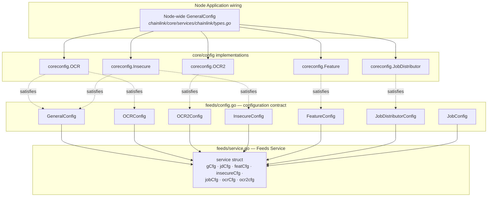
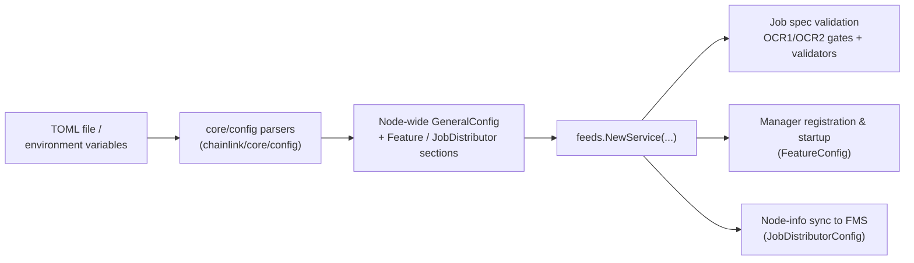
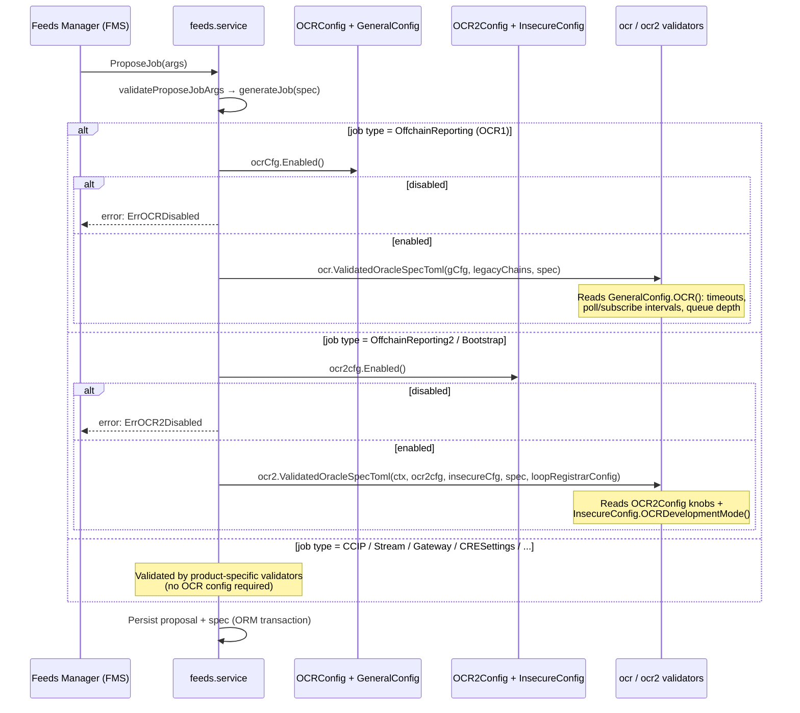
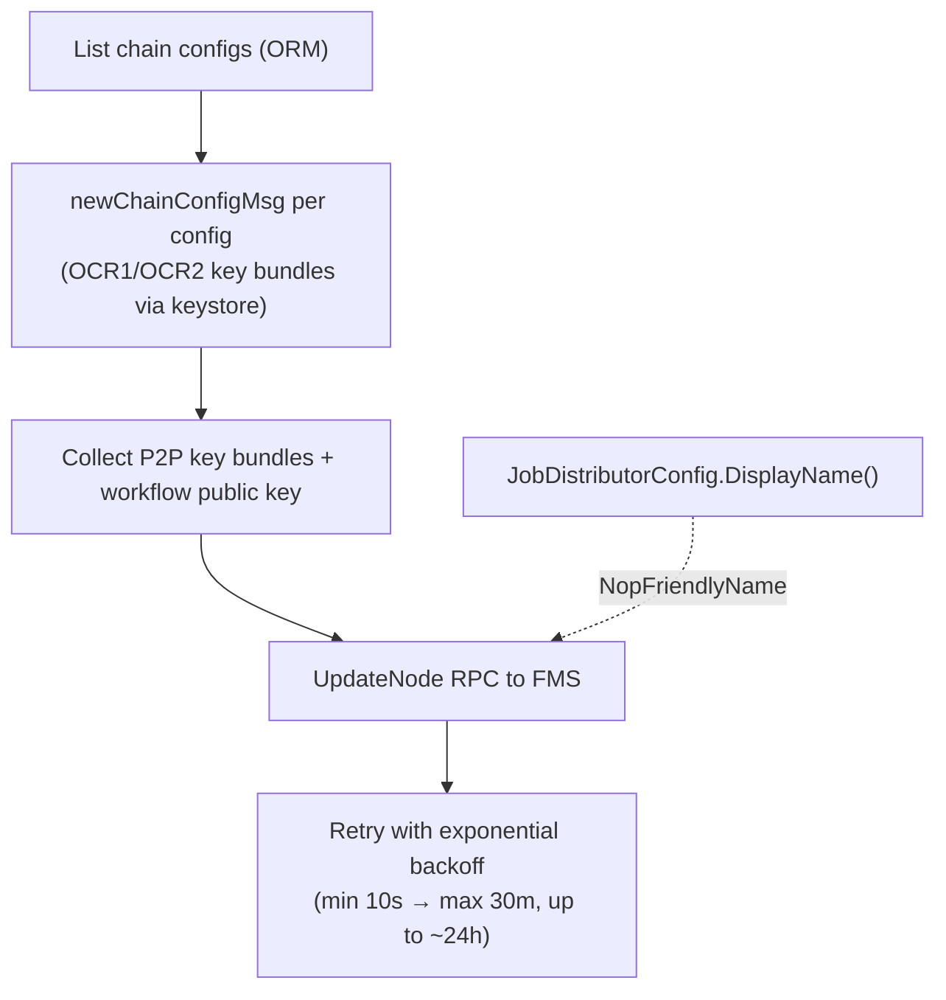
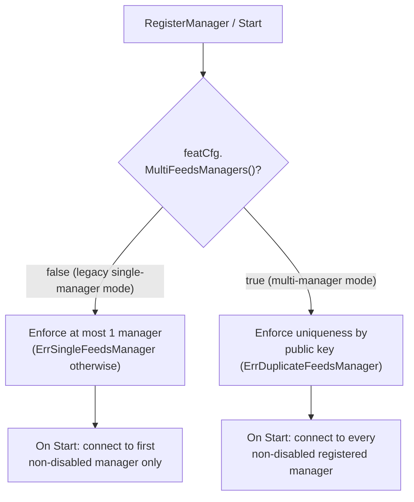

# Feeds Service — Configuration Contract (`feeds/config.go`)

## Introduction

`chainlink/core/services/feeds/config.go` defines the **configuration contract** of the Feeds Service: a set of small, consumer-side Go interfaces that describe every piece of node configuration the Feeds Service needs at runtime. Instead of depending on the node's large global `GeneralConfig` type, the `feeds` package declares only the narrow slices of configuration it actually consumes (`GeneralConfig`, `OCRConfig`, `OCR2Config`, `InsecureConfig`, `FeatureConfig`, `JobDistributorConfig`, `JobConfig`). At application startup, the node-wide configuration object (see [Node Application Config](../../Node_Application_Core___Interfaces/node_application/node_application_config.md)) is injected into `feeds.NewService(...)`, where Go's structural typing makes the concrete `core/config` implementations satisfy these interfaces automatically.

This is a classic **dependency inversion / interface segregation** pattern:

- The **feeds package** stays decoupled from the node's global config types, making the service easy to construct and test in isolation.
- The **application layer** decides which concrete configuration implementation is supplied.
- Each interface is a *subset* of a corresponding interface in [Core Config](../../Node_Application_Core___Interfaces/core_config.md), so the node's existing config objects satisfy them without adapters.

The Feeds Service itself, its gRPC connections to Feeds Manager Services (FMS), and its database persistence are documented in the sibling pages [Feeds Service Lifecycle](feeds_service_lifecycle.md), [Feeds Service Connections](feeds_service_connections.md), and [Feeds Service Persistence](feeds_service_persistence.md). This page focuses exclusively on the configuration layer.

---

## Core Components

All interfaces live in `chainlink/core/services/feeds/config.go`:

| Interface | Purpose | Satisfied (structurally) by |
|---|---|---|
| `GeneralConfig` | Root access to node-wide OCR and Insecure settings used for job spec validation | Node-wide `GeneralConfig` (`chainlink/core/services/chainlink/types.go`) |
| `FeatureConfig` | Feature flags governing multi-feeds-manager support | `coreconfig.Feature` (`chainlink/core/config/feature_config.go`) |
| `JobDistributorConfig` | Display name of this node reported to the Feeds Manager | `coreconfig.JobDistributor` (`chainlink/core/config/job-distributor.go`) |
| `JobConfig` | Job-execution defaults (default HTTP timeout) | Node job/pipeline config section |
| `InsecureConfig` | Development-mode flags affecting OCR2 validation | `coreconfig.Insecure` (`chainlink/core/config/insecure_config.go`) |
| `OCRConfig` | OCR1 (v1) enablement gate | `coreconfig.OCR` (`chainlink/core/config/ocr_config.go`) |
| `OCR2Config` | OCR2 (v2) runtime knobs used to validate OCR2 job specs | `coreconfig.OCR2` (`chainlink/core/config/ocr2_config.go`) |

### `GeneralConfig`

The service's window into node-wide settings. It is passed to the OCR1 spec validator (`ocr.ValidatedOracleSpecToml`), which reads the nested configuration it exposes:

| Method | Returns | Used for |
|---|---|---|
| `OCR()` | `coreconfig.OCR` | OCR1 job spec validation knobs — blockchain timeout, contract poll/subscribe intervals, observation timeout, `SimulateTransactions`, `TraceLogging`, `DefaultTransactionQueueDepth`, key bundle/transmitter address resolution, EA telemetry capture, config log validation |
| `Insecure()` | `coreconfig.Insecure` | Insecure/dev-mode flags: `DevWebServer`, `OCRDevelopmentMode`, `DisableRateLimiting`, `InfiniteDepthQueries` |

The concrete node `GeneralConfig` (see [Node Application Config](../../Node_Application_Core___Interfaces/node_application/node_application_config.md)) exposes these same accessors, so it satisfies this interface directly.

### `JobDistributorConfig`

A single-method interface:

| Method | Returns | Used for |
|---|---|---|
| `DisplayName()` | `string` | Sent as `NopFriendlyName` in the `UpdateNode` RPC when the service synchronizes node information with the Feeds Manager (FMS) |

The concrete source is `coreconfig.JobDistributor` in the node's TOML/env configuration.

### `FeatureConfig`

| Method | Returns | Used for |
|---|---|---|
| `MultiFeedsManagers()` | `bool` | Feature flag. When `true`, the service enforces *uniqueness by public key* instead of a single-manager cap in `RegisterManager`, and on `Start` connects to **all** enabled registered managers rather than only the first |

This is satisfied by `coreconfig.Feature`, which also carries unrelated flags (`FeedsManager`, `UICSAKeys`, `LogPoller`).

### `JobConfig`

| Method | Returns | Used for |
|---|---|---|
| `DefaultHTTPTimeout()` | `commonconfig.Duration` | Default timeout applied to HTTP-bound job/pipeline operations; uses the shared `chainlink-common` duration type (see [Config Validation](../../Shared_Foundation_Libraries___Domain_Types/config-validation.md)) |

### `InsecureConfig`

| Method | Returns | Used for |
|---|---|---|
| `OCRDevelopmentMode()` | `bool` | Forwarded to `ocr2.ValidatedOracleSpecToml(...)` to relax OCR2 spec validation in development mode |

A subset of `coreconfig.Insecure` — the full node `Insecure` config satisfies it.

### `OCRConfig`

| Method | Returns | Used for |
|---|---|---|
| `Enabled()` | `bool` | Gates approval of OCR1 (`OffchainReporting`) job proposals; if disabled, `generateJob` returns `ErrOCRDisabled` |

### `OCR2Config`

The richest interface in the file — a subset of `coreconfig.OCR2` — consumed both as an enablement gate and as the settings bundle passed to the OCR2 spec validator:

| Method | Returns | Meaning |
|---|---|---|
| `Enabled()` | `bool` | Master switch; gates OCR2 (`OffchainReporting2`, `Bootstrap`) job approval with `ErrOCR2Disabled` |
| `BlockchainTimeout()` | `time.Duration` | Max wait for blockchain interactions during spec validation |
| `ContractConfirmations()` | `uint16` | Confirmations required before contract state is trusted |
| `ContractPollInterval()` | `time.Duration` | Cadence for polling contract state |
| `ContractTransmitterTransmitTimeout()` | `time.Duration` | Max time allowed for a transmit operation |
| `DatabaseTimeout()` | `time.Duration` | Timeout for database operations performed by OCR2 components |
| `DefaultTransactionQueueDepth()` | `uint32` | Default transaction manager queue depth |
| `SimulateTransactions()` | `bool` | Whether transactions are simulated before broadcast |
| `TraceLogging()` | `bool` | Enables verbose trace-level logging |
| `SampleTelemetry()` | `bool` | Enables sampled telemetry emission |

---

## Architecture

The diagram below shows how configuration implementations in the application layer satisfy the feeds contract, and how the injected interfaces feed specific behaviors of the `service` struct in `service.go`.

Key points:

- All seven interfaces are injected once through the `NewService` constructor — the service never fetches configuration at runtime, so config changes require a node restart.
- The core config types are strict supersets of the feeds interfaces (e.g., `coreconfig.OCR2` additionally defines `ContractSubscribeInterval`, `KeyBundleID`, `AllowNoBootstrappers`, etc.), which is why no adapter code is needed.
- When the Feeds Service is disabled at the application level, a `NullService` is installed instead (see [Feeds Service Lifecycle](feeds_service_lifecycle.md)) and the configuration contract is not consulted — every mutating call returns `ErrFeedsManagerDisabled`.

---

## Configuration Flow (Data Flow)

Configuration originates from the node's TOML file and environment variables, is parsed by the core config layer, and is finally injected into the Feeds Service where it steers three behavior families: **job spec validation**, **manager registration**, and **node-info synchronization**.

### How each interface maps to service behavior

| Service behavior (service.go) | Interfaces consumed |
|---|---|
| `generateJob` / `validateProposeJobArgs` (job proposal validation) | `OCRConfig`, `GeneralConfig`, `OCR2Config`, `InsecureConfig` |
| `RegisterManager`, `Start` | `FeatureConfig` (`MultiFeedsManagers`) |
| `SyncNodeInfo` | `JobDistributorConfig` (`DisplayName` → `NopFriendlyName`) |
| Constructor injection of execution defaults | `JobConfig` |

---

## Process Flows

### 1. Job proposal validation (config-driven gating)

Every job proposal received from a Feeds Manager passes through `validateProposeJobArgs` → `generateJob`, where the OCR1/OCR2 configuration determines whether the job type is permitted and which validation rules apply.

Only job types gated by these validators depend on the feeds configuration contract; modern job types (CCIP, Stream, Gateway, CRE Settings, Standard Capabilities) validate without consulting it.

### 2. Node-info synchronization (JobDistributorConfig)

When the service connects to a manager (or chain configs change), `SyncNodeInfo` reports the node's identity to FMS. The configured `DisplayName` travels as `NopFriendlyName`.

Key material attached to the sync messages is resolved through the node keystore at runtime — see [Keystore — Node Keyring](../keystore/keystore_node_keyring.md); the configuration contract itself carries no secrets.

### 3. Feature-flagged manager registration (FeatureConfig)

---

## Interaction with Other Modules

| Module | Relationship |
|---|---|
| [Node Application Config](../../Node_Application_Core___Interfaces/node_application/node_application_config.md) | Supplies the concrete configuration objects that satisfy this module's interfaces |
| [Core Config](../../Node_Application_Core___Interfaces/core_config.md) | Home of the full `OCR`, `OCR2`, `Insecure`, `Feature`, and `JobDistributor` config interfaces; the feeds interfaces are deliberate subsets |
| [Feeds Service Lifecycle](feeds_service_lifecycle.md) | The `Service` implementation that stores and consumes these interfaces; defines `NullService` and the service error contract |
| [Feeds Service Connections](feeds_service_connections.md) | Outbound gRPC to FMS where `DisplayName` is reported during node-info sync |
| [Feeds Service Persistence](feeds_service_persistence.md) | Persistence of managers/proposals — DB connection parameters live in the node's `Database` config, not in this module |
| [Job Service](../job_service.md) | Parsed/validated job specs are created through the `job.Spawner`; spec TOML validation is driven by the config knobs defined here |
| [Keystore](../keystore.md) | OCR2 key bundles referenced during node-info sync are fetched at runtime (not part of the config contract) |
| [Config Validation](../../Shared_Foundation_Libraries___Domain_Types/config-validation.md) | Shared `commonconfig.Duration` type and config validation helpers used by `JobConfig` |

---

## Testing Notes

- **Mocks**: `chainlink/core/services/feeds/mocks/` contains generated mocks for `Service`, `ORM`, `ConnectionsManager`, and `FeedsManagerClient`, so the service can be tested with hand-crafted config interfaces rather than real node config.
- **Test-only seam**: `Unsafe_SetConnectionsManager(ConnectionsManager)` allows integration tests to replace the connection manager.
- **OCR2 config message tests** (`service_ocr2_config_test.go`): verify that `newOCR2ConfigMsg` includes the raw onchain signing public key only for EVM key bundles, omits it for non-EVM chains, and short-circuits (no keystore access) when `OCR2ConfigModel.Enabled` is `false` — using OCR2 keystore mocks.
- **Sync behavior options**: `WithSyncMinDelay`, `WithSyncMaxDelay`, and `WithSyncMaxAttempts` `ServiceOption`s override the default backoff constants in tests.

---

## Related Documentation

- Parent module: [Feeds Service](../feeds_service.md)
- Siblings: [Feeds Service Lifecycle](feeds_service_lifecycle.md) · [Feeds Service Connections](feeds_service_connections.md) · [Feeds Service Persistence](feeds_service_persistence.md)
- Configuration sources: [Node Application Config](../../Node_Application_Core___Interfaces/node_application/node_application_config.md) · [Core Config](../../Node_Application_Core___Interfaces/core_config.md)
- Application wiring: [Node Application Lifecycle](../../Node_Application_Core___Interfaces/node_application/node_application_lifecycle.md)
