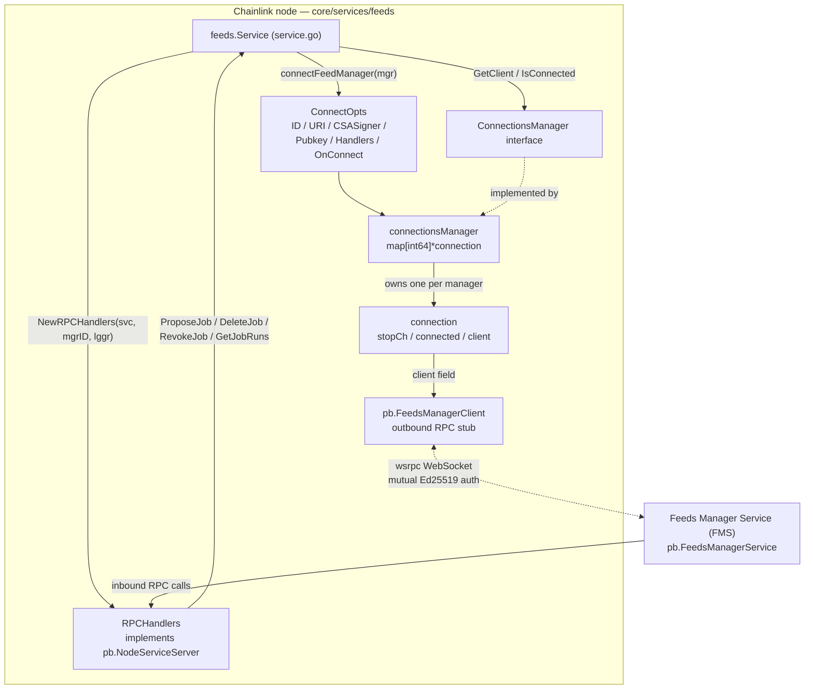
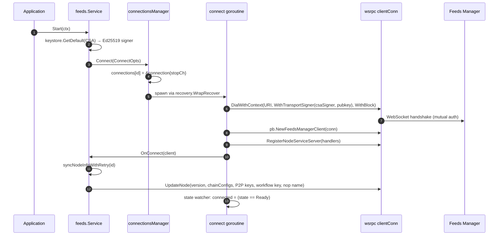
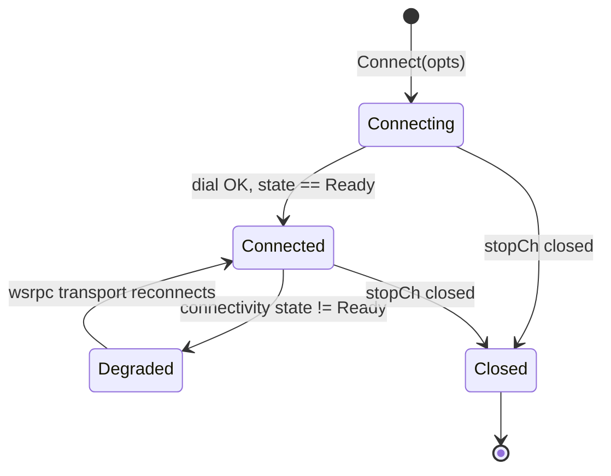
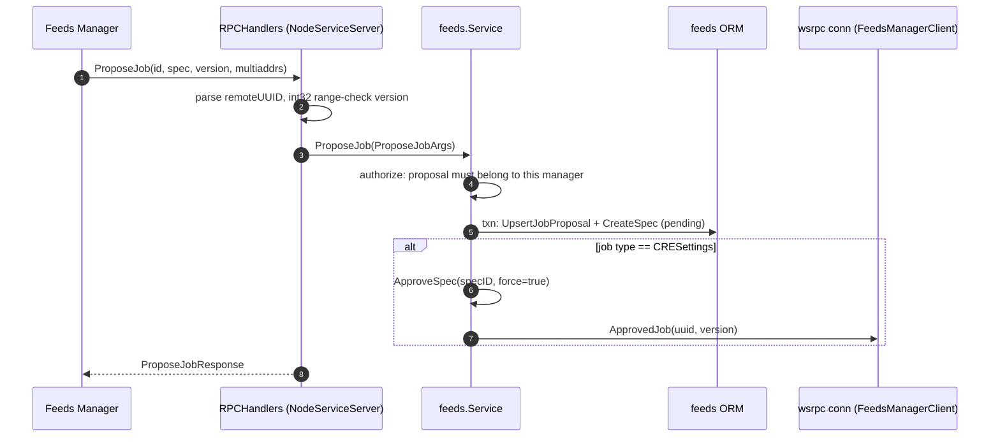

# Feeds Service — Connections (FMS Transport Layer)

> **Module path:** `chainlink/core/services/feeds` — files `connection_manager.go`, `rpc_handlers.go`
> **Parent module:** [Feeds Service](../feeds_service.md)

## 1. Overview

The `feeds_service_connections` module is the **transport layer** of the Feeds Service. It is responsible for two complementary concerns:

1. **Outbound connection management** (`connection_manager.go`) — establishing, monitoring, and tearing down long-lived **wsrpc** (WebSocket-based gRPC) connections from the Chainlink node to registered **Feeds Manager Service (FMS)** instances, and exposing the `pb.FeedsManagerClient` RPC stub used by the node to call FMS methods (e.g. `UpdateNode`, `ApprovedJob`).
2. **Inbound RPC handling** (`rpc_handlers.go`) — implementing the `pb.NodeServiceServer` interface so a connected FMS can call into the node (`ProposeJob`, `DeleteJob`, `RevokeJob`, `GetJobRuns`). Every inbound request is dispatched to the parent [Feeds Service lifecycle](feeds_service_lifecycle.md), which persists data via the [Feeds Service persistence](feeds_service_persistence.md) layer.

A key design property: **connection establishment never blocks service startup**. `Connect` dials asynchronously in a goroutine; if the FMS is unreachable, wsrpc keeps retrying at the transport level and the connection comes up "without any interaction on behalf of the node operator."

## 2. Position in the System

The Feeds Service (`feeds.Service`) lets node operators register their node with a Chainlink LaunchDarkly-owned *Feeds Manager* (the CLO-run management plane for OCR/OCR2 job proposals). This module sits between that `Service` and the remote FMS:

- On **startup** (or manager registration/enable), the parent service collects connection options (manager URI, pinned public key, node CSA signer) and hands them to this module.
- On **connect**, the node pushes its identity/version/chain configs to FMS via `UpdateNode` (see [Feeds Service config](feeds_service_config.md) for the `JobDistributorConfig.DisplayName()` nop-friendly-name and key material from the [Keystore](../keystore.md)).
- While connected, FMS drives the node: it proposes/updates/deletes job proposals, which the [Job Service](../job_service.md) eventually runs.

## 3. Architecture



**Data ownership summary:**

| Element | File | Responsibility |
|---|---|---|
| `ConnectionsManager` (interface) | `connection_manager.go` | Contract used by `feeds.Service` to manage FMS connections |
| `connectionsManager` / `connection` | `connection_manager.go` | Concrete connection registry, dial/reconnect loops, readiness tracking |
| `ConnectOpts` | `connection_manager.go` | Everything needed to dial one FMS: id, URI, CSA signer, pinned pubkey, inbound handlers, on-connect hook |
| `RPCHandlers` / `NewRPCHandlers` | `rpc_handlers.go` | Inbound `pb.NodeServiceServer` implementation, one instance per manager, bound to that manager's ID |

The `Service`, `ORM`/models and configuration types live in the sibling modules [feeds_service_lifecycle](feeds_service_lifecycle.md), [feeds_service_persistence](feeds_service_persistence.md) and [feeds_service_config](feeds_service_config.md).

## 4. Component Reference

### 4.1 `ConnectionsManager` (interface)

```go
type ConnectionsManager interface {
    Connect(opts ConnectOpts)
    Disconnect(id int64) error
    Close()
    GetClient(id int64) (pb.FeedsManagerClient, error)
    IsConnected(id int64) bool
}
```

| Method | Semantics |
|---|---|
| `Connect(opts)` | Registers a new connection entry and dials asynchronously. Never blocks the caller. Re-invoking with the same `FeedsManagerID` replaces the map entry. |
| `Disconnect(id)` | Closes a single connection by closing its stop channel and removing it from the registry. Returns an error if the manager is not connected. |
| `Close()` | Closes **all** connections and blocks (via `sync.WaitGroup`) until every dial goroutine has finished. |
| `GetClient(id)` | Returns the typed `pb.FeedsManagerClient` stub, or an error (`"feeds manager is not connected"`) if the manager is unknown or its connection is not ready. |
| `IsConnected(id)` | Cheap readiness probe used by the parent service to populate `Manager.IsConnectionActive` for API/GUI presentation. |

### 4.2 `connectionsManager` and `connection` (implementation)

- Registry: `connections map[int64]*connection` guarded by a `sync.Mutex`; all reads/writes lock the mutex.
- Per-connection state: `stopCh services.StopChan` (lifecycle channel), `connected bool` (readiness flag), `client pb.FeedsManagerClient` (stub, set only after a successful dial).
- A `sync.WaitGroup` (`wgClosed`) tracks dial goroutines so `Close()` can drain them deterministically.
- Goroutines spawned inside `Connect` are wrapped with `recovery.WrapRecover`, so a panic during dial/handshake cannot take down the node.

### 4.3 `ConnectOpts`

| Field | Purpose |
|---|---|
| `FeedsManagerID int64` | Registry key; ties the connection (and every inbound RPC) to a specific `FeedsManager` row. |
| `URI string` | wsrpc endpoint of the FMS. |
| `CSASigner crypto.Signer` | Node's **CSA Ed25519 signer** (obtained from the [Keystore](../keystore.md) during `Service.Start`). Used as the node's transport identity. |
| `Pubkey []byte` | FMS's public key, **pinned** for the connection (mutual authentication). |
| `Handlers pb.NodeServiceServer` | Inbound handler set — always an `RPCHandlers` instance built by `NewRPCHandlers`. |
| `OnConnect func(pb.FeedsManagerClient)` | Post-connect hook. The parent service uses it to kick off `SyncNodeInfo` with retry/backoff. |

### 4.4 `RPCHandlers` (`NewRPCHandlers`)

`NewRPCHandlers(svc Service, feedsManagerID int64, lggr logger.Logger)` builds a handler instance **bound to one manager ID**. Because each connection registers its own handler instance (`pb.RegisterNodeServiceServer(clientConn, opts.Handlers)`), every inbound call is automatically scoped to the manager that owns the connection — the parent `Service` then uses that ID for authorization (e.g. rejecting requests that touch job proposals belonging to *another* feeds manager).

| RPC | Guard / validation | Delegates to `Service` |
|---|---|---|
| `ProposeJob` | Parses `req.Id` as a UUID; rejects versions outside `int32` range (the DB stores `int32`) | `ProposeJob` — upserts `JobProposal` + pending `JobProposalSpec` in a transaction; auto-approves CRE settings specs |
| `DeleteJob` | Parses UUID | `DeleteJob` — deletes the job proposal if owned by this manager |
| `RevokeJob` | Parses UUID | `RevokeJob` — revokes a *pending* spec if owned by this manager |
| `GetJobRuns` | Parses UUID; clamps `limit`: `0` or `> MaxJobRunsLimit (100)` → `DefaultJobRunsLimit (50)`, with a warning log | `GetJobRuns` — returns recent `pb.JobRunSummary` pipeline runs for the job |

Constants: `MaxJobRunsLimit = 100`, `DefaultJobRunsLimit = 50`.

## 5. Connection Lifecycle

### 5.1 Establishment (outbound dial)



Key behaviors:

- **Non-blocking startup.** `DialWithContext` + `WithBlock` blocks *inside the goroutine*, not the caller. The node keeps booting while wsrpc works on the handshake; when FMS comes back up, the transport establishes itself with no operator action.
- **Error differentiation.** Dial failures are logged as a warning unless the context was cancelled (`ctx.Err() != nil`), in which case it is logged as an intentional shutdown.
- **Readiness tracking.** A dedicated watcher goroutine polls `GetState()` / `WaitForStateChange` and atomically updates `connection.connected = (state == connectivity.Ready)`. It exits when the state reaches `connectivity.Shutdown`. This is what makes `IsConnected`/`GetClient` accurate across network flaps.
- **Post-connect sync.** The `OnConnect` hook triggers `syncNodeInfoWithRetry`, which pushes node identity/chain configs to FMS with exponential backoff (10 s → 30 min, up to ~24 h of attempts).

### 5.2 Teardown

```mermaid
sequenceDiagram
    autonumber
    participant SVC as feeds.Service
    participant CM as connectionsManager
    participant CN as connection
    participant GR as connect goroutine

    SVC->>CM: Disconnect(id) / Close()
    CM->>CN: close(stopCh) [Disconnect also deletes map entry]
    CN-->>GR: ctx cancelled (stopCh.NewCtx)
    GR->>GR: clientConn.Close(); wgClosed.Done()
    CM->>CM: Close(): wgClosed.Wait() until all goroutines exit
```

`Disconnect` is used when a manager is disabled (`Service.DisableManager`); `Close` is called by `Service.Close` during node shutdown and blocks until every connection goroutine has drained.

### 5.3 Connection state machine



The `connected` flag (and therefore `IsConnected`/`GetClient`) follows the *grpc-style connectivity state* observed by the watcher goroutine; a flapping network toggles the flag without ever re-dialing from application code.

## 6. Inbound RPC Processing (FMS → Node)



The same pattern applies to `DeleteJob`, `RevokeJob`, and `GetJobRuns` (with `GetJobRuns` reading pipeline run history through the job ORM — see [Job Service](../job_service.md)).

**Outbound calls from the parent service** use the same connection registry via `GetClient(id)`, always inside the transactional workflow of the parent service (e.g. `ApproveSpec` → `fmsClient.ApprovedJob`, `CancelSpec` → `fmsClient.CancelledJob`, `RejectSpec` → `fmsClient.RejectedJob`, `SyncNodeInfo` → `fmsClient.UpdateNode`). Full workflows are documented in [Feeds Service lifecycle](feeds_service_lifecycle.md).

## 7. Integration with the Parent Service

| Parent event | Connection action |
|---|---|
| `Service.Start` | Loads the default CSA key, builds the Ed25519 signer, lists managers, then `connectFeedManager` for every enabled manager (all managers when the multi-managers feature flag is on, else only the first). |
| `RegisterManager` | Persists the manager (+chain configs) then immediately connects it. |
| `UpdateManager` / `EnableManager` | Restarts the connection (tear down + reconnect with possibly updated URI/public key). |
| `DisableManager` | `Disconnect(id)`; the entry is removed from the registry. |
| `GetManager` / `ListManagers*` | Decorates each `Manager` with `IsConnectionActive = connMgr.IsConnected(id)` for API/GUI consumption. |
| Chain config create/update/delete | Triggers `syncNodeInfoWithRetry` so FMS learns the new chain configuration. |
| `Service.Close` | `connMgr.Close()` (blocking drain) and CSA signer shutdown. |

**Testing hook.** `Service.Unsafe_SetConnectionsManager(ConnectionsManager)` exists solely so integration tests can inject a mock connection manager; production code always uses `newConnectionsManager` created in `NewService`.

## 8. Concurrency, Security & Error Handling Notes

- **Concurrency:** one mutex protects the connection map; every public method locks it briefly. Dial work, state watching, and sync retries all run in detached goroutines; panics are contained by `recovery.WrapRecover`. `Close` is the only blocking drain point (`wgClosed.Wait`).
- **Security:** mutual authentication on the WebSocket — the node presents its CSA Ed25519 signature (`CSASigner`) and validates the FMS against its pinned public key (`Pubkey`) via `wsrpc.WithTransportSigner`. Key material comes from the [Keystore](../keystore.md); manager registration public keys are stored by the [persistence layer](feeds_service_persistence.md).
- **Failure modes:** dial failures are logged and retried by wsrpc at the transport level; RPC calls made through `GetClient` fail fast with `"feeds manager is not connected"` when readiness is false; `GetJobRuns` guards against unbounded queries via the limit clamp; `ProposeJob` guards against `int64→int32` overflow on the version field.
- **Protocol surface:** protobufs come from `github.com/smartcontractkit/chainlink-protos/orchestrator/feedsmanager` (`FeedsManagerClient`, `NodeServiceServer`, job-proposal request/response messages).

## 9. Related Documentation

- [Feeds Service](../feeds_service.md) — parent module overview
- [Feeds Service lifecycle](feeds_service_lifecycle.md) — `feeds.Service` start/close, job proposal approval workflows, metrics
- [Feeds Service persistence](feeds_service_persistence.md) — `ORM`, `FeedsManager`, `JobProposal`, `JobProposalSpec` models
- [Feeds Service config](feeds_service_config.md) — `GeneralConfig`, `JobDistributorConfig`
- [Keystore](../keystore.md) — CSA/P2P/OCR key material used for signing and node-info sync
- [Job Service](../job_service.md) — job spawner and pipeline runs surfaced through `GetJobRuns`
