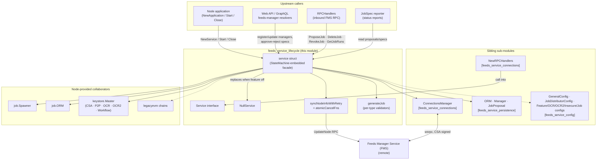
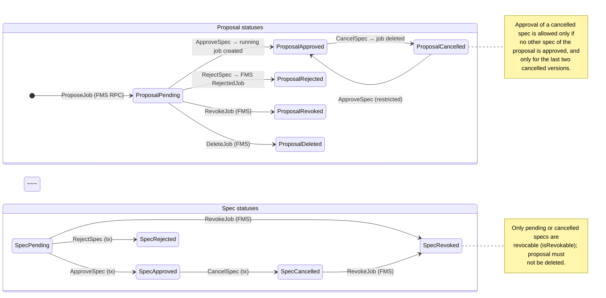
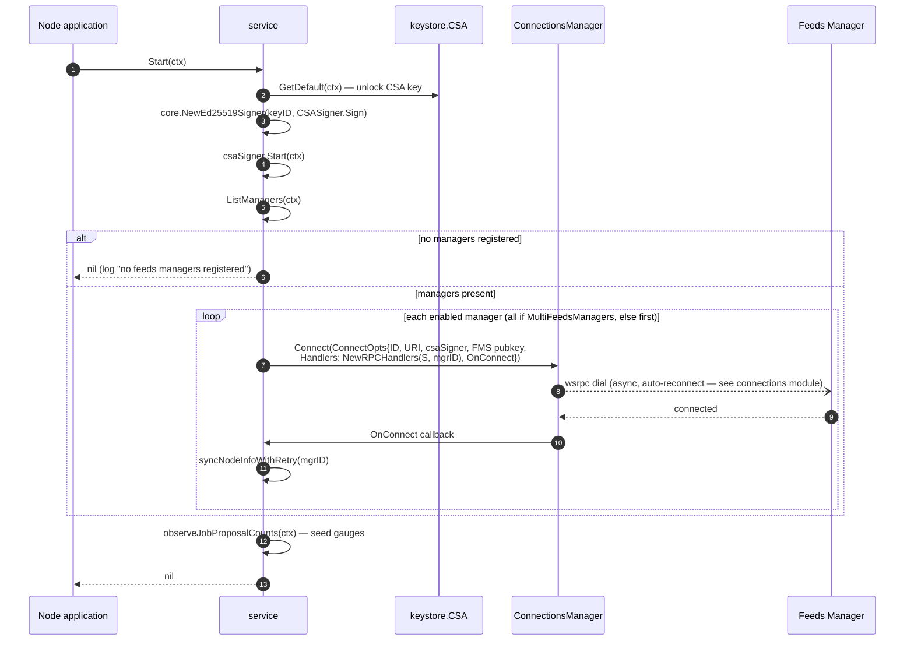
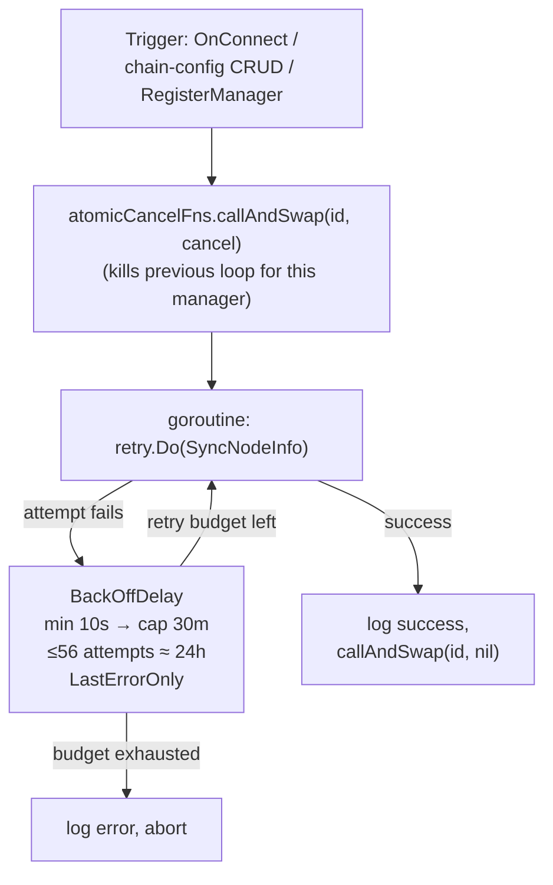
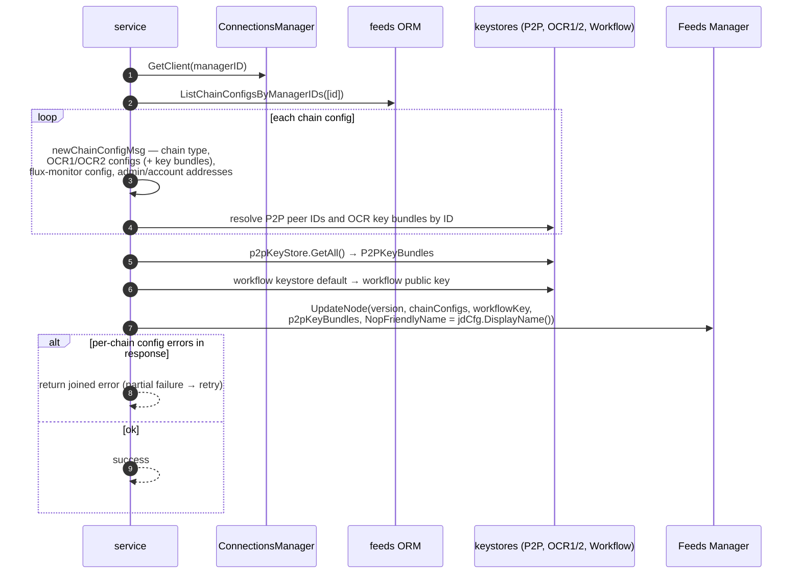
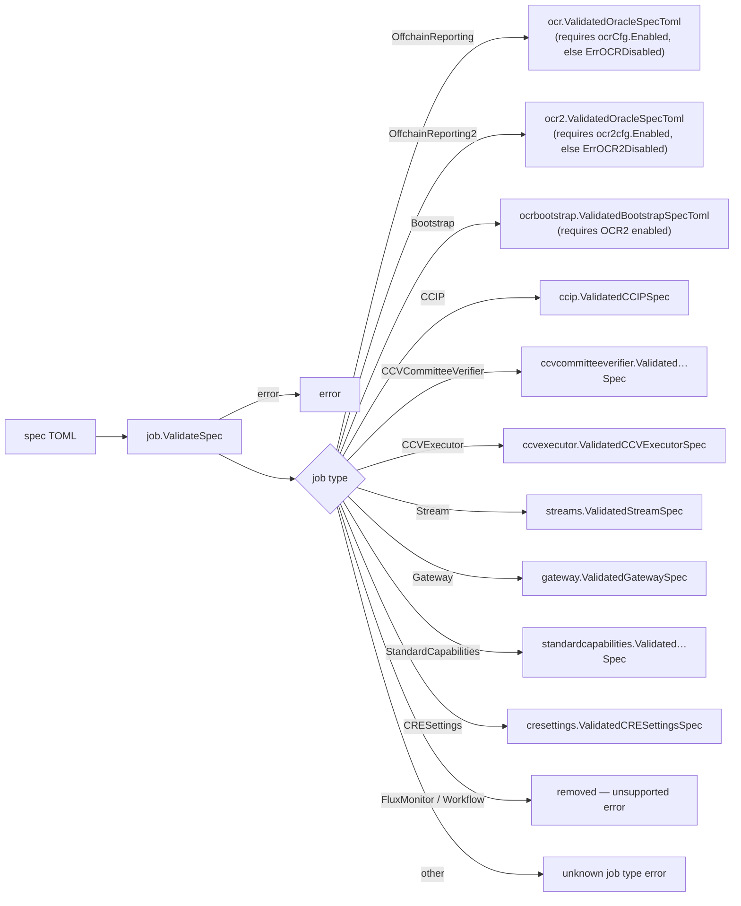

# Feeds Service Lifecycle (`service.go`)

> **Module page:** `Node_Platform_Services/feeds_service/feeds_service_lifecycle.md` · **Parent:** [Node_Platform_Services](../../Node_Platform_Services.md) › [feeds_service](../feeds_service.md)

## 1. Purpose and Scope

The **feeds service lifecycle** module implements the orchestration core of the node-side [feeds service](../feeds_service.md): the `Service` facade that the node application wires in, the web API calls, and the inbound Feeds Manager Service (FMS) RPC handlers invoke. It answers the questions *"how does a node register with an FMS, how do proposed jobs become running jobs, and how is the node's state reported back to the FMS?"*

Connectivity (the wsrpc connection pool), persistence (the ORM and domain model), and configuration are owned by sibling modules; this page documents the facade and its lifecycle behaviour:

| Concern | Components (`chainlink/core/services/feeds/service.go`) |
|---|---|
| Public contract | `Service` interface (managers, chain configs, job proposals, specs, node-info sync, start/close) |
| Implementation | `service` struct — embeds `services.StateMachine`, composes ORM, keystores, spawner, connections manager and config slices |
| Construction | `NewService` + functional `ServiceOption`s (`WithSyncMinDelay`, `WithSyncMaxDelay`, `WithSyncMaxAttempts`) |
| Disabled mode | `NullService` — no-op implementation wired when the Feeds Manager feature is off |
| Node-info sync | `SyncNodeInfo`, `syncNodeInfoWithRetry` (exponential backoff), `atomicCancelFns` (per-manager cancellation) |
| Spec → job pipeline | `generateJob` (per-type validators), `ApproveSpec` / `CancelSpec` / `RejectSpec` (transactional), auto-approval for `CRESettings` |
| Helpers | `extractName`, `ConvertPipelineRunErrors`, `findExistingJobForOCRFlux`, `findExistingJobForOCR2`, `parseChainIDFromJSONConfig` |
| Observability | Prometheus counters/gauges updated at every proposal mutation (`observeJobProposalCounts`) |

Everything below is specific to `service.go`; the transport and storage layers it drives are documented in [feeds_service_connections](feeds_service_connections.md) and [feeds_service_persistence](feeds_service_persistence.md).

## 2. Position in the System



* **Upstream** — the node application constructs the service at boot ([node_application_lifecycle](../../Node_Application_Core___Interfaces/node_application/node_application_lifecycle.md)); the [GraphQL API](../../Node_Application_Core___Interfaces/web_api/web_api_graphql_api.md) exposes manager/spec mutations to operators; inbound FMS RPCs arrive via [`RPCHandlers`](feeds_service_connections.md), which hold a reference back to the `Service` (created by `NewRPCHandlers`).
* **Siblings** — [`ConnectionsManager`](feeds_service_connections.md) owns wsrpc dial/reconnect; [`ORM`](feeds_service_persistence.md) persists managers, chain configs and versioned proposals/specs; [config interfaces](feeds_service_config.md) carry node TOML settings into the facade.
* **Downstream** — approved specs are materialized into running services by the [job service spawner](../job_service/job_service_lifecycle.md); signing keys come from the [keystore](../keystore.md) (node keyring: [keystore_node_keyring](../keystore/keystore_node_keyring.md)); per-type spec validation delegates to [OCR](../../Oracle_Engines___Data_Pipelines/ocr.md), [pipeline/streams](../../Oracle_Engines___Data_Pipelines/pipeline.md), [CCIP](../../CCIP_Cross-Chain_Protocol/ccip.md), [gateway](../gateway.md) and CRE settings validators.
* **Foundation** — start/stop idempotency uses `services.StateMachine` (`StartOnce`/`StopOnce`) from the shared [services library](../../Shared_Foundation_Libraries___Domain_Types/services.md); transactions use [`sqlutil`](../../Shared_Foundation_Libraries___Domain_Types/sqlutil.md) over the [pg layer](../database_persistence/database_persistence_pg_layer.md); logging uses the shared [logger](../../Shared_Foundation_Libraries___Domain_Types/logger.md); retry backoff uses `github.com/avast/retry-go/v4` (declared in [`chainlink/go.mod`](../../../chainlink/go.mod), module `github.com/smartcontractkit/chainlink/v2`).

## 3. Core Components

### 3.1 `Service` — the public facade

The interface is the single entry point for every feeds-manager interaction. Methods group into five clusters:

| Cluster | Methods | Notes |
|---|---|---|
| **Lifecycle** | `Start(ctx)`, `Close()` | Idempotent via the embedded `services.StateMachine`. |
| **Manager management** | `RegisterManager`, `UpdateManager`, `EnableManager`, `DisableManager`, `GetManager`, `ListManagers`, `ListManagersByIDs` | Register/enable/update establish or restart connections; results carry `IsConnectionActive` from the connections manager. |
| **Chain configs** | `CreateChainConfig`, `UpdateChainConfig`, `DeleteChainConfig`, `GetChainConfig`, `ListChainConfigsByManagerIDs` | Every mutation triggers a node-info sync to the owning FMS. |
| **Job proposals / specs** | `ProposeJob`, `ApproveSpec`, `RejectSpec`, `CancelSpec`, `RevokeJob`, `DeleteJob`, `UpdateSpecDefinition`, `GetJobProposal`, `GetSpec`, `ListJobProposalsByManagersIDs`, `ListSpecsByJobProposalIDs`, `CountJobProposalsByStatus`, `IsJobManaged` | The proposal/spec state machine ([§4.2](#42-job-proposal--spec-state-machine)); approvals create/delete real jobs through the spawner. |
| **Node reporting** | `SyncNodeInfo`, `GetJobRuns` | Outbound node info and per-job pipeline run summaries for the FMS. |

`Unsafe_SetConnectionsManager(ConnectionsManager)` is a test-only escape hatch for injecting a mock connections manager.

### 3.2 `service` — implementation state

```go
type service struct {
    services.StateMachine        // StartOnce / StopOnce
    orm          ORM             // feeds persistence (sibling module)
    jobORM       job.ORM         // job rows, pipeline runs, bridge checks
    ds           sqlutil.DataSource
    csaKeyStore  keystore.CSA    // connection auth + request signing
    csaSigner    *core.Ed25519Signer
    p2pKeyStore  keystore.P2P
    ocr1KeyStore keystore.OCR
    ocr2KeyStore keystore.OCR2
    workflowKeyStore keystore.Workflow
    jobSpawner   job.Spawner     // creates/stops running jobs
    gCfg          GeneralConfig   // forwarded to the OCR spec validator
    jdCfg         JobDistributorConfig // FMS display name (UpdateNode)
    featCfg       FeatureConfig   // MultiFeedsManagers flag
    insecureCfg   InsecureConfig  // forwarded to the OCR2 validator
    jobCfg        JobConfig
    ocrCfg        OCRConfig       // engine enablement gates
    ocr2cfg       OCR2Config
    connMgr      ConnectionsManager
    legacyChains legacyevm.LegacyChainContainer
    lggr         logger.SugaredLogger   // named "Feeds"
    version      string
    loopRegistrarConfig plugins.RegistrarConfig  // LOOP plugin registration for OCR2 jobs
    syncNodeInfoCancel atomicCancelFns
    syncMinDelay, syncMaxDelay time.Duration   // defaults: 10s, 30m
    syncMaxAttempts uint                        // default: 56 (~24h of backoff)
}
```

Key structural points:

* **Two ORMs, one transaction.** `transact(ctx, fn)` builds a `datasources{ds, orm, jobORM}` bundle via `sqlutil.Transact`, re-scoping *both* the feeds `ORM` (`WithDataSource`) and the `job.ORM` to the same transactional `DataSource`. All spec mutations that touch jobs (approve/cancel) are therefore atomic across the two persistence domains.
* **Keystores are extracted once** from the `keystore.Master` at construction; the CSA key itself is only unlocked during `Start` ([§5.1](#51-node-boot--start)).
* **`atomicCancelFns`** is a mutex-guarded `map[int64]context.CancelFunc` keyed by feeds-manager ID. `callAndSwap(id, cancel)` cancels the previous sync goroutine for a manager before installing a new one; `callAllAndClear` cancels everything on shutdown. This guarantees only one in-flight sync-retry loop per manager.

### 3.3 Construction — `NewService` and `ServiceOption`s

`NewService(orm, jobORM, ds, jobSpawner, keyStore, gCfg, jdCfg, fCfg, insecureCfg, jobCfg, ocrCfg, ocr2Cfg, legacyChains, lggr, version, rc, opts...)` wires all collaborators and creates the default `ConnectionsManager` (`newConnectionsManager`). Variadic `ServiceOption`s override the sync backoff knobs:

| Option | Default | Meaning |
|---|---|---|
| `WithSyncMinDelay(d)` | `10s` | Initial retry delay for node-info sync. |
| `WithSyncMaxDelay(d)` | `30m` | Cap on the exponential backoff delay. |
| `WithSyncMaxAttempts(n)` | `56` | `48` attempts at the 30 m cap (~24 h) plus 8 shorter initial retries. |

### 3.4 `NullService` — the disabled mode

When the Feeds Manager feature is disabled, the application injects `NullService{}` instead of a nil pointer. All mutating/reading methods return `ErrFeedsManagerDisabled`, except: `ListManagers` and `ListJobProposals` return empty slices, `IsJobManaged` returns `false, nil`, `SyncNodeInfo`/`Start`/`Close` are no-ops. Callers (web resolvers, RPC handlers) thus never need feature checks or nil-guards.

### 3.5 Error catalogue

| Sentinel error | Raised when |
|---|---|
| `ErrOCRDisabled` / `ErrOCR2Disabled` | A proposed spec needs OCR/OCR2 but the corresponding engine is disabled in node config. |
| `ErrSingleFeedsManager` | Registering a second manager while `MultiFeedsManagers` is off (marked for removal once multi-manager support ships). |
| `ErrDuplicateFeedsManager` | Registering a manager whose public key was already registered (multi-manager mode). |
| `ErrJobAlreadyExists` | Approving a spec that would duplicate a running job without `force=true`. |
| `ErrFeedsManagerDisabled` | Any `NullService` call while the feature is off. |

## 4. Lifecycle State and Concurrency Model

### 4.1 Service start/stop

The service embeds `services.StateMachine`, so `Start` (`StartOnce("FeedsService")`) and `Close` (`StopOnce("FeedsService")`) are idempotent and mutually exclusive — the same primitives used by every node service (see the [services library](../../Shared_Foundation_Libraries___Domain_Types/services.md)). `Close` first cancels all pending node-info sync retries (`syncNodeInfoCancel.callAllAndClear`), then drains the connections manager (blocking), then closes the CSA signer.

### 4.2 Job proposal & spec state machine

A **job proposal** (identified by the FMS-issued `RemoteUUID`) carries many **versioned specs**. Status transitions are guarded by three predicates in this module — `isApprovable`, `isRevokable`, and `CanEditDefinition` (persistence model, see [feeds_service_persistence](feeds_service_persistence.md)):



Guard rules enforced by the facade:

| Operation | Preconditions (enforced where) |
|---|---|
| `ApproveSpec` | Proposal must not be `Deleted`/`Revoked`; spec must be `Pending` — or `Cancelled` under the two-version rule above (`isApprovable`). |
| `RejectSpec` | Spec must be `Pending`. |
| `CancelSpec` | Spec must be `Approved`. |
| `RevokeJob` | Proposal not `Deleted` **and** latest spec `Pending` or `Cancelled` (`isRevokable`). |
| `UpdateSpecDefinition` | Spec must be pending or cancelled (`CanEditDefinition`). |
| `DeleteJob` | None beyond ownership — deletes the proposal regardless of status. |

Every mutating proposal operation also asserts **manager ownership**: a proposal may only be mutated by the feeds manager whose ID matches `proposal.FeedsManagerID`, defending against UUID collisions or malicious cross-manager reuse.

### 4.3 Concurrency invariants

1. **One sync loop per manager.** Each `syncNodeInfoWithRetry` call cancels its predecessor for that manager ID via `atomicCancelFns.callAndSwap` before starting a new retry goroutine — a burst of chain-config edits produces at most one active backoff loop.
2. **Shutdown ordering.** `Close` cancels sync loops *before* closing the connections manager, so no sync goroutine races a dead client.
3. **Transactional cross-ORM mutations.** `ApproveSpec`/`CancelSpec` run job create/delete, spec status changes and FMS notifications inside one `sqlutil.Transact` scope; a failure anywhere rolls back both the job and the spec status.
4. **Feature-gated fan-out.** With `MultiFeedsManagers` enabled, `Start` connects every manager with `DisabledAt == nil`; otherwise exactly the first manager — enforced at registration time by `ErrSingleFeedsManager`.

## 5. Process Flows

### 5.1 Node boot — `Start`



If `Start` itself fails (e.g. the CSA key cannot be unlocked), the application logs the error and swaps in a `NullService`, keeping startup and shutdown paths safe (see [feeds_service](../feeds_service.md) §3). Connection establishment, by contrast, is asynchronous and handled by the connections manager.

### 5.2 Node-info sync with exponential backoff

`syncNodeInfoWithRetry` runs in its own goroutine and is triggered by: a successful (re)connect (`OnConnect`), any chain-config mutation, and manager registration.



A single attempt (`SyncNodeInfo`, 30 s timeout):



### 5.3 `ProposeJob` — inbound proposal (FMS-initiated)

```mermaid
sequenceDiagram
    autonumber
    participant FMS as Feeds Manager
    participant H as RPCHandlers
    participant S as service
    participant ORM as feeds ORM
    participant SP as job.Spawner

    FMS->>H: ProposeJob(remoteUUID, version, spec TOML, multiaddrs)
    H->>S: ProposeJob(args)
    S->>S: validateProposeJobArgs — generateJob(spec) (full validation);<br/>multiaddrs only for OCR/OCR2 types
    S->>ORM: GetJobProposalByRemoteUUID
    alt proposal exists
        S->>S: ownership check (FeedsManagerID must match)
        S->>ORM: ExistsSpecByJobProposalIDAndVersion
        S->>S: version conflict → error (never overwrite)
    end
    S->>ORM: Transact: UpsertJobProposal(status=pending,<br/>name = extractName(spec)) + CreateSpec(pending, version)
    alt job type == CRESettings
        Note over S: auto-approval — no operator action needed
        S->>S: ApproveSpec(specID, force=true)
        S->>SP: CreateJob (via approval flow, see 5.4)
        S->>FMS: ApprovedJob(uuid, version)
        S->>S: workflow_requests / workflow_approvals (+rejections on failure)
    else any other type
        S->>S: job_proposal_requests counter++
    end
    S->>S: observeJobProposalCounts — refresh status gauges
    S-->>H: proposal ID
```

### 5.4 `ApproveSpec` — the transactional core

This is the most involved operation: it validates state, generates a fully-validated `job.Job`, deduplicates against running jobs (with optional forced replacement), creates the job, approves the spec, and notifies the FMS — all inside one transaction across both ORMs.

```mermaid
sequenceDiagram
    autonumber
    participant C as Caller (operator / auto-approval)
    participant S as service
    participant ORM as feeds ORM (tx)
    participant JOB as job.ORM (tx)
    participant SP as job.Spawner
    participant FMS as Feeds Manager

    C->>S: ApproveSpec(specID, force)
    S->>ORM: GetSpec, GetJobProposal
    S->>S: isApprovable — proposal not deleted/revoked;<br/>spec pending, or cancelled under 2-version rule
    S->>S: connMgr.GetClient(proposal.FeedsManagerID)
    S->>S: generateJob(spec.Definition) — type-specific validator<br/>(rejects removed types, disabled engines)
    S->>S: require ExternalJobID ≠ uuid.Nil
    S->>JOB: AssertBridgesExist(job.Pipeline)
    rect rgb(235, 245, 255)
        Note over S,FMS: sqlutil.Transact — feeds ORM + job ORM share one tx
        S->>JOB: FindJobByExternalJobID
        alt not found — per-type duplicate detection
            OCR / FluxMonitor → JOB: FindJobIDByAddress (EIP55 + chain ID)
            OCR2 / Bootstrap → JOB: FindOCR2JobIDByAddress (relay, chainID, contractID, feedID)
            CCIP → JOB: FindJobIDByCapabilityNameAndVersion
            Gateway → JOB: FindGatewayJobID
            CRESettings / Stream / CCV / StdCapabilities → NOOP (external-ID match only)
        end
        alt existing job found
            alt force = false
                S-->>C: ErrJobAlreadyExists
            else force = true
                S->>ORM: CancelSpec(approved spec, if any)
                S->>SP: DeleteJob(existingJobID)
            end
        end
        S->>SP: CreateJob(job) — job services start
        S->>ORM: ApproveSpec(specID, externalJobID)
        S->>FMS: ApprovedJob(uuid, version)
    end
    S->>S: observeJobProposalCounts
    S-->>C: error or nil
```

The transactional helper `transact` is what makes the "cancel-then-delete-then-create" replacement of a forced approval safe: if the FMS notification or the job creation fails, the old job, the spec statuses and the proposal all revert together.

### 5.5 Other spec/proposal operations (compact)

| Operation | Transactional steps | FMS notification | Trigger for sync retry |
|---|---|---|---|
| `RejectSpec` | `RejectSpec` (pending specs only) | `RejectedJob(uuid, version)` | — |
| `CancelSpec` | `CancelSpec` + `Spawner.DeleteJob` (if proposal has an `ExternalJobID` with a matching job) | `CancelledJob(uuid, version)` | — |
| `RevokeJob` | `RevokeSpec` (latest spec; `isRevokable`) | — | — |
| `DeleteJob` | `DeleteProposal` | — | — |
| `UpdateSpecDefinition` | `UpdateSpecDefinition` (pending/cancelled specs only) | — | — |
| `GetJobRuns` | *(read-only)* `jobORM.FindJobByExternalJobID` → manager-ownership check → `jobORM.PipelineRuns` → `pb.JobRunSummary` (errors filtered by `ConvertPipelineRunErrors`) | — | — |
| `CreateChainConfig` / `UpdateChainConfig` / `DeleteChainConfig` | ORM mutation (admin-address validated as a mixed-case EVM address) | — | ✔ `syncNodeInfoWithRetry` |
| `UpdateManager` / `EnableManager` | ORM update/enable → `restartConnection` (disconnect + reconnect) | — | via reconnect |
| `DisableManager` | ORM disable → `ConnectionsManager.Disconnect` | — | — |

### 5.6 `generateJob` — spec-type dispatch

`generateJob` first runs `job.ValidateSpec` (TOML parse + job-type detection), then dispatches to the type-specific validator package. It is the module's extension point for new job types and the choke point that blocks removed/unsupported ones.



Validated specs rely on the node's `legacyevm` chains ([pipeline engine](../../Oracle_Engines___Data_Pipelines/pipeline.md)), the OCR/OCR2 config slices ([feeds_service_config](feeds_service_config.md)), and — for OCR2 — the LOOP plugin registrar ([Plugin Process Framework](../../Plugin_Process_Framework_(Loop)/loop-plugin-core.md)).

## 6. Observability

The facade updates Prometheus metrics at every proposal mutation (`observeJobProposalCounts` after register/propose/approve/reject/cancel/revoke/delete; seeded at `Start`). The full metric catalogue — including the deprecated `feeds_*` aliases — is documented in the [parent module page](../feeds_service.md#5-observability). In short:

* Counters: `job_proposal_requests`, `workflow_requests`, `workflow_approvals`, `workflow_rejections`.
* Gauge: `job_proposal_count{status}` over pending / approved / rejected / cancelled / deleted / revoked.
* Per-manager connection state is surfaced as `Manager.IsConnectionActive` (from `ConnectionsManager.IsConnected`) on every manager read.

## 7. Configuration

The behaviour consumed by this module comes from the config interfaces documented in [feeds_service_config](feeds_service_config.md):

| Config slice | Used for |
|---|---|
| `GeneralConfig` | Passed to the OCR spec validator (`ocr.ValidatedOracleSpecToml`). |
| `JobDistributorConfig` | `DisplayName()` reported to the FMS as `NopFriendlyName` in `UpdateNode`. |
| `FeatureConfig` | `MultiFeedsManagers()` — single vs. multi-manager registration and connection fan-out. |
| `OCRConfig` / `OCR2Config` | Engine enablement gates in `generateJob` (`ErrOCRDisabled` / `ErrOCR2Disabled`). |
| `InsecureConfig` / `JobConfig` | Forwarded to the OCR2 validator / job validation context. |
| `plugins.RegistrarConfig` | LOOP plugin registration for OCR2 jobs ([Loop framework](../../Plugin_Process_Framework_(Loop)/loop-plugin-core.md)). |

The sync backoff knobs (`syncMinDelay` / `syncMaxDelay` / `syncMaxAttempts`) are compile-time defaults overridable via `ServiceOption`s — useful in tests to avoid multi-hour retry budgets. The node-TOML feature flag (`Feature.FeedsManager`) that decides real-service vs. `NullService` is wired in the node application — see [feeds_service](../feeds_service.md#3-wiring-into-the-node) and [node_application_lifecycle](../../Node_Application_Core___Interfaces/node_application/node_application_lifecycle.md).

## 8. Related modules

* [feeds_service](../feeds_service.md) — package overview, node wiring and end-to-end data flows.
* [feeds_service_connections](feeds_service_connections.md) — `ConnectionsManager` (wsrpc dial/reconnect, `ConnectOpts`) and `RPCHandlers` (inbound `ProposeJob`/`DeleteJob`/`RevokeJob`/`GetJobRuns` dispatch).
* [feeds_service_persistence](feeds_service_persistence.md) — `ORM` interface and domain model (`FeedsManager`, `ChainConfig`, `JobProposal`, `JobProposalSpec`).
* [feeds_service_config](feeds_service_config.md) — config interfaces.
* [job_service](../job_service.md) — `job.Spawner` ([lifecycle](../job_service/job_service_lifecycle.md)) that turns approved specs into running services, and `job.ORM` for job rows, pipeline runs and bridge checks.
* [keystore](../keystore.md) — CSA (connection auth + Ed25519 signing), P2P, OCR, OCR2 and Workflow keys reported to the FMS.
* [database_persistence](../database_persistence.md) — the `sqlutil`/pg layer underpinning `transact`.
* [OCR](../../Oracle_Engines___Data_Pipelines/ocr.md), [pipeline](../../Oracle_Engines___Data_Pipelines/pipeline.md), [streams](../../Oracle_Engines___Data_Pipelines/streams.md), [CCIP](../../CCIP_Cross-Chain_Protocol/ccip.md), [gateway](../gateway.md) — spec validators and execution engines behind approved proposals.
