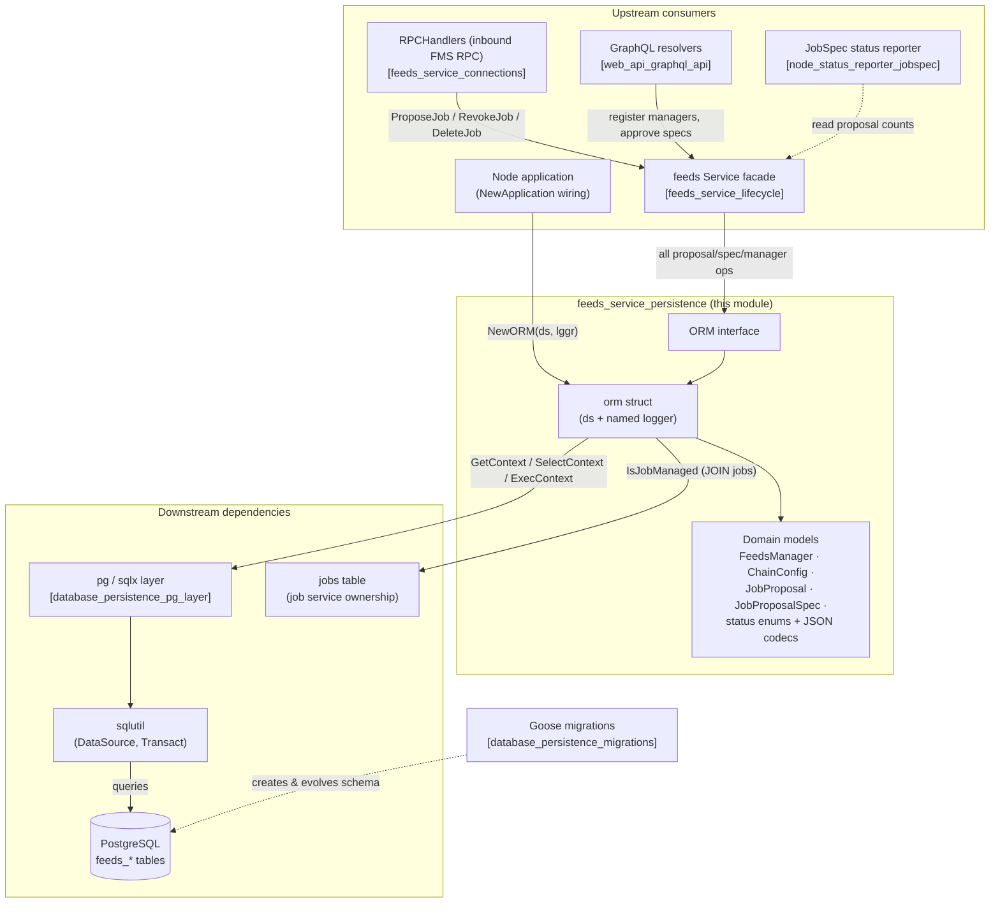
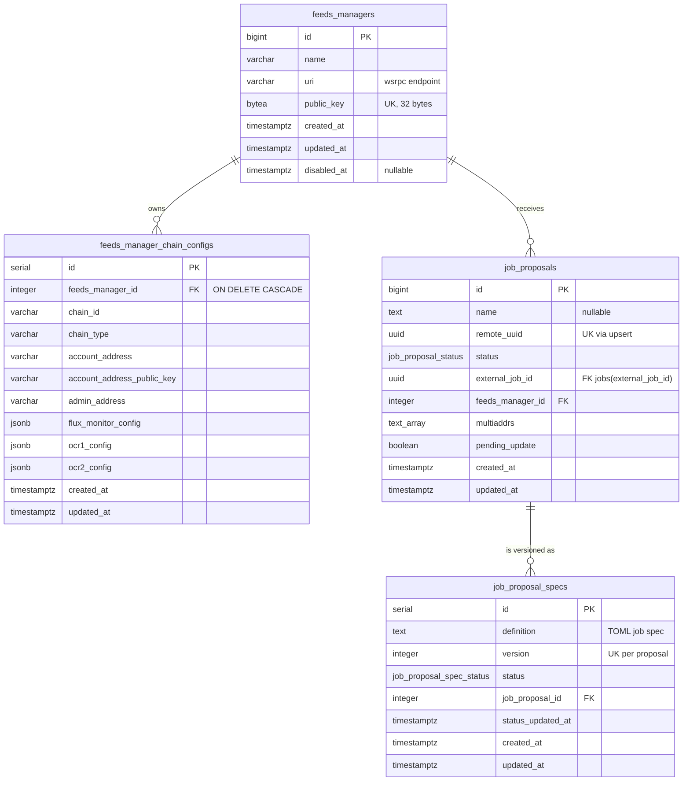
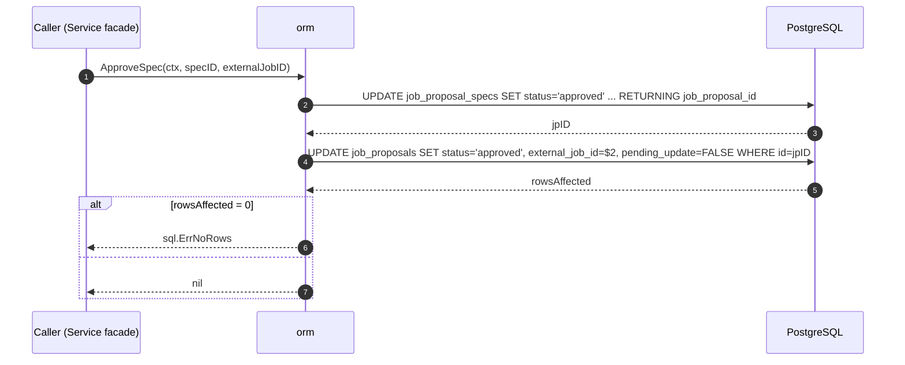

# Feeds Service — Persistence (`feeds_service_persistence`)

> **Code anchors:** `chainlink/core/services/feeds/orm.go` — core component [`ORM`](#31-orm--the-data-access-contract) — and `chainlink/core/services/feeds/models.go` — core components [`FeedsManager`](#32-feedsmanager--manager) and [`JobProposal`](#33-jobproposal--jobproposalspec).
>
> **Module page:** `Node_Platform_Services/feeds_service/feeds_service_persistence.md` · **Parent:** [Node_Platform_Services](../../Node_Platform_Services.md) › [feeds_service](../feeds_service.md) · **Siblings:** [Lifecycle / Service facade](feeds_service_lifecycle.md) · [Connections](feeds_service_connections.md) · [Config](feeds_service_config.md)

## 1. Overview

`feeds_service_persistence` is the database persistence layer of the node-side **feeds service**. It is the *only* place where SQL for feeds-manager data lives: it owns all reads and writes against four PostgreSQL tables — `feeds_managers`, `feeds_manager_chain_configs`, `job_proposals`, and `job_proposal_specs` — and exposes them through the `ORM` interface together with the Go domain models that map onto those rows.

The module answers the questions: *"Which Feeds Manager Services (FMS) is this node registered with, what chain configurations does each manager own, and what is the versioned state of every job proposal the FMS has sent?"*

Design principles:

- **Interface-isolated storage.** Consumers — the [Service facade](feeds_service_lifecycle.md), inbound [`RPCHandlers`](feeds_service_connections.md), and the [GraphQL resolvers](../../Node_Application_Core___Interfaces/web_api/web_api_graphql_api.md) — depend on the `ORM` interface, never on SQL.
- **Co-located domain model.** `models.go` defines the row-mapped structs, status enums, and JSON column codecs (`driver.Valuer`/`sql.Scanner` implementations) so that mapping logic cannot drift from the SQL.
- **Transaction-composable.** `Transact`/`WithDataSource` allow the facade to run feeds mutations *and* [job-service](../job_service/job_service_persistence.md) mutations (creating or deleting real jobs) inside a single database transaction.
- **Schema-owned elsewhere.** Table creation, enums, indexes and check constraints are owned by [database persistence migrations](../database_persistence/database_persistence_migrations.md); this module assumes an already-migrated schema (see [§4](#4-data-model--schema)).

## 2. Position in the System



* **Upstream** — the node application constructs `NewORM` at boot ([node_application_lifecycle](../../Node_Application_Core___Interfaces/node_application/node_application_lifecycle.md)) and injects it into `NewService` ([feeds_service_lifecycle](feeds_service_lifecycle.md)). All other callers reach this module indirectly through the facade.
* **Siblings** — [connections](feeds_service_connections.md) consumes the persisted manager registry (URI + pinned public key) when dialling FMS instances; [config](feeds_service_config.md) interfaces are orthogonal (the ORM takes no config).
* **Downstream** — all SQL runs over `sqlutil.DataSource` built on the node's [pg layer](../database_persistence/database_persistence_pg_layer.md); `IsJobManaged*` queries join the `jobs` table owned by the [job service persistence](../job_service/job_service_persistence.md).
* **Foundation** — transactions and the `DataSource` abstraction come from the shared [sqlutil library](../../Shared_Foundation_Libraries___Domain_Types/sqlutil.md); logging uses the shared [logger](../../Shared_Foundation_Libraries___Domain_Types/logger.md). Third-party drivers (`lib/pq`, `google/uuid`, `guregu/null`) are declared in [`chainlink/go.mod`](../../../chainlink/go.mod).

## 3. Core Components

### 3.1 `ORM` — the data-access contract

The `ORM` interface (`orm.go`) groups the full persistence surface into six areas:

| Area | Methods | Notes |
|---|---|---|
| **Feeds managers** | `ManagerExists`, `CountManagers`, `CreateManager`, `GetManager`, `ListManagers`, `ListManagersByIDs`, `UpdateManager`, `EnableManager`, `DisableManager` | `ManagerExists` matches on the 32-byte CSA public key; `EnableManager`/`DisableManager` clear/set `disabled_at` and `RETURNING *`. `CountManagers` backs the legacy single-manager guard (marked for removal once multi-manager support ships). |
| **Chain configs** | `CreateChainConfig`, `CreateBatchChainConfig`, `DeleteChainConfig`, `GetChainConfig`, `ListChainConfigsByManagerIDs`, `UpdateChainConfig` | One row per (manager, chain); batch insert generates numbered placeholders (`$1..$9` per row) with `NOW()` timestamps and returns all IDs. |
| **Job proposals** | `CreateJobProposal`, `UpsertJobProposal`, `GetJobProposal`, `GetJobProposalByRemoteUUID`, `GetJobProposalByExternalJobID`, `ListJobProposalsByManagersIDs`, `UpdateJobProposalStatus`, `CountJobProposals`, `CountJobProposalsByStatus`, `DeleteProposal` | `UpsertJobProposal` implements FMS reconciliation (`ON CONFLICT (remote_uuid)`, see [§5.2](#52-upsertjobproposal--fms-reconciliation)); `DeleteProposal` is a *soft* delete. |
| **Proposal specs** | `CreateSpec`, `GetSpec`, `GetApprovedSpec`, `GetLatestSpec`, `ExistsSpecByJobProposalIDAndVersion`, `ListSpecsByJobProposalIDs`, `ApproveSpec`, `RejectSpec`, `CancelSpec`, `RevokeSpec`, `UpdateSpecDefinition` | Specs are versioned; every status transition updates the owning proposal in the same call (see [§5.1](#51-spec-state-transitions--two-step-updates)). |
| **Job ownership** | `IsJobManaged`, `IsJobManagedByFeedsManager` | `EXISTS` queries joining `job_proposals` to the `jobs` table on `external_job_id`, excluding deleted proposals. |
| **Infrastructure** | `Transact(ctx, fn)`, `WithDataSource(ds)` | Transaction scoping, see [§5.3](#53-transact--withdatasource--cross-orm-atomicity). |

### 3.2 `orm` — implementation state

```go
type orm struct {
    ds   sqlutil.DataSource   // tx-scopable sqlx/pgx data source
    lggr logger.Logger        // named "FeedsORM"
}

func NewORM(ds sqlutil.DataSource, lggr logger.Logger) *orm
```

* Constructed once by the node application; safe for concurrent use (the underlying `DataSource` is a connection pool).
* Every statement is executed through `GetContext`/`SelectContext`/`ExecContext`, honouring caller context cancellation/timeouts.
* Every error is wrapped with `pkg/errors.Wrap` carrying the operation name (e.g. `"CreateManager failed"`); mutations that affect zero rows return `sql.ErrNoRows` so callers can distinguish *not found* from *connection failures*.
* Only multi-row reads (`ListManagers`, specs/proposal lists) use `SelectContext`; everything else is `GetContext` single-row scans.

### 3.3 `FeedsManager` (alias `Manager`)

```go
type FeedsManager struct {
    ID                 int64
    Name               string
    URI                string             // wsrpc endpoint of the remote FMS
    PublicKey          crypto.PublicKey   // FMS CSA key, pinned for auth
    IsConnectionActive bool               // runtime-only, filled by the facade
    CreatedAt          time.Time
    UpdatedAt          time.Time
    DisabledAt         *time.Time         // nil = enabled
}
```

Persisted in `feeds_managers` (migration [`0035_create_feeds_managers.sql`](../../../chainlink/core/store/migrate/migrations/0035_create_feeds_managers.sql), later extended by `0258` with `disabled_at`). The `public_key` column is a `bytea` with a 32-byte `CHECK` and a `UNIQUE` constraint — `ManagerExists` and the facade's duplicate-registration guard both rely on it. The original `job_types`/`is_ocr_bootstrap_peer` columns were dropped by migration `0118` when chain configs moved to their own table. `IsConnectionActive` is never persisted; the facade overlays connection state from the [connections manager](feeds_service_connections.md) before returning managers to callers.

### 3.4 `ChainConfig` and JSON payload types

```go
type ChainConfig struct {
    ID, FeedsManagerID      int64
    ChainID                 string      // chain-scoped id (string form)
    ChainType               ChainType   // EVM, SOLANA, APTOS, TRON, TON, SUI, STARKNET, STELLAR, UNKNOWN
    AccountAddress          string
    AccountAddressPublicKey null.String
    AdminAddress            string
    FluxMonitorConfig       FluxMonitorConfig  // JSONB column
    OCR1Config              OCR1Config         // JSONB column
    OCR2Config              OCR2ConfigModel    // JSONB column
    CreatedAt, UpdatedAt    time.Time
}
```

Persisted in `feeds_manager_chain_configs` (migration [`0118_create_feeds_manager_chain_config.sql`](../../../chainlink/core/store/migrate/migrations/0118_create_feeds_manager_chain_config.sql), `account_address_public_key` added by `0242`). Key characteristics:

* **Engine enablement lives in JSONB.** `FluxMonitorConfig{Enabled}`, `OCR1Config{Enabled, IsBootstrap, Multiaddr, P2PPeerID, KeyBundleID}` and `OCR2ConfigModel{Enabled, IsBootstrap, Multiaddr, ForwarderAddress, P2PPeerID, KeyBundleID, Plugins}` each implement `driver.Valuer`/`sql.Scanner` by marshalling to/from JSON, mapped to `JSONB` columns. `Plugins{Commit, Execute, Median, Mercury, Rebalancer}` records which OCR2 plugin families the manager may propose.
* **Uniqueness.** `UNIQUE (chain_id, chain_type, feeds_manager_id)` with an additional plain index on `(chain_id, chain_type)`; deleting a manager cascades to its chain configs (`ON DELETE CASCADE`).
* **`ChainType` conversions.** `NewChainType` parses canonical strings; `ChainTypeToProtoChainType` maps to the `chainlink-protos/orchestrator/feedsmanager` enum (`CHAIN_TYPE_*`) for FMS RPC payloads — the RPC side of that conversion is documented in [feeds_service_connections](feeds_service_connections.md).
* **`PluginType`** (`COMMIT`, `EXECUTE`, `MEDIAN`, `MERCURY`, `REBALANCER`) mirrors the FMS-side plugin taxonomy used by OCR2 job proposals.

### 3.5 `JobProposal` / `JobProposalSpec`

A **job proposal** is a job the FMS has proposed to this node; each re-proposal creates a new **spec version**:

```go
type JobProposal struct {
    ID             int64
    Name           null.String
    RemoteUUID     uuid.UUID      // proposal identity in FMS (unique key)
    Status         JobProposalStatus
    ExternalJobID  uuid.NullUUID  // set only while a spec is approved & running
    FeedsManagerID int64
    Multiaddrs     pq.StringArray // P2P multiaddrs from the FMS
    PendingUpdate  bool           // FMS reconciliation flag
    CreatedAt, UpdatedAt time.Time
}

type JobProposalSpec struct {
    ID                       int64
    Definition               string      // TOML job spec text
    Status                   SpecStatus
    Version                  int32       // monotonic per proposal
    JobProposalID            int64
    StatusUpdatedAt          time.Time
    CreatedAt, UpdatedAt     time.Time
}
```

Helpers on the model:

* `JobProposalSpec.CanEditDefinition()` — the definition may only change while the spec is `pending` or `cancelled` (used by the facade's `UpdateSpecDefinition`).
* `JobProposalCounts.toMetrics()` — converts the per-status counts into a `map[JobProposalStatus]float64` for the Prometheus gauges the facade maintains (`CountJobProposalsByStatus` is the source).

Statuses are database enums (not free strings):

| Enum | Values | Source migration |
|---|---|---|
| `job_proposal_status` | `pending, approved, rejected, cancelled, deleted, revoked` | `0042` (3 values) → `0066`/`0161`/`0165` |
| `job_proposal_spec_status` | `pending, approved, rejected, cancelled, revoked` | `0096` (4 values) → `0167` adds `revoked` |

### 3.6 Component interaction map

```mermaid
flowchart LR
    subgraph Callers
        SVC["Service facade<br/>(feeds_service_lifecycle)"]
    end

    subgraph ORM["ORM interface (this module)"]
        M["Manager ops"]
        CC["ChainConfig ops"]
        JP["JobProposal ops"]
        SP["Spec ops"]
        JM["IsJobManaged ops"]
        TX["Transact / WithDataSource"]
    end

    subgraph Tables[("PostgreSQL schema")]
        T1["feeds_managers"]
        T2["feeds_manager_chain_configs"]
        T3["job_proposals"]
        T4["job_proposal_specs"]
        T5["jobs (job service)"]
    end

    SVC --> M & CC & JP & SP & JM
    SVC --> TX
    M --> T1
    CC --> T2
    JP --> T3
    SP --> T4
    JM -->|"JOIN external_job_id"| T5
    T3 -->|"FK feeds_manager_id"| T1
    T2 -->|"FK feeds_manager_id CASCADE"| T1
    T4 -->|"FK job_proposal_id"| T3
```

## 4. Data Model & Schema

The schema is created and evolved by [goose migrations](../database_persistence/database_persistence_migrations.md) under `chainlink/core/store/migrate/migrations/` (loaded by `NewProvider` in [`chainlink/core/store/migrate/migrate.go`](../../../chainlink/core/store/migrate/migrate.go)). Key migrations: `0035` (feeds_managers), `0042` (job_proposals), `0047`/`0049` (remote/external UUIDs), `0055` (multiaddrs), `0063`/`0159` (timestamps, name), `0066`/`0067`/`0161` (status FSM), `0096` (specs table), `0118` (chain configs), `0165` (FSM check constraint), `0167` (`revoked` spec status), `0242` (account public key), `0258` (`disabled_at`).



**Integrity rules enforced by the database** (the ORM relies on these, it does not re-implement them):

| Constraint | Table | Effect |
|---|---|---|
| `public_key` `UNIQUE` + 32-byte `CHECK` | `feeds_managers` | One node registration per FMS identity. |
| `UNIQUE (chain_id, chain_type, feeds_manager_id)` | `feeds_manager_chain_configs` | One config per manager per chain. |
| `UNIQUE (job_proposal_id, version)` | `job_proposal_specs` | Monotonic spec versioning. |
| Partial `UNIQUE (job_proposal_id) WHERE status = 'approved'` | `job_proposal_specs` | **At most one approved spec per proposal** — the invariant that makes "cancel the old job before approving a new version" safe. |
| `chk_job_proposals_status_fsm` | `job_proposals` | `pending`/`rejected`/`cancelled`/`revoked` ⇒ `external_job_id IS NULL`; `approved` ⇒ `external_job_id IS NOT NULL`; `deleted` is unconstrained (migration `0165`). |
| FK `external_job_id → jobs(external_job_id)` | `job_proposals` | Ties proposals to real, running jobs owned by the [job service](../job_service/job_service_persistence.md). |

## 5. Behaviour

### 5.1 Spec state transitions — two-step updates

`ApproveSpec`, `RejectSpec`, `CancelSpec`, and `RevokeSpec` all follow the same two-step pattern: first the spec row's status is updated with `RETURNING job_proposal_id`, then the owning proposal's status (and, where applicable, `external_job_id` and `pending_update`) is updated with a `CASE` expression that preserves *terminal* statuses. Rows-affected checks return `sql.ErrNoRows` if the proposal vanished mid-operation.



Transition semantics per operation (guarded by the DB `CASE` expressions and the `chk_job_proposals_status_fsm` constraint):

| Operation | Spec status becomes | Proposal status becomes | `external_job_id` | `pending_update` |
|---|---|---|---|---|
| `ApproveSpec` | `approved` | `approved` | set to the new job's UUID | cleared |
| `RejectSpec` | `rejected` | `rejected`, unless proposal is `approved` or `deleted` (preserved) | unchanged | cleared |
| `CancelSpec` | `cancelled` | `cancelled`, unless `deleted` | cleared | cleared |
| `RevokeSpec` | `revoked`, unless already `approved` (preserved) | `revoked`, unless `deleted`/`approved` | cleared when proposal is not `approved` | cleared |
| `DeleteProposal` | (unchanged) | `deleted` (soft delete) | unchanged | set `TRUE` **only if** the latest spec was `approved` — this is the flag that reminds the facade to cancel the running job |

The corresponding status machine (and the facade-level guards around it) is documented in [feeds_service_lifecycle §4.2](feeds_service_lifecycle.md#42-job-proposal--spec-state-machine).

### 5.2 `UpsertJobProposal` — FMS reconciliation

`UpsertJobProposal` is the write path used when the FMS re-proposes a job. It inserts a new proposal, or on `ON CONFLICT (remote_uuid)`:

* sets `pending_update = TRUE` and refreshes `name`, `multiaddrs`, `updated_at`;
* **preserves terminal local state** — a proposal the operator `deleted` or has a running (`approved`) job for keeps its status, otherwise the FMS-supplied status is adopted.

This is what makes proposal delivery idempotent and prevents an FMS restart from resurrecting cancelled work. The *consumption* of `pending_update` (who acts on it) is the facade's job — see [feeds_service_lifecycle](feeds_service_lifecycle.md).

Lookups used by reconciliation are delete-aware: `GetJobProposalByRemoteUUID` and `GetJobProposalByExternalJobID` both filter `status <> 'deleted'`, so soft-deleted proposals never satisfy re-proposals.

### 5.3 `Transact` / `WithDataSource` — cross-ORM atomicity

```go
func (o *orm) Transact(ctx context.Context, fn func(ORM) error) error {
    return sqlutil.Transact(ctx, o.WithDataSource, o.ds, nil, fn)
}
func (o *orm) WithDataSource(ds sqlutil.DataSource) ORM { return &orm{ds: ds, lggr: o.lggr} }
```

`WithDataSource` returns a shallow copy of the ORM bound to a transaction-scoped `DataSource`; `sqlutil.Transact` (shared [sqlutil library](../../Shared_Foundation_Libraries___Domain_Types/sqlutil.md)) uses it as a factory so the callback receives a transacted `ORM`. This is the mechanism the facade exploits in its `transact` helper to re-scope *both* the feeds ORM and the `job.ORM` into one transaction — so approving or cancelling a spec atomically updates the spec row **and** creates/deletes the real job (see [feeds_service_lifecycle §3.2](feeds_service_lifecycle.md#32-service--implementation-state)).

### 5.4 Counting & metrics

`CountJobProposalsByStatus` computes all six status counts in a single query using PostgreSQL `COUNT(*) FILTER` clauses, with a nuance that mirrors the reconciliation design: rows with `pending_update = TRUE` are counted as **pending** regardless of their stored status (except `deleted`), because a pending FMS update on an approved/rejected/revoked proposal must surface as work to do. The result feeds `toMetrics()` and the facade's Prometheus gauges.

## 6. Dependencies

| Dependency | Used for | Documented at |
|---|---|---|
| `sqlutil.DataSource`, `sqlutil.Transact` | Connection-pool abstraction, transaction scoping | [sqlutil](../../Shared_Foundation_Libraries___Domain_Types/sqlutil.md) |
| `core/services/pg` (sqlx/pgx) | Underlying `Queryer` implementation | [database_persistence_pg_layer](../database_persistence/database_persistence_pg_layer.md) |
| `chainlink/core/store/migrate/migrations` | Schema ownership (tables, enums, indexes, constraints) | [database_persistence_migrations](../database_persistence/database_persistence_migrations.md) |
| `core/services/job` (`jobs` table) | `IsJobManaged*` JOINs; FK on `external_job_id`; cross-ORM transactions | [job_service_persistence](../job_service/job_service_persistence.md) |
| `core/utils/crypto` | `crypto.PublicKey` (32-byte ed25519 CSA identity) | — |
| `chainlink-protos/orchestrator/feedsmanager` | `ChainType` ↔ proto enum conversion for FMS RPC payloads | [feeds_service_connections](feeds_service_connections.md) |
| `lib/pq`, `google/uuid`, `guregu/null` | `pq.StringArray`, UUID/nullable mapping | declared in [`chainlink/go.mod`](../../../chainlink/go.mod) |
| `chainlink-common/pkg/logger` | Named `"FeedsORM"` logger | [logger](../../Shared_Foundation_Libraries___Domain_Types/logger.md) |

## 7. Error Handling & Failure Modes

* **Wrapped errors.** Every statement path wraps failures with its operation name (`errors.Wrap(err, "<Op> failed")`), preserving the chain for upstream logging.
* **`sql.ErrNoRows` as a domain signal.** Mutating paths (`UpdateManager`, `UpdateJobProposalStatus`, `UpdateSpecDefinition`, and the second statement of every spec transition) check `RowsAffected` and return `sql.ErrNoRows` when the target row is gone — callers can treat this as "already deleted / raced", not as an infrastructure fault.
* **Constraint violations as business invariants.** A concurrent approve of two spec versions is impossible (partial unique index); an invalid status/`external_job_id` combination aborts at the `chk_job_proposals_status_fsm` CHECK; the batch chain-config insert is all-or-nothing inside the statement.
* **Context propagation.** All statements are context-aware; the node-wide [database timeout settings](../database_persistence.md) therefore apply to feeds queries as well.
* **Logging.** Informational logs on reconciliation-relevant paths (`GetJobProposalByRemoteUUID`, `CancelSpec`, `DeleteProposal`, `GetApprovedSpec`) carry the relevant IDs under the `FeedsORM` named logger.

## 8. Related Documentation

* [feeds_service](../feeds_service.md) — parent module overview and feature gating.
* [feeds_service_lifecycle](feeds_service_lifecycle.md) — the `Service` facade that owns this ORM and enforces the proposal/spec workflow guards.
* [feeds_service_connections](feeds_service_connections.md) — wsrpc connections to FMS and inbound RPC handlers.
* [feeds_service_config](feeds_service_config.md) — configuration interfaces (`GeneralConfig`, `JobDistributorConfig`).
* [job_service_persistence](../job_service/job_service_persistence.md) — the `jobs` table and the spawner that materializes approved specs; also re-scoped into this module's transactions.
* [database_persistence](../database_persistence.md) — pg layer, migrations and backups for the whole node database.
* [web_api_graphql_api](../../Node_Application_Core___Interfaces/web_api/web_api_graphql_api.md) — GraphQL mutations (`CreateFeedsManager`, `ApproveJobProposalSpec`, …) that ultimately drive this ORM.
* [node_status_reporter_jobspec](../node_status_reporter/node_status_reporter_jobspec.md) — consumer of proposal counts/spec state for operational reporting.
