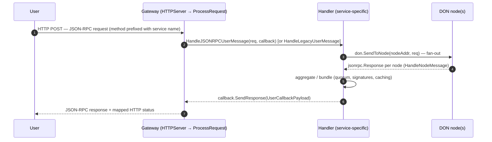
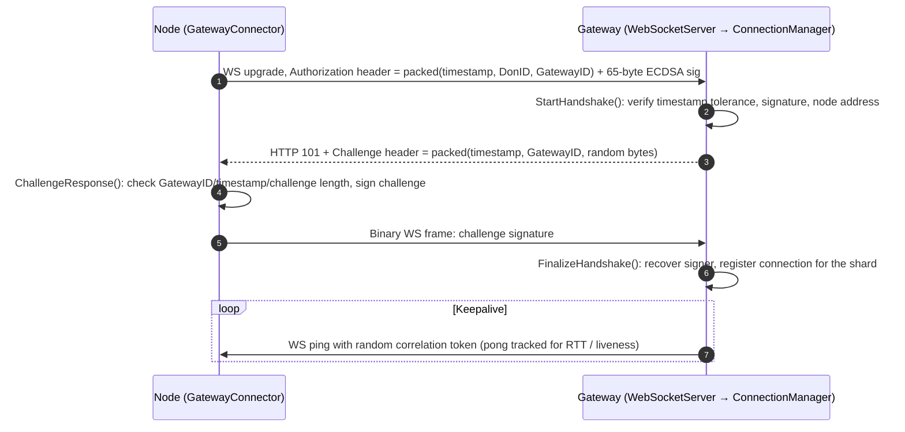

# Gateway

> **Module:** `chainlink/core/services/gateway` — part of [Node Platform Services](../Node_Platform_Services.md)

## 1. Purpose

The Gateway module implements Chainlink's **Gateway tier**: a horizontally scalable, (mostly) stateless HTTP/WebSocket service that sits between external callers and the member nodes of a Decentralized Oracle Node network (**DON**). Users send JSON-RPC requests to a Gateway; the Gateway authenticates and fans them out to the DON's nodes over mutually-authenticated WebSocket connections, collects the node responses, applies service-specific aggregation / quorum logic, and returns a single JSON-RPC response to the caller.

The module contains **both ends of the wire**:

| Side | Description | Entry points |
|---|---|---|
| **Gateway server** | Runs on dedicated *Gateway* nodes as a `gateway` **job type**. Serves users over HTTP and DON nodes over WebSocket, dispatching each request to a pluggable `Handler` chosen by service name. | `gateway.go`, `connectionmanager.go`, `handler_factory.go`, `multihandler.go`, `delegate.go` |
| **Node side** | `GatewayConnector` is embedded in oracle nodes to maintain persistent, authenticated WebSocket connections to one or more Gateways, and is exposed to LOOP plugins over gRPC. | `connector/connector.go` |
| **Shared protocol** | The signed `api.Message` envelope (legacy) and JSON-RPC 2.0 envelopes, plus error-code mappings shared by both sides. | `api/message.go`, `api/codec.go` |
| **Network primitives** | An SSRF-hardened outbound HTTP client and a WebSocket server/client pair with an ECDSA challenge-response handshake. | `network/httpclient.go`, `network/wsserver.go`, `network/wsclient.go`, `network/handshake.go` |

## 2. Position in the overall system

- **Job-based lifecycle.** `gateway.Delegate` implements the [`job.Delegate`](job_service.md) interface with `JobType() == job.Gateway`. A `GatewaySpec` (TOML, validated by `ValidatedGatewaySpec`) carries the full `GatewayConfig`; the [job service Spawner](job_service.md) starts/stops the resulting `Gateway` service.
- **Node application wiring.** On oracle nodes, `GatewayConnector` is configured from the node's `GatewayConnector` TOML section (`connector.Config.From(...)`) and signed with node keys (CSA key / `keys.MessageSigner` from the [keystore](keystore.md)).
- **LOOP plugin access.** `GatewayConnector` also implements `core.MultiGatewayConnector`, and node handlers implement `core.GatewayConnectorHandler`; both interfaces are mirrored over gRPC by the [Loop plugin framework](../Plugin_Process_Framework_(Loop).md) (`loop/internal/pb/gatewayconnector/*`), so plugin processes can talk to Gateways through the node.
- **CRE integration.** CRE capabilities consume the Gateway tier: the `http_action` capability wraps a `GatewayConnector` in a `routingGatewayConnector` ([http_action_capability](../Workflow___Capability_Runtime_(CRE_Engine)/http_action_capability.md)), the vault handler resolves workflows via the capabilities/workflow registries ([workflows](../Workflow___Capability_Runtime_(CRE_Engine)/workflows.md)), and a fake in-process Gateway exists for tests ([core_capabilities_runtime](../Workflow___Capability_Runtime_(CRE_Engine)/core_capabilities_runtime.md)).
- **Shared foundation.** The module leans on `chainlink-common` primitives: [jsonrpc2](../Shared_Foundation_Libraries___Domain_Types/jsonrpc2.md) envelopes, [services](../Shared_Foundation_Libraries___Domain_Types/services.md) state machines, [settings/limits](../Shared_Foundation_Libraries___Domain_Types/settings.md) rate limiters & resource pools, and [Beholder](../Telemetry___Observability_Platform/beholder-telemetry.md) metrics.

## 3. Architecture

### 3.1 Component & deployment view

```mermaid
flowchart LR
    U["External user /<br/>workflow enclave"]

    subgraph GWN["Gateway node (job type 'gateway')"]
        direction TB
        HS["HTTPServer<br/>(user port, TLS, limits)"]
        GW["Gateway.ProcessRequest<br/>(decode, route, timeout, metrics)"]
        MH["MultiHandler<br/>(service name → handler)"]
        HND["Handlers:<br/>web-api-capabilities · http-capabilities (v2)<br/>vault · confidential-compute-relay · dummy"]
        HC["network.HTTPClient<br/>(safeurl egress, mTLS)"]
        CM["ConnectionManager<br/>(per DON-shard donConnectionManager)"]
        WSS["WebSocketServer<br/>(node port, handshake, TLS)"]
    end

    subgraph DON["DON member nodes"]
        GC["GatewayConnector<br/>(reconnect loop, read loop)"]
        NH["Node-side handler logic<br/>(native or LOOP plugin)"]
    end

    U -->|"JSON-RPC over HTTP"| HS
    HS --> GW --> MH --> HND
    HND -->|"SendToNode (fan-out)"| CM
    CM -->|"WS frames"| WSS
    WSS <-->|"authenticated WS (challenge-response)"| GC
    GC --- NH
    HND -->|"outbound http(s) call"| HC
```

The server side is assembled by `NewGatewayFromConfig`:

1. `config.GatewayConfig` is validated (unique DON/service names, `3F+1` nodes per shard, pong/heartbeat consistency).
2. A `ConnectionManager` is created — one `donConnectionManager` per *DON shard* (`GatewayDONIDForShard` produces the connection ID a node must present, e.g. `donName` or `donName_shard-N`).
3. A user-facing `HTTPServer` and a node-facing `WebSocketServer` are created from `gw_net` primitives.
4. For each configured **service**, a `MultiHandler` is built from a `HandlerFactory` (handler type strings: `dummy`, `web-api-capabilities`, `http-capabilities`, `vault`, `confidential-compute-relay`) and registered both on the service map and on every attached DON-shard connection manager.

### 3.2 User request lifecycle

Key behaviours of `Gateway.ProcessRequest`:

- Requests are JSON-RPC 2.0 (`jsonrpc2.DecodeRequest`); the **service name** is a prefix of the method (e.g. `workflows.execute` → service `workflows`) or a legacy `DonID` in the `api.Message` body. Request IDs are capped at 200 characters.
- Each in-flight request gets a fresh `handlerscommon.Callback`; `ProcessRequest` blocks on `callback.Wait(ctx)` and maps `api.ErrorCode` → HTTP status via `api.ToHTTPErrorCode`.
- Latency/invocation metrics are recorded per method/response code (`monitoring.GatewayMetrics` via Beholder, plus the Prometheus `gateway_request` counter).

### 3.3 Node ↔ Gateway mutual-auth handshake

Nodes prove control of an ECDSA key whose address must match the configured node address for that DON shard. The handshake lives in `network/handshake.go` and is used by both `WebSocketServer` (acceptor side = `ConnectionManager`) and `GatewayConnector` (initiator side):

The same signing machinery secures the legacy `api.Message` envelope: fixed-width aligned fields (MessageID ≤128, Method ≤64, DonID ≤64, Receiver 42) + payload are signed with keccak256/ECDSA; see [gateway_api](gateway/gateway_api.md).

## 4. Sub-modules

| Sub-module | Key components | Responsibility |
|---|---|---|
| **API / wire protocol** | `api.Message`, `MessageBody`, `JSONRPCCodec`, error codes | Signed message envelope, JSON-RPC codec, error-code → JSON-RPC/HTTP mapping. → [gateway_api](gateway/gateway_api.md) |
| **Connector (node side)** | `GatewayConnector` | Persistent authenticated WS connections to Gateways, reconnect/read loops, method→handler dispatch, `core.MultiGatewayConnector` for LOOP. → [gateway_connector](gateway/gateway_connector.md) |
| **Handlers (service logic)** | `Handler`, `DON`, `Callback`, `Request`/`Response` (webapi), confidential-relay `Config` | Per-service request handling: HTTP capabilities (v1/v2), vault, confidential relay bundling & quorum. → [gateway_handlers](gateway/gateway_handlers.md) |
| **Network primitives** | `HTTPClient`, `WebSocketServer` | SSRF-hardened egress HTTP client (mTLS, limits, metrics) and node-facing WS server with challenge-response handshake. → [gateway_network](gateway/gateway_network.md) |

Detailed sub-module documentation:

- **[Gateway API — signed message envelope & JSON-RPC codec](gateway/gateway_api.md)** — the legacy `api.Message` wire format, signing/verification over aligned fields, JSON-RPC codec and the `ErrorCode` → JSON-RPC/HTTP mappings shared by both peers.
- **[Gateway Connector — node-side Gateway connectivity](gateway/gateway_connector.md)** — lifecycle, reconnect/read loops, handler registry, auth handshake roles, multi-DON routing and metrics of the `GatewayConnector` service embedded in oracle nodes.
- **[Gateway Handlers — service-specific message handling](gateway/gateway_handlers.md)** — the `Handler`/`DON`/`Callback` contract, concrete handler types from the factory, webapi capability request/response schema, and the confidential relay fan-out/bundling design.
- **[Gateway Network — transport primitives](gateway/gateway_network.md)** — the SSRF-hardened `HTTPClient` (egress rules, mTLS, limits) and the node-facing `WebSocketServer` with challenge-response authentication.

## 5. Server-side orchestration (module root)

These files compose the sub-modules above into the running Gateway service:

- **`gateway.go`** — `Gateway` interface + `ProcessRequest` dispatch, service→handler routing (new `Services`/`ShardedDONs` format with a legacy DON-ID fallback), Prometheus request counter.
- **`connectionmanager.go`** — `ConnectionManager` / `donConnectionManager`: accepts node WebSocket connections (implements `network.ConnectionAcceptor`), per-node `WSConnectionWrapper`s, keepalive ping tracking (`pingtracker.go`), and `SendToNode` fan-out exposed to handlers as the `handlers.DON` interface.
- **`handler_factory.go`** — maps handler type strings to concrete `handlers.Handler` implementations, injecting dependencies (legacy EVM chains, `sqlutil.DataSource`, `network.HTTPClient[Factory]`, `CapabilitiesRegistry`, workflow registry syncer, `limits.Factory`, optional `OrgResolver`).
- **`multihandler.go`** — composes multiple handlers behind one service name (`NewMultiHandler`) and adapts sharded DON configs (`handlers.NewShardedDONs`).
- **`delegate.go`** — `job.Delegate` for `job.Gateway`; parses `GatewaySpec` TOML, builds the HTTP client and handler factory, returns the `Gateway` service to the [job spawner](job_service.md).
- **`monitoring/metrics.go`** — Beholder-backed gateway metrics (handler duration/invocations, connection counters).

## 6. Configuration

**Server side** (`config.GatewayConfig`, embedded in the `GatewaySpec` job TOML):

- `UserServerConfig` / `NodeServerConfig` — HTTP and WebSocket server settings (host/port, timeouts, TLS, max request bytes, limiters) — see [gateway_network](gateway/gateway_network.md).
- `ConnectionManagerConfig` — auth gateway ID, timestamp tolerance, challenge length, heartbeat interval, pong timeout (pong deadline must exceed heartbeat interval).
- `HTTPClientConfig` — egress restrictions for handler-initiated HTTP calls (see [gateway_network](gateway/gateway_network.md)).
- `Services` + `ShardedDONs` — service → handler-set → DON-shards mapping. Each shard must hold ≥ `3F+1` nodes; shard 0 keeps the bare DON name for backward compatibility.

**Node side** (`connector.Config`, built from the node's `GatewayConnector` TOML section — see [node_application_config](../Node_Application_Core___Interfaces/node_application/node_application_config.md)):

- `NodeAddress`, `DonID` (must exactly match `GatewayDONIDForShard` output or the handshake fails), list of `Gateways` (`ID`/`DonID`/`URL`), `WsClientConfig`, `AuthMinChallengeLen`, and `AuthTimestampToleranceSec` (defaults to 5 s).

## 7. Security model

- **Mutual authentication** — ECDSA-signed auth header + challenge-response on every node connection; timestamp tolerance bounds replay; challenge length is enforced on both sides; the recovered signer address must match the configured node address for the shard.
- **Message signing** — legacy `api.Message` envelopes are signed over fixed-width aligned fields; signatures are hex-encoded with `0x` prefix and recovered by the peer.
- **Egress hardening** — the HTTP client uses `safeurl` with IP/CIDR, port, scheme, and method allow/deny lists, disables redirects, blocks header injection (host, `x-forwarded-*`, connection-family headers, …), caps response size and request duration, and supports mTLS with a bounded concurrency pool.
- **Abuse containment** — request-ID length caps, per-request timeouts, JSON-RPC error-code mapping, per-node and global rate limiters (`limits.Factory`) in the confidential relay handler, and message-size limits on the WebSocket server.
- The Gateway is deliberately **stateless regarding trust**: e.g. the confidential relay forwards node response bundles to the user's enclave, which performs signature and quorum verification (the gateway only counts decodable signed responses for forwarding decisions).

## 8. Observability

- Prometheus: `gateway_request` counter (per response code) in `gateway.go`.
- Beholder/OTel meters: `monitoring.GatewayMetrics` (user-message handler duration/invocations), connector metrics (`gateways_per_don` gauge labelled by CSA key and DON), WebSocket connection metrics (per `gateway_id`), and HTTP client metrics (method/status/connection-reuse/latency via `httptrace`).
- Health: every component implements `HealthReport()`; the ConnectionManager aggregates per-connection health, the connector aggregates per-gateway health.

## 9. Related documentation

- [Node Platform Services](../Node_Platform_Services.md) — sibling platform services ([job service](job_service.md), [keystore](keystore.md), [p2p](p2p.md), [feeds service](feeds_service.md)).
- [Plugin Process Framework (Loop)](../Plugin_Process_Framework_(Loop).md) — gRPC bindings that expose `GatewayConnector` / handlers to plugin processes (see [loop-grpc-bindings](../Plugin_Process_Framework_(Loop)/loop-grpc-bindings.md)).
- [Shared Foundation Libraries](../Shared_Foundation_Libraries___Domain_Types.md) — [types-core](../Shared_Foundation_Libraries___Domain_Types/types-core.md) (`core.MultiGatewayConnector`, `core.GatewayConnectorHandler`), [jsonrpc2](../Shared_Foundation_Libraries___Domain_Types/jsonrpc2.md), [services](../Shared_Foundation_Libraries___Domain_Types/services.md), [settings/limits](../Shared_Foundation_Libraries___Domain_Types/settings.md).
- [Workflow & Capability Runtime (CRE Engine)](../Workflow___Capability_Runtime_(CRE_Engine).md) — capabilities that consume or wrap the Gateway ([http_action_capability](../Workflow___Capability_Runtime_(CRE_Engine)/http_action_capability.md), [core_capabilities_runtime](../Workflow___Capability_Runtime_(CRE_Engine)/core_capabilities_runtime.md), [workflows](../Workflow___Capability_Runtime_(CRE_Engine)/workflows.md)).
- [Telemetry & Observability Platform](../Telemetry___Observability_Platform.md) — Beholder meter/trace infrastructure ([beholder-telemetry](../Telemetry___Observability_Platform/beholder-telemetry.md)).
- [Dev, Test & Simulation Environments](../Dev,_Test___Simulation_Environments.md) — gateway integration tests and CRE system-test `GatewayServiceConfig` ([system-tests](../Dev,_Test___Simulation_Environments/system-tests.md)).
