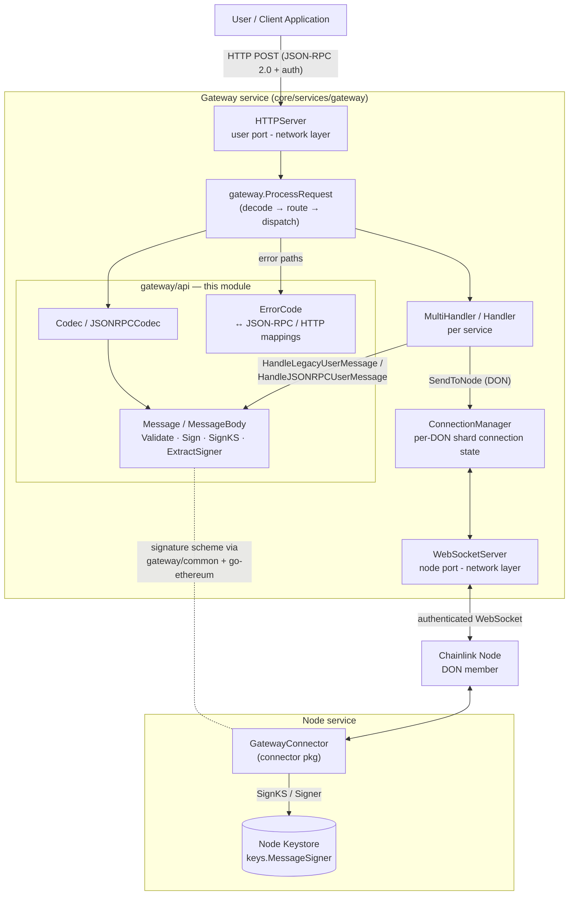
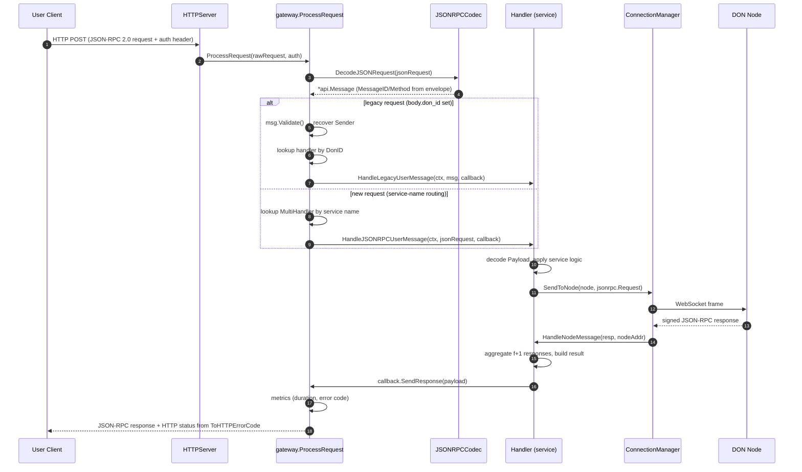
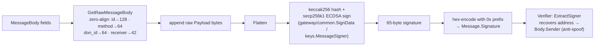

# Gateway API (`core/services/gateway/api`)

## Introduction

The `gateway_api` module defines the **wire protocol of the Chainlink Gateway**: the canonical message format exchanged between user clients, the Gateway service, and the Chainlink nodes that make up a Decentralized Oracle Network (DON). It is deliberately small and dependency-light so that it can be shared by every process that speaks the Gateway protocol:

- the **Gateway server** (`core/services/gateway`), which terminates user HTTP requests and node WebSocket connections,
- the **product handlers** (web-api capabilities, vault, confidential relay) that decode service-specific payloads,
- the **node-side `GatewayConnector`**, which nodes use to send requests to and receive requests from Gateways.

The module provides three things:

1. **`Message` / `MessageBody`** — the signed, top-level envelope for all Gateway traffic, together with its validation, signing, and signer-recovery logic.
2. **`Codec` / `JSONRPCCodec`** — (de)serialization between `Message` and JSON-RPC 2.0 envelopes (both the legacy format, which embeds the whole `Message` in `params`, and the newer format, where identity fields live in the JSON-RPC envelope).
3. **`ErrorCode`** — the Gateway error taxonomy, with bidirectional mappings to JSON-RPC error codes and HTTP status codes.

This page documents the protocol contract itself. For how messages are routed and processed, see [Gateway](../gateway.md), [Gateway Handlers](gateway_handlers.md), [Gateway Connector](gateway_connector.md), and [Gateway Network](gateway_network.md).

---

## Role in the System

The Gateway is a stateless reverse proxy that sits between off-chain user applications and DON nodes: it fans a user's request out to the members of a DON, aggregates their responses, and returns a single reply. Every hop in that exchange is expressed as a `gateway/api.Message` (legacy protocol) or a `jsonrpc2` envelope (new protocol), and every error surfaced to clients is expressed as a `gateway/api.ErrorCode`.

```
User client ──HTTP──> Gateway ──WebSocket──> DON node
        gateway/api.Message (legacy)          │
        jsonrpc2 envelope (new)               ▼
                                  gateway/api defines the shared
                                  wire format + error codes for both sides
```

Because nodes and the Gateway are separate codebases/deployments, this package is the **single source of truth** for field layout, length limits, signature encoding, and error semantics. Any change here is a protocol change and must be coordinated across Gateway and node releases.

---

## Core Components

### 1. `Message` and `MessageBody` (`api/message.go`)

The top-level wire structure:

```go
type Message struct {
    Signature string      `json:"signature"` // hex-encoded, "0x" prefix
    Body      MessageBody `json:"body"`
}

type MessageBody struct {
    MessageID string          `json:"message_id"`
    Method    string          `json:"method"`
    DonID     string          `json:"don_id"`
    Receiver  string          `json:"receiver"`
    // Service-specific payload, decoded inside the Handler.
    Payload   json.RawMessage `json:"payload,omitempty"`
    // Local-only convenience field; never serialized.
    Sender    string          `json:"-"`
}
```

| Constant | Value | Meaning |
|---|---|---|
| `MessageSignatureLen` | 65 | Raw ECDSA signature length (r‖s‖recovery-id, Ethereum style) |
| `MessageSignatureHexEncodedLen` | 132 | Hex-encoded signature length (`0x` + 130 hex chars) |
| `MessageIDMaxLen` | 128 | Max `message_id` length (also the signature alignment width) |
| `MessageMethodMaxLen` | 64 | Max `method` length |
| `MessageDonIDMaxLen` | 64 | Max `don_id` length |
| `MessageReceiverLen` | 42 | `receiver` length (`0x` + 20-byte address) |
| `NullChar` | `"\x00"` | Rejected trailing byte for string fields |
| `MethodInternalError` | `"internal_error"` | Reserved method name |

**Key methods:**

- **`Validate()`** — the protocol acceptance gate. Rejects nil messages, wrong signature length, empty/overlong `MessageID`/`Method`/`DonID`, any of those fields ending in a NUL byte, and a `Receiver` that is neither empty nor exactly 42 characters. It then recovers the signer address from the signature via `ExtractSigner()` and populates `Body.Sender` from it — the sender is therefore always *derived from cryptography*, never trusted from the wire (reinforced by `json:"-"`).
- **`Sign(privateKey *ecdsa.PrivateKey)`** — signs the aligned body fields directly with an ECDSA key (used in tests and tooling).
- **`SignKS(ctx, ks keys.MessageSigner, signer common.Address)`** — signs through the node keystore abstraction (`chainlink-evm/pkg/keys.MessageSigner`), so nodes never expose private keys to message-handling code. See [Keystore](../keystore.md).
- **`ExtractSigner()`** — recovers the signer's Ethereum address from the 65-byte signature.
- **`GetRawMessageBody()`** — produces the exact byte sequence that is signed: `MessageID` zero-aligned to 128 bytes, `Method` to 64, `DonID` to 64, `Receiver` to 42, followed by the raw payload bytes (before JSON parsing). Deterministic alignment is what makes signatures unambiguous across implementations.

### 2. `Codec` and `JSONRPCCodec` (`api/codec.go`, `api/jsonrpccodec.go`)

```go
type Codec interface {
    DecodeRawRequest(msgBytes []byte, jwtToken string) (*Message, error)
    DecodeJSONRequest(request jsonrpc2.Request[json.RawMessage]) (*Message, error)
    EncodeLegacyRequest(msg *Message) ([]byte, error)
    DecodeLegacyResponse(msgBytes []byte) (*Message, error)
    EncodeLegacyResponse(msg *Message) []byte
    EncodeNewErrorResponse(id string, code int64, message string, data []byte) []byte
}
```

`JSONRPCCodec` is the only production implementation (`JsonRPCCodec` is a deprecated alias kept for backward compatibility). It relies on the shared [jsonrpc2](../../Shared_Foundation_Libraries___Domain_Types/jsonrpc2.md) types.

Two wire formats coexist:

- **Legacy format** — the entire `Message` (including `signature`, `don_id`, and `receiver`) is embedded as the JSON-RPC `params`/`result` object. Routing is by DON ID; `MessageID`/`Method` are duplicated from the JSON-RPC envelope onto the body on decode. Used for Gateway⇄node traffic and older clients.
- **New format** — `params` carries only the service-specific payload; `MessageID` and `Method` come from the JSON-RPC envelope itself, and requests are routed by **service name** (e.g. `workflows`, `vault`) rather than DON ID.

`DecodeLegacyResponse` is strict: a non-empty `error` field or an empty `result` field is rejected rather than silently propagated.

### 3. `ErrorCode` (`api/constants.go`)

A closed taxonomy of Gateway-level errors:

`NoError`, `UserMessageParseError`, `UnsupportedDONIdError`, `HandlerError`, `RequestTimeoutError`, `NodeReponseEncodingError`, `FatalError`, `UnsupportedMethodError`, `InvalidParamsError`, `StaleNodeResponseError`, `ConflictError`, `LimitExceededError`.

Each maps deterministically onto JSON-RPC 2.0 error codes and HTTP status codes (tables in [Error Semantics](#error-semantics)), so a single error enum drives both the WebSocket and HTTP transports.

---

## Architecture and Component Relationships



Dependency direction is intentionally one-way: everything in the Gateway depends on `api`; `api` depends only on the shared [jsonrpc2](../../Shared_Foundation_Libraries___Domain_Types/jsonrpc2.md) types, hex utilities, `gateway/common` crypto helpers, and `go-ethereum` primitives (`chainlink/go.mod`, module `github.com/smartcontractkit/chainlink/v2`).

---

## Message Lifecycle and Data Flow

### User request → Gateway → DON → user (legacy `Message` path)



Notes on the flow:

- The callback indirection (`handlers/common.Callback`) lets each user request be handled in its own goroutine with a timeout; a timeout surfaces as `RequestTimeoutError` (HTTP 504).
- When a handler receives node responses in the legacy format, it converts them back through `ValidatedMessageFromResp` / `ValidatedMessageFromReq` (`handlers/common/message_util.go`), which call `msg.Validate()` — meaning **node responses are authenticated with the same signature scheme before their payloads are trusted**.
- Errors produced anywhere in the pipeline are emitted as JSON-RPC error envelopes built from `api.ErrorCode` → `ToJSONRPCErrorCode` → `ToHTTPErrorCode`.

### Signing / verification flow



The same `Sign`/`ExtractSigner` pair underpins the node↔Gateway WebSocket authentication challenge/response (`gateway/common.ExtractSigner` is reused by `connectionmanager.StartHandshake`/`FinalizeHandshake`), so message authentication and connection authentication share one cryptographic scheme.

---

## Error Semantics

`ErrorCode` is the single enum used across Gateway code paths. Mapping tables (from `api/constants.go`):

| ErrorCode | JSON-RPC code | HTTP status |
|---|---|---|
| `NoError` | `0` | 200 OK |
| `UserMessageParseError` | Parse error | 400 Bad Request |
| `UnsupportedDONIdError` | Invalid params | 400 Bad Request |
| `InvalidParamsError` | Invalid params | 400 Bad Request |
| `HandlerError` | Invalid request | 400 Bad Request |
| `UnsupportedMethodError` | Method not found | 400 Bad Request |
| `RequestTimeoutError` | Server overloaded | 504 Gateway Timeout |
| `NodeReponseEncodingError` | Internal error | 500 Internal Server Error |
| `FatalError` | Internal error | 500 Internal Server Error |
| `StaleNodeResponseError` | Internal error | 500 Internal Server Error |
| `ConflictError` | Conflict | 409 Conflict |
| `LimitExceededError` | Limit exceeded | 429 Too Many Requests |

`FromJSONRPCErrorCode` provides the reverse mapping (unknown codes degrade to `FatalError`), which lets node-side and plugin consumers interpret Gateway error codes uniformly. The Gateway also exports a `gateway_request` Prometheus counter labeled by error-code string and records per-method handler duration/invocation metrics through `gateway/monitoring`.

---

## Security Model

- **Signer derivation over sender claims.** `Body.Sender` is never serialized (`json:"-"`) and is always recomputed from the ECDSA signature during `Validate()`. A client cannot assert a different identity.
- **Deterministic signature domain.** Signatures cover zero-padded, fixed-width fields plus the raw payload bytes; the NUL-suffix checks (`NullChar`) reject crafted IDs/methods/DON IDs whose padding could otherwise create signature-domain ambiguity between different logical messages.
- **Strict length limits.** Envelope constraints (132-char signature, 128-char message ID, 64-char method/DON ID, 42-char receiver, 200-char JSON-RPC request ID enforced in `gateway.ProcessRequest`) bound parser work and prevent abuse.
- **Keystore-mediated signing.** `SignKS` funnels signing through `keys.MessageSigner` ([Keystore](../keystore.md)), keeping private keys in the node keyring rather than in handler code.
- **Transport-level auth is separate.** The mTLS/WebSocket handshake between Gateway and nodes (`network/handshake.go`, challenge/response with the node's key) is independent of message-level signatures; the `api` package supplies the shared crypto primitives but not the transport policy — see [Gateway Network](gateway_network.md).

---

## Dependencies and Related Modules

| Dependency | Used for | Documentation |
|---|---|---|
| `chainlink-common/pkg/jsonrpc2` | JSON-RPC 2.0 `Request`/`Response`/`WireError` and error code constants | [jsonrpc2](../../Shared_Foundation_Libraries___Domain_Types/jsonrpc2.md) |
| `gateway/common` (`SignData`, `ExtractSigner`, `Flatten`) | keccak256/ECDSA sign & recover helpers (internal to the gateway package) | — |
| `chainlink-evm/pkg/keys.MessageSigner` | keystore-backed message signing (`SignKS`) | [Keystore](../keystore.md) |
| `go-ethereum` (`crypto`, `common`) | pubkey → address derivation | declared in `chainlink/go.mod` |
| `chainlink-common/pkg/utils/hex`, `core/utils` | hex decode/encode helpers | — |

| Consumer | Relationship | Documentation |
|---|---|---|
| `gateway` (top-level service) | decodes requests, routes by service name/DON ID, maps errors | [Gateway](../gateway.md) |
| `handlers` | `HandleLegacyUserMessage(ctx, *api.Message, callback)`; payload decoding per product | [Gateway Handlers](gateway_handlers.md) |
| `connector` (node side) | nodes speak the same protocol toward Gateways | [Gateway Connector](gateway_connector.md) |
| `network` | HTTP + WebSocket transports carrying codec output | [Gateway Network](gateway_network.md) |
| `job` | Handler lifecycle contract (`ServiceCtx`) implemented by consumers | [Job Service](../job_service.md) |

---

## Extension Points and Design Notes

- **Codec is an interface.** A new wire format can be introduced by implementing `Codec`; the Gateway takes the codec as a constructor argument (`NewGateway`), while `NewGatewayFromConfig` wires the production `JSONRPCCodec`.
- **Methods are handler-owned.** `handlers.Handler.Methods()` must return globally unique method names across handlers; the `api` package only carries the method string and reserves `internal_error`.
- **Payload is opaque by design.** `Payload json.RawMessage` is never interpreted here — each product handler (web-api capabilities, vault, confidential relay) owns its payload schema, which keeps the protocol layer stable as products evolve.
- **Deprecated aliases are compatibility surfaces.** `JsonRPCCodec` (aliased to `JSONRPCCodec`) and the legacy embedding format must remain functional for nodes running older releases; removal is a coordinated protocol upgrade, not a routine refactor.

For the routing, sharding, keepalive, and aggregation behavior built on top of this protocol, continue with [Gateway](../gateway.md) and [Gateway Handlers](gateway_handlers.md).
