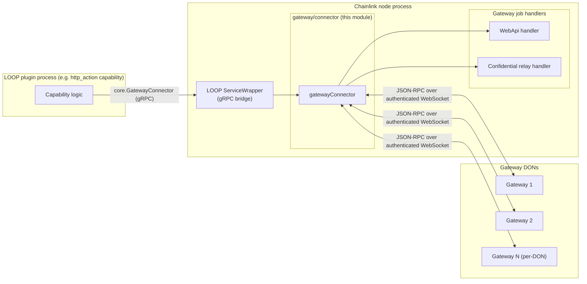
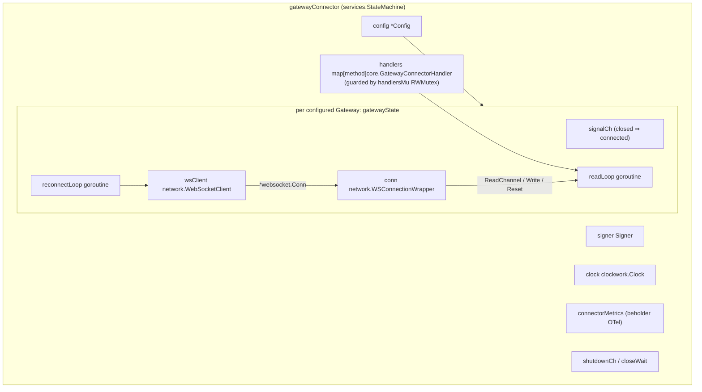
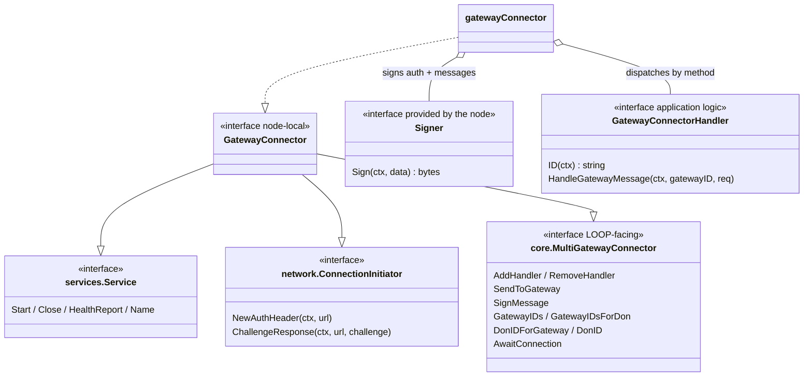
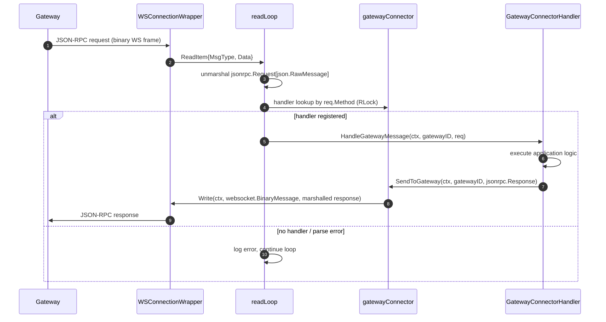
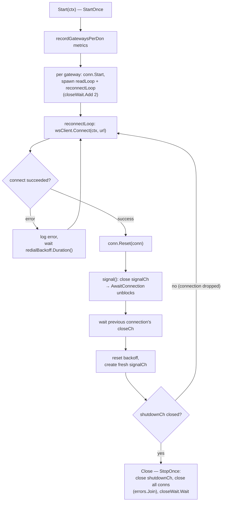
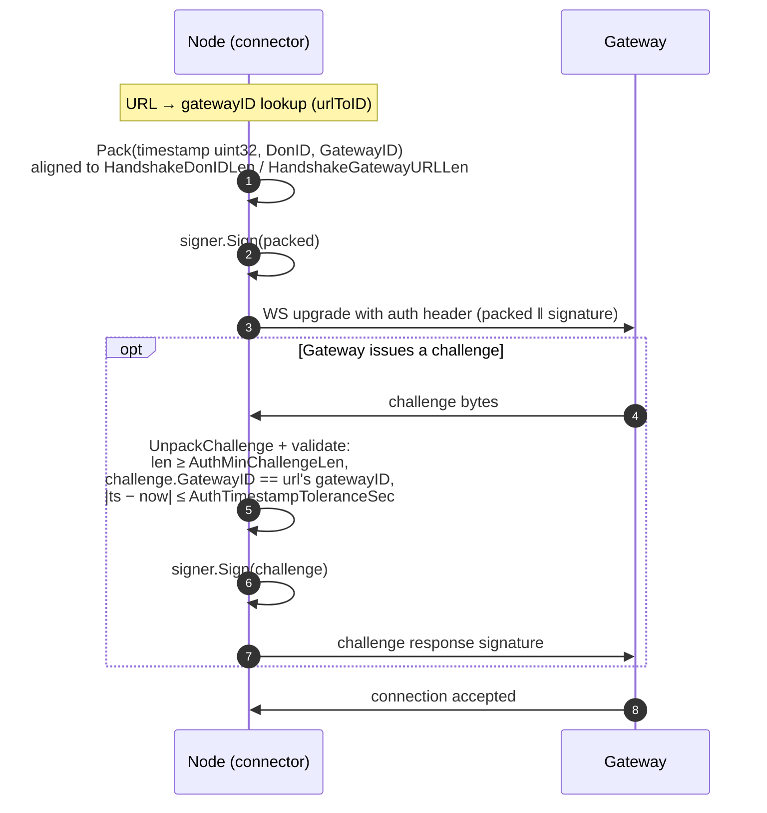

# Gateway Connector

> **Module:** `chainlink/core/services/gateway/connector`
> **Parent:** [Gateway](../gateway.md) | **Siblings:** [Gateway API](gateway_api.md) · [Gateway Handlers](gateway_handlers.md) · [Gateway Network](gateway_network.md)

## 1. Introduction

The **Gateway Connector** is the node-side client that connects a Chainlink node — or a LOOP plugin process running inside it — to a set of remote **Gateway** nodes. It owns:

- **Connection management** — one managed WebSocket connection per configured Gateway, with automatic redial and exponential backoff.
- **Authentication** — signing the connection auth header and challenge/response payloads with the node's private key.
- **Message routing** — dispatching inbound JSON-RPC requests from Gateways to registered [`GatewayConnectorHandler`](gateway_handlers.md)s (keyed by RPC method name) and writing JSON-RPC responses back to Gateways.
- **Multi-DON addressing** — resolving which Gateways serve which DON (`GatewayIDsForDon`, `DonIDForGateway`).
- **Lifecycle & observability** — `Start`/`Close` service semantics, health reporting, and Beholder/OTel metrics.

The same interface is exposed **over gRPC to LOOP plugin processes** via the Loop framework, which is how CRE capabilities (e.g. `http_action`) reach Gateways from inside their plugin sandbox.

Core source files:

| File | Contents |
| --- | --- |
| `chainlink/core/services/gateway/connector/connector.go` | `GatewayConnector` interface, `Signer`, `GatewayConnectorHandler`, `gatewayConnector` implementation |
| `chainlink/core/services/gateway/connector/config.go` | `Config`, `GatewayConfig` |
| `chainlink/core/services/gateway/connector/validate_config.go` | `validateConnectorConfig` |
| `chainlink/core/services/gateway/connector/metrics.go` | `connectorMetrics` (`gatewaysPerDon` gauge) |

---

## 2. Architecture

### 2.1 Position in the system

### 2.2 Internal component structure

Key source references: [Gateway Network](gateway_network.md) provides `WSConnectionWrapper`, `WebSocketClient`, `ReadItem`, and the auth-header packing used above.

### 2.3 Interface composition

The public `GatewayConnector` interface is a composition of three contracts (source: `connector.go`, `chainlink-common/pkg/types/core/gateway_connector.go` — see [Core Types](../../Shared_Foundation_Libraries___Domain_Types/types-core.md)):

The implementation also embeds `core.UnimplementedGatewayConnector` for forward compatibility with interface extensions made in `chainlink-common` (see the [LOOP gRPC bindings](../../Plugin_Process_Framework_(Loop)/loop-grpc-bindings.md), which mirror this interface as gRPC services).

### 2.4 Supporting interfaces

| Interface | Provided by | Purpose |
| --- | --- | --- |
| `Signer` | The node (e.g. CSA-key signer from the [Keystore](../keystore.md)) | Signs the keccak-256 hash of data for the auth handshake and outbound messages. |
| `GatewayConnectorHandler` | Node-side handler implementations ([Gateway Handlers](gateway_handlers.md)) or LOOP plugins | Implements the application logic for a set of RPC methods; embeds `core.GatewayConnectorHandler` (`ID`, `HandleGatewayMessage`) and `job.ServiceCtx`. |
| `network.WSConnectionWrapper` | [Gateway Network](gateway_network.md) | Per-gateway connection object: `Reset`, `Write`, `ReadChannel`, `IsConnected`, health reporting, and WS connection metrics. |
| `network.WebSocketClient` | [Gateway Network](gateway_network.md) | Establishes the raw `*websocket.Conn` (with handshake timeout from `WsClientConfig`). |

---

## 3. Configuration

The connector is configured from a **Gateway job spec** on the node (`job.GatewaySpec.GatewayConfig` — see [Job Service](../job_service.md)); the spec carries a JSON/TOML payload that decodes into `connector.Config` (`config.go`):

| Field | Type | Description |
| --- | --- | --- |
| `NodeAddress` | `string` | Hex-encoded node address; decoded to bytes at construction time. |
| `DonID` | `string` | The DON this node belongs to. Used in auth headers (`network.HandshakeDonIDLen` limit) and as the default gateway DON. |
| `Gateways` | `[]GatewayConfig` | The gateway fleet to connect to. |
| `WsClientConfig` | `network.WebSocketClientConfig` | `HandshakeTimeoutMillis` for the WS handshake. |
| `AuthMinChallengeLen` | `int` | Minimum accepted challenge length in `ChallengeResponse`. |
| `AuthTimestampToleranceSec` | `uint32` | Allowed clock skew when validating challenge timestamps. |

Per-gateway `GatewayConfig` (`ID`, `DonID`, `URL`):

- **`ID`** — unique gateway identifier; duplicates are rejected by `NewGatewayConnector`.
- **`URL`** — unique WebSocket URL; also rejected on duplicates. Used to key the URL → ID map for auth.
- **`DonID`** — the gateway's serving DON; **required on every gateway when multi-DON mode is enabled** (enforced by `validateConnectorConfig`).

Construction-time validation (`NewGatewayConnector`) fails fast on: nil dependencies, invalid DON ID (empty or exceeding `HandshakeDonIDLen`), duplicate gateway IDs/URLs, unparsable URLs, and undecodable `NodeAddress`.

---

## 4. Data & Message Flow

### 4.1 Inbound request / outbound response

Notes:

- `readLoop` **does not abort** on handler errors: `HandleGatewayMessage` implementations are responsible for sending an error response back to the Gateway themselves (documented in [Gateway Handlers](gateway_handlers.md)).
- `SendToGateway` marshals the `jsonrpc.Response[json.RawMessage]` and writes it as a **binary** WebSocket frame; it errors if the connector has not started (`gateway.conn == nil`) or the gateway ID is unknown.
- `AwaitConnection(ctx, gatewayID)` blocks callers (including plugins via gRPC) until the target gateway's `signalCh` is closed, i.e. until the first successful (re)connection.

### 4.2 Outbound request from a plugin

LOOP plugins obtain a `core.GatewayConnector` client over gRPC (bridged by `gatewayconnector.ServiceWrapper`, see [LOOP Plugin Core](../../Plugin_Process_Framework_(Loop)/loop-plugin-core.md) and [LOOP gRPC Bindings](../../Plugin_Process_Framework_(Loop)/loop-grpc-bindings.md)). A capability such as `http_action` resolves a gateway via `GatewayIDsForDon` / `DonIDForGateway` and sends its request with `SendToGateway` — see [HTTP Action Capability](../../Workflow___Capability_Runtime_(CRE_Engine)/http_action_capability.md) (`routingGatewayConnector` in `capabilities/http_action/gateway/gateway_outbound_proxy.go`).

---

## 5. Connection Lifecycle & Reconnection

Key behaviors (`connector.go`):

- **Backoff:** `utils.NewRedialBackoff()` is re-created after each successful connection, so a stable link is not penalized by earlier failures.
- **Connection swap:** `WSConnectionWrapper.Reset` atomically installs the new socket and returns a channel that fires when that socket closes; the reconnect loop waits on it so only one live socket per gateway exists at a time.
- **Handler registry:** `AddHandler` / `RemoveHandler` operate *all-or-nothing* across the supplied method list, under `handlersMu`, and reject duplicate/missing method registrations — safe to call while loops are running.
- **Health:** `HealthReport()` merges the connector's own health with every gateway's `WSConnectionWrapper` health report via `services.CopyHealth`.

---

## 6. Security & Authentication

The connector implements `network.ConnectionInitiator`; the [Gateway Network](gateway_network.md) WebSocket client invokes these callbacks during the connection handshake.

### 6.1 Auth header (`NewAuthHeader`)

Security properties:

- **Identity binding** — both the auth header and the challenge embed the gateway ID resolved from the connection URL; a challenge from a different gateway than the one at the negotiated URL is rejected (`network.ErrAuthInvalidGateway`).
- **Replay mitigation** — challenge timestamps must fall within `AuthTimestampToleranceSec` of the node clock (`clockwork.Clock` injected for testability), else `network.ErrAuthInvalidTimestamp`; undersized challenges yield `network.ErrChallengeTooShort`.
- **Key material** — signatures are produced by the injected `Signer`, which the node backs with its CSA private key (see [Keystore](../keystore.md)). The CSA key ID also labels connector metrics.

---

## 7. Multi-DON Routing

For deployments where one node connects to gateways serving multiple DONs:

| Method | Behavior |
| --- | --- |
| `GatewayIDs(ctx)` | All configured gateway IDs. |
| `GatewayIDsForDon(ctx, donID)` | Empty `donID` → all gateway IDs. Otherwise requires **multi-DON mode** (per-gateway `DonID`s configured) and returns only gateways whose `GatewayConfig.DonID` matches. In single-DON mode it returns `nil`. |
| `DonIDForGateway(ctx, gatewayID)` | The per-gateway `DonID` from its `GatewayConfig`. |
| `DonID(ctx)` | The node's own DON ID (`Config.DonID`) — used for auth headers and default routing. |

Validation (`validateConnectorConfig`) guarantees consistency: if multi-DON mode is active, **every** gateway entry must carry a `DonID`.

---

## 8. Observability

- **Metrics (Beholder/OTel)** — see [Beholder Telemetry](../../Telemetry___Observability_Platform/beholder-telemetry.md):
  - `connectorMetrics.gatewaysPerDon` (`metric.Int64Gauge`): emitted at `Start` per DON, labeled with the node's CSA key; skipped when the CSA key is empty.
  - Per-gateway WebSocket connection metrics via `network.NewWSConnectionMetrics(beholder.GetMeter())`, observed with a `gateway_id` attribute on each `WSConnectionWrapper`.
- **Health reporting** — `HealthReport()` aggregates connector + all gateway connection health for the node's health check pipeline ([Node Application](../../Node_Application_Core___Interfaces/node_application.md)).
- **Logging** — a named logger (`GatewayConnector`) with per-gateway loggers scoped by `URL`; connection errors, reconnections, parse errors, and handler failures are logged with gateway ID and method fields.

---

## 9. Integration Points

| Consumer | Mechanism | Reference |
| --- | --- | --- |
| Gateway job handlers (WebApi relay, confidential relay) | Implement `GatewayConnectorHandler` and register RPC methods via `AddHandler` | [Gateway Handlers](gateway_handlers.md) |
| LOOP plugin processes (standard capabilities) | `StandardCapabilities` holds the connector as `core.GatewayConnector`; `Delegate` exposes it through `gatewayconnector.ServiceWrapper` (gRPC services `GatewayConnector` / `GatewayConnectorHandler`) | [LOOP Plugin Core](../../Plugin_Process_Framework_(Loop)/loop-plugin-core.md), [LOOP gRPC Bindings](../../Plugin_Process_Framework_(Loop)/loop-grpc-bindings.md), [Core Capabilities Runtime](../../Workflow___Capability_Runtime_(CRE_Engine)/core_capabilities_runtime.md) |
| CRE `http_action` capability | Uses `core.GatewayConnector` + `GatewayIDsForDon` for outbound HTTP via gateways | [HTTP Action Capability](../../Workflow___Capability_Runtime_(CRE_Engine)/http_action_capability.md) |
| Node job lifecycle | Instantiated per `job.GatewaySpec` and started/stopped with the job's services | [Job Service](../job_service.md) |
| Message wire format | JSON-RPC `Request`/`Response[json.RawMessage]` codec | [Gateway API](gateway_api.md) |

---

## 10. Testing & Mocks

- Unit tests: `connector_test.go` (lifecycle, auth, send/read flows), `routing_test.go` (multi-DON resolution), `config_test.go` / `validate_config_test.go` (config parsing & validation) — all under `chainlink/core/services/gateway/connector/`.
- Generated mocks for consumers: `connector/mocks/` provides `GatewayConnector`, `GatewayConnectorHandler`, `Signer`, and `UnimplementedGatewayConnector` mocks.
- The `clockwork.Clock` injection makes timestamp-tolerance behavior deterministic in tests.

## 11. Related Documentation

- [Node Platform Services](../../Node_Platform_Services.md) — service-layer overview.
- [Gateway Network](gateway_network.md) — WS client/server, connection wrappers, handshake primitives used by this module.
- [Gateway API](gateway_api.md) — `Message` and JSON-RPC codecs exchanged over the connection.
- [Core Types](../../Shared_Foundation_Libraries___Domain_Types/types-core.md) — `core.GatewayConnector` / `core.MultiGatewayConnector` / `core.GatewayConnectorHandler` shared contracts.
- [Keystore](../keystore.md) — CSA key material backing the `Signer`.
