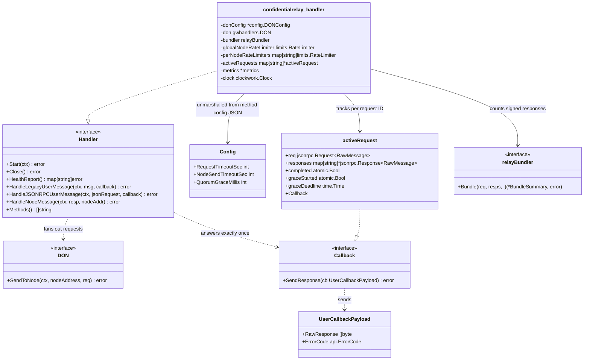
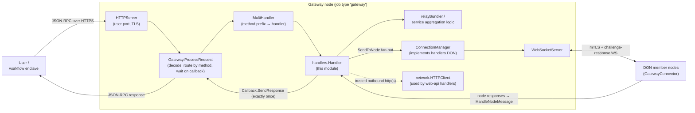
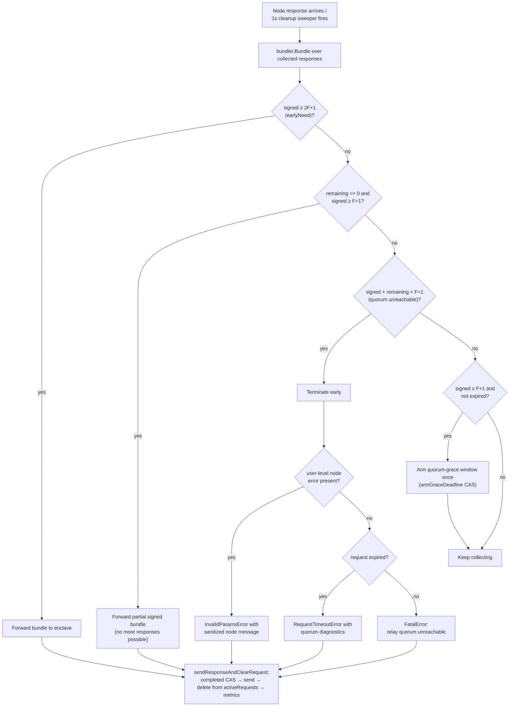
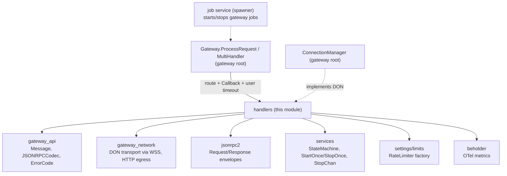

# Gateway Handlers

> **Module:** `chainlink/core/services/gateway/handlers` — the service-logic layer of the [Gateway](../gateway.md) tier in [Node Platform Services](../../Node_Platform_Services.md)

## 1. Purpose

Gateway *handlers* implement the **per-service business logic** of the Gateway tier. A Gateway job exposes one or more named services (e.g. `web-api-capabilities`, `confidential-compute-relay`, `vault`); each service is routed to a `Handler` that owns the decisions the Gateway makes about a request:

- how the user request is **fanned out** to the member nodes of a DON,
- how node responses are **aggregated** (bundling, quorum counting, signatures),
- **when** exactly one response is sent back to the user, and with which gateway `ErrorCode`,
- which JSON-RPC **method names** the service accepts.

The module itself is a thin, contract-first package:

| Area | File | Contents |
|---|---|---|
| Core contract | `handlers/handler.go` | `Handler`, `DON`, `Callback`, `UserCallbackPayload` |
| Web-API capability wire types | `handlers/capabilities/webapi.go` | `Request`, `Response`, `Response.Validate()` |
| Confidential relay implementation | `handlers/confidentialrelay/handler.go` | production `Handler` implementing quorum-aware relay bundling |

Concrete handler *construction* (mapping handler type strings to implementations and injecting dependencies) lives in the gateway root package — see [Gateway → Server-side orchestration](../gateway.md#5-server-side-orchestration-module-root).

## 2. Core abstractions

### 2.1 `Handler` — the service contract

```go
type Handler interface {
    job.ServiceCtx // Start(ctx)/Close() lifecycle, plus HealthReport()/Name()
    HandleLegacyUserMessage(ctx, msg *api.Message, callback Callback) error
    HandleJSONRPCUserMessage(ctx, jsonRequest jsonrpc.Request[json.RawMessage], callback Callback) error
    HandleNodeMessage(ctx, resp *jsonrpc.Response[json.RawMessage], nodeAddr string) error
    Methods() []string
}
```

The interface fixes a strict concurrency and lifecycle contract (documented in `handler.go`):

1. `Start()` → a series of `Handle*UserMessage` / `HandleNodeMessage` calls **executed in parallel** (handlers must be thread-safe) → `Close()`.
2. Each user request is processed by its own goroutine, which calls `Handle*UserMessage` and then waits on the supplied `Callback` with a timeout (that wait lives in `Gateway.ProcessRequest` — see [Gateway → User request lifecycle](../gateway.md#32-user-request-lifecycle)).
3. `HandleNodeMessage` must be **non-blocking** and must validate the response — no assumptions are made about which goroutine calls it.
4. `Methods()` returns the method names the handler supports; they must be **globally unique across all handlers**, because the `MultiHandler` routes by method prefix (see [Gateway → gateway.go](../gateway.md#5-server-side-orchestration-module-root)).
5. `HandleLegacyUserMessage` is the legacy signed-`api.Message` entry point (see [gateway_api](gateway_api.md)); modern handlers may reject it — the confidential relay handler does.

### 2.2 `DON` and `Callback` — the handler's ports

```go
// Representation of a DON from a Handler's perspective (thread-safe).
type DON interface {
    SendToNode(ctx context.Context, nodeAddress string, req *jsonrpc.Request[json.RawMessage]) error
}

// Exactly one response must be sent per user request.
type Callback interface {
    SendResponse(cb UserCallbackPayload) error
}

type UserCallbackPayload struct {
    RawResponse []byte        // encoded JSON-RPC response bytes
    ErrorCode   api.ErrorCode // gateway-level outcome, mapped to HTTP status by the caller
}
```

- **`DON`** is implemented by the gateway's `ConnectionManager` and hides the authenticated WebSocket transport (challenge-response handshake, keepalive) behind a single `SendToNode` call — transport details are documented in [gateway_network](gateway_network.md).
- **`Callback`** is implemented per-request by `Gateway.ProcessRequest`; the caller blocks on it, maps `api.ErrorCode` to an HTTP status via `api.ToHTTPErrorCode`, and writes `RawResponse` to the user.

### 2.3 Component model



## 3. Architecture & position in the Gateway

Handlers are the *middle* of the Gateway pipeline: the HTTP server decodes the user's JSON-RPC request, the `Gateway.ProcessRequest` dispatcher selects the handler by method prefix, the handler drives the DON round-trip, and the connection layer performs the authenticated transport to nodes.



**What this module does *not* own** (documented elsewhere, to avoid duplication):

- WebSocket/HTTP transport, handshake, SSRF-safe egress → [gateway_network](gateway_network.md)
- Signed `api.Message` envelope, `JSONRPCCodec`, error-code → JSON-RPC/HTTP mapping → [gateway_api](gateway_api.md)
- Node-side connection maintenance and LOOP gRPC exposure → [gateway_connector](gateway_connector.md)
- Job-spec parsing, service→handler wiring, sharding → [Gateway root page](../gateway.md)

## 4. Request lifecycle (data flow)

The sequence below is the generic handler pipeline, instantiated here with the confidential relay handler (the most complete implementation in the module):

```mermaid
sequenceDiagram
    autonumber
    participant U as User / workflow enclave
    participant G as Gateway.ProcessRequest
    participant H as confidentialrelay handler
    participant D as ConnectionManager (DON)
    participant N as DON member nodes

    U->>G: JSON-RPC request (relay method)
    G->>H: HandleJSONRPCUserMessage(req, callback)
    H->>H: validate ID (non-empty, ≤200 chars, unique) + register activeRequest
    par fan-out, each send bounded by NodeSendTimeoutSec
        H->>D: SendToNode(node₁, req)
        D->>N: WS frame
    and
        H->>D: SendToNode(nodeₙ, req)
        D->>N: WS frame
    end
    D-->>H: send failures counted; if reachable nodes < F+1 → fail fast
    loop per node response (non-blocking)
        N-->>H: HandleNodeMessage(resp, nodeAddr)
        H->>H: rate-limit check → addResponseForNode (first response wins)
        H->>H: bundler.Bundle → summary (decodable signed count)
    end
    alt signed responses ≥ 2F+1 (earlyNeed)
        H-->>U: forward signed bundle immediately
    else signed ≥ F+1 (minQuorum)
        H->>H: arm QuorumGraceMillis window once (CAS)
        H-->>U: forward bundle when grace elapses (1s cleanup sweeper)
    else quorum unreachable / expired
        H-->>U: JSON-RPC error (user error, RequestTimeout, or Fatal)
    end
    Note over H,U: completed.CompareAndSwap guarantees exactly one response per request
```

## 5. Implementations

### 5.1 Confidential relay handler (`confidentialrelay`)

A production-grade `Handler` (`var _ gwhandlers.Handler = (*handler)(nil)`) that relays requests from **workflow enclaves** to a relay DON and returns a **bundle of quorum-signed node responses**. The gateway deliberately makes *no trust decision*: it counts decodable signed responses for forwarding policy, while the enclave verifies signatures and quorum — see [Gateway → Security model](../gateway.md#7-security-model) and the [workflows runtime](../../Workflow___Capability_Runtime_(CRE_Engine)/workflows.md) that consumes this service.

**Supported methods.** Two JSON-RPC methods, re-exported from `chainlink-common/pkg/capabilities/v2/actions/confidentialrelay`: `MethodSecretsGet` and `MethodCapabilityExec`. Legacy `api.Message` requests are rejected (`HandleLegacyUserMessage` returns an error).

#### Configuration (`Config`, JSON from the gateway job spec)

| Field | Default | Semantics |
|---|---|---|
| `RequestTimeoutSec` | `30` | Overall lifetime of a relay request. Expired requests are swept, bundled, and terminated by the cleanup goroutine. |
| `NodeSendTimeoutSec` | `10` | Bounds each individual fan-out send; **clamped to ≤ `RequestTimeoutSec`** so a node whose WebSocket accepts no writes cannot delay delivery to the rest of the DON. |
| `QuorumGraceMillis` | `10 000` | Extra wait after the first `F+1` signed responses before forwarding whatever has been collected. Clamped to ≤ `RequestTimeoutSec`; a negative value disables the grace window (wait until expiry instead). It bounds how long a DON that answers with quorum but never reaches `2F+1` holds a viable bundle past the caller's own HTTP deadline. |

Quorum thresholds derive from the DON configuration (`config.DONConfig.F`, `Members`, `DonID` — see [Gateway → Configuration](../gateway.md#6-configuration)): `minQuorum = F+1`, `earlyNeed = 2F+1`.

#### Bundle-forwarding decision logic

`forwardBundleOrTerminateIfReady` applies the same completion rules to live and *expired* requests (expiry passes `remaining = 0`, because waiting can no longer improve the bundle):



Key properties of the algorithm:

- **First response per node wins.** `addResponseForNode` ignores duplicates; collected responses are never replaced, so the signed count only grows (the sweeper can safely forward after grace).
- **Gateway stays a dumb relay.** The `relayBundler` counts *decodable* signed responses; signature and quorum verification are the enclave's responsibility.
- **Exactly-once response.** Concurrent completion paths (live forward, terminal-state forward, quorum grace, expiry) all race through `sendResponseAndClearRequest`; only the first claimer of the `completed` CAS sends, deletes the request, and records metrics.
- **Fail-fast on unreachable quorum.** After fan-out, if `nodes − sendFailures < F+1` the request is failed immediately rather than waiting for the timeout.

#### Background maintenance

`Start` (`StartOnce` via the [services](../../Shared_Foundation_Libraries___Domain_Types/services.md) `StateMachine`) launches a cleanup goroutine on an injected `clockwork` clock, ticked every `defaultCleanUpPeriod` (1 s):

- **`forwardGracedRequests`** — forwards bundles whose grace window elapsed (a request that armed the window is guaranteed to hold ≥ `F+1` signed responses).
- **`removeExpiredRequests`** — bundles whatever was collected for requests older than `RequestTimeoutSec`, forwarding a viable partial bundle or emitting a `RequestTimeoutError`.

Sweeping by ticker (instead of per-request timers) keeps every completion path on a goroutine that observes `stopCh`, so `Close()` is clean. `Close` (`StopOnce`) also closes the rate limiters.

#### Abuse containment

- **Rate limiting** — a global limiter plus one limiter per DON member, created from the `limits.Factory` using CRE settings (`GatewayConfidentialRelayGlobalRate`, `GatewayConfidentialRelayPerNodeRate`); see [settings/limits](../../Shared_Foundation_Libraries___Domain_Types/settings.md). Node messages from addresses not in `DONConfig.Members` are rejected outright.
- **Request-ID hygiene** — non-empty, ≤ 200 characters, unique among active requests.
- **Log-spam containment** — best-effort decoding of `workflow_id`/`execution_id` labels from request params happens at debug level; malformed params are still fanned out (validation belongs to the relay nodes).

### 5.2 Web-API capability wire types (`capabilities`)

`capabilities/webapi.go` defines the JSON contract used by handlers that proxy **trusted outbound HTTP calls** on behalf of workflows (the `web-api-capabilities` handler family wired in the gateway root — see [Gateway → Architecture](../gateway.md#3-architecture); the CRE-side counterpart is the [http_action capability](../../Workflow___Capability_Runtime_(CRE_Engine)/http_action_capability.md)):

- **`Request`** — `url` (only `http`/`https`), `method` (default `GET`), `headers`, `body`, `timeoutMs`, `maxBytes` (response-size cap; the gateway's own max response size takes precedence if smaller), and `WorkflowID` for correlation. Outbound calls execute through the SSRF-hardened `network.HTTPClient` documented in [gateway_network](gateway_network.md).
- **`Response`** — `executionError` + `errorMessage` for non-HTTP failures, or `statusCode`/`headers`/`body` for whatever HTTP response was received (2xx/4xx/5xx alike).

`Response.Validate()` enforces a mutually exclusive shape, so a response can never be both "failed to execute" and "HTTP result":

| Condition | Invariant |
|---|---|
| `executionError == true` | `errorMessage` required; `statusCode`, `headers`, `body` must be empty |
| `executionError == false` | `statusCode` must be a valid HTTP code (100–599) |

### 5.3 Other handlers

Additional handler implementations (`vault`, `http-capabilities` v2, `dummy`, …) are registered in the gateway root's handler factory, which maps handler type strings from the job spec to constructors and injects dependencies (chains, data sources, `network.HTTPClient`, capability registries, `limits.Factory`). That wiring is covered in [Gateway → Server-side orchestration](../gateway.md#5-server-side-orchestration-module-root) and is not duplicated here.

## 6. Module dependencies

Handlers sit on top of `chainlink-common` primitives and plug into the gateway's transport layer. The handler code lives in the `github.com/smartcontractkit/chainlink/v2` module (`chainlink/go.mod`) and consumes the separate `github.com/smartcontractkit/chainlink-common` module (`chainlink-common/go.mod`) for envelopes, service state machines, rate limiting, and telemetry.



| Dependency | Used for | Reference |
|---|---|---|
| `gateway/api` | Legacy `Message` envelope, `JSONRPCCodec`, `ErrorCode` → JSON-RPC/HTTP mapping | [gateway_api](gateway_api.md) |
| `gateway/network` | `DON`-side transport (authenticated WebSocket server) and HTTP egress client | [gateway_network](gateway_network.md) |
| `chainlink-common/pkg/jsonrpc2` | `Request[json.RawMessage]` / `Response[json.RawMessage]` wire envelopes | [jsonrpc2](../../Shared_Foundation_Libraries___Domain_Types/jsonrpc2.md) |
| `chainlink-common/pkg/services` | `StateMachine` lifecycle (`StartOnce`/`StopOnce`), `StopChan`, `HealthReport` | [services](../../Shared_Foundation_Libraries___Domain_Types/services.md) |
| `chainlink-common/pkg/settings/limits` | Global/per-node rate limiters (`limits.Factory`, `RateLimiter`) | [settings](../../Shared_Foundation_Libraries___Domain_Types/settings.md) |
| `chainlink-common/pkg/beholder` | OTel metric counters for relay outcomes | [beholder-telemetry](../../Telemetry___Observability_Platform/beholder-telemetry.md) |
| `job.ServiceCtx` | Uniform Start/Close service lifecycle within the node | [job_service](../job_service.md) |

## 7. Observability

The confidential relay handler registers three Beholder `Int64Counter` metrics (labelled by `don_id`), incremented only after a response was **successfully sent** (so concurrent completion losers never double-count):

| Metric | When incremented |
|---|---|
| `confidential_relay_gateway_request_internal_error` | response with `api.HandlerError` (also labelled with `error`) |
| `confidential_relay_gateway_request_user_error` | response with `api.UnsupportedDONIdError` |
| `confidential_relay_gateway_request_success` | response with `api.NoError` (successful bundle forward) |

Structured logging is correlation-first: each request gets a logger bound to `method`, `requestID`, `workflowID`, `executionID` (the latter two best-effort decoded from params; node responses inherit them from the request they answer), so gateway lines line up with relay-DON and enclave logs for the same workflow execution. Broader gateway metrics (latency, connections) are described in [Gateway → Observability](../gateway.md#8-observability).

## 8. Testing & operational notes

- Handlers are constructed with injected dependencies (`clockwork.Clock`, `limits.Factory`, `logger.Logger`, `config.DONConfig`), which makes quorum/grace/expiry behaviour unit-testable without real transport; `NewHandler` validates and clamps all timing configuration up front.
- The node-side and enclave-side counterparts are exercised in CRE system tests via `GatewayServiceConfig` — see [system-tests](../../Dev,_Test___Simulation_Environments/system-tests.md).
- Every handler exposes `HealthReport()` (delegating to the [services](../../Shared_Foundation_Libraries___Domain_Types/services.md) state machine), which the gateway aggregates into node health.
- Gateway-level configuration that shapes handler behaviour (service → handler mapping, DON/shard membership with the `3F+1` invariant, server limits) is described in [Gateway → Configuration](../gateway.md#6-configuration).

## 9. Component reference

| Component | Location | Kind | Summary |
|---|---|---|---|
| `Handler` | `handlers/handler.go` | interface | Per-service request-processing contract; thread-safe, one instance per DON. |
| `DON` | `handlers/handler.go` | interface | Thread-safe `SendToNode` port implemented by the gateway `ConnectionManager`. |
| `Callback` | `handlers/handler.go` | interface | Exactly-once response channel back to `Gateway.ProcessRequest`. |
| `UserCallbackPayload` | `handlers/handler.go` | struct | `RawResponse` bytes + gateway `api.ErrorCode`. |
| `capabilities.Request` | `handlers/capabilities/webapi.go` | struct | Trusted outbound-HTTP request parameters for web-api capabilities. |
| `capabilities.Response` | `handlers/capabilities/webapi.go` | struct | HTTP result or execution error; `Validate()` enforces shape. |
| `confidentialrelay.Config` | `handlers/confidentialrelay/handler.go` | struct | Timeout/grace configuration with defaults and clamping. |
| `confidentialrelay.handler` | `handlers/confidentialrelay/handler.go` | struct | Quorum-aware relay bundling with rate limiting, metrics, and sweeper-based expiry. |
| `relayBundler` / `BundleSummary` | `handlers/confidentialrelay` | interface | Counts decodable signed/error/undecodable responses; gateway performs no signature verification. |
| `activeRequest` | `handlers/confidentialrelay/handler.go` | struct | Per-request state: responses, completion/grace CAS flags, deadline, callback. |

## 10. Related documentation

- [Gateway](../gateway.md) — parent module: orchestration, configuration, security model.
- [gateway_api](gateway_api.md) — signed message envelopes, JSON-RPC codec, error-code mapping.
- [gateway_network](gateway_network.md) — WebSocket server/client, handshake, hardened HTTP client.
- [gateway_connector](gateway_connector.md) — node-side connection maintenance exposed to LOOP plugins.
- [Node Platform Services](../../Node_Platform_Services.md) — sibling platform services ([job_service](../job_service.md), [keystore](../keystore.md)).
- [Workflow & Capability Runtime (CRE Engine)](../../Workflow___Capability_Runtime_(CRE_Engine).md) — consumers of relay/web-api services ([workflows](../../Workflow___Capability_Runtime_(CRE_Engine)/workflows.md), [http_action_capability](../../Workflow___Capability_Runtime_(CRE_Engine)/http_action_capability.md), [capabilities](../../Workflow___Capability_Runtime_(CRE_Engine)/capabilities.md)).
- [Telemetry & Observability Platform](../../Telemetry___Observability_Platform.md) — Beholder meters ([beholder-telemetry](../../Telemetry___Observability_Platform/beholder-telemetry.md)).
