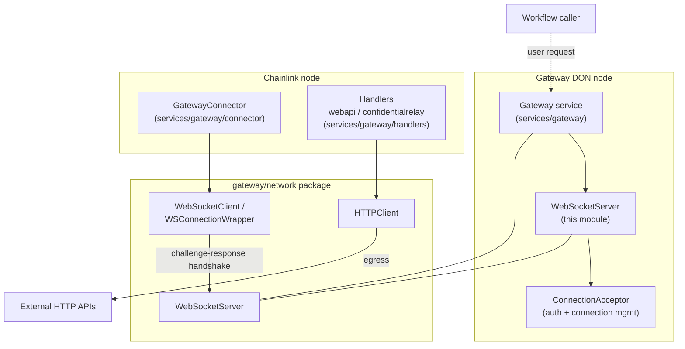
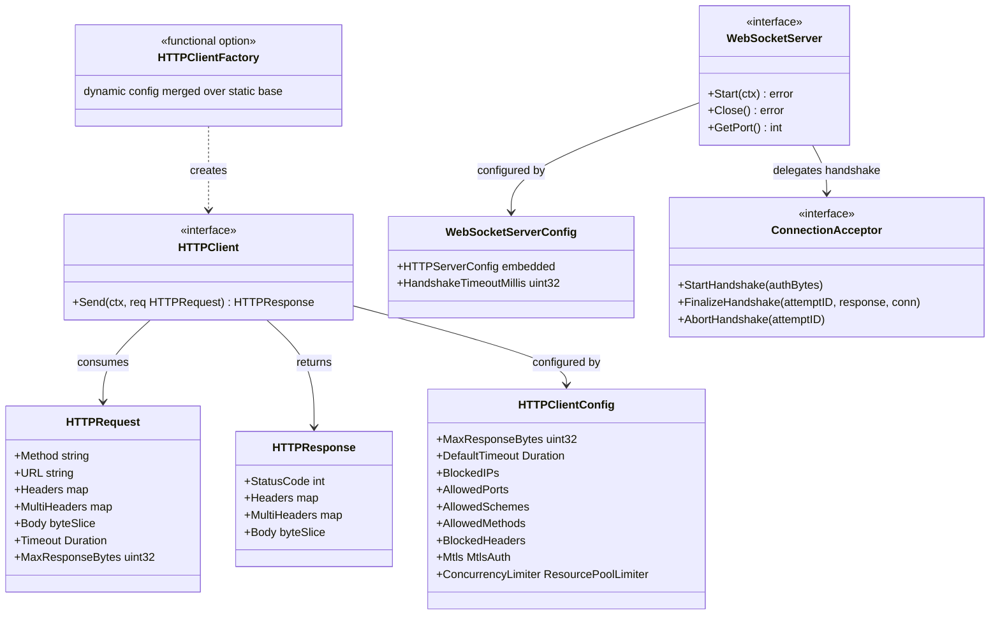
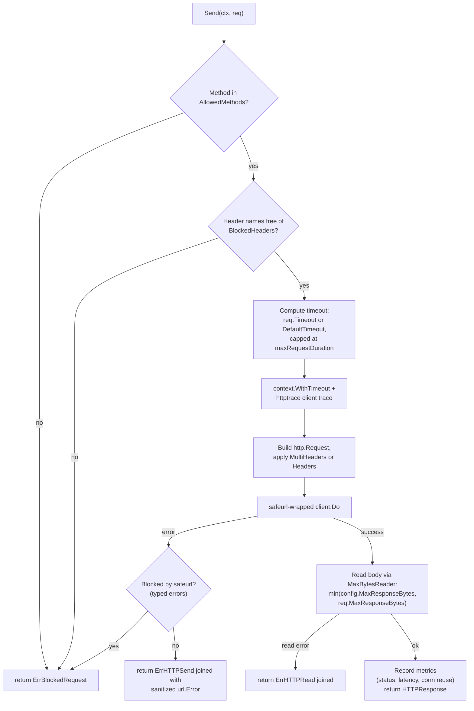
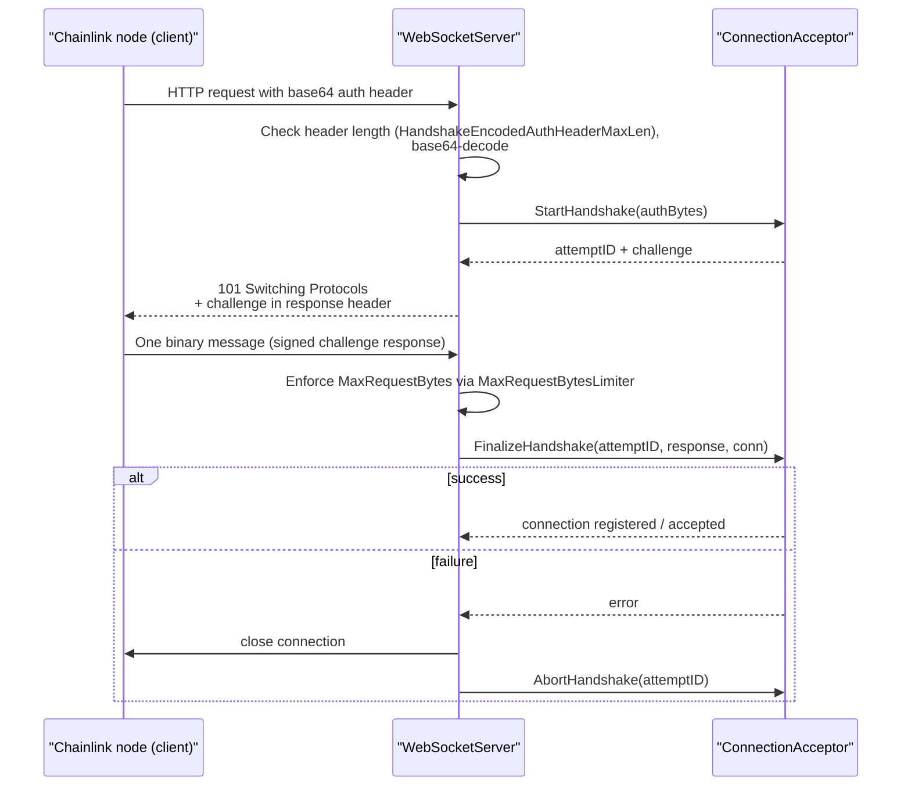

# Gateway Network

> **Package:** `chainlink/core/services/gateway/network/`
> **Parent module:** [Node_Platform_Services/gateway](../gateway.md)

## Introduction

The `gateway_network` module provides the transport primitives of the Gateway subsystem: an outbound, security-hardened **HTTP client** and an inbound, authenticated **WebSocket server**. It is deliberately free of gateway business logic — its job is to move bytes securely so that higher layers (the [Gateway DON server](../gateway.md), its [handlers](gateway_handlers.md), and the node-side [gateway connector](gateway_connector.md)) never have to build sockets themselves.

Two components make up the module's public surface:

| Component | File | Role |
|---|---|---|
| `HTTPClient` | `network/httpclient.go` | Sends HTTP requests on behalf of gateway handlers, with SSRF protection, allow-lists, mTLS, size/timeout caps and metrics. |
| `WebSocketServer` | `network/wsserver.go` | Accepts authenticated, challenge-response WebSocket connections from chainlink nodes, exposing them to a pluggable `ConnectionAcceptor`. |

The same package also contains companion types that are consumed elsewhere (a `WebSocketClient` / `WSConnectionWrapper` used by the node-side connector, an `HTTPServer` used by the Gateway DON, and connection/WebSocket metrics). Those are documented from the consumer side — see [gateway_connector](gateway_connector.md) and the parent [gateway](../gateway.md) page — while this page focuses on the two core components above.

---

## Architecture

The gateway subsystem is asymmetric: a **Gateway DON node** runs servers and receives node connections, while a **chainlink node** runs a connector that dials out to gateways. `gateway_network` supplies primitives for both directions, but this module's core components are the server side (`WebSocketServer`) and the handler-side HTTP egress (`HTTPClient`).



Key relationships:

- The [Gateway service](../gateway.md) receives an `HTTPServer` from this package and registers itself as its `HTTPRequestHandler` (`httpServer.SetHTTPRequestHandler(gw)`), which routes decoded user/node messages into [handlers](gateway_handlers.md).
- The `WebSocketServer` delegates all authentication decisions to a `ConnectionAcceptor` (supplied by the gateway layer); the module only orchestrates the transport-level handshake.
- On the node side, the [gateway connector](gateway_connector.md) instantiates `network.NewWebSocketClient(...)` and `network.NewWSConnectionWrapperWithObserver(...)` per configured gateway URL and performs the matching client half of the handshake.
- Handler-side HTTP egress: the [webapi capability handler](gateway_handlers.md) converts a workflow's request into `HTTPRequest`, calls `HTTPClient.Send`, and maps the result back to a `Response`.

### Component and type model



---

## HTTPClient

### Interface

```go
type HTTPClient interface {
    Send(ctx context.Context, req HTTPRequest) (*HTTPResponse, error)
}
```

A single entry point executes a fully validated, time- and size-limited HTTP request. All construction goes through `NewHTTPClient(config, lggr)` or the `NewHTTPClientFactory` variant.

### Configuration model

`HTTPClientConfig` separates **network access control** from **resource limits**:

| Category | Fields | Purpose |
|---|---|---|
| IP controls | `AllowedIPs`, `AllowedIPsCIDR`, `BlockedIPs`, `BlockedIPsCIDR` | Enforced by `safeurl`, which additionally blocks internal/link-local IPs by default (SSRF defence). |
| Port controls | `AllowedPorts`, `AllowedPortRanges` | Range strings (e.g. `"8000-9000"`) are expanded via `nat.ParsePortRange` (`docker/go-connections`) at construction and merged into `AllowedPorts`. Start port must be ≥ 1. |
| Protocol controls | `AllowedSchemes`, `AllowedMethods` | Defaults: `http`/`https`; `GET`, `POST`, `PUT`, `PATCH`, `DELETE` (case-insensitive method match). |
| Header controls | `BlockedHeaders` | Case-insensitive block-list checked before dispatch. |
| Resource limits | `MaxResponseBytes`, `DefaultTimeout` | Response body capped via `http.MaxBytesReader`; per-request `Timeout` overrides the default but is capped by an internal `maxRequestDuration` (60 s). |
| mTLS | `Mtls *gateway.MtlsAuth`, `ConcurrencyLimiter` | Client certificate presented on outbound requests; the limiter bounds in-flight mTLS requests. |

Defaults are applied by `ApplyDefaults()` when constructing a client:

| Setting | Default |
|---|---|
| Allowed ports | 80, 443 |
| Allowed schemes | `http`, `https` |
| Allowed methods | `GET`, `POST`, `PUT`, `PATCH`, `DELETE` |
| Max response bytes | ~26.4 KB (`26.4 * utils.KB`) |
| Default timeout | 5 s |
| Max request duration (hard cap) | 60 s |
| Blocked headers | `host`, `content-length`, `transfer-encoding`, `user-agent`, `upgrade`, `expect`, `connection`, `keep-alive`, `te`, `trailer`, `x-forwarded-for`, `x-forwarded-host`, `x-forwarded-proto`, `x-real-ip` |

The blocked-header list prevents clients of the gateway from spoofing identity/routing metadata (`x-forwarded-*`, `x-real-ip`), hijacking connection semantics (`connection`, `upgrade`, `expect`), or tampering with framing (`content-length`, `transfer-encoding`, `trailer`).

### Request processing flow



Notable behaviours:

- **Multi-value headers.** `HTTPRequest.MultiHeaders` (`map[string][]string`) takes precedence over the deprecated single-value `Headers`; responses always populate `MultiHeaders` and provide comma-joined `Headers` for backward compatibility.
- **Redirects disabled.** The safeurl config installs a `CheckRedirect` hook that always fails, so redirects can never bypass IP/port/scheme allow-lists.
- **Error taxonomy.** `ErrBlockedRequest` (validation or safeurl typed errors such as `IPv6BlockedError`, `AllowedPortError`, `AllowedSchemeError`, `InvalidHostError`, `AllowedIPError`, redirects-disabled), `ErrHTTPSend`, and `ErrHTTPRead` let callers distinguish policy violations from transport failures.
- **Log hygiene.** `truncateLogError` reduces `url.Error` messages to `scheme://host` so credentials or paths in URLs are never logged.
- **Metrics.** An `httptrace`-based client trace records request totals, status codes, latency and connection reuse via Prometheus-style metrics.

### mTLS and concurrency limiting

When `Mtls` is set, `NewHTTPClient`:

1. Parses the certificate/key pair and installs a `tls.Config` (min version TLS 1.2) on a cloned default transport.
2. Disables keep-alives on that transport as defence-in-depth against cross-user reuse of authenticated connections.
3. **Requires** a `ConcurrencyLimiter` (`chainlink-common/pkg/settings/limits.ResourcePoolLimiter[int]`); construction fails without one. Requests are wrapped in a `concurrencyLimitedClient` that acquires a slot on the request's own (timeout-capped) context, so waiters self-evict at the request deadline instead of blocking indefinitely.

### Factory pattern for dynamic configuration

```go
func NewHTTPClientFactory(config HTTPClientConfig, lggr logger.Logger) HTTPClientFactory
```

The factory merges a **dynamic** config (typically carrying per-request settings such as mTLS credentials and a concurrency limiter) on top of a **static** base config via `merge`. Only non-zero fields of the dynamic config override the base — a dynamic config can add or override settings but cannot *unset* defaults already populated by the base. This lets the gateway serve multiple handler configurations from one hardened baseline.

---

## WebSocketServer

### Interface

```go
type WebSocketServer interface {
    job.ServiceCtx  // Start(ctx) / Close() lifecycle (see job_service module)
    GetPort() int   // valid after Start() returns; supports dynamic port binding
}
```

`NewWebSocketServer(config *WebSocketServerConfig, acceptor ConnectionAcceptor, lggr logger.Logger, lf limits.Factory)` wires:

- an `http.ServeMux` with two routes: the health-check path (returns `200` with `HealthCheckResponse`) and the configured WS path. Construction **fails** if the WS path collides with the health-check path.
- a `gorilla/websocket.Upgrader` with the configured handshake timeout.
- a base context (cancelled on `Close`) installed via `http.Server.BaseContext`, so all handlers inherit shutdown.

`WebSocketServerConfig` embeds the shared `HTTPServerConfig` (host, port, path, read/write/request timeouts, max request bytes, TLS cert/key paths and limiter factory support) and adds `HandshakeTimeoutMillis`. Defaults: 10 s read/write/request/handshake timeouts, 1 MB max message size.

### Handshake protocol (challenge-response)

The server never authenticates peers itself; it defers to the injected `ConnectionAcceptor`. The protocol runs over HTTP upgrade headers plus one binary WebSocket message:



Failure handling at every stage is defensive: oversize or non-base64 auth headers get `400`, rejected auth gets `401`, a failed upgrade or invalid (non-binary) handshake message triggers connection close plus `acceptor.AbortHandshake(attemptID)` so handshake state can never leak.

### Lifecycle and TLS

- `Start` uses the node's standard `StartOnce` state machine (see [job_service lifecycle](../job_service.md)); the listener is created with `net.ListenConfig` and served in a goroutine, either plain (`Serve`) or TLS (`ServeTLS` with the configured cert/key paths).
- `Close` cancels the base context, calls `http.Server.Shutdown`, and waits on `doneCh` before returning — a clean, drain-then-exit shutdown.
- `GetPort()` reads the bound TCP port from the listener, which supports the common pattern of binding to port `0` and discovering the actual port (used heavily by the [gateway](../gateway.md) and [system tests](../../Dev,_Test___Simulation_Environments/system-tests.md) tooling).

---

## Security model summary

| Threat | Mitigation | Component |
|---|---|---|
| SSRF / access to internal networks | `safeurl` allow-lists + automatic internal-IP blocking, redirects disabled | `HTTPClient` |
| Port/scheme smuggling | Port expansion + allow-lists, scheme allow-list | `HTTPClient` |
| Header spoofing / request smuggling | Blocked-headers list, computed framing headers, multi-header validation | `HTTPClient` |
| Unbounded responses / slowloris-style hangs | `MaxBytesReader`, per-request timeout capped at 60 s | `HTTPClient` |
| Credential leakage across users | Keep-alives disabled for mTLS, concurrency-limited mTLS requests | `HTTPClient` |
| Unauthenticated node connections | Challenge-response handshake delegated to `ConnectionAcceptor` | `WebSocketServer` |
| Oversize handshake messages | Auth-header length cap, `SetReadLimit` from `MaxRequestBytesLimiter` | `WebSocketServer` |
| Transport interception | Optional TLS on the server; mTLS on the client | both |

The hard dependencies underpinning this posture are pinned in [`chainlink/go.mod`](https://github.com/smartcontractkit/chainlink/blob/main/chainlink/go.mod): `github.com/doyensec/safeurl v0.2.5` (URL sanitisation), `github.com/gorilla/websocket` (WebSocket server), and `github.com/docker/go-connections` (port-range parsing).

---

## How this module fits into the system

- **Inbound (Gateway DON):** the [Gateway service](../gateway.md) hosts `WebSocketServer`(s) for user and node traffic. Decoded [`api.Message`](gateway_api.md) envelopes are dispatched to [handlers](gateway_handlers.md) (e.g. the webapi and confidential-relay handlers), which own quorum, timeouts and signing policy.
- **Outbound (handlers):** webapi-style handlers translate workflow HTTP requests into `HTTPRequest` and rely on `HTTPClient` for safe execution; the confidential-relay handler's `Config` (request/node-send timeouts, quorum grace) composes with the client's own timeout caps.
- **Outbound (node side):** the [gateway connector](gateway_connector.md) dials gateways with the package's WebSocket client/wrapper and performs the client half of the same challenge-response handshake, driven by CSA keys and a signer.
- **Lifecycle:** both core components implement the standard service lifecycle contracts shared across the node ([job_service](../job_service.md), [`services.StateMachine`](../../Shared_Foundation_Libraries___Domain_Types/services.md)).
- **Configuration & limits:** resource limiting (`ResourcePoolLimiter`, `limits.Factory`) comes from the shared [settings/limits library](../../Shared_Foundation_Libraries___Domain_Types/settings.md); logging uses the shared [logger](../../Shared_Foundation_Libraries___Domain_Types/logger.md); the `MtlsAuth` type lives in the shared [gateway domain types](../../Shared_Foundation_Libraries___Domain_Types/types-core.md).

## Related documentation

- [Node_Platform_Services](../../Node_Platform_Services.md) — parent services catalog
- [gateway](../gateway.md) — Gateway DON server that consumes this package
- [gateway_api](gateway_api.md) — `Message` wire format carried over these transports
- [gateway_handlers](gateway_handlers.md) — primary consumers of `HTTPClient`
- [gateway_connector](gateway_connector.md) — node-side WebSocket client counterpart
- [job_service](../job_service.md) — `ServiceCtx` lifecycle contract
- [settings/limits](../../Shared_Foundation_Libraries___Domain_Types/settings.md) — resource-pool limiting used by mTLS and WS message-size limits
