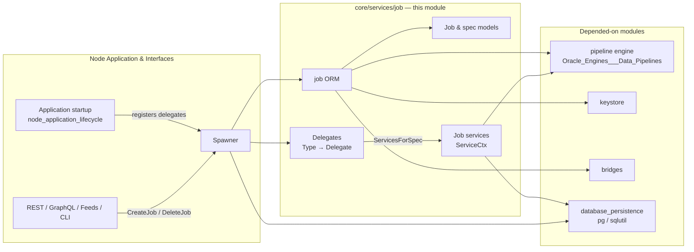
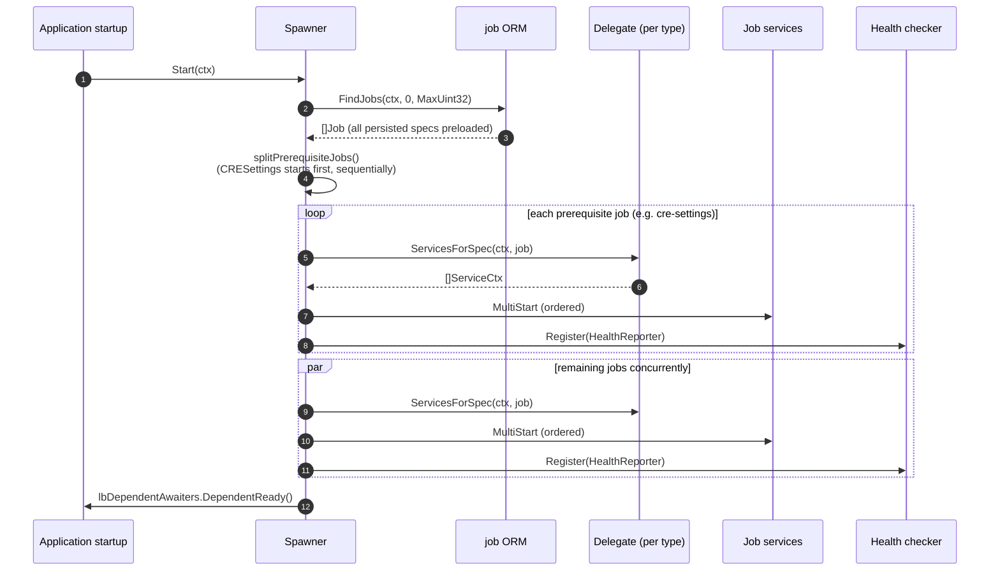
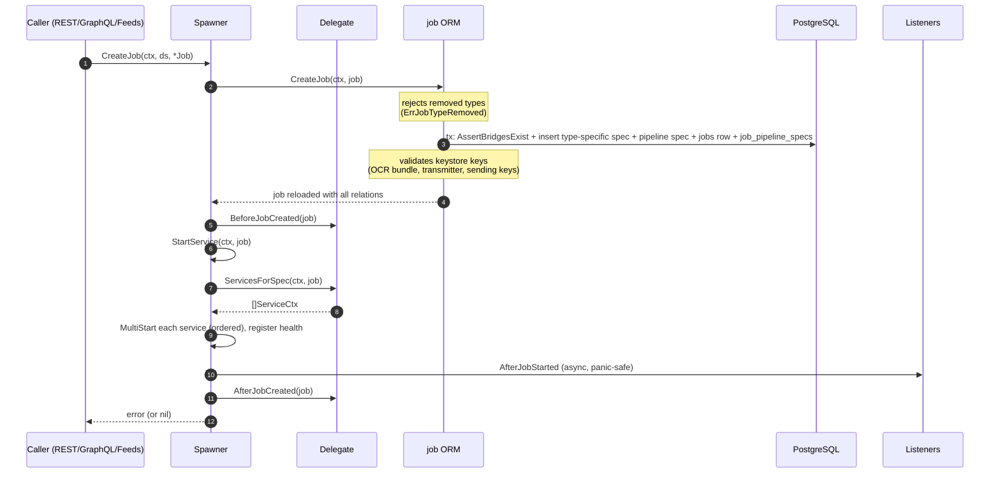
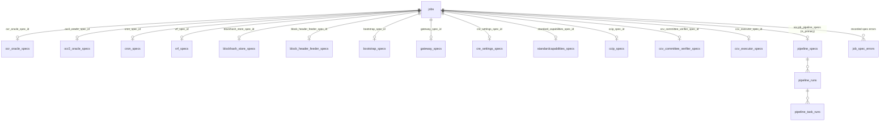

# Job Service (`core/services/job`)

> **Module page:** `Node_Platform_Services/job_service.md` · **Parent:** [Node_Platform_Services](../Node_Platform_Services.md)

## 1. Purpose and Scope

The **job service** package (`chainlink/core/services/job`) is the **central job registry and lifecycle manager** of a Chainlink node. A *job* is the unit of work configuration on a node: a declarative **job spec** (TOML/JSON, persisted in PostgreSQL) that describes *what* the node should do — run an OCR/OCR2 oracle, fulfil VRF requests, publish blockhashes, run cron-triggered pipelines, host a gateway, participate in CCIP, execute CRE standard capabilities, and so on.

This package is responsible for:

1. **Domain model** — the `Job` aggregate, the ~18 job `Type`s, and the type-specific spec structs (`OCROracleSpec`, `OCR2OracleSpec`, `VRFSpec`, `CCIPSpec`, `GatewaySpec`, `WorkflowSpec`, `StandardCapabilitiesSpec`, …) that make up a job.
2. **Persistence** — the `job.ORM`, which transactionally creates, deletes, and queries jobs and their associated spec records, and manages pipeline-spec/run records through the pipeline ORM.
3. **Lifecycle orchestration** — the `job.Spawner`, which starts/stops the long-running `ServiceCtx` services backing each job, both at node boot and when jobs are created/deleted at runtime, with ordered `Start`/reverse `Close` semantics and health-checker registration.
4. **Runtime abstractions** — the `Service` / `ServiceCtx` interfaces every job service must satisfy, and the `ServiceAdapter` bridge between the legacy and context-aware interfaces.

Everything else in the node ultimately runs *because* a job spec was registered with this module: oracle engines, the CRE workflow engine, and the gateway all surface their runtime through a job-type `Delegate` handed to the `Spawner`.

## 2. Position in the System



* **Upstream consumers** — [node_application_lifecycle](../Node_Application_Core___Interfaces/node_application/node_application_lifecycle.md) constructs the `Spawner` during `Application` startup and wires a `map[Type]Delegate` contributed by every feature package (OCR/OCR2 oracles, VRF, feeds, workflows, gateway, CCIP, …). The web API and feeds manager route job CRUD through `Spawner.CreateJob` / `Spawner.DeleteJob`.
* **Downstream dependencies** —
  * [pipeline](../Oracle_Engines___Data_Pipelines/pipeline.md) — `pipeline.ORM` stores pipeline specs/runs referenced by jobs; `pipeline.Runner` is the execution engine the spawned services drive.
  * [keystore](keystore.md) — the master keystore validates OCR key bundles, transmitter/sending keys at job-creation time.
  * [bridges](../Node_Application_Core___Interfaces/bridges.md) — `AssertBridgesExist` verifies external adapters referenced by a pipeline before a job is created.
  * [database_persistence](database_persistence.md) — PostgreSQL connectivity, `sqlutil.DataSource`, transaction helpers, and schema migrations (tables `jobs`, `*_specs`, `pipeline_runs`, …).
* **Related platform services** — [feeds_service](feeds_service.md) (job proposals from a Job Distributor), [node_status_reporter](node_status_reporter.md) (reports job health/status), [gateway](gateway.md) (hosts `GatewaySpec` jobs), and the [workflows](../Workflow___Capability_Runtime_(CRE_Engine)/workflows.md) engine (consumes `WorkflowSpec` / `CRESettingsSpec` jobs).

## 3. Architecture Overview

The package is deliberately small — four files — but sits at the center of the node. The responsibilities split cleanly into three sub-modules:

```mermaid
flowchart TB
    subgraph job_service_lifecycle [Sub-module: job_service_lifecycle (spawner.go, common.go)]
        SP["Spawner<br/>(orchestrates start/stop, listeners, health)"]
        DLG["Delegate interface<br/>(per-job-type plugin)"]
        LSN["Listener interface<br/>(job start/stop callbacks)"]
        SVC["Service / ServiceCtx / ServiceAdapter<br/>(runtime contract)"]
    end

    subgraph job_service_persistence [Sub-module: job_service_persistence (orm.go)]
        ORM["ORM interface + orm impl<br/>(CreateJob / DeleteJob / Find*)"]
    end

    subgraph job_service_domain_model [Sub-module: job_service_domain_model (models.go)]
        JT["Type enum + capability maps"]
        JOB["Job aggregate + type-specific specs"]
        PRUN["PipelineRun / StandardCapabilitiesConfig"]
    end

    SP -->|uses| ORM
    SP -->|manages| SVC
    ORM -->|persists| JOB
    JT --- JOB
    PRUN --- JOB
    DLG -->|returns| SVC
```

### Core abstractions at a glance

| Abstraction | Defined in | Role |
|---|---|---|
| `Type` (job type enum) | [job_service_domain_model](job_service/job_service_domain_model.md) | Identifies the job flavour and drives capability lookups (`RequiresPipelineSpec`, `SupportsAsync`, `SchemaVersion`). |
| `Job` + spec structs | [job_service_domain_model](job_service/job_service_domain_model.md) | The persisted aggregate: one `jobs` row, zero/one type-specific spec row, one primary pipeline spec. |
| `ORM` / `ORMConfig` | [job_service_persistence](job_service/job_service_persistence.md) | Transactional persistence, uniqueness & keystore validation, spec-error recording, pipeline-run paging. |
| `Spawner` / `Delegate` / `Listener` | [job_service_lifecycle](job_service/job_service_lifecycle.md) | Runtime management: creates & starts services per job type, stops them in reverse order, notifies listeners, registers health reporters. |
| `Service` / `ServiceCtx` / `ServiceAdapter` | [job_service_lifecycle](job_service/job_service_lifecycle.md) | The lifecycle contract for every job service, plus the migration shim from `Start()` to `Start(ctx)`. |

### Supported job types

Job types are declared in `models.go` and mapped to capability tables:

| Type | Pipeline spec required | Async support | Notes |
|---|:---:|:---:|---|
| `blockheaderfeeder` | ✗ | ✗ | Feeds block headers to blockhash store |
| `blockhashstore` | ✗ | ✗ | Stores block hashes on-chain (VRF support) |
| `bootstrap` | ✗ | ✗ | OCR/OCR2 P2P bootstrap peer |
| `cre-settings` | ✗ | ✗ | Distributes CRE settings overrides (starts first) |
| `cron` | ✓ | ✓ | Cron-scheduled pipeline runs |
| `ccip` | ✗ | ✗ | CCIP DON oracle job |
| `ccv-committee-verifier` / `ccv-executor` | ✗ | ✗ | CCV jobs for CCIP v2 |
| `gateway` | ✗ | ✗ | Hosts a gateway node config |
| `offchainreporting` / `offchainreporting2` | ✗* | ✗ | OCR / OCR2 oracles (*bootstrap variants) |
| `stream` | ✓ | ✓ | Streams job (no dedicated spec row) |
| `vrf` | ✓ | ✓ | VRF / VRFv2 / VRFv2+ fulfilment |
| `standard-capabilities` | ✗ | ✗ | CRE standard capability host |
| `directrequest`, `fluxmonitor`, `webhook`, `workflow` | — | — | **Removed** — rejected by `CreateJob` (`ErrJobTypeRemoved`) and surfaced by `DeprecatedDelegate` |

## 4. Sub-module Documentation

| Sub-module | Files | Documentation |
|---|---|---|
| **job_service_lifecycle** | `spawner.go`, `common.go` | [job_service/job_service_lifecycle.md](job_service/job_service_lifecycle.md) — `Spawner`, `Delegate`, `Listener`, `NullDelegate`/`DeprecatedDelegate`, `Service`/`ServiceCtx`/`ServiceAdapter`, `Config`. |
| **job_service_persistence** | `orm.go` | [job_service/job_service_persistence.md](job_service/job_service_persistence.md) — `ORM` contract & implementation, `ORMConfig`, transactions, validation, pipeline-run paging. |
| **job_service_domain_model** | `models.go` | [job_service/job_service_domain_model.md](job_service/job_service_domain_model.md) — `Type`, `Job`, all spec structs, `JSONConfig`, `PipelineRun`, `StandardCapabilitiesConfig`. |

## 5. Key Data Flows

### 5.1 Node boot: starting all persisted jobs



The startup ordering is significant: **prerequisite jobs** (`CRESettings`) are started to completion *before* any other job, because OCR plugins freeze CRE settings at construction; starting them concurrently would bake in compiled defaults.

### 5.2 Runtime job creation (`Spawner.CreateJob`)



Notable invariants:

* All DB work in `ORM.CreateJob` happens in a single transaction (`sqlutil.Transact` over a `WithDataSource`-derived ORM); spec, pipeline spec, and job rows are committed atomically and the job is re-read fully populated.
* If `ServicesForSpec` fails, the error is persisted via `ORM.TryRecordError` so it shows up as a `SpecError` in the UI, and the job stays registered (with zero services) so `OnDeleteJob` can still be invoked later.
* Services started with `services.MultiStart` are stopped in reverse order on failure/shutdown; every service implementing `services.HealthReporter` is registered with the `Checker`.

### 5.3 Runtime job deletion (`Spawner.DeleteJob`)

```mermaid
sequenceDiagram
    autonumber
    participant API as Caller
    participant SP as Spawner
    participant DEL as Delegate
    participant ORM as job ORM
    participant LSN as Listeners

    API->>SP: DeleteJob(ctx, ds, jobID)
    SP->>SP: look up activeJob (or FindJob + delegate)
    SP->>DEL: BeforeJobDeleted(spec)
    SP->>ORM: tx { DeleteJob(jobID, type); OnDeleteJob(spec) }
    Note over ORM: cascade-deletes job, type-specific spec,<br/>job_pipeline_specs, pipeline_specs (1-min timeout)
    alt job was active
        SP->>SP: stopService(jobID): close services in reverse,<br/>unregister health reporters
        SP->>LSN: AfterJobStopped (async, panic-safe)
    end
    SP-->>API: error (or nil)
```

`OnDeleteJob` runs *inside* the DELETE transaction: DB side effects must precede non-DB side effects so that a rollback leaves the job running and visible.

### 5.4 Entity/relationship model



## 6. Cross-cutting Behaviour

* **Spec-error bookkeeping** — `RecordError` upserts into `job_spec_errors` with an occurrence counter; foreign-key violations from already-deleted jobs are treated as no-ops. `DismissError` removes an error; `TryRecordError` logs failures instead of propagating them.
* **Keystore validation at creation** — OCR jobs validate encrypted key bundles and transmitter addresses; OCR2 jobs validate OCR2 bundles, sending keys vs. transmitter ID exclusivity, per-relay key matches (EVM, Solana, StarkNet, Aptos, Tron, TON, Sui, Stellar), dual-transmission configuration, and that transmitter keys are not reused across jobs (`checkIfKeyLock` via keystore resource mutexes). See [keystore](keystore.md).
* **Bridge validation** — pipeline bridge tasks must reference registered external adapters (`AssertBridgesExist`), enforced both at insert time and when resolving jobs by bridge name. See [bridges](../Node_Application_Core___Interfaces/bridges.md).
* **Pipeline-run paging** — `loadPipelineRunIDs` scans the most recent runs in doubling windows (1 000 → 2 000 → …) bounded by `MIN(id)…MAX(id)` to keep the operator UI responsive on tables with millions of runs; offsets are adjusted across batches.
* **External job IDs** — UUID `ExternalJobID`s can be encoded to 32-byte EVM log topics (`ExternalIDEncodeStringToTopic` / `ExternalIDEncodeBytesToTopic`) for on-chain event filtering.
* **Configuration surface** — the ORM only needs a query timeout (`ORMConfig.DatabaseDefaultQueryTimeout`); the `Spawner` receives a `job.Config` (URL provider) which is passed down to delegates (e.g. the pipeline runner address). Global node configuration is described in [node_application_config](../Node_Application_Core___Interfaces/node_application/node_application_config.md).

## 7. Related Modules

* [pipeline](../Oracle_Engines___Data_Pipelines/pipeline.md) — execution engine (`Runner`) and pipeline persistence used by spawned services.
* [keystore](keystore.md) — key validation performed by the job ORM during job creation.
* [database_persistence](database_persistence.md) — PostgreSQL primitives (`sqlutil.DataSource`, transactions) and schema migrations backing the tables modelled here.
* [node_status_reporter](node_status_reporter.md) — consumes job information for bridge/job status reporting.
* [feeds_service](feeds_service.md) — feeds managers that propose jobs into the spawner.
* [workflows](../Workflow___Capability_Runtime_(CRE_Engine)/workflows.md) — CRE engine backing `workflow`/`standard-capabilities` job types.
* [services (chainlink-common)](../Shared_Foundation_Libraries___Domain_Types/services.md) — `StateMachine`, `MultiStart`, `StopChan`, `HealthReporter` primitives the spawner builds on.
