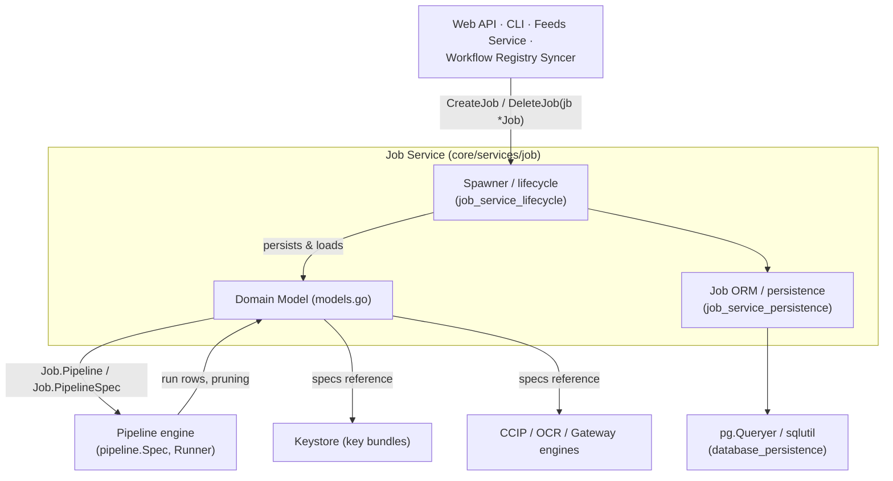
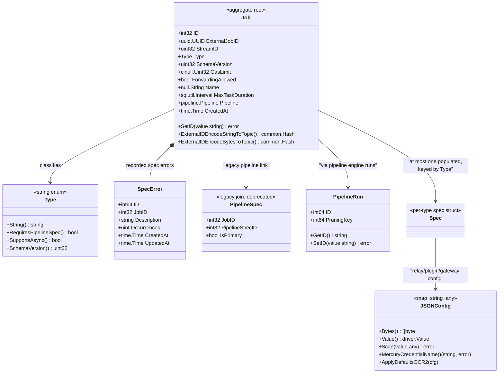
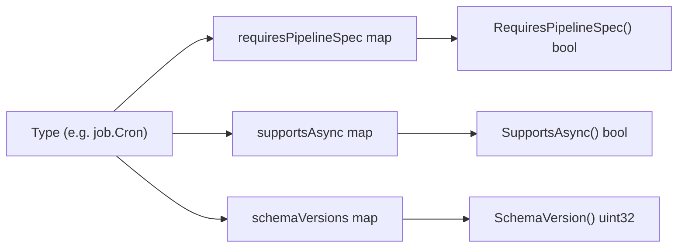
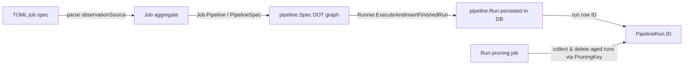
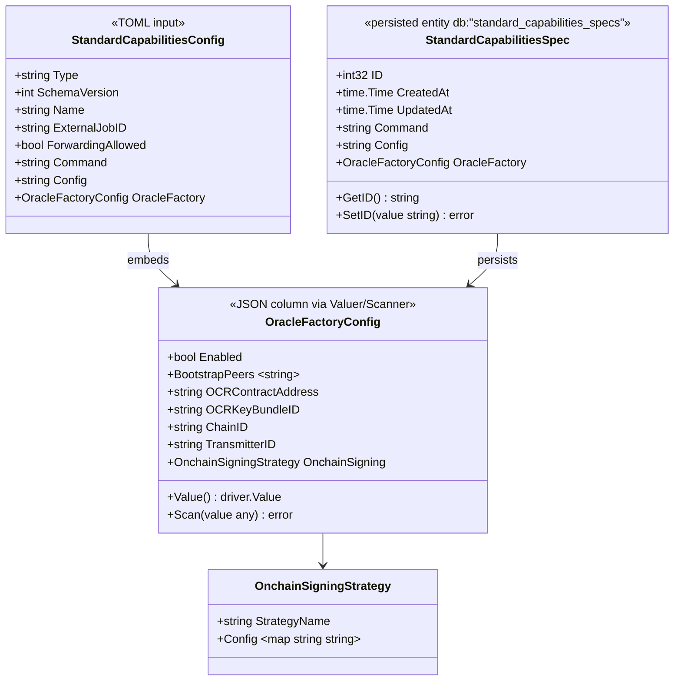
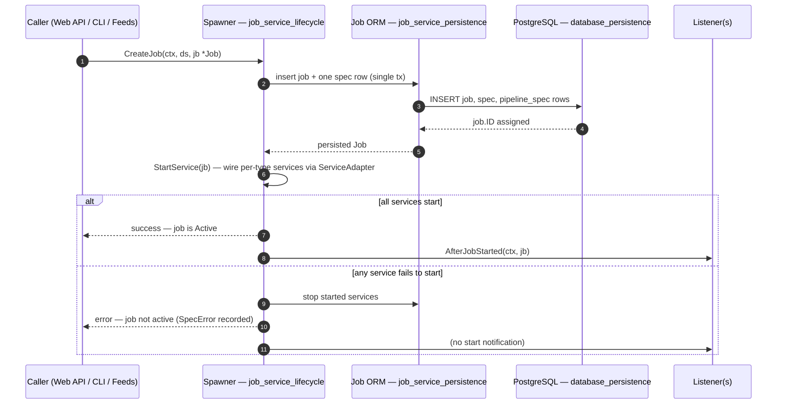
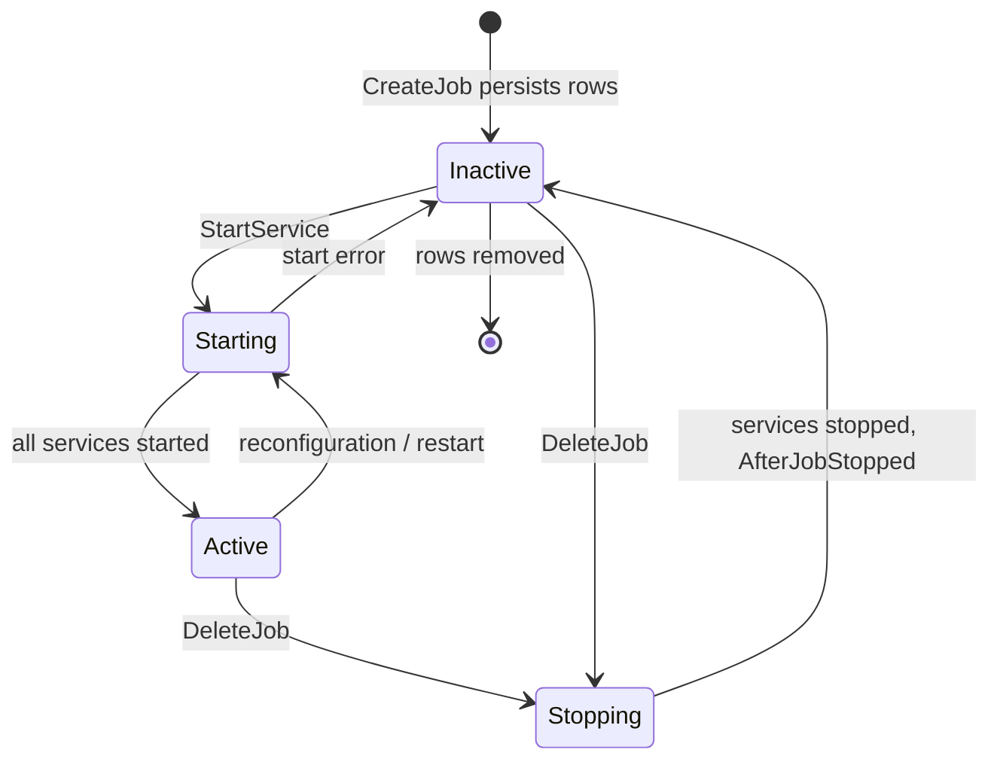

# Job Service — Domain Model

> **Module:** `chainlink/core/services/job/models.go` (package `job`) · **Parent:** [Job Service](../job_service.md)

The **job service domain model** defines the canonical, in-memory representation of a Chainlink node *job* — the unit of configuration that tells the node which off-chain workload to run (an OCR round, a VRF fulfillment, a cron trigger, a WASM workflow, a CCIP oracle, …) and with which chain-specific parameters. Everything the node knows about a job is expressed by the types in this module; process lifecycle (starting/stopping job services) and persistence (reading/writing job rows) live in the sibling modules [Job Service — Lifecycle](job_service_lifecycle.md) and [Job Service — Persistence](job_service_persistence.md).

The module is deliberately "dumb": it contains **no goroutines and no I/O**. Its designated core components are:

| Core component | Role |
|---|---|
| [`PipelineRun`](#6-core-component-pipelinerun) | Slim handle to a persisted pipeline execution run, used for ID addressing and run pruning |
| [`StandardCapabilitiesConfig`](#7-core-component-standardcapabilitiesconfig) | TOML-shaped configuration for the *Standard Capabilities* job type (command-driven capability binaries with an optional OCR oracle factory) |

Alongside these two, the same file hosts the full domain vocabulary — the `Job` aggregate root, the `Type` enumeration with its behavior matrices, and one *spec* struct per job type — which is documented here because the module cannot be understood without it.

---

## 1. Purpose and scope

- **Single source of truth** for what a job *is*: identity (`ID`, `ExternalJobID`), classification (`Type`, `SchemaVersion`), resource limits (`GasLimit`, `MaxTaskDuration`), and the type-specific payload (*spec*).
- **Serialization contracts**: every struct carries both `toml:"…"` tags (job specs are authored as TOML by node operators and deployment tooling) and `db:"…"` tags (rows in the node's PostgreSQL database), plus `driver.Valuer`/`sql.Scanner` implementations for JSON-typed columns.
- **Cross-module glue**: the model translates between operator-facing concepts (TOML specs) and engine-facing concepts (relay IDs, OCR key bundles, pipelines, contract addresses) without owning any of those engines.

**Out of scope** (handled elsewhere, see [Related documentation](#10-related-documentation)): spawning/stopping job services, SQL access, pipeline execution, and chain interaction.

---

## 2. Position in the system

The domain model sits at the center of the job service and is consumed by nearly every other subsystem that needs to know *which jobs exist and how they are configured*.



- The **Spawner** ([lifecycle](job_service_lifecycle.md)) is the only component that mutates the set of active jobs; it accepts fully-parsed `Job` values, hands them to the **ORM** ([persistence](job_service_persistence.md)), and starts per-type services.
- The **pipeline engine** ([Pipeline](../../Oracle_Engines___Data_Pipelines/pipeline.md)) owns execution of `pipeline.Spec` DOT graphs referenced by pipeline-backed jobs; `PipelineRun` in this module is the job-service-side handle to runs it produces.
- EVM-specific value types (`EIP55Address`, `Wei`, `toml.ChainIDInt64`) and shared primitives (`sqlutil.Interval`, `sqlutil.Big`, `types.RelayID`) are provided by the `chainlink-evm` and `chainlink-common` Go modules, pinned in `chainlink/go.mod` (see the `smartcontractkit/chainlink-common` and `smartcontractkit/chainlink-evm` require entries of the `chainlink` module manifest).

---

## 3. The `Job` aggregate

`Job` is the aggregate root. It groups generic fields with **one nullable foreign-key + pointer pair per job type** (the polymorphic-spec pattern):



Key aspects:

- **Polymorphic specs.** Fields such as `OCROracleSpecID/OCROracleSpec`, `VRFSpecID/VRFSpec`, `WorkflowSpecID/WorkflowSpec`, `CCIPSpecID/CCIPSpec`, … each model a 1-to-0..1 association. Exactly one pair is populated for a given job, determined by `Type`; the ORM enforces this on load/save.
- **Legacy pipeline association.** `Job.PipelineSpecID` / `Job.PipelineSpec` (non-nullable) is the *deprecated* link to the primary pipeline spec, superseded by the `job_pipeline_specs` table relationship represented by the `PipelineSpec` struct (`IsPrimary` flag). The parsed DOT graph itself is available on the aggregate as `Job.Pipeline pipeline.Pipeline` (TOML key `observationSource`).
- **Identity.** `ID` is the database key (`int32`); `ExternalJobID` is a UUID used for API addressing and on-chain event filtering. Two helpers encode it into 32-byte EVM log topics:
  - `ExternalIDEncodeStringToTopic` — UUID string with dashes removed (32 characters), hashed;
  - `ExternalIDEncodeBytesToTopic` — the 16 UUID bytes right-padded to 32 bytes.
- **`SpecError`** records validation/execution errors attached to a job (description + occurrence counter), so operators can see *why* a job is not running via the API without failing startup.
- **`SetID(value string)`** (and the symmetric `GetID()` on specs) implements the node's generic ID-addressing convention used by ORM helpers, presenters, and REST routing.

### Invariants

1. At most one type-specific spec is populated; it must be consistent with `Type`.
2. Jobs whose `Type.RequiresPipelineSpec()` is `true` carry an `observationSource` pipeline.
3. For OCR2 jobs, `RelayID()` must yield a valid relay ID — EVM chain IDs must parse as `int64` (`validateRelayID`).
4. VRF jobs with `BatchFulfillmentEnabled = true` must set `BatchCoordinatorAddress`.
5. `SchemaVersion` must match `Type.SchemaVersion()` (currently `1` for all types).

---

## 4. Job type catalog

`Type` is a string enum whose constants delegate to the pipeline package's job-type constants. Three lookup maps define per-type behavior, exposed as methods:



| `Type` constant | Purpose | Requires pipeline spec | Supports async | Spec struct |
|---|---|:---:|:---:|---|
| `BlockHeaderFeeder` | Store block headers for VRF consumers | ✗ | ✗ | `BlockHeaderFeederSpec` |
| `BlockhashStore` | Store block hashes for VRF consumers | ✗ | ✗ | `BlockhashStoreSpec` |
| `Bootstrap` | OCR/OCR2 bootstrap peer (no consensus) | ✗ | ✗ | `BootstrapSpec` |
| `CRESettings` | CRE engine settings distribution | ✗ | ✗ | `CRESettingsSpec` |
| `Cron` | Run a pipeline on a cron schedule | ✓ | ✓ | `CronSpec` |
| `CCIP` | Cross-chain protocol oracle (multichain) | ✗ | ✗ | `CCIPSpec` |
| `CCVCommitteeVerifier` | CCV committee verifier plugin | ✗ | ✗ | `CCVCommitteeVerifierSpec` |
| `CCVExecutor` | CCV executor plugin | ✗ | ✗ | `CCVExecutorSpec` |
| `DirectRequest` | Legacy direct-request spec | ✓ | ✓ | `DirectRequestSpec` |
| `FluxMonitor` | Price-deviation triggered feeds | ✓ | ✗ | `FluxMonitorSpec` |
| `Gateway` | Gateway DON node config | ✗ | ✗ | `GatewaySpec` |
| `OffchainReporting` | OCR v1 oracle | ✗ | ✗ | `OCROracleSpec` |
| `OffchainReporting2` | OCR2 oracle (bootstrap jobs do not require a pipeline) | ✗ | ✗ | `OCR2OracleSpec` |
| `Stream` | Data-streams job | ✓ | ✓ | uses `Job.StreamID` + pipeline spec |
| `VRF` | VRF request fulfillment | ✓ | ✓ | `VRFSpec` |
| `Webhook` | External-initiator triggered jobs | ✓ | ✓ | `WebhookSpec` |
| `Workflow` | CRE/WASM workflow execution | ✗ | ✗ | `WorkflowSpec` |
| `StandardCapabilities` | Standard capability binary | ✗ | ✗ | `StandardCapabilitiesSpec` |

> Note: the per-type pipeline requirement in the map is coarse-grained (e.g. OCR2 reports `false` because *bootstrap* OCR2 jobs need no pipeline); finer-grained validation happens at spec-validation time.

---

## 5. Per-type spec structs

Each spec struct follows the same conventions: an `ID int32` primary key, `toml:"…"` tags for TOML specs, `db:"…"` tags for SQL mapping, `CreatedAt/UpdatedAt` timestamps, and `GetID`/`SetID` methods. Highlights per family:

- **OCR family**
  - `OCROracleSpec` (OCR v1, EVM-specific): contract address, encrypted OCR key bundle ID, transmitter address, various `sqlutil.Interval` timeouts, `EVMChainID`.
  - `OCR2OracleSpec` (relay-agnostic): `Relay` + `ChainID` + `RelayConfig` (`JSONConfig`), `PluginType` (`types.OCR2PluginType`), `PluginConfig`, `OCRKeyBundleID`, `OnchainSigningStrategy`, `AllowNoBootstrappers` escape hatch. `RelayID()` resolves the chain ID from the top-level field first, falling back to a buried `chainID` inside `RelayConfig` (string/int/float accepted) for backward compatibility, then validates it via `validateRelayID`. `MercuryCredentialName` on `JSONConfig` selects Mercury credentials for a job. `ForwardersSupportedPlugins` lists the plugin types (`Median`, `Functions`) that support transaction forwarders.
  - `BootstrapSpec`: P2P bootstrapping peers for an OCR/OCR2 network; `AsOCR2Spec()` adapts it into an `OCR2OracleSpec` so bootstrap and full oracles share service-wiring code.
- **Data feeds**
  - `FluxMonitorSpec`: deviation `Threshold`/`AbsoluteThreshold`, poll/idle timers, drumbeat schedule, min payment.
  - `DirectRequestSpec`: contract address, allowed `requesters`, `MinContractPayment`.
- **Randomness**
  - `VRFSpec`: coordinator addresses (v1/v2/`VRFOwnerAddress`), `PublicKey` (`secp256k1.PublicKey` from the [keystore](../keystore.md) module), batch fulfillment knobs, backoff parameters, `GasLanePrice` (`assets.Wei`), sender allow-list.
  - `BlockhashStoreSpec` / `BlockHeaderFeederSpec`: block-hash/header storage feeds supporting VRF with lookback/wait windows, heartbeat, and batching settings.
- **Workflows & capabilities**
  - `WorkflowSpec`: raw `workflow` (binary) and `config` strings, derived indexing fields (`WorkflowID` CID, `WorkflowOwner`, `WorkflowName`, `WorkflowTag`), `Status` (`active`/`paused`/unset), `SpecType` (`wasm_file`), `BinaryURL`/`ConfigURL`/`SecretsID`, registration metadata (`RegisteredAt`, `Source`, `StorageBytes`) and a `TriggerSubscriptions` cache (marshaled trigger subscription requests, allowing engine restarts without re-executing the binary). Consumed by the CRE engine — see [Workflows](../../Workflow___Capability_Runtime_(CRE_Engine)/workflows.md).
  - `StandardCapabilitiesSpec` + `StandardCapabilitiesConfig` — see [§7](#7-core-component-standardcapabilitiesconfig).
- **Cross-chain**
  - `CCIPSpec`: explicitly multichain — `P2PV2Bootstrappers`, `CapabilityVersion`/`CapabilityLabelledName` (must exist in the on-chain capability registry), per-chain-family `OCRKeyBundleIDs` (e.g. `{"evm": …, "solana": …}`) and `RelayConfigs` (per-family chain reader/writer configuration), `P2PKeyID` (must be present in the capability registry), and `PluginConfig` (token-price pipelines, RMN blessing info). See [CCIP](../../CCIP_Cross-Chain_Protocol/ccip.md).
  - `CCVCommitteeVerifierSpec` / `CCVExecutorSpec`: raw multichain TOML configurations (chain-selector keyed) for the CCV verifier/executor plugins.
- **Misc**
  - `CronSpec` (schedule + chain ID), `GatewaySpec` (`GatewayConfig` JSON plus `AuthGatewayID()` extractor — see [Gateway](../gateway.md)), `EALSpec` (EIP-2771 gas-station/forwarder meta-transactions), `LiquidityBalancerSpec`, `WebhookSpec` with nested `ExternalInitiatorWebhookSpec` (bridging [core/bridges](../../Node_Application_Core___Interfaces/bridges.md) external initiators), and `CRESettingsSpec` (`Hash` + raw settings payload).

---

## 6. Core component: `PipelineRun`

```go
type PipelineRun struct {
    ID         int64 `json:"-"`
    PruningKey int64 `json:"-"`
}
```

`PipelineRun` is intentionally *not* the full run entity — the pipeline engine ([Pipeline](../../Oracle_Engines___Data_Pipelines/pipeline.md)) owns the rich `pipeline.Run` model with task runs, states, and outputs. In the job service, `PipelineRun` is a **thin reference/handle**:

- `ID` — the persisted pipeline-run row ID (`GetID()`/`SetID()` provide the string-form conversion required by the node's generic ID-addressing helpers used by the ORM and API layers).
- `PruningKey` — grouping key used by the run-pruning loop to identify runs eligible for garbage collection, keeping the `pipeline_runs`/`task_runs` tables bounded.



Contract with the pipeline `Runner` (`ExecuteRun`, `InsertFinishedRun`, `ResumeRun`, `OnRunFinished`) is documented in the [Pipeline module](../../Oracle_Engines___Data_Pipelines/pipeline.md); this module only guarantees that run IDs round-trip correctly as strings and that pruning can key off `PruningKey`.

---

## 7. Core component: `StandardCapabilitiesConfig`

The `StandardCapabilities` job type runs a **capability binary** (`Command`) with user-supplied `Config`, optionally hosting an **OCR oracle factory** (so a standard capability can also participate in on-chain reporting).



- `StandardCapabilitiesConfig` is the **TOML-shaped user input**: the top-level fields mirror `Job`'s own fields (`Type`, `SchemaVersion`, `Name`, `ExternalJobID`, `ForwardingAllowed`) plus the capability payload (`Command`, `Config`). It is what node operators (and the CRE engine's standard-capability loader, see [Workflows](../../Workflow___Capability_Runtime_(CRE_Engine)/workflows.md)) author on disk; parsing it produces a `Job` with a `StandardCapabilitiesSpec`.
- `StandardCapabilitiesSpec` is the **persisted counterpart** (`Command`, `Config`, `OracleFactory` columns) with `GetID`/`SetID`.
- `OracleFactoryConfig` toggles OCR participation for the capability: bootstrap peers, OCR contract address, key bundle (resolved through the [keystore](../keystore.md)), chain ID, transmitter ID, and an `OnchainSigningStrategy` (named strategy + free-form key/value config). It implements `driver.Valuer`/`sql.Scanner`, so the whole struct round-trips as a single JSON column — including the nullable case (`Scan` returns `nil` for SQL `NULL`).

---

## 8. Value types and serialization contracts

| Concern | Mechanism in this module |
|---|---|
| TOML authoring | `toml:"…"` tags on every spec/job field; parsed by the node's TOML config loader |
| SQL mapping | `db:"…"` tags; Go type choices keep the model DB-portable: `sqlutil.Interval` (durations), `sqlutil.Big` (chain IDs), `clnull.Uint32`/`null.String` (nullables), `pq.StringArray` (string lists) |
| JSON columns | `JSONConfig` (map of loosely-typed relay/plugin/gateway config) and `OracleFactoryConfig` implement `driver.Valuer` + `sql.Scanner`; `JSONConfig` adds `Bytes()`, `MercuryCredentialName()`, and `ApplyDefaultsOCR2` (fills `defaultTransactionQueueDepth` / `simulateTransactions` from node defaults) |
| ID addressing | `GetID()`/`SetID(string)` on `Job`, `PipelineRun`, and every spec — uniform convention used by generic ORM helpers, presenters, and REST routing |
| On-chain identity | `ExternalIDEncodeStringToTopic` / `ExternalIDEncodeBytesToTopic` convert `ExternalJobID` into EVM log topics so contract events can be filtered per job |
| Relay identity | `OCR2OracleSpec.RelayID()` → `types.RelayID` from [types-core](../../Shared_Foundation_Libraries___Domain_Types/types-core.md), with EVM chain-ID validation |
| EVM values | `evmtypes.EIP55Address`, `assets.Wei` / `commonassets.Link` (payment amounts), `toml.ChainIDInt64` validation |

---

## 9. Data flows and lifecycle

### 9.1 Job creation (domain model in action)



The `Spawner` interface (`CreateJob`, `DeleteJob`, `ActiveJobs`, `StartService`, `RegisterListener`) and the `Listener` callbacks (`AfterJobStarted`/`AfterJobStopped`) are defined in the [lifecycle module](job_service_lifecycle.md); the domain model's role here is purely to be the payload — a validated `*Job` in, an active job out.

### 9.2 Job lifecycle states (as observed by the Spawner)



### 9.3 From spec text to running service

1. Operator authors a TOML job spec; the parser fills the matching `*Config`/spec structs and assembles a `Job` (validating `Type`, schema version, pipeline requirement, relay ID).
2. `CreateJob` persists the aggregate ([persistence](job_service_persistence.md), `ORMConfig` supplies default query timeouts).
3. The Spawner translates the domain model into live services — relay adapters for OCR2 (`RelayID`), pipeline `Runner` wiring for pipeline-backed jobs, plugin processes for CCIP/CCV — using the `ServiceAdapter`/`Config` abstractions ([lifecycle](job_service_lifecycle.md)).
4. During execution, pipeline-backed jobs produce runs referenced through `PipelineRun` handles ([Pipeline](../../Oracle_Engines___Data_Pipelines/pipeline.md)), pruned periodically.

---

## 10. Related documentation

- Parent module: [Job Service](../job_service.md)
- Siblings: [Job Service — Lifecycle](job_service_lifecycle.md) (`Spawner`, `ServiceAdapter`, `Listener`) · [Job Service — Persistence](job_service_persistence.md) (`ORMConfig`, SQL access)
- Infrastructure: [Database Persistence](../database_persistence.md) (`pg.Queryer`, backups, versioning) · [Keystore](../keystore.md) (OCR/VRF/P2P key bundles referenced by specs)
- Engines consuming this model: [Pipeline](../../Oracle_Engines___Data_Pipelines/pipeline.md) · [OCR](../../Oracle_Engines___Data_Pipelines/ocr.md) · [Workflows / CRE](../../Workflow___Capability_Runtime_(CRE_Engine)/workflows.md) · [CCIP](../../CCIP_Cross-Chain_Protocol/ccip.md) · [Gateway](../gateway.md) · [Feeds Service](../feeds_service.md) · [Node Status Reporter](../node_status_reporter.md) (job-based reporting)
- Shared primitives: [types-core](../../Shared_Foundation_Libraries___Domain_Types/types-core.md) (`RelayID`, `OCR2PluginType`) · [sqlutil](../../Shared_Foundation_Libraries___Domain_Types/sqlutil.md)

---

## 11. Maintainer guide: adding a new job type

1. Add a `Type` constant in `models.go`, delegating to the pipeline package's job-type constant (keeps the string value canonical).
2. Register it in the three behavior maps: `requiresPipelineSpec`, `supportsAsync`, `schemaVersions`.
3. Define the spec struct with `toml:`/`db:` tags, timestamps, and `GetID`/`SetID`; use `JSONConfig` for loosely-typed sub-configs and `sqlutil`/`null` value types for portability.
4. Add the `XSpecID *int32` + `XSpec *XSpec` pair to `Job` and extend the persistence module's save/load logic.
5. Add the corresponding DB migration in the [persistence](job_service_persistence.md) module and the service wiring (service adapter / relay support) in the [lifecycle](job_service_lifecycle.md) module.
6. If the type is chain-agnostic, follow the OCR2/CCIP pattern (`Relay`/`RelayConfig`, per-family configs) instead of introducing EVM-only fields.