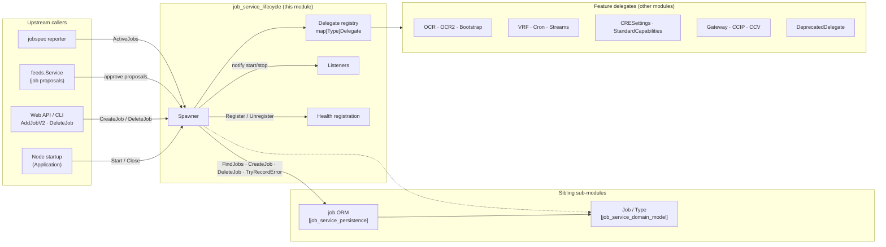
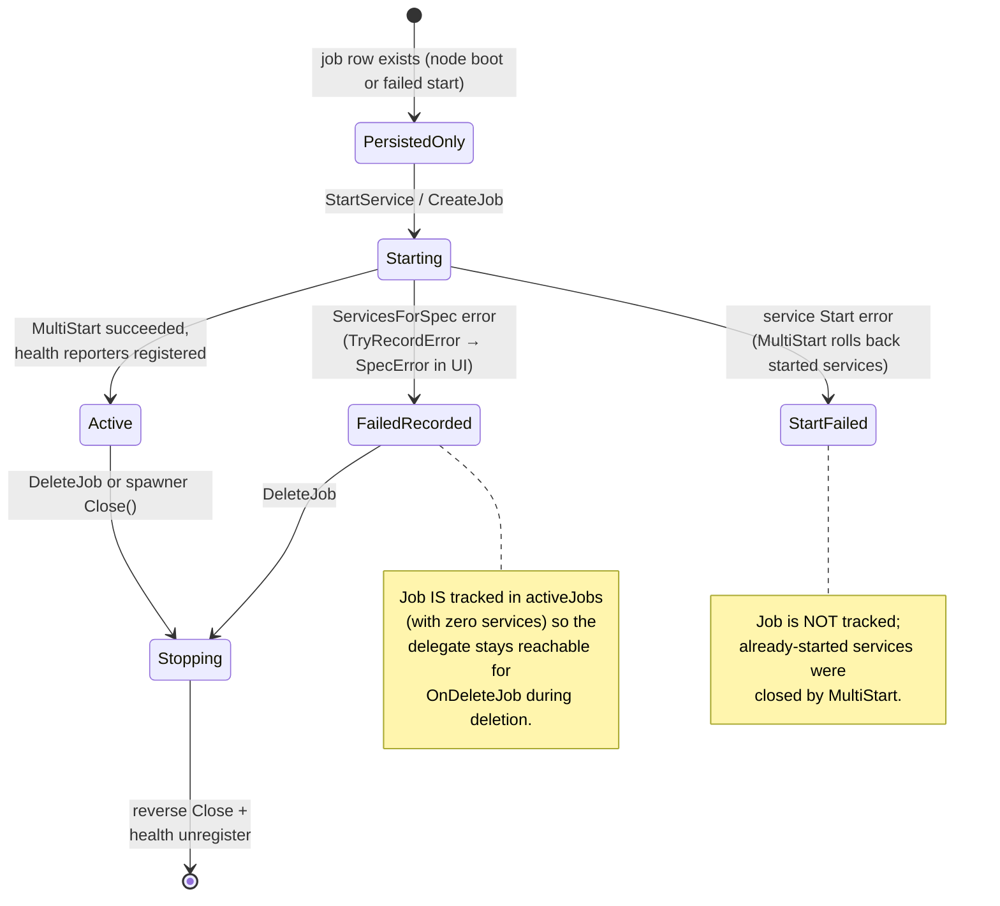
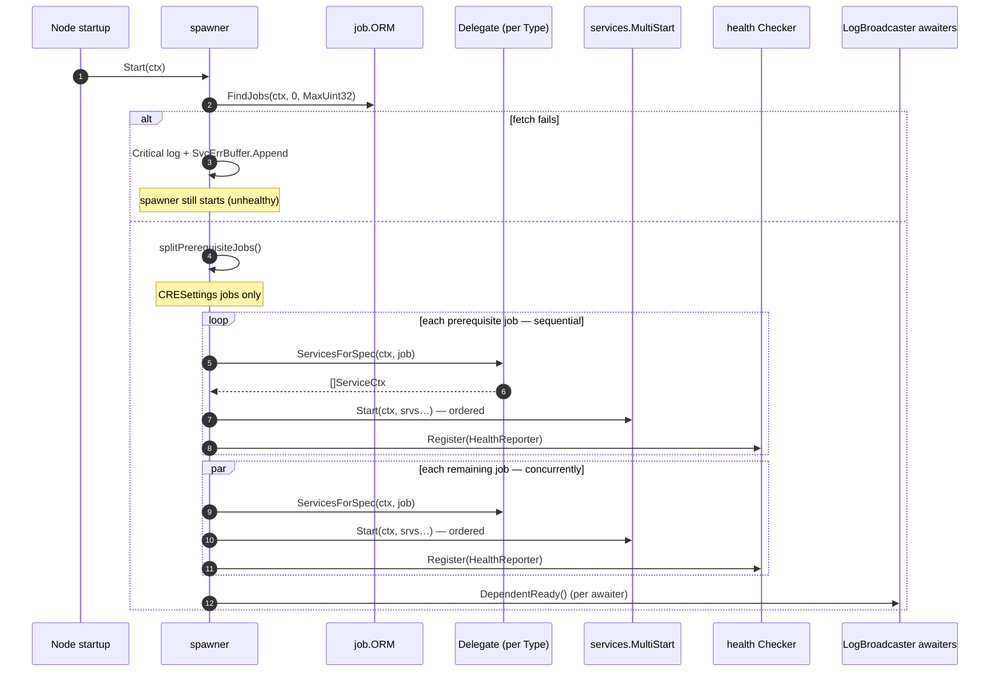
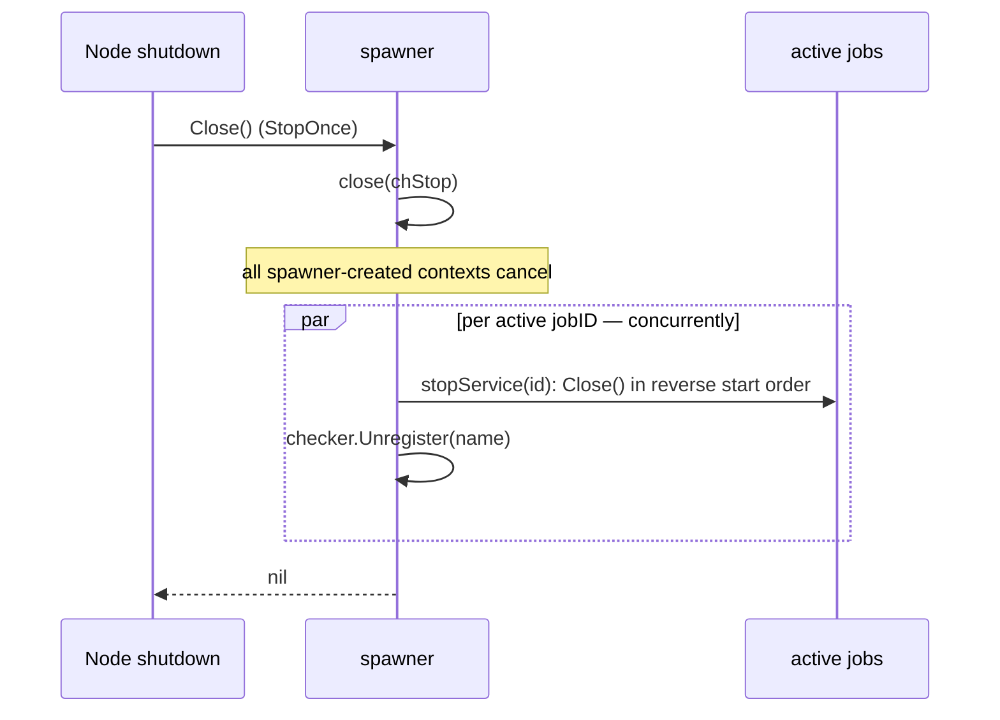

# Job Service Lifecycle (`spawner.go`, `common.go`)

> **Module page:** `Node_Platform_Services/job_service/job_service_lifecycle.md` · **Parent:** [Node_Platform_Services](../../Node_Platform_Services.md) › [job_service](../job_service.md)

## 1. Purpose and Scope

The **job service lifecycle** module implements the runtime half of the job system: it owns the **spinning up and down of the long-running services that perform the work described by job specs**. Persistence and the domain model live in sibling modules; this module answers the question *"how does a job spec become a set of running services — and how does it stop?"*

Concretely, the module (`chainlink/core/services/job/spawner.go` and `common.go`) provides:

| Concern | Components |
|---|---|
| Orchestrator | `Spawner` interface + `spawner` implementation (`Start`, `CreateJob`, `DeleteJob`, `StartService`, `ActiveJobs`, `RegisterListener`, `Close`) |
| Per-job-type plugin point | `Delegate` interface, plus the `NullDelegate` and `DeprecatedDelegate` built-in implementations |
| Start/stop observers | `Listener` interface (`AfterJobStarted` / `AfterJobStopped`) |
| Service runtime contract | `Service`, `ServiceCtx`, and the `ServiceAdapter` migration shim |
| Configuration carrier | `Config` (`URL() url.URL`), satisfied by the node's `Database` config |
| Health plumbing | `Checker` interface (register/unregister `services.HealthReporter`) |

Everything the node does at runtime — OCR/OCR2 reporting, VRF fulfilment, cron pipelines, CCIP, CRE capabilities, gateways — runs *inside services started and stopped by this module's `Spawner`*.

## 2. Position in the System



* **Upstream** — [node_application_lifecycle](../../Node_Application_Core___Interfaces/node_application/node_application_lifecycle.md) constructs the spawner at boot; the web API, feeds manager and job-spec reporter call into it (see [§6](#6-integration--wiring-in-the-node)).
* **Siblings** — the [`job.ORM`](job_service_persistence.md) supplies job rows and transactional create/delete; the [`Job` aggregate and `Type` enum](job_service_domain_model.md) are the data being brought to life. Package-wide overview: [job_service](../job_service.md).
* **Downstream** — delegates hand back `ServiceCtx` instances owned by feature modules: [pipeline](../../Oracle_Engines___Data_Pipelines/pipeline.md) (runner-driven jobs), [keystore](../keystore.md) (signing services), [workflows/CRE](../../Workflow___Capability_Runtime_(CRE_Engine)/workflows.md), [gateway](../gateway.md), etc.
* **Foundation** — lifecycle primitives come from the shared [services library](../../Shared_Foundation_Libraries___Domain_Types/services.md): `StateMachine` (start-once/stop-once, error buffer), `MultiStart` (ordered start, reverse rollback), `StopChan`, `HealthReporter`, and `utils.DependentAwaiter`.

## 3. Core Components

### 3.1 `Spawner` — the public contract

```go
type Spawner interface {
    services.Service // Start(ctx), Close(), Name(), HealthReport()
    CreateJob(ctx, ds sqlutil.DataSource, jb *Job) error
    DeleteJob(ctx, ds sqlutil.DataSource, jobID int32) error
    ActiveJobs() map[int32]Job
    StartService(ctx context.Context, spec Job) error // test-only escape hatch
    RegisterListener(l Listener)
}
```

| Method | Semantics |
|---|---|
| `Start(ctx)` | Idempotent (`StartOnce`). Loads **all** persisted jobs and starts their services (see [§5.1](#51-node-boot--startall_services)). |
| `CreateJob` | Persists the job via the ORM, then starts its services. All services must start without error for the job to be active. Accepts an optional external `sqlutil.DataSource` (used inside ORM transactions by callers). |
| `DeleteJob` | Transactionally deletes the job and stops its services. Refuses `jobID == 0`. Works for **both** active and inactive jobs. |
| `ActiveJobs` | Snapshot of tracked jobs (jobs whose service construction failed are also present, with zero services — see [§4](#4-lifecycle-state-and-concurrency-model)). |
| `StartService` | Starts services for a spec *without* persisting it — "only publicly exposed for use in tests to start a job that was previously manually inserted into DB". Prefer `CreateJob`. |
| `RegisterListener` | Adds a start/stop listener. Safe to call before or after `Start`. |
| `Close` | Idempotent (`StopOnce`); closes `chStop` then stops **all** active jobs concurrently ([§5.5](#55-shutdown--close)). |
| `HealthReport` | `{Name(): Healthy()}` — the spawner's own health; boot-time job-load failures are additionally captured in its `SvcErrBuffer`. |

### 3.2 Internal `spawner` state

| Field | Purpose |
|---|---|
| `orm ORM` | Persistence handle; re-scoped per call via `WithDataSource(ds)` when a caller supplies one. |
| `config Config` | Node DB config injected at construction (`cfg.Database()` in the wiring code) — provides the database `URL()`. |
| `checker Checker` | Health registry: `Register(services.HealthReporter)` / `Unregister(name)`. |
| `jobTypeDelegates map[Type]Delegate` | The per-job-type plugin registry. |
| `activeJobs map[int32]activeJob` + `activeJobsMu sync.RWMutex` | Tracked jobs. Each `activeJob` holds `{delegate, spec, services []ServiceCtx}`. |
| `listeners []Listener` + `listenersMu` | Start/stop observers. |
| `chStop services.StopChan` | Closed on `Close`; every internally created context (error recording, listener dispatch) is cancelled when it fires. |
| `lbDependentAwaiters []utils.DependentAwaiter` | Log-Broadcaster awaiters signalled (`DependentReady()`) only after the initial job fleet is up, so the initial log backfill covers all subscribers registered by starting services. |

### 3.3 `Delegate` — the per-job-type plugin contract

A `Delegate` is how one job type plugs into the spawner. Feature packages provide implementations; the spawner knows nothing about OCR, VRF, CRE, etc.

| Method | When called | Contract |
|---|---|---|
| `JobType() Type` | Registry lookup | Identifies the job type handled. |
| `BeforeJobCreated(Job)` | Once, on first create | Pre-persist hook. |
| `ServicesForSpec(ctx, Job) ([]ServiceCtx, error)` | On every start | Returns the services for the job. **Started in the order given, stopped in reverse order** — delegates may rely on this for startup/shutdown ordering. |
| `AfterJobCreated(Job)` | After start attempt | Always invoked, even if starting failed. |
| `BeforeJobDeleted(Job)` | Before delete transaction | Pre-delete hook. |
| `OnDeleteJob(ctx, Job) error` | **Inside the DELETE transaction** | DB commands must be issued *first* — the DELETE finalises only if all DB work here succeeds; non-DB side effects run after DB work so a rollback leaves the job running and visible. The job is not visible in the DB within this callback. |

Built-in implementations:

* **`NullDelegate`** — a complete no-op; useful for job types with no runtime and for tests.
* **`DeprecatedDelegate`** — for job types that have been removed (`directrequest`, `fluxmonitor`, `webhook`, `workflow`). `ServicesForSpec` returns an error, which the spawner persists via `ORM.TryRecordError`, so operators see *"job type %q has been removed and is no longer supported; please delete this job"* in the UI instead of the job silently doing nothing.

### 3.4 `Listener` — start/stop observers

```go
type Listener interface {
    AfterJobStarted(ctx context.Context, jb Job)
    AfterJobStopped(ctx context.Context, jb Job)
}
```

Callbacks run **asynchronously and must not block**. `dispatchToListeners` copies the listener slice under `listenersMu.RLock`, then fans out to every listener sequentially **in a single best-effort goroutine** with a context derived from `chStop` (cancelled on shutdown). Panics are recovered, so a faulty listener cannot take the spawner down.

### 3.5 `Service`, `ServiceCtx` and `ServiceAdapter` (`common.go`)

| Interface | Signature | Role |
|---|---|---|
| `Service` | `Start() error; Close() error` | Legacy, context-less runtime contract. |
| `ServiceCtx` | `Start(ctx) error; Close() error` | The target contract — what `ServicesForSpec` must return and what the spawner manages. |
| `ServiceAdapter` | `interface { ServiceCtx }` | Named alias marking the transition period. |
| `NewServiceAdapter(Service) ServiceCtx` | constructor | Wraps a legacy `Service`, forwarding `Close` and ignoring the context in `Start`. Lets old-style services participate in `MultiStart`/spawner management before being migrated to context-aware `Start`. |

`common.go` also defines `Config`:

```go
type Config interface { URL() url.URL }
```

satisfied in production by the node's `Database` config (see [§7](#7-configuration)).

### 3.6 `Checker` — health registry

```go
type Checker interface {
    Register(service services.HealthReporter) error
    Unregister(name string) error
}
```

Satisfied by the node's health checker (`Application.GetHealthChecker()`). Every started job service that implements [`services.HealthReporter`](../../Shared_Foundation_Libraries___Domain_Types/services.md) (`Ready()`, `HealthReport()`, `Name()`) is registered on start and unregistered on stop (unregister failures are logged as warnings only).

## 4. Lifecycle State and Concurrency Model

### 4.1 Job lifecycle state machine



### 4.2 Concurrency invariants

1. **Single start/stop** — the spawner embeds `services.StateMachine`; `StartOnce`/`StopOnce` hold the state lock during startup/shutdown, so `Start` and `Close` are idempotent and mutually exclusive.
2. **`activeJobsMu`** — `RLock` for reads (`ActiveJobs`, delete-time lookup, `activeJobIDs`); full `Lock` held for the **entire duration of `StartService`**, which serialises service starts per spawner.
3. **Ordered start, reverse stop** — within a job, `services.MultiStart` starts services in delegate-given order; on failure it closes the already-started services in reverse. `stopService` iterates `slices.Backward(aj.services)` for the same guarantee.
4. **Best-effort stop** — `stopService` *always* removes the job from memory, even if individual `Close()` calls fail (failures are logged `Critical` and appended to `SvcErrBuffer`).
5. **Listener isolation** — notifications are asynchronous, panic-recovered, and use a shutdown-aware context; listeners must not block.
6. **Transactional deletion** — `sqlutil.Transact` wraps `DeleteJob` + `Delegate.OnDeleteJob`; either both commit or the job keeps running.

## 5. Process Flows

### 5.1 Node boot — `startAllServices`



**Why prerequisite jobs exist:** `CRESettings` is in `prerequisiteJobTypes`. Its delegate applies CRE settings overrides *synchronously inside* `ServicesForSpec`, and OCR plugins resolve those settings at construction and freeze them for the life of the instance. Starting a dependent job before the settings land would silently bake in compiled defaults and desync the node from its DON until restart — so prerequisite jobs start to completion, sequentially, before anything else. All remaining jobs start in parallel (goroutines + `WaitGroup`), and each job's start errors are logged per-job without aborting the fleet.

### 5.2 Runtime creation — `CreateJob`

```mermaid
sequenceDiagram
    autonumber
    participant C as Caller (API / feeds)
    participant SP as spawner
    participant ORM as job.ORM
    participant DEL as Delegate
    participant MS as services.MultiStart
    participant HC as health Checker
    participant L as Listeners

    C->>SP: CreateJob(ctx, ds, *Job)
    SP->>ORM: (WithDataSource).CreateJob(ctx, jb)
    Note over ORM: single tx: spec rows + jobs row;<br/>rejects removed types; validates keystore keys & bridges
    SP->>DEL: BeforeJobCreated(jb)
    SP->>SP: StartService(ctx, jb)
    SP->>DEL: ServicesForSpec(ctx, jb)
    DEL-->>SP: []ServiceCtx (or error)
    alt ServicesForSpec error
        SP->>ORM: TryRecordError(ctx from chStop, jobID, err)
        Note over SP: job stored in activeJobs with 0 services
    else
        loop each service — in order
            SP->>MS: Start(ctx, srv)
            SP->>HC: Register if HealthReporter
        end
        SP->>L: AfterJobStarted (async, panic-safe)
    end
    SP->>DEL: AfterJobCreated(jb)  % always
    SP-->>C: error (or nil)
```

Invariants:

* The DB insert is atomic and performed by the [`job.ORM`](job_service_persistence.md); the spawner never touches SQL directly except through the ORM and `sqlutil.Transact`.
* If starting fails **after** the job was persisted, the job remains in the database, the failure is recorded as a `SpecError` (visible in the operator UI), and the error is returned to the caller — re-creation requires an explicit delete.
* `AfterJobCreated` runs on both success and failure paths.

### 5.3 `StartService` — spec normalisation

Before consulting the delegate, `StartService` normalises the spec for the runtime: it copies `jb.Name`, `jb.ID`, `string(jb.Type)`, and `jb.ForwardingAllowed` into `jb.PipelineSpec`, and propagates an optional `jb.GasLimit` into `PipelineSpec.GasLimit`. This guarantees every pipeline-driven service sees consistent job metadata regardless of which delegate produced it.

### 5.4 Runtime deletion — `DeleteJob`

```mermaid
sequenceDiagram
    autonumber
    participant C as Caller
    participant SP as spawner
    participant ORM as job.ORM
    participant DEL as Delegate
    participant L as Listeners

    C->>SP: DeleteJob(ctx, ds, jobID)
    Note over SP: rejects jobID == 0
    alt job is active
        SP->>SP: activeJob lookup (activeJobsMu.RLock)
    else inactive / unknown
        SP->>ORM: WithDataSource(ds).FindJob(jobID)
        SP->>SP: resolve delegate by spec.Type
    end
    SP->>DEL: BeforeJobDeleted(spec)
    SP->>ORM: sqlutil.Transact { tx.DeleteJob(jobID, type); DEL.OnDeleteJob(ctx, spec) }
    Note over ORM,DEL: OnDeleteJob runs INSIDE the tx —<br/>DB side effects first, rollback-safe
    alt job was active
        SP->>SP: stopService(jobID): reverse Close,<br/>checker.Unregister per HealthReporter
        SP->>L: AfterJobStopped (async, panic-safe)
    end
    SP-->>C: transaction error (or nil)
```

The active/inactive split matters: deleting an inactive-but-persisted job (e.g. one whose services never started, or whose type has since been deprecated) still resolves the delegate from the DB spec so `OnDeleteJob` cleanup hooks run. Once the transaction commits, the running service is stopped **unconditionally** — even if `Close()` fails, the job is removed from memory.

### 5.5 Shutdown — `Close`



Stop errors per service are logged `Critical` and appended to the spawner's `SvcErrBuffer` (surfaced via `HealthReport`), but never prevent removal of the job or the shutdown of the rest of the fleet.

## 6. Integration & Wiring in the Node

The spawner is constructed and started by `NewApplication` in `chainlink/core/services/chainlink/application.go`:

1. **Delegate registry** (application.go, `delegates := map[job.Type]job.Delegate{…}`): one entry per supported job type — `VRF`, `Cron`, `BlockhashStore`, `BlockHeaderFeeder`, `Gateway`, `Stream`, `CCVCommitteeVerifier`, `CCVExecutor` unconditionally; `CRESettings` and `StandardCapabilities` (CRE); `OffchainReporting` only when OCR is enabled; `OffchainReporting2`, `Bootstrap` and `CCIP` only when OCR2 is enabled. Removed types (`DirectRequest`, `Webhook`, `Workflow`, `FluxMonitor`) get `&job.DeprecatedDelegate{Type: …}` so legacy rows surface a visible error.
2. **Construction**: `job.NewSpawner(jobORM, cfg.Database(), healthChecker, delegates, globalLogger, lbs)` — where `lbs` are `utils.DependentAwaiter`s from each legacy EVM chain's Log Broadcaster.
3. **Lifecycle ownership**: the spawner is appended to the node's top-level `srvcs` and registered with the health checker, so the node's own start/stop sequence drives `Spawner.Start` / `Spawner.Close`.
4. **Consumers**: `feeds.NewService(…, jobSpawner, …)` uses it to activate approved job proposals (see [feeds_service](../feeds_service.md)); `jobspec.NewJobSpecReporter(…, jobSpawner, …)` reports job status (see [node_status_reporter](../node_status_reporter.md)); `Application.JobSpawner()`, `AddJobV2` and `DeleteJob` expose it to the web API.

## 7. Configuration

* `job.Config` (`URL() url.URL`) is satisfied by the node's `Database` config (`cfg.Database()`), which also satisfies [`job.ORMConfig`](job_service_persistence.md) (`DatabaseDefaultQueryTimeout`). Global node configuration is described in [node_application_config](../../Node_Application_Core___Interfaces/node_application/node_application_config.md).
* The `Checker` is produced from `HealthCheckerConfig` in the application wiring, with Prometheus/Beholder/OTel hooks configured (see [Telemetry & Observability](../../Telemetry___Observability_Platform.md) for the telemetry stack).
* Which delegates are registered depends on node config flags (`OCR().Enabled()`, `OCR2().Enabled()`, feature flags) — a disabled OCR2 removes the `Bootstrap`/`CCIP` delegates entirely, causing job starts of those types to fail with `unregistered type %q for job: %d`.
* The Go test suite covering the spawner and its delegates runs via the repository Makefile (`chainlink/GNUmakefile`, `test` target).

## 8. Failure Modes & Operational Notes

| Symptom | Mechanism | Operator guidance |
|---|---|---|
| Job visible in UI with a spec error *"job type … has been removed"* | `DeprecatedDelegate.ServicesForSpec` error → `ORM.TryRecordError` | Delete the job; the type is no longer supported. |
| `unregistered type %q for job: %d` | No delegate registered for the job's `Type` (e.g. OCR2 disabled while a CCIP job row exists) | Enable the relevant feature/config or delete the job. |
| Job persisted but inactive, error recorded | `ServicesForSpec` failed after insert; job kept in `activeJobs` with zero services | Fix the underlying cause (keys, bridges, chains) and recreate the job. |
| Boot proceeds but spawner reports unhealthy | `FindJobs` failed at `Start`; error in `SvcErrBuffer` | Check PostgreSQL availability — persisted jobs were **not** started. |
| `Error stopping job service` criticals at shutdown | `Close()` failure on a job service | Job is still removed from memory; investigate the offending service's shutdown path. |
| Listener misbehaviour cannot crash the node | `dispatchToListeners` panic recovery | Fix the listener; notifications are best-effort. |

## 9. Related Documentation

* [job_service](../job_service.md) — package overview, job-type table, and cross-cutting behaviours.
* [job_service_persistence](job_service_persistence.md) — the `ORM` the spawner drives; transactional create/delete semantics.
* [job_service_domain_model](job_service_domain_model.md) — `Job`, `Type`, spec structs.
* [node_application_lifecycle](../../Node_Application_Core___Interfaces/node_application/node_application_lifecycle.md) — where the spawner and delegate registry are built.
* [services (chainlink-common)](../../Shared_Foundation_Libraries___Domain_Types/services.md) — `StateMachine`, `MultiStart`, `StopChan`, `HealthReporter`, `DependentAwaiter` primitives.
* [database_persistence](../database_persistence.md) — `sqlutil.DataSource`/`Transact` and PostgreSQL schema.
* [feeds_service](../feeds_service.md), [node_status_reporter](../node_status_reporter.md) — runtime consumers of the `Spawner`.
* [pipeline](../../Oracle_Engines___Data_Pipelines/pipeline.md), [keystore](../keystore.md), [workflows (CRE)](../../Workflow___Capability_Runtime_(CRE_Engine)/workflows.md), [gateway](../gateway.md) — modules whose services are spawned by delegates.
